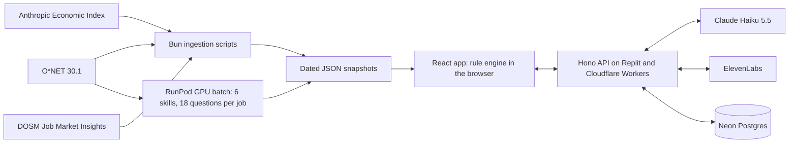

# Kotak

> Kotak shows a Malaysian worker which of their skills are rising or declining with AI, and gives them a dated, cited plan for what to learn next.

---

## Team Information

| Field                 | Details                                                                                                     |
| --------------------- | ----------------------------------------------------------------------------------------------------------- |
| **Team Name**         | T010NG                                                                                                      |
| **Team Domain**       | Domain 1: Aiversecity Future-Ready Workforce                                                                |
| **SDG Track (1–17)**  | SDG 4 — Quality Education (target 4.4)                                                                      |
| **Team Leader**       | Hee Zi Jie                                                                                                  |
| **University**        | Asia Pacific University of Technology & Innovation (APU), University of Reading and University of Sheffield |
| **Number of Members** | 5                                                                                                           |

## Links

| Resource          | Link                                                                                   |
| ----------------- | -------------------------------------------------------------------------------------- |
| GitHub Repository | https://github.com/TolongLabs/sdc-hack                                                 |
| Replit Project    | https://replit.com/@alaskxntxna/Kotak                                                  |
| Live Demo         | https://kotak-alaskxntxna.replit.app (mirror: https://kotak.tp073654.workers.dev)      |
| RunPod Endpoint   | https://api.runpod.ai/v2/5yjk19uqmrpbp7 (idle at 0 workers; it ran the one-time batch) |
| Slide Deck        | _Added before submission_                                                              |
| Demo Video        | _Added before submission_                                                              |

---

## Overview

### Problem

AI is changing Malaysian jobs faster than training can keep up: 56% of Malaysian professionals use AI tools at work, but only 26% have had formal training (Hays Asia Salary Guide 2025). Workers who wonder what AI means for their job get static skills lists with no dates, no scores and no plan. Without dated evidence, they cannot tell which skills to learn first, and may spend scarce hours on tasks AI is taking over.

### Solution

Kopi, a cat counsellor, asks 12 yes/no can-do questions about the user's job or a role they want. Kotak then draws a Future Skills Radar of the job's 6 core skills, ranks matched roles and builds a dated roadmap, in about 3 minutes. Fixed rules over dated public data set every verdict, score and step, so every number cites its source. AI does the language work around those rules: a RunPod GPU batch built each job's skills and questions from its own O\*NET tasks, Claude explains verdicts and matches Malay job titles, and ElevenLabs gives Kopi a voice.

### Key Features

- **Skills profile intake** — a job title in any language, a goal (stay strong, move to a chosen role, or explore) and 12 can-do questions.
- **AI-trend signal layer** — dated Anthropic Economic Index snapshots for Malaysia (April and May 2026) and DOSM Job Market Insights, refreshed weekly. A Before/After switch shows what changed when May's data arrived.
- **Future-role matching** — ranked roles with a fit score, the maths behind it and the named gaps.
- **Reskilling pathway** — an interactive roadmap with ordered steps, hours, one free resource per step and a finish date that moves with the user's weekly hours.
- **SDG mapping** — every skill carries SDG targets, every job shows the goals its work serves, and the roadmap highlights steps by goal.
- **Handling uncertainty** — every target is labelled an estimate, Split shows slow and fast AI-uptake futures, and Unknown marks thin data.
- **Ask Kopi and MCP** — a chat agent answers through 6 read-only tools over the same rules, and other assistants can use the same tools at `/api/mcp`.

### Tech Stack

| Layer         | Technology                                                                |
| ------------- | ------------------------------------------------------------------------- |
| Frontend      | TypeScript, React 19, Vite, Tailwind CSS, Recharts, Live2D (Kopi)         |
| Backend       | Bun, Hono, Zod; the rule engine runs in the browser through `@kotak/sdk`  |
| Database      | Neon Postgres 18                                                          |
| AI / Compute  | RunPod serverless GPU (Qwen3.8-27B on vLLM), Claude Haiku 5.5, ElevenLabs |
| Hosting / Dev | Replit, Cloudflare Workers, GitHub Actions                                |

---

## Project Structure

```
.
├── apps/
│   ├── api/                 # Hono API: title match, explanations, voice, Ask Kopi, MCP
│   └── web/                 # React app and the static data snapshots
├── packages/
│   ├── shared/              # Rules, verdicts, roadmap and Zod schemas
│   ├── sdk/                 # The check-up engine
│   ├── agent/               # Ask Kopi's tools and the MCP server
│   └── browser/             # Browser for the JobStreet research scraper
├── scripts/                 # Data ingestion, the RunPod batch runner and refresh checks
├── data/                    # Dated source snapshots and generated skills
├── runpod/                  # RunPod endpoint notes and example requests
├── docs/                    # PRD, technical design, declaration and research
├── submission/              # Required submission documents
│   ├── REPLIT PROOF OF USE.pdf
│   ├── RUNPOD PROOF OF USE.pdf
│   ├── SDC2026_T010NG_Preliminary.pdf
│   └── SDC2026_T010NG_TechDeclaration.pdf
├── .env.example             # Example environment variables
├── .replit                  # Replit run configuration
├── wrangler.jsonc           # Cloudflare Workers configuration
├── LICENSE
├── NOTICE.md                # Third-party credits
└── README.md
```

### Architecture



The [PRD](docs/PRD.md) and the [technical design](docs/TRD.md) explain each part.

---

## How to Run

### Option 1 — Run on Replit (Recommended)

1. Open the [Replit Project](https://replit.com/@alaskxntxna/Kotak), or import this repository via **Create Repl → Import from GitHub**.
2. Open the **Secrets** tab (🔒) and add the variables listed in `.env.example`:
   - `ANTHROPIC_API_KEY` for job-title matching, explanations and Ask Kopi
   - `ELEVENLABS_API_KEY` for Kopi's voice
3. Click **Run**. Replit uses the `.replit` file to install, build and start the server on port 5000.

The app runs without keys too: explanations fall back to fixed templates, and Kopi's lines show as text.

### Option 2 — Run Locally

Requires [Bun](https://bun.sh) 1.3 or later.

```bash
# 1. Clone the repository
git clone https://github.com/TolongLabs/sdc-hack.git
cd sdc-hack

# 2. Install dependencies
bun install

# 3. Configure environment variables
cp .env.example .env            # then fill in your values

# 4. Build the data snapshots and the web app
bun run build

# 5. Start the server, then open http://localhost:8787
bun run start
```

### Run Tests

```bash
bun run typecheck
bun test
```

---

## How We Use Replit _(Required)_

- **Hosting:** Replit publishes Kotak from the `main` branch on the team's own account, at the Live Demo link above.
- **Run configuration:** `.replit` installs with Bun, builds the data and the app, and starts the Hono server on port 5000.
- **Secrets:** API keys are stored in Replit Secrets, never in the code.

📄 Proof of use: [`submission/REPLIT PROOF OF USE.pdf`](submission/REPLIT%20PROOF%20OF%20USE.pdf)

## How We Use RunPod _(Required)_

- **Workload:** a RunPod serverless GPU ran `Qwen/Qwen3.8-27B-FP8` on vLLM once, before the demo, to group each O\*NET job's own tasks into 6 skills and draft 18 can-do statements for each of 923 jobs. A JSON schema constrains every answer, and a validator rejects any task from another job.
- **Setup:** the stock RunPod vLLM worker, `runpod/worker-v1-vllm:v2.28.0`, on one H100 80 GB GPU. [`runpod/README.md`](runpod/README.md) has the endpoint settings.
- **Integration:** [`scripts/corners/run-batch.ts`](scripts/corners/run-batch.ts) sends the requests with `RUNPOD_API_KEY` and `RUNPOD_ENDPOINT_ID`, and writes the results into the data snapshots that the app ships. The full run took 783 seconds and cost about US$1.25.

Example request:

```bash
curl https://api.runpod.ai/v2/$RUNPOD_ENDPOINT_ID/openai/v1/chat/completions \
  -H "Authorization: Bearer $RUNPOD_API_KEY" \
  -H "Content-Type: application/json" \
  -d '{
    "model": "Qwen/Qwen3.8-27B-FP8",
    "messages": [{"role": "user", "content": "Name one skill of a graphic designer as JSON."}],
    "temperature": 0,
    "max_tokens": 50,
    "chat_template_kwargs": {"enable_thinking": false},
    "response_format": {"type": "json_schema", "json_schema": {"name": "skill", "schema": {
      "type": "object", "properties": {"skill": {"type": "string"}},
      "required": ["skill"], "additionalProperties": false}}}
  }'
```

📄 Proof of use: [`submission/RUNPOD PROOF OF USE.pdf`](submission/RUNPOD%20PROOF%20OF%20USE.pdf)

---

## Challenges & Learnings

- **Making AI answers checkable.** Letting a model pick skills or verdicts made results impossible to verify. We moved every verdict, score and step into fixed rules over dated data, and kept AI for language: drafting skills from a job's own tasks, explaining verdicts and matching titles, with a validator or a check on each.
- **Thin trend data.** The Economic Index has only two monthly points for Malaysia so far. Instead of hiding that, Kotak labels every target an estimate and shows Split and Unknown verdicts.
- **Shipping as a team of five.** GitHub Actions deploys every merge to `main`, so any member can ship, and Replit publishes the same branch.

## Future Improvements

- [ ] Have people review the AI-drafted skills for the most common jobs
- [ ] Load MyCOL critical-occupation editions and OpenDOSM wage series as extra demand signals
- [ ] Paste a job ad to check a specific vacancy
- [ ] Malay and Chinese interface translations

## Team

| Name           | Role                | GitHub                                         |
| -------------- | ------------------- | ---------------------------------------------- |
| Hee Zi Jie     | Team Lead / Product | [@AlaskanTuna](https://github.com/AlaskanTuna) |
| Lim Yuh Kang   | Backend / Engine    | [@kymil4](https://github.com/kymil4)           |
| Yow Li Hao     | Data                | [@chaosiris](https://github.com/chaosiris)     |
| Liau Jin Siang | Frontend / QA       | [@DrxgClanPC](https://github.com/DrxgClanPC)   |
| Chew Jun Song  | Member              | [@Doraemon-00](https://github.com/Doraemon-00) |

---

## Submission Checklist

- [x] Team name, domain (Domain 1 / Domain 2) and SDG track filled in
- [ ] Slide deck link added
- [ ] Demo video link added
- [ ] Replit used, with proof of use in `submission/`
- [x] RunPod used, with proof of use in `submission/`
- [ ] Submission template completed in `submission/`
- [ ] "How to Run" steps verified
- [ ] No API keys or secrets committed to the repository

## License

This project is licensed under the [Apache License 2.0](LICENSE). Third-party credits are in [NOTICE.md](NOTICE.md).
