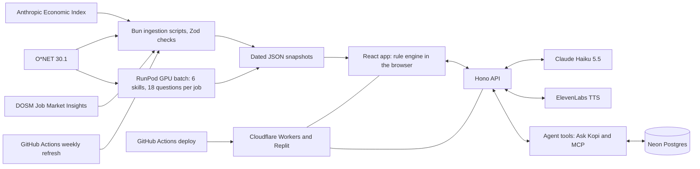

# Kotak product requirements

Kotak shows a Malaysian worker which of their skills are rising or declining with AI, and what to do next. This document holds its product requirements in the order of the organisers' [Phase 1 proposal template][template], and the team exports it as `SDC2026_T010NG_Preliminary.pdf`. Headings carry the template's word limit where it sets one; the template sets no limit for the other sections.

[template]: /docs/sources/drive.google.com/submission-template.md

Contents:

1.  [1. Team and project overview](#1-team-and-project-overview)
1.  [2. Executive summary & problem statement](#2-executive-summary--problem-statement)
    1.  [2.1. The problem context (250 words max)](#21-the-problem-context-250-words-max)
    1.  [2.2. The proposed AI solution (300 words max)](#22-the-proposed-ai-solution-300-words-max)
1.  [3. Technical architecture & implementation plan](#3-technical-architecture--implementation-plan)
    1.  [3.1. Conceptual tech stack](#31-conceptual-tech-stack)
    1.  [3.2. Design-thinking & deployment strategy (200 words max)](#32-design-thinking--deployment-strategy-200-words-max)
1.  [4. Preliminary environmental & SDG impact framework](#4-preliminary-environmental--sdg-impact-framework)
1.  [5. Eligibility & readiness checklist](#5-eligibility--readiness-checklist)
1.  [6. IP & originality declaration](#6-ip--originality-declaration)
    1.  [6.1. Pre-existing / prior-owned work](#61-pre-existing--prior-owned-work)
    1.  [6.2. Third-party code, datasets, or models](#62-third-party-code-datasets-or-models)
    1.  [6.3. Employment-related IP conflicts](#63-employment-related-ip-conflicts)
1.  [7. Declaration](#7-declaration)

## 1. Team and project overview

- **Team name**: T010NG, as registered on the [team portal][portal]. The team works in the TolongLabs GitHub organisation.
- **Selected domain**: Domain 1, the Aiversecity Future-Ready Workforce Domain ([problem statement][d1]).
- **Selected SDG track**: SDG 4, Quality Education, through target 4.4.
- **Project name**: Kotak.
- **Team leader**: Hee Zi Jie (AlaskanTuna). The leader's email and phone go only in the exported PDF.
- **University affiliations**: Asia Pacific University of Technology & Innovation (APU), University of Reading and University of Sheffield.
- **Number of team members**: 5 ([team portal][portal]).

The members:

- Hee Zi Jie (AlaskanTuna), product lead, APU
- Lim Yuh Kang (kymil4), APU
- Yow Li Hao (chaosiris), APU
- Liau Jin Siang (DrxgClanPC), University of Reading
- Chew Jun Song (Doraemon-00), University of Sheffield

[portal]: /docs/sources/sdchack.my/team-portal.md#registration-status
[d1]: /docs/sources/drive.google.com/domain-1-aiversecity.md

## 2. Executive summary & problem statement

### 2.1. The problem context (250 words max)

AI is changing Malaysian jobs faster than training and skills lists can keep up. In Malaysia, 56% of professionals use AI tools at work, but only 26% have had formal training (Hays Asia Salary Guide 2025, via the [Domain 1 brief][d1-bg]). In October 2024, the government said about 600,000 workers in 10 sectors needed reskilling within three to five years ([Bernama][bernama-600k]). TalentCorp projects about 620,000 workers, 18% of the workforce in the sectors it studied, will be significantly affected ([Impact Study][tc-impact]). A World Bank and ISIS Malaysia study rates 28% of the workforce highly exposed to AI ([World Bank, 2025][wb-isis]). Skills are also under-used: in Q2 2026, 35.2% of employed tertiary-educated workers held semi-skilled or low-skilled jobs ([OpenDOSM][sru]; [hiring-bar evidence][hiring]).

Our user is a working adult in Malaysia, in any industry, who wonders what AI means for their job. They come with a worry and a few minutes, often on a phone. Some want to keep their job safe, some to move to a role they have in mind, and some to learn where they could go ([users][idea-users]).

Today they get static lists. TalentCorp's MyMahir maps roles and skills, but shows no score, time estimate, scenario or SDG tag, and no Malaysian tool we checked joins role data to a scored gap and a timed pathway ([prior art][ctx-prior]). Without dated evidence, a worker cannot tell which skills to learn first, and may spend scarce hours on tasks AI is taking over.

[bernama-600k]: https://www.bernama.com/en/news.php?id=2350085
[tc-impact]: https://www.talentcorp.com.my/impact-study/
[wb-isis]: https://documents1.worldbank.org/curated/en/099092325013010451/pdf/P181093-2e5b89c5-f3be-43b3-868c-8890b74bef21.pdf
[sru]: https://open.dosm.gov.my/data-catalogue/lfs_qtr_sru_age
[ctx-prior]: /docs/CONTEXT.md#prior-art-and-white-space

### 2.2. The proposed AI solution (300 words max)

Kotak, Malay for "box", is a web app. Kopi, a cat counsellor, asks 12 yes/no can-do questions about the user's job or a role they want. It draws a Future Skills Radar of the job's 6 core skills, ranks matched roles and builds a dated roadmap in about 3 minutes.

The six must-haves:

1.  **Skills profile intake**: a job title in any language, a goal (stay, move or explore) and the 12 questions.
2.  **AI-trend signal layer**: dated Anthropic Economic Index snapshots for Malaysia (April and May 2026) and DOSM Job Market Insights, refreshed weekly.
3.  **Future-role matching**: ranked roles, each with a fit score, its maths and named gaps.
4.  **Reskilling pathway**: ordered steps, each with hours and one free resource, and a finish date set by the user's weekly hours.
5.  **SDG mapping**: skills carry SDG targets, jobs show the goals their work serves, and the roadmap highlights steps by goal.
6.  **Handling uncertainty**: targets are labelled estimates, Split shows slow and fast AI-uptake futures, and Unknown marks thin data.

Fixed rules, not AI, set every verdict, score, ranking and roadmap order. AI does four jobs:

- Before the demo, a RunPod GPU batch groups each O\*NET job's own tasks into 6 skills and drafts the questions. A validator rejects any task outside that job.
- Live, Claude Haiku 5.5 explains each verdict with its dated sources and matches Malay and local job titles.
- Ask Kopi, a chat agent, answers through 7 read-only tools over the same rules, which other assistants reach through an MCP server.
- ElevenLabs voices Kopi, with mute and a text fallback.

From the Phase 1 workshops, we use GenAI APIs (Claude), Postgres (Neon), cloud hosting (Cloudflare Workers and Replit) and RunPod serverless GPUs ([workshops][workshops]; [Workshop 1][w1]).

[workshops]: /docs/sources/sdchack.my/team-portal.md#workshops
[w1]: /docs/sources/workshop-1-alphared/transcript.md

## 3. Technical architecture & implementation plan

### 3.1. Conceptual tech stack

Kotak is a TypeScript monorepo run with Bun. It has two apps, `apps/web` (the React app) and `apps/api` (the Hono API), and four packages: `shared` (the rules and Zod schemas), `sdk` (the check-up engine), `agent` (the AI tools) and `browser` (the research scraper's browser).

- **Frontend**: React and Vite, Tailwind CSS, Recharts for the radar and the roadmap charts, Lucide icons, and pixi-live2d-display for Kopi, built on Live2D's Hijiki sample model. It has phone (390 px) and desktop (1440 px) layouts, follows WCAG 2.2 AA and has a reduced-motion mode ([design system][design]).
- **Rule engine in the browser**: the app loads precomputed, dated JSON snapshots and computes levels, targets, verdicts, fit scores and roadmap order in the browser. Switching the snapshot from April to May 2026 recomputes them at once. A guest session in `localStorage` keeps answers, goals and ticked steps.
- **API**: Hono, on Cloudflare Workers for the main link and on Bun for Replit. One server serves the React build and the API. Its routes match job titles, write cited explanations, proxy text to speech, run Ask Kopi and serve an MCP endpoint. Zod validates every request and response. On Workers, the MCP and chat routes run in a Durable Object.
- **GenAI**: the Claude API with Claude Haiku 5.5. The API caches each answer by a SHA-256 hash of the request and pre-warms the cache for the demo roles. A check rejects any explanation that changes a verdict or lacks a dated citation, and falls back to a fixed template.
- **Agent layer**: `@kotak/agent` exposes 7 read-only tools over `@kotak/sdk`: find a role, get the questions, run a check-up, what changed, national skill gaps, job ads in Malaysia and list sources. Ask Kopi calls them through Claude, and outside assistants call them through `/api/mcp`. Every number the agent quotes comes from a tool.
- **Voice**: ElevenLabs. Fixed lines are pre-generated with `eleven_v4`, and live lines use `eleven_v4_turbo`. The API caches audio by a hash of the text, and the key stays on the server ([TTS notes][tts]).
- **Data pipeline**: Bun scripts ingest O\*NET 30.1, filter the Economic Index to Malaysia, Singapore and global rows, and extract DOSM Job Market Insights (Q3 2019 to Q2 2026). Every record carries its source, date and layer. A GitHub Actions workflow checks for new releases every Saturday and rebuilds the snapshots.
- **Database**: Neon Postgres 18 (region `aws-ap-southeast-1`). One table stores anonymous check-ups: only the role code, the 6 skill levels, a sample flag and the date, and totals show only for groups of 10 or more. Other tables hold the scraper's job listings, the admins' reviews of them, each listing's matched skills and the admin accounts.
- **GPU**: a RunPod serverless endpoint runs `Qwen/Qwen3.8-27B-FP8` on vLLM for the one-time batch that builds 6 skills and 18 can-do statements for each of 923 jobs.
- **Hosting and CI**: GitHub Actions type-checks, builds and deploys Kotak to Cloudflare Workers on every merge to `main`, or when a member clicks "Run workflow" ([deploy notes][deploy]). Replit publishes the same `main` branch from the team's own account. API keys and the database URL live in GitHub, Cloudflare and Replit secrets, never in code.

System block diagram:

Sponsor platforms: yes, Kotak uses both.

- **Replit**: the team publishes Kotak from `main` on its own Replit account at the live demo link. The project link, its history and the published app are the proof of use.
- **RunPod**: a serverless GPU endpoint, paid with the team's RunPod credit, ran the batch that built every job's skills and questions: a 3-job smoke test, then 920 jobs in 783 seconds, with none failing. Screenshots of the endpoint, GPU type and runtime are the proof of use ([RunPod notes][runpod]; [sponsor rules][brief-rules]).

[design]: /docs/DESIGN.md
[deploy]: /docs/research/deploy-and-tts.md#deploy-recommendation
[runpod]: /runpod/README.md
[brief-rules]: /docs/BRIEF.md#rules-that-can-cost-us

### 3.2. Design-thinking & deployment strategy (200 words max)

- **Empathise**: on 21 October, we named three kinds of worker: stay strong, move to a target role, or ask where to go ([users][idea-users]). Research showed Malaysian graduates find work, often below their skill level ([hiring-bar evidence][hiring]).
- **Define**: one user and one moment: a worried worker with a few minutes, who leaves with a plan to start this week.
- **Ideate**: we gave five AI models the brief, as other teams would, and 17 of their 75 ideas served this same worker ([field simulation][field]). So Kotak's uniqueness comes from its mechanism: yes/no can-do questions, skills built from the job's own tasks, and verdicts set by visible rules.
- **Prototype and test**: six AI-played experts raised 43 attacks on the first Kotak ([roast][roast]). We cut the planted-mistake test and moved the demo from a sample card to real data. We set the visual design in Figma before coding.
- **Deploy**: the live demo swaps the Economic Index from April to May 2026, and the radar, ranking and roadmap move. Cached Claude answers and a fixed-template fallback cover API overload. GitHub Actions deploys to Cloudflare Workers on every merge to `main`, so any member can ship.

[field]: /docs/research/field-simulation.md
[roast]: /docs/research/kotak-roast.md

## 4. Preliminary environmental & SDG impact framework

The target, indicator and baseline come from the UN SDG API, accessed on 22 October 2026, following our [impact notes][bp-impact].

- **Target SDG sub-target**: target 4.4, "By 2030, substantially increase the number of youth and adults who have relevant skills, including technical and vocational skills, for employment, decent jobs and entrepreneurship". It is measured by indicator 4.4.1, "Proportion of youth and adults with information and communications technology (ICT) skills, by type of skill" ([UN SDG API, goal 4][sdg-goal4]).
- **Current problem baseline**: in 2024, 39.8% of Malaysians aged 15 and over had above-basic digital skills in all 5 skill areas, and 19.6% reported writing a computer program in a programming language. Both figures are indicator 4.4.1, series `SE_ADT_ACTS`, from DOSM ([UN SDG API, Malaysia][sdg-441]). For AI skills, 56% of Malaysian professionals use AI tools at work, but only 26% have had formal training ([Domain 1 brief][d1-bg]).
- **Core measurable KPI**: the sourced-roadmap rate. It is the percentage of finished check-ups that reach a roadmap in under 3 minutes, where every verdict, fit score and milestone shows its source and date. A second count tracks uncited recommendations, which must stay at 0 ([LLM credibility notes][bp-llm]).
- **Phase 2 impact target**: 100% of 20 seeded test profiles reach a sourced roadmap in under 3 minutes with 0 uncited recommendations ([issue #28][i28]; [LLM credibility notes][bp-llm]). On 100% of the hand-checked demo roles, the April-to-May 2026 snapshot swap changes at least one verdict ([issue #37][i37]).

[bp-impact]: /docs/research/best-practices.md#impact-claims
[sdg-goal4]: https://unstats.un.org/sdgapi/v1/sdg/Goal/4/Target/List?includechildren=true
[sdg-441]: https://unstats.un.org/sdgapi/v1/sdg/Indicator/Data?indicator=4.4.1&areaCode=458
[bp-llm]: /docs/research/best-practices.md#llm-credibility
[i28]: https://github.com/TolongLabs/Kotak/issues/28
[i37]: https://github.com/TolongLabs/Kotak/issues/37

## 5. Eligibility & readiness checklist

- **Workshops**: the leader ticks this box only after confirming that every member finished the GenAI, Database and Cloud Deployment workshops.
- **A verified problem mapped to an SDG**: the problem in section 2.1 rests on linked public data from DOSM, TalentCorp and the World Bank. It maps to SDG 4, target 4.4, in section 4.
- **A deployed application**: Kotak is a working web app with a live link on Replit and on Cloudflare Workers, not a business case. Its key feature, the trend swap that re-ranks roles, runs live.
- **Word limits**: sections 2.1, 2.2 and 3.2 stay within 250, 300 and 200 words.

## 6. IP & originality declaration

### 6.1. Pre-existing / prior-owned work

No. Kotak's code, design and research are new work by the team during the hackathon.

### 6.2. Third-party code, datasets, or models

Yes. Kotak cites restricted sources by figure and date, and does not redistribute their files.

| Name                                       | Type           | License                                                                                   |
| ------------------------------------------ | -------------- | ----------------------------------------------------------------------------------------- |
| O\*NET 30.1 Database                       | dataset        | CC BY 4.0, with O\*NET's fixed credit line and a modification notice [trend]              |
| Anthropic Economic Index                   | dataset        | Data CC BY, version not stated; code MIT [trend]                                          |
| DOSM Job Market Insights                   | dataset        | DOSM data terms: reuse with "Data source: Department of Statistics Malaysia" [dosm-terms] |
| OpenDOSM skill-related underemployment     | dataset        | CC BY 4.0; one figure cited [trend]                                                       |
| TalentCorp MyCOL and Epoch AI              | dataset        | Cited as context only, not loaded [dosm-terms]                                            |
| Qwen3.8-27B-FP8, run on RunPod             | model          | Apache 2.0                                                                                |
| Claude Haiku 5.5, through the Claude API   | model          | Proprietary API service from Anthropic                                                    |
| ElevenLabs text to speech                  | model          | Proprietary API; users keep the rights to the output [tts]                                |
| Live2D Hijiki sample model and Cubism Core | model (2D art) | [Live2D Free Material License Agreement][l2d]; Cubism Core under Live2D's own licence     |
| Lucide icons                               | code           | ISC                                                                                       |

The Live2D licence says "the Customer may not Redistribute all or part of the Material to third party" (clause 4.1.1). The team keeps the model in the repository and credits Live2D, a risk it accepted on 22 October 2026 ([mascot decision][idea-mascot]).

The code also uses these open-source frameworks and tools: Bun, TypeScript, React, Vite, Tailwind CSS, Recharts, pixi.js, pixi-live2d-display, Hono, Zod, the Anthropic TypeScript SDK, the MCP server SDK, the Neon serverless driver, Cloudflare's Wrangler, Playwright and Clearcote. Every licence is listed in the [technical declaration][decl] and in [NOTICE.md][notice]. Kotak runs on hosted services that add no code to the repository: Cloudflare Workers, Neon Postgres, GitHub Actions and Replit.

[dosm-terms]: /docs/research/demand-official.md
[l2d]: https://www.live2d.com/eula/live2d-free-material-license-agreement_en.html
[idea-mascot]: /docs/ideas/0007-kotak.md#mascot
[decl]: /docs/TECH-DECLARATION.md#22-languages-frameworks--libraries
[notice]: /NOTICE.md

### 6.3. Employment-related IP conflicts

No. No team member is bound by an employment, internship or consulting agreement that lets an employer claim work made during the hackathon.

## 7. Declaration

The team leader signs and dates the declaration in the exported PDF.

[d1-bg]: /docs/sources/drive.google.com/domain-1-aiversecity.md#1-background
[idea-users]: /docs/ideas/0007-kotak.md#users
[hiring]: /docs/research/hiring-bar-evidence.md
[trend]: /docs/research/trend-data.md
[tts]: /docs/research/deploy-and-tts.md
