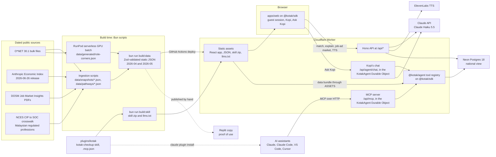

# Technical requirements

Kotak's technical specification: how the app is built, which data it uses, the exact engine rules, the API routes, the AI models and how it deploys. The builders work from it, and the team copies the [Technical Tools Declaration][td] from it (#73). It records decisions made in the [locked idea][kotak] and in issues #26 to #105, the hosting and database set-up of 22 October 2026, and the SDK and agent layer of #184 to #193; where a detail is not decided, it names the issue that owns it.

Contents:

1.  [Overview](#overview)
    1.  [Core rule: data decides, AI explains](#core-rule-data-decides-ai-explains)
    1.  [What AI may and may not do](#what-ai-may-and-may-not-do)
    1.  [Declaration crosswalk](#declaration-crosswalk)
1.  [System architecture](#system-architecture)
    1.  [Architecture summary](#architecture-summary)
    1.  [Components](#components)
    1.  [Data flow](#data-flow)
    1.  [Architecture diagram](#architecture-diagram)
    1.  [Client runtime](#client-runtime)
1.  [Stack](#stack)
    1.  [Languages, frameworks and libraries](#languages-frameworks-and-libraries)
    1.  [External APIs and cloud services](#external-apis-and-cloud-services)
1.  [Data sources](#data-sources)
    1.  [Datasets](#datasets)
    1.  [Licences and attribution](#licences-and-attribution)
    1.  [Four-layer hierarchy and fallbacks](#four-layer-hierarchy-and-fallbacks)
1.  [Engine](#engine)
    1.  [Engine schemas](#engine-schemas)
    1.  [Question order and levels](#question-order-and-levels)
    1.  [Verdict rules](#verdict-rules)
    1.  [Projections and scenarios](#projections-and-scenarios)
    1.  [Target level](#target-level)
    1.  [Fit score](#fit-score)
    1.  [Levels on matched roles](#levels-on-matched-roles)
    1.  [Gaps and roadmap order](#gaps-and-roadmap-order)
    1.  [Intake and pathways](#intake-and-pathways)
    1.  [What changed diff](#what-changed-diff)
    1.  [Static build](#static-build)
1.  [SDK layer](#sdk-layer)
1.  [Agent layer](#agent-layer)
    1.  [Tool registry](#tool-registry)
    1.  [Agent rules](#agent-rules)
    1.  [MCP server and clients](#mcp-server-and-clients)
    1.  [Skill, plugin and llms.txt](#skill-plugin-and-llmstxt)
    1.  [Ask Kopi](#ask-kopi)
1.  [API routes](#api-routes)
    1.  [Rules for every route](#rules-for-every-route)
    1.  [Job match route](#job-match-route)
    1.  [Explanations route](#explanations-route)
    1.  [TTS route](#tts-route)
    1.  [National view routes](#national-view-routes)
    1.  [Job-ad market route](#job-ad-market-route)
    1.  [MCP route](#mcp-route)
    1.  [Kopi's chat route](#kopis-chat-route)
    1.  [Health check](#health-check)
1.  [AI models](#ai-models)
    1.  [Models by task](#models-by-task)
    1.  [Claude Haiku 5.5 request rules](#claude-haiku-55-request-rules)
    1.  [Caching and pre-warming](#caching-and-pre-warming)
    1.  [Explanation verifier](#explanation-verifier)
    1.  [Batch generation](#batch-generation)
1.  [Deployment and environments](#deployment-and-environments)
    1.  [Environments](#environments)
    1.  [Deploy pipeline](#deploy-pipeline)
    1.  [Data refresh](#data-refresh)
    1.  [Replit](#replit)
    1.  [RunPod](#runpod)
    1.  [Database](#database)
    1.  [Environment variables and secrets](#environment-variables-and-secrets)
1.  [Non-functional requirements](#non-functional-requirements)
    1.  [Accessibility](#accessibility)
    1.  [Viewports](#viewports)
    1.  [Performance and availability](#performance-and-availability)
    1.  [Privacy](#privacy)
    1.  [Privacy summary](#privacy-summary)
    1.  [Security](#security)
1.  [Known limitations and risks](#known-limitations-and-risks)
    1.  [Risk register](#risk-register)
    1.  [Limitations summary](#limitations-summary)
    1.  [Dropped and not loaded](#dropped-and-not-loaded)
1.  [Traceability](#traceability)
1.  [See also](#see-also)

## Overview

Kotak shows a Malaysian worker which of their skills are rising or declining with AI, and what to do next. A cat counsellor, Kopi, asks where the user is now, what they studied and what they want, then 12 can-do questions rated from 1 to 4. Kotak draws the user's 6 skill corners against what the role will need in 12 months, ranks 3 matched roles by fit score and builds a roadmap of free steps with a finish date. One button switches the Economic Index snapshot from April to May 2026, and the radar, verdicts, ranking and roadmap update. The [product flow][flow] and the [users][users] are in the locked idea.

[flow]: /docs/ideas/0007-kotak.md#product-flow
[users]: /docs/ideas/0007-kotak.md#users

### Core rule: data decides, AI explains

Fixed rules over dated, sourced data set every number and every verdict. AI only names, drafts and explains. The rule comes from CareerSphere's team: "the data decides; the AI interprets" ([winner teardowns][teardowns]). Every number on screen shows its source and its date.

Rules decide question order, levels, verdicts, targets, fit scores, role ranking, roadmap order, finish dates and the What Changed list. The engine functions that compute them make zero AI calls (#37). AI agents, Kopi's chat included, reach these rules only through Kotak's read-only tools, which return each result with its sources (#184).

[teardowns]: /docs/research/winner-teardowns.md

### What AI may and may not do

AI may:

- Group a job's own O\*NET tasks into 6 corners and name them. It may only use task IDs that belong to that occupation (#74).
- Draft the basic, working and advanced can-do statements, SDG tags, milestone time estimates and free-resource search links, in the batch (#74).
- Suggest the closest O\*NET occupation for a Malay or local job title. The user confirms it (#43).
- Write a 2-sentence explanation per corner and a short What Changed summary, citing the source names and dates it is given (#43).
- Voice Kopi's lines through text to speech (#46).
- Answer a user's follow-up and what-if questions in Kopi's chat, and run a check-up in the user's own AI assistant, by calling Kotak's tools and explaining what they return (#184, #186, #189).

AI may not:

- Set or change a level, target, verdict, fit score, role rank, roadmap position or finish date (#27).
- Work out, estimate or recompute a number or date in place of Kotak's tools, in Kopi's chat or in an outside assistant (#184).
- Invent a task, job, course, statistic or quote. A claim without its source and date is a failure even if the app works ([anti-goals][anti-goals]).

Code enforces the boundary:

- A post-validator rejects batch output that references a task ID outside the occupation's own list (#74).
- A verifier rejects or strips any explanation that alters a verdict label or omits a dated citation, then falls back to a deterministic template (#43).
- Every route validates its request and response with shared Zod schemas (#27).
- Kopi's chat and the MCP server give the model only Kotak's read-only tools, which compute every result with the engine rules. One [agent rules](#agent-rules) text tells every agent to quote tool results and cite their sources. Kopi's chat fills in the user's own answers, so the model can't retype or change them (#184, #186, #189).
- An outside assistant is not Kotak's code. The MCP server's instructions and the kotak-checkup skill give it the same rules, and the build fails if the skill's rules drift from them (#188).

### Declaration crosswalk

Copy each declaration section from the part of this document shown. The [declaration template][td] sets the word limits.

| Declaration section                   | Word limit | Source in this document                                                                              |
| ------------------------------------- | ---------- | ---------------------------------------------------------------------------------------------------- |
| 2.1 System architecture overview      | 200        | [Architecture summary](#architecture-summary) and the [diagram](#architecture-diagram)               |
| 2.2 Languages, frameworks & libraries | None       | [Languages, frameworks and libraries](#languages-frameworks-and-libraries)                           |
| 3.1 External APIs                     | None       | [External APIs and cloud services](#external-apis-and-cloud-services)                                |
| 3.2 Cloud platforms & deployment      | None       | [External APIs and cloud services](#external-apis-and-cloud-services), [Environments](#environments) |
| 4.1 AI models used in the solution    | None       | [Models by task](#models-by-task)                                                                    |
| 4.2 Datasets                          | None       | [Datasets](#datasets)                                                                                |
| 4.3 AI-assisted development tools     | 100        | Not in this document; #73 collects it                                                                |
| 5 Sponsor-provided resources          | 100        | [Replit](#replit), [RunPod](#runpod), and the mentor session (#98)                                   |
| 6.1 Data handling & privacy           | 150        | [Privacy summary](#privacy-summary)                                                                  |
| 6.2 Known limitations & risks         | 150        | [Limitations summary](#limitations-summary)                                                          |

## System architecture

### Architecture summary

This paragraph fits declaration section 2.1 (under 200 words).

Kotak is a web app. Before the demo, Bun scripts turn dated public data into static JSON: O\*NET 30.1, two Anthropic Economic Index snapshots (April and May 2026), DOSM Job Market Insights, the NCES CIP to SOC crosswalk and the team's list of Malaysian regulated professions. A one-time batch on a RunPod serverless GPU groups each job's O\*NET tasks into 6 skill corners and drafts the can-do questions. A Zod-checked build fails if a number lacks a source or a date. GitHub Actions deploys one Cloudflare Worker serving the React app, the JSON snapshots and a Hono API. Fixed rules in a TypeScript SDK set every level, verdict, target, fit score and roadmap position, in the browser and on the server. The API calls Claude Haiku 5.5 to match local job titles and write cited explanations, and caches each answer. ElevenLabs voices the cat. An agent layer serves the SDK as read-only tools: through an MCP server to any AI assistant, and to Claude in Kopi's in-app chat. A Neon Postgres database holds the national view's labelled sample rows and the JobStreet ads the team's admins approve. A copy runs on Replit for the proof of use.

### Components

| Component         | What it is                                                                                                                                  | Issues           |
| ----------------- | ------------------------------------------------------------------------------------------------------------------------------------------- | ---------------- |
| Bun monorepo      | Root workspaces for `apps/*` and `packages/*`, with shared TypeScript, lint and format scripts                                              | #29              |
| `apps/web`        | React, Vite, Tailwind CSS, Recharts, Lucide and the Live2D cat. Runs the engine rules in the browser through `@kotak/sdk`                   | #28, #41, #185   |
| `apps/api`        | Hono routes for job match, explanations, job ads, TTS, the national view, the MCP server and Kopi's chat, with CORS middleware              | #27, #186, #189  |
| `packages/shared` | Zod schemas for engine data, guest session state and API payloads. Re-exports the engine schemas from #40                                   | #29, #40         |
| `packages/sdk`    | `@kotak/sdk`: the whole check-up from the data bundle, in the browser, Bun and the Worker, plus a typed client for the API                  | #185, #187       |
| `packages/agent`  | `@kotak/agent`: the tool registry, the agent rules, and adapters to an MCP server and to Claude's tool runner                               | #186, #189, #190 |
| `plugins/kotak`   | The Claude Code plugin: the kotak-checkup skill and an `.mcp.json` for the live MCP server, listed by `.claude-plugin/marketplace.json`     | #188             |
| Ingestion scripts | Bun scripts that write dated, validated files to `data/snapshots/`                                                                          | #30              |
| Engine module     | Pure TypeScript functions for verdicts, projections, targets, scoring, transfers, roadmaps and diffs. Runs at build time and in the browser | #81, #83, #86    |
| Batch generator   | The corner and question prompt harness and its validator, run on a RunPod serverless GPU                                                    | #74, #77         |
| Static build      | `bun run build:data` joins everything into Zod-validated static JSON                                                                        | #88              |
| National view     | A Postgres table on Neon, its seed script, two Hono routes and the `national_skill_gaps` tool. No screen since #167                         | #34, #167, #190  |

Hono runs on the Cloudflare Workers runtime in production and on Bun locally and on Replit. Code in `apps/api`, `packages/sdk`, `packages/agent` and the engine module must therefore avoid Bun-only and Node-only APIs. The Bun entry point, `apps/api/src/bun.ts`, injects what needs the disk: the data bundle reader and the AI cache. Ingestion and build scripts run only under Bun.

### Data flow

1.  **Snapshot.** Ingestion scripts read each source, keep only the series the engine needs, attach source name, URL, vintage date and layer to every number, and write dated files to `data/snapshots/` (#30).
2.  **Generate.** The batch reads O\*NET tasks and writes `data/generated/role-corners.json`. Every role starts with `quality: "auto-generated"` (#77). The 3 demo roles are checked by hand and set to `"human-checked"` (#104).
3.  **Build.** `bun run build:data` joins roles, the alternate-title index, corners, the four-layer signals for `2026-04` and `2026-05`, and the demo diffs into static JSON. It fails on any missing source or date (#88).
4.  **Serve.** The Worker serves the app and the JSON as static assets. The app never runs ingestion or build scripts at runtime (#28).
5.  **Score.** The browser loads the active snapshot and runs the engine rules on the guest's answers through `@kotak/sdk` (#41, #185).
6.  **Explain.** The browser sends computed verdicts, levels and source metadata to the API. The API returns cited explanations and never changes a number (#43).
7.  **Ask.** Kopi's chat sends the conversation and the guest's check-up to the API. Claude answers by calling Kotak's tools, which run the same SDK over the same bundle on the server, and the API returns the reply, the tools Claude ran and their sources (#189, #191).
8.  **Connect.** An outside AI assistant calls the same tools through the MCP server at `/api/mcp` (#186).
9.  **Aggregate.** `POST /api/national-view/checkups` can store a check-up's role code, corner levels (one per corner, up to 6) and date in Postgres, but no screen posts one, so the national view serves its labelled sample rows (#34, #167).
10. **Refresh.** A scheduled workflow checks for new upstream releases, rebuilds the JSON and opens a commit or pull request with the snapshot diff (#90).

### Architecture diagram

#56 exports this diagram as PNG or SVG for the README, PRD section 3.1 and declaration section 2.1.



### Client runtime

- **Guest session.** A Zod-validated `localStorage` store holds guest status, role code, goal, impact area, target role code, the 12 answers, follow-up answers, ticked milestones, custom weekly hours, pasted job-ad quotes, the TTS mute state and the active snapshot ID (`2026-04` or `2026-05`). A stored value that fails validation resets to clean defaults. A reset action clears the session (#41).
- **Snapshot loader.** It reads the precomputed slow and fast targets for the active snapshot, defaulting to May 2026 since #167, and calls the engine functions from #83, through `@kotak/sdk`, for levels, fit scores, estimate labels and roadmap order. Switching snapshots recomputes them synchronously (#41, #185).
- **Screens.** Landing (#54), guest sign-in and dashboard (#57), check-up start and 12 questions (#59), Future Skills Radar (#61), matched roles (#64), roadmap (#67), What Changed and the demo switcher (#69), Connect your AI (#192) and the 3D space (#441). The shell, transitions and the Loading, AI Error and No Match states are in #51. Kopi is in #49. The [Ask Kopi](#ask-kopi) chat panel opens from the shell on every `/app` page (#191), and on the 3D space, which sits outside the shell, from its HUD or, without 3D, from the table's header. #167 removed the National View screen at `/app/national` and the radar's Slow/Fast switch: the screens show the slow scenario, and the national view is the [summary route](#national-view-routes) and the `national_skill_gaps` tool.
- **3D space.** `/app/space` draws every job in `space.json` as a tuft of grass, one blade per skill, outside the app shell. The browser ranks every role against the assessed one with `computeCheckup` from `@kotak/sdk`, as the Roles page does, in both snapshots and both AI futures, with the assessed role from its full file, so a fit in the space matches its Roles card to the percent. Distance from the box is 100 minus fit, and a blade's height is that skill's AI use, 12-month change (est.), from the same verdict rules. Look Around (`?view=look-around`) needs no answers: it places each job by its O\*NET Job Zone and runs no check-up. The page reads and sets the session's AI future and active snapshot, so a flip there moves every other screen. `?job=<O*NET code>` opens it on one job: its card pinned, the camera flown to its tuft (at once under reduced motion) and the table on its page; an unknown code is ignored. The flight, like a double-click on a tuft, stops at the nearest spot on that screen where no lit grass, glow or box sits behind the HUD's text (`focusShot` in `scene/layout.ts`), so text keeps its contrast without a backing. In 3D the address then follows the card in focus, and drops `?job` when it closes, so a reload opens on what was on screen. Home, Radar, Roles, What Changed and the job page link to it through `spacePath()` in `apps/web/src/app/routes.ts`. Without WebGL, after a scene failure or under reduced motion, the same numbers show as a paged table. three.js loads only on this route, in a lazy chunk of about 1.1 MB (300 kB gzipped) (#441).
- **Visual design.** `DESIGN.md` governs tokens, type, surfaces and components (#31, #32).

## Stack

### Languages, frameworks and libraries

The issues pin no library versions. `bun.lock` records them once #29 scaffolds the workspace. A dash means no version is set in the issues.

| Name                                                                  | Version | Purpose                                                               | Issues     |
| --------------------------------------------------------------------- | ------- | --------------------------------------------------------------------- | ---------- |
| TypeScript                                                            | —       | The language of the app, API, engine and scripts                      | #29        |
| Bun                                                                   | —       | Package manager, workspaces, script runner and local server           | #29        |
| React                                                                 | —       | `apps/web` user interface                                             | #29        |
| Vite                                                                  | —       | `apps/web` build                                                      | #29        |
| Tailwind CSS                                                          | —       | Theme, tokens and utilities from `DESIGN.md`                          | #32        |
| Recharts                                                              | —       | Radar chart and readiness graph                                       | #61, #67   |
| three.js                                                              | 0.186.1 | The 3D space, lazy-loaded; kept under 0.187 for postprocessing 6.39   | #441       |
| `@react-three/fiber`                                                  | 9.8.2   | React renderer for the 3D space                                       | #441       |
| postprocessing                                                        | 6.39.5  | The 3D space's bloom, tone mapping and grain                          | #441       |
| Lucide                                                                | —       | The 60-icon registry                                                  | #32        |
| pixi-live2d-display, a PixiJS plugin                                  | —       | Renders the Live2D cat                                                | #49        |
| Live2D sample model Hijiki                                            | —       | Kopi the cat counsellor                                               | #49        |
| Hono                                                                  | —       | API routes, on the Workers runtime in production and on Bun elsewhere | #27        |
| Zod                                                                   | —       | Shared schemas for data files, session state and API payloads         | #29, #40   |
| `@anthropic-ai/sdk`                                                   | —       | Claude Messages calls, and the beta tool runner for Kopi's chat       | #43, #189  |
| `@modelcontextprotocol/server`, the MCP TypeScript SDK                | v2      | Serves Kotak's tools over MCP at `/api/mcp`, on the Worker and on Bun | #186       |
| `@kotak/sdk` and `@kotak/agent`, Kotak's own packages                 | —       | The check-up engine for any runtime; Kotak's tools and agent rules    | #185, #186 |
| fflate                                                                | —       | Zips the kotak-checkup skill for claude.ai                            | #188       |
| Postgres on Neon                                                      | 18      | National view storage                                                 | #34        |
| Atkinson Hyperlegible Next, Atkinson Hyperlegible Mono, Shantell Sans | —       | Interface type, figures and Kopi's speech box                         | #32        |
| `cloudflare/wrangler-action`                                          | v4      | Deploy step in GitHub Actions ([deploy notes][deploy])                | #62        |
| RunPod serverless worker                                              | —       | vLLM, or an embedding and structured-output worker, for the batch     | #77        |

Licences go in `NOTICE.md` (#47). The repo docs state two of them: Lucide is ISC, and the Live2D model is under the Live2D Free Material License Agreement.

### External APIs and cloud services

| Service                       | Purpose                                                                                         | Access tier, plan or region                                                                                |
| ----------------------------- | ----------------------------------------------------------------------------------------------- | ---------------------------------------------------------------------------------------------------------- |
| Anthropic Claude API          | Job-title match, explanations, Kopi's chat, and sorting scraped listing titles for admin review | Team API key; #73 records the tier                                                                         |
| ElevenLabs Text to Speech API | Kopi's voice                                                                                    | A 34,000-credit budget ([deploy notes][deploy]); #73 records the plan                                      |
| UN SDG API                    | Official target text and Malaysia's indicator 4.4.1 values                                      | Free, no key                                                                                               |
| Hugging Face Hub              | Economic Index files and new-release polling                                                    | Free, no key; anonymous limit of 3,000 resolver requests per 5 minutes                                     |
| O\*NET bulk downloads         | The occupation and task backbone                                                                | Free, no key                                                                                               |
| Cloudflare Workers            | Hosts the app, the static JSON and the API                                                      | One Worker; the free plan allows 100,000 requests a day and 10 ms CPU per request ([deploy notes][deploy]) |
| GitHub Actions                | Deploys, data refresh and checks                                                                | Repository workflows                                                                                       |
| Neon                          | Postgres 18 for the national view                                                               | Project `kotak`, region `aws-ap-southeast-1`                                                               |
| Replit                        | A hand-published copy for the compulsory proof of use                                           | Sponsor Replit Core, or the one free Starter app (#99)                                                     |
| RunPod                        | Serverless GPU for the one-time batch                                                           | Sponsor credit of US$25 per team ([brief][brief-credits])                                                  |

[brief-credits]: /docs/BRIEF.md#support-and-contacts

## Data sources

### Datasets

Every dataset is public, synthetic or collected by the team from public job ads, and none holds personal data. Vintages and coverage come from the [trend data notes][trend], the [official demand notes][demand-official] and the [published demand notes][demand-published].

| Dataset                                      | Vintage used                                                                                                                                                                                                                                                                                                                                                                                                                            | Malaysia coverage                                                                                                                                                                                  | Issue      |
| -------------------------------------------- | --------------------------------------------------------------------------------------------------------------------------------------------------------------------------------------------------------------------------------------------------------------------------------------------------------------------------------------------------------------------------------------------------------------------------------------- | -------------------------------------------------------------------------------------------------------------------------------------------------------------------------------------------------- | ---------- |
| O\*NET database                              | 30.1 for occupations, alternate titles, tasks, work activities and related roles; 30.1 Job Zones, Education, Training, and Experience, and Interests in `data/pathways/onet-preparation.json`; 30.3 Hot Technologies (May 2026) in `data/onet/hot-technologies.json`, which the radar and roadmap show; and 31.0 Emerging Tasks (late August 2026) in `data/onet/emerging-tasks.json`, which no screen reads yet. All on the same codes | None: US O\*NET-SOC 2019 codes. 923 occupations and 52,606 title-index entries                                                                                                                     | #44, #154  |
| O\*NET to ESCO and ISCO-08 crosswalk         | O\*NET's ESCO crosswalk; ESCO v1.2.1, updated 10 December 2025                                                                                                                                                                                                                                                                                                                                                                          | Indirect, through ISCO-08                                                                                                                                                                          | #44        |
| MASCO 2020 unit-group codes                  | 2020 edition; 4-digit codes attached by hand where title and code align                                                                                                                                                                                                                                                                                                                                                                 | Malaysia; about 300 of 490 unit groups line up with ISCO-08. Others carry `masco_unmatched: true`                                                                                                  | #44        |
| Anthropic Economic Index                     | Release 2026-06-26 (`aei_claude_ai_2026-06-26.csv`, 219 MB), months April and May 2026, filtered to `MYS`, `SGP` and `GLOBAL`                                                                                                                                                                                                                                                                                                           | Usage share for 198 Malaysian occupations in April and 243 in May. The automation and augmentation split only for 20 major groups and for work activities (20 in April, 23 in May)                 | #50        |
| DOSM Big Data Analytics: Job Market Insights | Quarterly, Q3 2019 (74,018 offerings) to Q2 2026 (555,509)                                                                                                                                                                                                                                                                                                                                                                              | Online job offerings from private recruitment platforms, by major occupation group and top named roles                                                                                             | #52        |
| OpenDOSM `lfs_qtr_sru_age`, two figures      | Q2 2026, updated 11 August 2026: skill-related underemployment of tertiary-educated workers, 35.2% overall (cited in the PRD and the proposal) and 74.3% of 15 to 24-year-olds (cited on the landing page)                                                                                                                                                                                                                              | Malaysia                                                                                                                                                                                           | #63        |
| UN SDG API                                   | Indicator 4.4.1 for Malaysia, 2015 and 2017 to 2024                                                                                                                                                                                                                                                                                                                                                                                     | Malaysia, for indicator 4.4.1                                                                                                                                                                      | #47, #58   |
| CIP 2020 to SOC 2018 crosswalk               | NCES, 2020: 5,723 links from fields of study to occupations, without its NO MATCH rows                                                                                                                                                                                                                                                                                                                                                  | None: US programmes and occupations. 55 Malaysian fields of study are mapped to CIP codes by hand                                                                                                  | #284       |
| Malaysian regulated professions              | 42 professions over 132 O\*NET codes, accessed 23 October 2026. Each row cites its Act on the Attorney General's Chambers' Laws of Malaysia site, the regulator's site or, where neither opened, a legal database or news report                                                                                                                                                                                                        | Malaysia: who may practise law, medicine, engineering, teaching and the other professions an Act restricts                                                                                         | #284       |
| JobStreet Malaysia job ads, self-collected   | From 22 October 2026: breadth batches of JobStreet search results, each reviewed by an admin against one O\*NET occupation                                                                                                                                                                                                                                                                                                              | Malaysia: the ads approved per O\*NET occupation, with advertised pay, location, work type, the text of the card and, when fetched, the description, plus JobStreet's count of ads for each search | #235, #271 |
| SkillsFuture Singapore Skills Framework      | 2.0, the 30 September 2026 revision, retrieved 31 October 2026: job roles, key tasks, skills at proficiency levels 1 to 6, and the unique skill list with its emerging flag                                                                                                                                                                                                                                                             | None: Singapore roles by sector and track. An AI crosswalk maps 2,030 of them to 302 O\*NET occupations, and links skills to the corners of 296                                                    | #464       |
| Synthetic profiles and sample rows           | Made by the team, labelled as samples                                                                                                                                                                                                                                                                                                                                                                                                   | Not applicable                                                                                                                                                                                     | #34, #88   |

JobStreet job ads come from the team's own scraper ([scraper guide][jobstreet-guide]). An admin reviews each batch, and an ad counts only once it is approved under an O\*NET occupation. Claude sorts each ad's title first, and an admin can clear a search title's stored answers and sort it again (#265). Depth runs fetch the descriptions of approved ads first, then the most recently seen; the runner learns which ads are approved from `jobstreet_listings.approved_at`, which the admin route sets and clears and the nightly cron repairs, because its database role cannot read the review tables (#276). The column only orders depth runs. The runner's role can write `jobstreet_listings`, so it could change the column, but no verdict, check-up title or job-ad market figure reads it: they read the reviews. When the browser crashes mid-run, the runner relaunches it, up to three times a run, and resumes from the next unsaved search page or the next job, so the run keeps going instead of ending failed (#264). The approved ads feed the [job-ad market route](#job-ad-market-route) and the `job_market` tool, as context beside the verdicts. No verdict, fit score or roadmap reads them until #275 adds a demand rule with enough weekly history, so DOSM's Job Market Insights stays the job-ad demand series behind the verdicts.

TalentCorp MyCOL and Epoch AI are cited as context only, and Kotak loads no data from them. DOSM Quarterly Employment Statistics, the other OpenDOSM series and the GitHub Innovation Graph are not loaded either. [Dropped and not loaded](#dropped-and-not-loaded) lists them with their issues.

### Licences and attribution

Each licence fact below comes from the research notes or #47. Where they differ, both are given. `NOTICE.md` carries the full credit lines (#47).

- **O\*NET**: CC BY 4.0, with a fixed credit line and a modification notice for any change ([trend data notes][trend]). The notes quote the credit as "includes information from the O\*NET 31.0 Database … Used under the CC BY 4.0 license. O\*NET® is a trademark of USDOL/ETA". The credit names the database version used. The backbone is 30.1 (#44); #47 writes the credit for 31.0. The ingestion script puts the credit and the modification notice in the emitted metadata header (#44).
- **ESCO**: free reuse for any purpose, provided "The use of ESCO shall be acknowledged by publishing the statement" from the ESCO FAQ ([trend data notes][trend]).
- **MASCO 2020**: "No part of this publication may be reproduced" (Ministry of Human Resources). Kotak stores only hand-checked codes, not a parsed copy ([trend data notes][trend]).
- **Anthropic Economic Index**: the README says "Data released under CC-BY, code released under MIT License", with no CC BY version; the YAML metadata says MIT ([trend data notes][trend]). #47 writes "CC BY 4.0 / MIT". Credit Anthropic.
- **DOSM Job Market Insights**: the [published demand notes][demand-published] found no reuse licence on the releases, but DOSM's [Terms of Use][dosm-terms], read on 22 October 2026, cover them. DOSM "authorizes the use of data without any charge worldwide, continuously and not exclusive for the content available on this portal" for copying, publishing, adapting and using it "commercially and non-commercially", under the [Government Open Data Terms of Use 1.0][open-data-terms]. Users must state "Data source: Department of Statistics Malaysia", link to those terms and not present their analysis as DOSM's. Kotak extracts only the figures it needs, cites each with its release title, quarter, URL and that attribution, and links both terms in the snapshot's licence (#52).
- **TalentCorp MyCOL**: no open data licence; the TalentCorp site says all rights reserved ([official demand notes][demand-official]). Kotak cites it as context and stores none of its data (#60).
- **OpenDOSM**: CC BY 4.0. Kotak cites two figures, with their credit (#63).
- **SkillsFuture Skills Framework**: not open data. SWDA's [terms of use](https://jobsandskills.swda.gov.sg/terms-of-use) forbid reproducing or displaying the contents "without the prior written permission of SWDA". A SkillsFuture ambassador gave the team verbal approval at the hackathon on 31 October 2026; nothing is in writing yet. Kotak stores the fields it needs, credits SWDA and keeps the downloaded workbooks out of the repository (#464).
- **Epoch AI**: "Creative Commons Attribution", version not stated ([trend data notes][trend]). Kotak cites it as context and stores none of its data (#66).
- **UN SDG API**: the repo notes state no licence. #47 adds its credit.
- **Lucide**: ISC (#47).
- **Live2D sample model Hijiki**: the Live2D Free Material License Agreement. Clause 4.1.1 says "the Customer may not Redistribute all or part of the Material to third party". The team accepted this risk on 22 October and credits Live2D Inc. in `NOTICE.md` ([mascot][mascot], #47).

No restricted dataset is committed as raw data (#47).

[mascot]: /docs/ideas/0007-kotak.md#mascot
[dosm-terms]: https://www.dosm.gov.my/portal-main/article/term-of-use
[open-data-terms]: https://www.dosm.gov.my/assets/img/article/Terms-of-Use-Government-Open-Data-1-Appendix-B.pdf

### Four-layer hierarchy and fallbacks

Each layer has its own signal. For a given role, the engine collects only the layers at and above it (#71).

| Layer               | Signal                                             | Sources                                                                                                                                                                 |
| ------------------- | -------------------------------------------------- | ----------------------------------------------------------------------------------------------------------------------------------------------------------------------- |
| 1. Sector           | Where money goes                                   | None loaded. DOSM QES (#55) and OpenDOSM `employment_sector` (#63) were planned; the engine lists the layer as missing                                                  |
| 2. Occupation group | Job data with history; Malaysia's automation split | DOSM Job Market Insights by major group; Economic Index rows for 20 SOC major groups                                                                                    |
| 3. Role             | AI exposure, demand                                | Economic Index detailed-occupation usage; roles named in Job Market Insights                                                                                            |
| 4. Skill            | What employers ask for                             | O\*NET tasks and work activities; Economic Index work-activity and task rows; SkillsFuture Singapore skills and levels, labelled as Singapore's, as context only (#464) |

Fallback rules:

1.  **Borrow and label.** When a layer has no Malaysian data, the engine borrows from the layer above, or uses global data, and labels the borrowed value (#71).
2.  **AI use on a corner.** Use the finest level published: task, then work activity, then detailed occupation, then major occupation group. Use Malaysia (`MYS`) first, then `GLOBAL`. Attach a fallback label whenever a higher layer or a global row is used (#71). The locked idea's chain stops at occupation; #71 adds the major group.
3.  **How AI is used.** The automation and augmentation split for `MYS` exists only for work activities and major groups, so it resolves at work-activity level first, then major group, then `GLOBAL`, labelled ([trend data notes][trend]).
4.  **Role demand**, in order: the role's own count where Job Market Insights names it among a quarter's top roles; its occupation group's Job Market Insights series; otherwise `Unknown`, which adds 0 to the target (#71). The engine has a MyCOL step between the first two, which reads a role's presence across MyCOL editions. MyCOL is not loaded, so the engine skips that step and the fallback label says so (#60).
5.  **Missing is not zero.** A suppressed Economic Index cell is stored as `null`, not `0` (#50).

Until skill-level demand history exists, each corner takes its role's demand direction. Corners differ through their AI data, not their demand. No open Malaysian series tracks demand for single skills ([engine][engine]).

Layer 1 was planned as context only, and has no loaded source. The verdict uses only the three inputs in [Verdict rules](#verdict-rules). The optional signals in #95, had they been built, were to be labelled as developer or research activity and never override the demand fallback. The locked idea also lists Bursa sector indexes as Layer 1 context; no issue ingests them.

[engine]: /docs/ideas/0007-kotak.md#layered-hierarchy

## Engine

The engine is pure TypeScript. It runs at build time and in the browser, so the snapshot switch updates the radar at once (#81). It computes both the slow and the fast scenario for every corner. The radar shows the slow one, and a corner whose scenarios disagree shows as Split with both futures; the app has had no scenario switch since #167. The rules below come from the [locked idea][kotak] and #81, #83 and #86; they agree unless a note says otherwise. The [SDK layer](#sdk-layer) composes them into a whole check-up for the browser, Bun and the Worker.

### Engine schemas

#40 defines Zod schemas and types for:

- **Source files**: O\*NET occupations, alternate titles, tasks, intermediate and broad work activities, related roles, and ISCO and MASCO crosswalk rows.
- **Dated signal snapshots**: Economic Index rows and Job Market Insights quarters (`DosmDemandSchema`, #52). Schemas for QES sector rows, OpenDOSM series, MyCOL editions (`MyColSchema`, #60) and Epoch AI context exist too, unused until those sources are loaded.
- **Batch output** (`RoleCornersSchema`, #77): up to 6 corners, the basic, working and advanced can-do statements, SDG tags, free resources, hour estimates and a quality label.
- **Engine output**: verdicts, slow and fast targets, fit-score breakdowns, What Changed diffs and provenance citations.

Field rules:

- Every numeric signal requires `source_name`, `source_url`, `vintage_date` and `geo_or_layer`. Undated records fail (#40).
- Projected values carry `is_estimate: true` (#81).
- Occupations without a verified MASCO match carry `masco_unmatched: true` (#44).
- The quality label is `"auto-generated"` or `"human-checked"` (#77, #104).

### Question order and levels

The cat asks 2 can-do questions for each of the 6 corners: 12 in all, the corner's basic statement and then its advanced one. The user rates each from 1 (Not yet) to 4 (Yes, on my own), with a click or the number keys 1 to 4 (#238). The corners belong to the assessed role: the target role when the goal names one, as it always does for a user with no job, or else the user's job (#284). Rising corners come first (#59, #83).

Questions 2, 4, 7, 10 and 12 are reversed once their corner has reversed wording: agreeing means less skill, so the rating counts as 5 minus the rating (#238).

A role with a scenario for every slot in `data/generated/scenarios.json` asks "what would you do" questions instead (#352; the question screen for them is #354). The build merges them into each corner as `scenarios.basic` and `scenarios.advanced`; `slotQuestion` in `packages/shared` shows the four options in an order seeded by the slot and the session's seed (`scenarioSeed()` in the session store, kept under its own `kotak:scenario-seed` key until the session is reset), so a reload keeps it. The picked option's hidden score from 1 to 4 is the slot's rating, never reversed, and is never shown. A role without them keeps the statements.

A corner's level runs from 0 to 3 in steps of 0.5: (basic rating + advanced rating − 2) ÷ 2. Both at 1 give 0; both at 4 give 3.

The radar labels these levels "self-reported" (#61).

### Verdict rules

Each corner gets three inputs from dated snapshots:

1.  **AI use on the corner**: the Economic Index usage share for the corner's tasks, resolved by the [fallback rules](#four-layer-hierarchy-and-fallbacks). It counts as rising when its projected 12-month change is more than 5%.
2.  **How AI is used**: mostly augmentation (people work with AI) or mostly automation (AI does the work), from the Economic Index collaboration split.
3.  **Demand for the role**: up, flat or down, from the demand fallback. Job Market Insights directions come from quarter-on-quarter and year-on-year changes (#52).

| AI use on the corner | How AI is used | Demand | Verdict                     |
| -------------------- | -------------- | ------ | --------------------------- |
| Rising               | Augmentation   | Any    | Rising: AI helps it scale   |
| Rising               | Automation     | Any    | Declining because of AI     |
| Not rising           | Any            | Up     | Rising: AI can't do it yet  |
| Not rising           | Any            | Flat   | Steady                      |
| Not rising           | Any            | Down   | Declining for other reasons |

Two more states:

- **Split**: the slow and fast scenarios give different verdicts, or sources point opposite ways. A Split corner returns and shows both futures.
- **Unknown**: fewer than two dated points. The app always shows it.

The status chips show five states: Rising, Steady, Declining, Split and Unknown (#36).

### Projections and scenarios

- **Horizon**: each trend runs 12 months ahead. Every projected value is labelled an estimate (#81). The horizon counts from the latest data month, not from today (`HORIZON_MONTHS`), so on the May 2026 snapshot the radar labels the red line "Needed by May 2027" (#61).
- **Slow**: keeps Malaysia's current pace of AI use. It is the default (`DEFAULT_SCENARIO`), and the only scenario the screens show (#167).
- **Fast**: moves Malaysia halfway to Singapore's level, which raises every corner's projected AI-use growth. The app shows it only when the two scenarios disagree, as the second future of a Split corner; Ask Kopi and MCP clients can still ask `run_checkup` and `what_changed` for it.
- **Anchors**: kymil4's notes give May 2026 usage-per-capita indexes of 5.81 for Singapore and 0.87 for Malaysia. #50 re-checks both against the release file before the engine uses them.
- **Formula**: the exact projection formula, within these rules, belongs to #81.
- **AI advancement**: the Economic Index is the only AI signal. The landing page cites Epoch AI as context only; no Epoch data is loaded (#66).

### Target level

The red line on the radar draws the slow scenario's target. Every new snapshot moves it (#81, #167).

```text
target = clamp(2.0 + ai_effect + demand_effect, 1.0, 3.0)

ai_effect     in [-1.0, +1.0]; its size grows with the corner's projected AI-use growth
              positive for augmentation, negative for automation
demand_effect = +0.5 if demand is up
                 0   if demand is flat or Unknown
                -0.5 if demand is down
```

The scaling curve of `ai_effect` within its bounds belongs to #81. The verdict labels still come from the [verdict table](#verdict-rules), not from the target.

### Fit score

```text
fit_score = sum over corners of min(user_level, target_level)
            / sum over corners of target_level
            x 100
```

The function returns the numerator, the denominator and each corner's term, so tapping the score shows the maths (#83, #64).

### Levels on matched roles

Matched and backup roles come from O\*NET's related-occupations list, ranked by fit score, and, with the intake's profile, from the [candidate pool](#intake-and-pathways). The screen shows 3 ranked roles, or 6 from a wider pool. For "stay strong" it becomes "Your Job's Future": the current role, then 2 backup roles (#64).

A matched role reuses the 12 answers where its corners overlap the answered ones. The engine tries these rules in order (#83):

1.  The same intermediate work activity as an answered corner, weighted by shared task links. Label: "estimated from your answers".
2.  The same broad work activity. Label: "rough estimate".
3.  Otherwise level 0. Label: "not asked yet".

Across each job's 3 most related O\*NET roles, the first rule covers a median 44% of a matched role's task links, and the first two a median 73% (lower quartile 57%). When the user picks a role, the cat asks only its "not asked yet" corners, so the chosen role is fully covered (#64).

### Gaps and roadmap order

```text
gap_size  = target_level - user_level, for each corner where user_level < target_level
weeks     = total_hours / weekly_hours
```

- **Order**: each corner's milestones stay in level order; across corners, the next milestone is the one that adds the most fit per hour, so cheap basic steps come before costly advanced ones and the plan reaches 80% fit soonest. Declining corners come last, tagged "less important by 2027"; ties keep rising gaps first, largest first, then Steady, Split and Unknown (#83).
- **Milestone**: the next can-do statement, done for real, with an AI-drafted time estimate and one free resource: a guide, a video, a community or an HRD Corp-claimable programme (#67). The [context notes](/docs/CONTEXT.md#what-this-means-for-us) advise calling a course "HRD Corp-claimable" only where HRD Corp or the provider's own page says so, because no working public list of claimable programmes exists. #104 curates verified resources for the demo roles.
- **Weekly hours**: the app starts at 4 hours a week and the user can set 1 to 20, and the finish date updates at once. Without a figure, as from an MCP client, the SDK uses part of the time AI could save the user on declining tasks, the AI dividend (#67, #83).
- **Length**: the web roadmap runs at least 12 weeks and on to the week the plan first reaches 80% fit, at the chosen weekly hours; unfinished milestones and remaining hours are listed after that week. A partial milestone earns no projected level gain. The SDK keeps the full path: its finish date comes from total hours divided by weekly hours. The 80% fit threshold is separate from completing every skill target.
- **Practice project**: follows the user's impact area. Every corner and role has at least one SDG tag (#67).
- **Ticking**: the user ticks a milestone when they can honestly say yes to it. That raises the corner's level and updates the fit score and the readiness graph (#67).

### Intake and pathways

The check-up starts from who the user is, not only a job title (#284).

- **Intake**: where the user is now (working, studying, graduated and looking, between jobs, or returning to work), their highest qualification on the ladder of the [Malaysian Qualifications Framework][mqf], their field of study and their years of work. Then a job title, which only "stay strong" needs, and a goal: stay, up to 3 target roles, explore with up to 3 interest areas, or not sure. The browser keeps it as the session's `profile`.
- **No job, or not sure**: Kotak suggests roles before any question. "Not sure" first asks which of 18 everyday activities the user enjoys, 3 for each of Holland's six interest areas. The team wrote them, so they are a pointer, not a validated test. The role the user picks becomes the target the 12 questions test.
- **Candidate pool**: each reason a role is in front of the user adds a fixed weight:
  - a target the user named: 10;
  - a picked area: 3, plus up to 1.5 for the area's core roles, which a digital area lists first;
  - the field of study: 3, plus 1 when the role is in a picked area too;
  - interests: up to 4, from the correlation of the picks with O\*NET's interest scores; without a picked area, the 40 closest matches join the pool. Picks spread evenly over the six areas point nowhere, so the screen asks the user to leave some out;
  - an area the picked activities are about, without a picked area or a field of study: 2.5. The scores carry only a shape, so "set up computers" and "analyse data" alone suggested zoologists and astronomers, and no computing role. 12 of the 18 activities name a subject and its areas (`ACTIVITY_AREAS`), such as computers and networks for Cloud and Infrastructure and Cybersecurity, or health for Health and Care. The profile keeps the picks by activity id beside the counts, and the card says "Your picks point to" the area, not that the user picked it;
  - O\*NET's related list of the user's job: 1.

  A manager or supervisor role for a user without the years, and a job well below the user's qualification, take some away; a qualification the user doesn't hold takes nothing. Suggestions add the outlook, from +2 for Rising to −1 for Declining. The check-up ranks up to 18 of these roles beside the assessed role's related list, and Roles That Fit then shows 6, the user's own choices first. An empty profile ranks the related list only, as before.

- **The highlighted role**: Roles That Fit highlights one card, and the role details and the roadmap follow it. Until the user picks, it is the target role when the goal names one; otherwise the best fit of the Rising roles that aren't the user's job, or the best fit when none is Rising. A role the roadmap already plans for stays highlighted when the user comes back. The card says why in one bold line, such as "Picked for you: your best fit of the 4 Rising roles", and when a better fit isn't Rising, Kopi names it and its outlook. Roles to Check highlights Kopi's top suggestion the same way.

- **Fields of study**: 55 fields, plus Other, each a set of CIP 2020 codes; the NCES CIP to SOC crosswalk links them to occupations. A SOC "All Other" code reaches its detailed O\*NET occupations only from fields whose group lists its major group, so Psychology never reaches Wind Energy Operations Managers. NCES's guidelines for the crosswalk say it "is not a record of the occupational outcomes of postsecondary instructional program completers", so the app says a field "leads here", not that graduates go there.
- **Access rule**, fixed, in this order. It informs and never blocks: no role is hidden or ranked lower because the user lacks a qualification. The radar, the role detail and the roadmap show it beside the user's fit, so they can weigh whether the qualification is worth pursuing.
  1.  **A Malaysian regulated profession**, from `data/pathways/regulated-professions.json`, each row citing the pages it rests on. It is open to someone in the job now. Otherwise it is "Registration Steps Left" when the user's field and level qualify, "Qualification Needed" when they don't, and "Licence Required" when Kotak doesn't know their study, entry is by licence or examination, or none of Kotak's fields of study covers the qualifying degree. A field qualifies only when its CIP codes sit inside a qualifying one, so Psychology doesn't count for counselling. Each shows the route in, the regulator and its sources, and names no single body as the one that admits, since that differs by profession; the roadmap says its steps build the skills, and that working in the profession still needs the route.
  2.  **Managers and first-line supervisors**: "Needs Experience" when the user's years of work fall below what US workers report, and at least 2. A user who didn't say their years isn't flagged; a student or new graduate who didn't say has none. Other jobs aren't flagged for experience: O\*NET asks working incumbents, who report years that junior Malaysian posts often don't ask for (Software Developers report over 6).
  3.  **"Degree Usually Needed"** when the median education US workers report is a diploma or above and the user's is lower.
- **Tools**: each role file carries every O\*NET Hot Technology that O\*NET marks In Demand, or without any, its first 12. The radar shows them for the assessed role, and the roadmap for the planned role.
- **Data**: `bun run ingest:pathways` writes `data/pathways/onet-preparation.json` (O\*NET 30.1 Job Zones; Education, Training, and Experience; and Interests) and `data/pathways/cip-soc.json`. `build:data` joins them with the fields, areas and professions into `/data/pathways.json`. The suggestion and access rules are in `@kotak/shared` (`pathways/`), and the web app, Kopi and MCP clients run the same ones through `@kotak/sdk`.

### What changed diff

`diffSnapshots(role, userAnswers, prevSnapshot, nextSnapshot, scenario)` is a pure function. It compares corner AI use, targets, verdicts, matched-role fit scores and roadmap positions (#86).

Each diff item holds the corner name, old and new verdict, old and new target, old and new roadmap rank, and the dated source citation. Every item has before and after values, source names and snapshot dates (#86).

The demo roles come from a scan of the O\*NET catalogue between `2026-04` and `2026-05`. Only occupations where the real May data flips at least one corner verdict qualify (#86). The What Changed screen shows each changed corner with its old verdict, new verdict and cited source (#69).

### Static build

- **Command**: `bun run build:data`, in `scripts/build-data.ts` (#88).
- **Inputs**: O\*NET roles, the alternate-title search index, the corner batch output, the four-layer signals for `2026-04` and `2026-05`, the demo role diffs, and the pathways data in `data/pathways/` with each role's Hot Technologies (#284).
- **Checks**: Zod validation of every file. The build exits non-zero if a number lacks a source URL or date, or if a demo role no longer flips a verdict.
- **Speed**: under 30 seconds.
- **Seed rows**: the build also writes labelled synthetic aggregates for the national view, at least 10 per occupation group (#88): the demo roles and one role for each other group, and each deploy re-seeds them (#147). They never count toward the 10-check-up threshold, which counts only rows where `is_sample = false` (#34). #88 says the seed rows let "k-anonymity thresholds pass"; #34 governs.
- **File budget**: each Economic Index snapshot file stays under 2 MB (#50).
- **Space file**: the build also writes `/data/space.json`, about 4.2 MB, from the roles it already checked. Each role keeps only what the engine reads to rank it: its corners' IDs, names and task IDs, its task-to-activity links, and per snapshot the AI-use points, collaboration shares and demand directions. Malaysia's and Singapore's usage index anchors appear once, with their sources (`packages/shared/src/bundle/space.ts`). The browser then ranks all 923 jobs without fetching 923 role files (#441).

## SDK layer

`@kotak/sdk` (`packages/sdk`) runs the whole check-up from the data bundle in the browser, in Bun and in the Worker, so the app, the MCP server and Kopi's chat give the same results for the same answers (#184, #185). It only composes the [engine](#engine) rules in `packages/shared`, and depends on `@kotak/shared` and Zod alone, with no React, DOM or Node built-ins. The [SDK README](/packages/sdk/README.md) has runnable examples.

- **Bundle source**: the SDK never reads files or the clock itself. A bundle source returns the file at a bundle path, and `fetchSource` builds one from a base URL and a `fetch`. The web passes the page's origin, the Worker its `ASSETS` binding, and `apps/api/src/bun.ts` a reader for the built bundle on disk, so no `node:` import reaches the Worker. A missing file throws `BundleFileError`; an HTML answer counts as missing, because the Worker answers unknown paths with `index.html` and status 200.
- **Cache and trust**: a `Kotak` keeps every file it parsed for its life. The server holds one per isolate and marks its source trusted, which skips the Zod parse of files the build already checked, to save Worker CPU.
- **Facade**: `createKotak({ source })` returns `manifest()`, `role(code)`, `questions(code)` in asking order with each corner's two follow-ups, `checkup(input)` and `whatChanged(input)`.
- **Inputs**: answers are `{ corner_id, basic, advanced }` (1 to 4 ratings) per corner, which the SDK maps onto the engine's 12 slots. `start_date` is required. The rest default to the web app's: snapshot `2026-05`, the slow scenario, 4 weekly hours (1 to 10, the Roadmap page's range; `null` lets the AI dividend decide) and the `explore` goal. With the `target` goal, the target role is assessed. A role whose `questions_ready` is false is refused, never given made-up levels, and so is a plan role outside the ranked roles.
- **Report**: per corner, the level and whether it is self-reported or estimated, the target, the verdict (both scenarios' rows when Split), a rule-written reason and dated sources; the ranked roles with fit score and the two biggest gaps; the roadmap with weekly hours, the AI dividend and the finish date; and every input used, defaults included. `CheckupReportSchema` validates it.
- **Web app**: `apps/web/src/engine` re-exports the check-up from the SDK and keeps only its React hooks and the session store (#185).
- **API client**: `createKotakClient({ baseUrl })` calls the health, job match, explanations and national view summary routes, checking each request and response with the schemas in `packages/shared`. It returns `available` or `unavailable` and never throws (#187). The web keeps its own calls.

## Agent layer

`@kotak/agent` (`packages/agent`) defines Kotak's tools once over the SDK, with one rules text every agent follows, and adapts them to an MCP server for any AI assistant and to Claude's tool runner for Kopi's chat (#184). The [agent layer README](/packages/agent/README.md) explains how to add a tool.

### Tool registry

Each tool is `{ name, title, description, inputSchema, outputSchema, annotations, run }`, with Zod schemas. Name, title and description come from a dependency-free catalogue, `@kotak/agent/catalog`, which the Connect your AI page and the skill build also import, so neither can drift from the server (#186, #192). Every tool is read-only, idempotent and closed-world. `run` gets the validated input and its dependencies: a `Kotak`, the O\*NET title search, today's date in Malaysia (UTC+8), the national view reader and the job-ad market reader.

| Tool                    | What it returns                                                                                                                                                                                | Issues |
| ----------------------- | ---------------------------------------------------------------------------------------------------------------------------------------------------------------------------------------------- | ------ |
| `find_role`             | The best O\*NET roles for an English job title, from the [job match route](#job-match-route)'s title and alternate-title search, with no Claude call. Flags roles whose questions aren't ready | #186   |
| `get_checkup_questions` | A role's corners and can-do questions in asking order, Rising first, each with its two follow-ups                                                                                              | #186   |
| `suggest_roles`         | Roles to check before any question, from a profile's situation, study, areas, targets and interests, each with its reasons, outlook and access rule; and the field and area ids                | #284   |
| `run_checkup`           | The SDK's check-up report, with each role's access rule and reasons when a profile is given. A missing start date becomes today in Malaysia                                                    | #186   |
| `what_changed`          | Each corner's verdict in two snapshots for the same answers, the verdict flips, and whether the roadmap order and the role ranking moved                                                       | #186   |
| `national_skill_gaps`   | The national view summary, each average joined to its corner's name and verdict. Keeps the 10-or-more rule and labels sample rows                                                              | #190   |
| `job_market`            | The [job-ad market](#job-ad-market-route) for up to 5 roles, exactly as `GET /api/market` gives it                                                                                             | #273   |
| `list_sources`          | The data sources with vintage dates, licences and credit lines, and the snapshots                                                                                                              | #186   |

`national_skill_gaps` calls `nationalViewSummary`, the function behind `GET /api/national-view/summary`, so the tool and the route return the same rows (#190).

Two adapters serve the registry:

- **MCP**: `createKotakMcpServer` registers each tool with its output schema and returns each result as `structuredContent` and as JSON text. Its instructions are the agent rules, and a `kotak://about` resource adds the snapshots and sources (#186).
- **Claude tool runner**: `createKotakClaudeTools` turns each tool into a runnable tool for the Anthropic SDK's beta [tool runner][tool-runner], bound to the user's check-up (#189); see [Ask Kopi](#ask-kopi).

[tool-runner]: https://platform.claude.com/docs/en/agents-and-tools/tool-use/tool-runner

### Agent rules

`AGENT_RULES` in `packages/agent/src/catalog.ts` is the one rules text for every Kotak agent: the MCP server's instructions, the start of Kopi's system prompt and the Rules section of the kotak-checkup skill (#184). In short:

1.  Call a Kotak tool for every level, target, verdict, fit score, ranking, hour count and date, and quote it as returned. Never estimate, recompute or fill a gap.
2.  Cite the source and vintage date behind each figure, and name the snapshot.
3.  Label self-reported and estimated levels, targets, and Split and Unknown verdicts plainly.
4.  Ask one question at a time: Kotak's can-do statements as written, in order.
5.  Suggest, never dictate, and end with one step the user can take this week.

The text stays well under the 4,096 characters at which Claude Code cuts a server's instructions ([Claude Code MCP docs][cc-mcp]).

[cc-mcp]: https://code.claude.com/docs/en/mcp#tool-search-for-mcp-server-authors

### MCP server and clients

The Worker and the Bun server both serve the registry at `/api/mcp`; on the live link that is `https://kotak.tp073654.workers.dev/api/mcp` (#186). It speaks MCP's Streamable HTTP through the [MCP TypeScript SDK v2][mcp-sdk]'s stateless `createMcpHandler`, a web-standard `fetch` handler that runs on both runtimes with no sessions. On Cloudflare the Worker hands `/api/mcp` to a Durable Object for its CPU budget (#202); see [Performance and availability](#performance-and-availability). The [MCP route](#mcp-route) gives the details.

Clients connect with no sign-in:

- **Claude and Claude Desktop**: add the URL as a custom connector. Claude calls connectors from Anthropic's cloud, so it needs the public URL.
- **Claude Code**: `claude mcp add --transport http kotak <url>`, or the kotak plugin, which adds the server and the skill.
- **VS Code and Cursor**: an `http` server entry in `.vscode/mcp.json` or `.cursor/mcp.json`.

The Connect your AI page at `/app/connect` shows the MCP URL of the site the user is on, with copy buttons, each client's setup, the plugin commands, the skill download and the tool list from the catalogue. On a local or private host it gives Claude's connector the live URL instead (#192).

[mcp-sdk]: https://ts.sdk.modelcontextprotocol.io/v2/

### Skill, plugin and llms.txt

- **Skill**: `plugins/kotak/skills/kotak-checkup/SKILL.md` follows the open [Agent Skills specification][skills-spec], with spec frontmatter fields only, so it loads in Claude Code and uploads to claude.ai. It says when to use Kotak, the check-up flow over the tools, the agent rules and how to present results (#188).
- **Plugin**: `plugins/kotak` holds the skill and an `.mcp.json` that points at the live `/api/mcp`. `.claude-plugin/marketplace.json` at the repository root lists it, so `claude plugin marketplace add TolongLabs/Kotak`, then `claude plugin install kotak@kotak`, installs both. The repository is private, and the plugin moves to a public repository before submission, so the slug is one constant (`MARKETPLACE_REPO`) and the connector URL and the skill zip are the main install paths.
- **Downloads**: `bun run build:skill`, part of `bun run build` and `bun run dev`, writes the skill zip for claude.ai (`/kotak-checkup.zip`), the skill's `SKILL.md` and `/llms.txt` to `apps/web/public`. `/llms.txt` describes Kotak and points to the MCP server, the skill and the tool list.
- **Drift check**: the same script exits 1 before writing anything if the skill's Rules section isn't `AGENT_RULES` word for word, if the skill doesn't name every tool, if the plugin's `.mcp.json` doesn't point at the live MCP URL, or if any URL in the plugin isn't on the live site. CI and the deploy run the build, so drift fails both.

[skills-spec]: https://agentskills.io/specification

### Ask Kopi

Ask Kopi is Kopi's chat panel, on every `/app` page (#191). A user who finished a check-up asks a follow-up or what-if question ("what if I study 6 hours a week?"). The panel sends the guest session as the check-up context, so the user retypes nothing, and shows Kopi's reply with the tools Kopi ran, their sources and the app's AI-drafted label. It has loading, error, unavailable and "no check-up yet" states, and follows WCAG 2.2 AA. The conversation stays in the page's memory and is never saved. Before the user picks a job, Kopi points to the check-up and answers general questions about Kotak's data.

The [chat route](#kopis-chat-route) runs Claude with Kotak's tools in process (#189):

- **In process**: the Anthropic API's `mcp_servers` connector needs a public HTTPS URL and a network hop back into the Worker, so the route runs the tool runner with the registry in the same isolate.
- **Bound tools**: `run_checkup` and `what_changed` are bound to the user's check-up. Their input schema drops the user's own fields (role, answers, goal, target role and start date), and the what-if fields (weekly hours, snapshot and plan role) default to the user's values, so the model sets only what a what-if changes, or the scenario. With no check-up, or a role picked with no corner answered yet, the tools that need answers are left out, so the model can't make answers up.
- **System prompt**: the agent rules, then Kopi's voice (plain text, the answer first, at most 120 words), then whether the user has a check-up, has picked a role but answered nothing yet, or has neither.

## API routes

### Rules for every route

- **Validation**: Zod schemas from `packages/shared` validate every request and response (#27).
- **No numbers from AI**: AI routes never generate or alter a level, target, fit score or verdict (#27).
- **Keys**: API keys live on the server. They never reach the browser (#46).
- **Errors**: a failed AI call shows the AI Error state, with Kopi's error pose, a plain explanation, a retry button and the cached or deterministic fallback (#51).

### Job match route

- **Route**: `POST /api/roles/match` (#43).
- **Input**: a job title, in English, Malay or a local form.
- **Logic**: search O\*NET 30.1 titles and alternate titles first. When there is no exact match, ask Claude Haiku 5.5 for the closest O\*NET occupation. When several occupations share the exact title ("Teacher" is an exact title of 23), Claude Haiku 5.5 picks one of them, and the user confirms it (#145).
- **Output**: the matched occupation. An AI suggestion carries `needs_confirmation: true`, and the start screen shows a confirmation card and the "auto-generated" badge for unchecked roles (#59).
- **Acceptance**: "Jurutera Perisian" and "akauntan" return the closest O\*NET occupation with `needs_confirmation: true`.
- **Caching**: see [Caching and pre-warming](#caching-and-pre-warming).
- **Failure**: the No Match state offers the AI closest-role suggestion or popular Malaysian roles (#51).

### Explanations route

- **Route**: `POST /api/explanations` (#43).
- **Input**: the computed corner verdicts, user and target levels, and dated source metadata.
- **Output**: a 2-sentence explanation per corner and a short What Changed summary. Each cites the exact source names and dates it was given.
- **Checks**: the [explanation verifier](#explanation-verifier).
- **Failure**: the deterministic template. If the Claude API is overloaded, the app serves the cached answer with a cached label (#78).

### TTS route

- **Route**: `POST /api/tts` (#49, #46).
- **Input**: one of Kopi's lines.
- **Output**: audio. The client plays it when unmuted and cancels playback at once on mute or screen change (#49).
- **Models**: fixed lines are pre-generated with `eleven_v4` and audio tags and served as static MP3 files. Live lines use `eleven_v4_turbo` over the dialogue WebSocket. The fallback streams `eleven_v4` over HTTP with `POST /v1/text-to-speech/{voice_id}/stream`, always sending `model_id` ([deploy notes][deploy], #46).
- **Voice**: designed with ElevenLabs Voice Design ([deploy notes][deploy]). Avoid voices with a 2x credit multiplier.
- **Caching**: by a hash of text, voice and model (#46).
- **Failure**: a clear error, so the UI falls back to text only (#46).

### National view routes

The table `national_checkups` stores only `id`, `onet_role_code`, `corner_levels` (JSONB of 1 to 6 numbers from 0 to 3, one per corner of the role), `is_sample` (boolean) and `created_date` (date). It holds no names, user IDs or free text (#34).

- **`POST /api/national-view/checkups`**: records a check-up. The Zod schema rejects any payload with extra personal fields. It stores only role code, 1 to 6 corner levels and date (#34, #152). No screen posts it, so the table holds only the labelled sample rows unless someone calls the route directly.
- **`GET /api/national-view/summary`**: each role's average corner levels, filtered by occupation group or role code. A role shows real averages only from 10 real check-ups (`is_sample = false`), counted in whole blocks of 10, so `checkup_count` is 10, 20 and so on, never the exact count; averages are rounded to one decimal. Otherwise it returns the role's labelled sample rows with `is_sample: true`. With no database, or one it can't reach, it returns the built-in sample rows with `database_available: false` (#34). No single check-up row or identifier appears in a response.
- **No screen**: #167 removed the National View page at `/app/national` (#72) and the landing page's For Government section that linked to it. Ask Kopi and MCP clients read the view through the `national_skill_gaps` tool (#190).
- **Seed**: a seed script inserts labelled sample rows for the demo occupations and groups (#34).
- **Shared summary**: the summary route and the `national_skill_gaps` tool both call `nationalViewSummary`, so they give the same rows (#190).

### Job-ad market route

`GET /api/market?codes=15-1254.00,15-1252.00` gives, for 1 to 10 of Kotak's 923 occupations, what the JobStreet ads an admin approved under each one say (#271). Other codes get a 400, and roles without approved ads are left out. Ads from hidden search titles, excluded ads and ads approved under an earlier occupation never count. When one ad is approved under two search titles for the same occupation, it counts once.

- **Active ads**: approved ads seen in the 14 days before the occupation's latest scrape, with their distinct employers. Missing from a scrape is not treated as closed, so the window is relative to the latest scrape, not to today.
- **Popularity**: how many of JobStreet's ads match the occupation. A breadth run's report keeps JobStreet's count of every ad its search finds, and the listings the run saw are a sample of them, newest first. The estimate is that count times the share of the sample an admin approved under the occupation, rounded to 10 from 100 up, once 20 or more of the sample are decided and one is approved. Each search title gives the estimate of its latest such run among its 3 latest counted runs, and an occupation takes the largest of its titles', since two searches can find the same ads. Occupations are ranked by it, a tie sharing a rank; the rank covers only the roles Kotak has searched JobStreet for.
- **Pay**: each ad's advertised range in ringgit (RM or MYR), its midpoint, per month or per year divided by 12. The words straight after the range set the period, so "per month + annual bonus" stays monthly, and pay with no period is taken as monthly. Hourly, daily, weekly, foreign-currency and unparseable pay is left out, as is any midpoint outside RM 500 to RM 100,000. The route gives the median and quartiles rounded to RM 100, only from 5 or more ads that state pay.
- **Pay by level**: the same figures for each level an ad asks for, each from 5 or more ads that state pay. The level comes from the experience an ad states in its title, summary, card text or description ("minimum 3 years of experience", "5+ yrs exp", "experience: at least 2 years"): under 2 years or open to fresh graduates is junior, 2 to 4 is mid, 5 or more is senior. A number counts only within three words of "experience", so "20 years in business" asks nothing. An ad that names experience more than once asks for the least of them, and a number above 15 is taken for company history ("with over 20 years of experience"). An ad that states no experience takes the level its title names: Junior, Graduate, Entry or Trainee, or Senior, Principal, Head, Manager, Director, a team or technical lead or a lead engineer. "Staff" doesn't count, since "Admin Staff" and "Staff Nurse" are entry jobs. Otherwise the ad has no level. The app shows the user's level first, from the intake's years of work counted the same way: under 2 is junior, 2 to 4 (the intake's "4 to 5 years" band included) is mid, 5 or more is senior. JobStreet's job pages carry no experience field, so most of the stated experience is in descriptions, which depth runs fetch for approved ads first.
- **Where and how**: the 5 states or federal territories with the most active ads, from the text after the location's last comma, and how many ads name no state; remote and hybrid counts; work types.
- **Skills**: each listing's title, summary, card text without the employer's name, and description are matched in Postgres against a reviewed vocabulary of 49 tools, 10 AI skills and 10 languages (`apps/api/src/market/skills.ts`). The matches are stored in `jobstreet_listing_skills`, and a listing is matched again only when its text or the vocabulary changes. Until then, matches from an older vocabulary still count. The route gives the top tools, languages and AI skills, and how many active ads mention AI, only from 10 or more checked ads.
- **Benefits**: 22 benefits and perks, such as medical cover, bonuses, flexible hours and parking, matched the same way but only in the selling points an employer puts on the ad's card: the text between its location, work arrangement and pay, and its summary. About a quarter of cards list any. The route gives the top 8 as shares of the checked active ads whose cards list selling points, only from 10 or more of them.
- **Trend data**: distinct approved ads seen each week (Monday to Sunday, Malaysia time), this week and the 11 before it, for #275 to turn into a demand rule later.
- **Source**: "JobStreet Malaysia job ads, reviewed by Kotak", `MYS/L3`, with the latest sighting's date as the vintage date.
- **Cost**: Postgres does the matching and the sums, so the Worker only shapes a few rows. Each role's answer is cached for a minute per isolate and `max-age=300` in browsers, and while Neon is unreachable an answer up to an hour old is served.
- **Matching runs**: when an admin approves a batch, for up to 5,000 of that search title's listings, and every night after the queue is set, for up to 10,000, in batches of 1,000. Postgres goes pattern by pattern, so each compiled pattern is reused across a batch; a batch of 1,000 takes about 0.8 s on Neon with the benefits. A vocabulary change on a larger table takes more than one night.
- **Screens**: the Future Skills Radar page shows the Job Ads in Malaysia card for the user's role, and each card in Roles That Fit shows active ads, the estimated JobStreet ads with the role's rank and median pay (#272). Both cite the source, and the card says it sets no verdict.
- **Privacy**: the route returns counts, quartiles and shares only, never an ad's text, title or employer.

### MCP route

- **Route**: `POST /api/mcp`, MCP's Streamable HTTP transport (#186). It serves the 2026-07-28 protocol revision and, statelessly, 2025-era requests, which need no `initialize`. `GET` answers 405, because the server keeps no sessions to stream.
- **Input**: a JSON-RPC message of at most 16 KiB. Each tool's arguments follow its input schema in the [tool registry](#tool-registry).
- **Output**: each tool result as `structuredContent` in the tool's published output schema, plus the same JSON as text for clients that ignore structured output. The server skips the MCP SDK's own check of each result against its schema, which cost about 2.5 ms of a cold Worker request's CPU; results come from the SDK's rules, and clients that validate still check them.
- **Auth**: none. Every tool only reads public data, and the server stores nothing. The route sits under `/api/*`, so the Worker runs first and the app's CORS applies.
- **`/.well-known/*`**: MCP clients probe it for OAuth metadata, so it answers a JSON 404 `not_found`, not the app's `index.html`. `wrangler.jsonc` sends it to the Worker first.
- **Data**: one `Kotak` per isolate, shared with Kopi's chat, reading the bundle through `ASSETS` in the `KotakAgent` Durable Object on Cloudflare and from disk on Bun, as a trusted source. A cold isolate warms the MCP and Zod code at startup with an in-memory `tools/list` and `run_checkup` that read no data.
- **Failure**: without a data bundle the route answers 503 `mcp_unavailable`. A tool that fails, such as for an unknown role code, returns an MCP tool error whose message tells the model what to do next.
- **CPU**: see [Performance and availability](#performance-and-availability).

### Kopi's chat route

- **Route**: `POST /api/agent/chat` (#189). [Ask Kopi](#ask-kopi) describes the panel and the bound tools.
- **Origin**: Kotak's own pages only, since the route spends Kotak's Claude key. A request whose `Origin` names another host answers 403 `cross_origin` before CORS applies; a request with no `Origin` passes.
- **Input** (`AgentChatRequestSchema` in `packages/shared/src/api.ts`, at most 64 KiB):
  - `messages`: 1 to 20 turns that start and end with the user, each `{ role, content }`, with at most 1,000 characters for a user turn and 4,000 for Kopi's.
  - `checkup`: the guest session's check-up, or `null` before the user picks a job. It holds `role_code`, `goal`, `target_role_code`, `plan_role_code`, the 12 `answers` slots in the assessed role's corner order, `snapshot_id`, `weekly_hours` (1 to 10; `null` takes the AI dividend) and `start_date`, the app's today, so Kopi's dates match the Roadmap page.
- **Output** (`AgentChatResponseSchema`): `reply`, Kopi's plain-text answer; `tools`, each tool call in order as `{ name, label }`, such as "Run the Check-Up: 6 h a week"; and `sources`, every `{ source_name, vintage_date }` in those tools' results, once.
- **Model**: Claude Haiku 5.5 with effort `low`, at most 5 Claude requests per chat request, tool rounds included, and at most 8,192 output tokens per Claude request.
- **Rate limit**: the route's own limit of 30 Claude requests a minute, on the limiter the other Claude routes use, counted before every Claude request in the tool loop, so one chat request counts up to 5 times (#155).
- **Caching**: none. Each conversation differs.
- **Failure**: an invalid body, or a check-up for a role Kotak doesn't have, answers 400 `invalid_request`. No API key, no data bundle, the rate limit (even mid-loop), a Claude failure (including running out of requests) or any other error answers 503 `agent_unavailable`: "Kopi can't chat right now. Your check-up, roles and roadmap still work." The panel then points to the rest of the app.
- **Logging**: the route never logs the user's messages or answers.

### Health check

`GET /api/health` returns `{ "status": "ok" }`. After each deploy, the workflow checks that it answers 200 (#62) and that an MCP `tools/list` at `/api/mcp` names all eight Kotak tools (#186).

## AI models

### Models by task

| Task                                                                          | Model                                                                         | Mode                           | Issues   |
| ----------------------------------------------------------------------------- | ----------------------------------------------------------------------------- | ------------------------------ | -------- |
| Corners, can-do statements, SDG tags, hours, resource links, title embeddings | An open-weights model on a RunPod serverless GPU; #77 names the model and GPU | One batch before the demo      | #74, #77 |
| Local and Malay job titles to the closest O\*NET occupation                   | Claude Haiku 5.5 (`claude-haiku-5-5`)                                         | Live, cached                   | #43      |
| Corner explanations and the What Changed summary                              | Claude Haiku 5.5 (`claude-haiku-5-5`)                                         | Live, cached, verified         | #43      |
| Sorting a scraped batch's listing titles for admin review                     | Claude Haiku 5.5 (`claude-haiku-5-5`)                                         | Live, admin only, stored       | #235     |
| Kopi's answers to follow-up and what-if questions, over Kotak's tools         | Claude Haiku 5.5 (`claude-haiku-5-5`)                                         | Live, tool runner, not cached  | #189     |
| Kopi's voice                                                                  | ElevenLabs `eleven_v4` (fixed lines) and `eleven_v4_turbo` (live lines)       | Pre-generated and live, cached | #46      |

All models are pre-trained and used as provided. None is fine-tuned or self-trained. The team chose live Claude calls through the Claude API on 22 October ([decisions][decisions]). The same day it moved from Claude Opus 5.5 to Claude Sonnet 5.5, then to Claude Haiku 5.5, for speed and cost.

#77 also makes multilingual title embeddings in the batch. The job match route in #43 searches titles and then asks Claude; it does not use the embeddings.

[decisions]: /docs/ideas/0007-kotak.md#decisions-so-far

### Claude Haiku 5.5 request rules

These rules come from Anthropic's [models overview][models] and [migration guide][migration]:

- **Model ID**: `claude-haiku-5-5`, with no date suffix.
- **Sampling**: Claude Haiku 5.5 rejects non-default `temperature`, `top_p` and `top_k` values with HTTP 400. The issues ask for `temperature: 0` (#43). Requests leave these fields out. Repeatable answers come from the response cache and the verifier, not from sampling settings.
- **Thinking**: adaptive by default, and Kotak leaves it on. `output_config.effort` defaults to `medium`, and each route sets it: `low` for title matching and Kopi's chat, where the user waits, and `medium` for explanations, which load in the background.
- **Structured output**: use `output_config.format` for JSON. Forced tool use (`tool_choice` of `any` or `tool`) skips thinking on this model, so requests do not use it.
- **Tool use**: Kopi's chat leaves `tool_choice` unset, so Claude picks its tools, and the Anthropic SDK's beta tool runner calls them until Claude answers (#189).
- **Overload**: the API returns `529 overloaded_error` when it is "temporarily overloaded" ([errors][errors]). The routes then serve cached, labelled answers.

[models]: https://platform.claude.com/docs/en/about-claude/models/overview
[migration]: https://platform.claude.com/docs/en/about-claude/models/migration-guide
[errors]: https://platform.claude.com/docs/en/api/errors

### Caching and pre-warming

- **Claude responses**: keyed by a SHA-256 hash of the normalised request payload, in memory and in a persistent store (#43). The Workers runtime has no persistent local disk, so #43 picks a store that runtime supports.
- **Repeat speed**: an identical request returns the cached payload in under 50 ms without calling the Anthropic API (#43).
- **Audio**: keyed by a hash of text, voice and model (#46).
- **Kopi's chat**: not cached, because each conversation differs (#189).
- **Pre-warming**: the cache is filled for the 2 or 3 demo roles before the demo, and Kopi's fixed lines are pre-generated, so the live demo never waits on an external API (#43, #46). `bun run prewarm:ai scripts/demo-requests.json` sends the requests `scripts/demo-requests.ts` builds with the app's own code, and each deploy pre-generates the lines in `scripts/kopi-lines.ts`, recorded from the demo walk (#150).

### Explanation verifier

After each generation, the verifier checks every explanation (#43):

1.  It rejects or strips any text that alters a verdict label.
2.  It rejects or strips any text that omits a dated citation.
3.  It rejects any text that cites no Anthropic Economic Index source when the corner, or a changed corner in the What Changed summary, has one: its AI-use trend sets the verdict, so demand alone can't explain it (#151).
4.  On rejection, it returns a deterministic template built from the same verdict, levels and sources.

The explanation never changes a numeric score or a verdict (#43).

### Batch generation

1.  **Group.** For each occupation, group its core tasks by intermediate work activity (IWA). The 50 occupations with fewer than 6 core IWA groups add supplemental tasks or show fewer corners (#74).
2.  **Merge or split.** The model splits or merges uneven groups into 6 readable corners, using only task IDs that belong to that occupation. For graphic designers, 10 of 17 core tasks fall in one IWA (#74).
3.  **Draft.** For each corner: exactly 3 tiered can-do statements (`basic`, `working`, `advanced`), at least one SDG target tag (such as 4.4, 8.2 or 8.5), a milestone time estimate and free-resource search links (#74).
4.  **Validate.** A post-validator rejects any output that references a task ID outside the occupation's own list. Every corner must map to the occupation's own task IDs and IWA codes (#74).
5.  **Run.** A RunPod serverless GPU worker runs the batch across the O\*NET catalogue and writes `data/generated/role-corners.json` (#77). The final run filled all 923 jobs: `data/generated/role-corners-run.json` lists no missing codes, so the planned Claude backup was never needed (#79).
6.  **Check.** People hand-check the 3 demo occupations, set `quality: "human-checked"` and curate verified free resources (#104). A law reviewer checks the legal roles (#91). All other roles stay `"auto-generated"` and the app labels them so.

## Deployment and environments

### Environments

| Environment | Where                                                             | Purpose                                               | Issues    |
| ----------- | ----------------------------------------------------------------- | ----------------------------------------------------- | --------- |
| Local       | A developer machine with Bun                                      | `bun install`, `cp .env.example .env`, `bun run dev`  | #76       |
| Production  | One Cloudflare Worker, deployed by GitHub Actions                 | The live prototype link for judges                    | #62       |
| Preview     | Pull request previews, if the host supports them at no extra cost | Optional review builds                                | #65       |
| Replit      | The team's Replit account, published by hand                      | Compulsory proof of use only                          | #68, #102 |
| Batch GPU   | A RunPod serverless endpoint                                      | The one-time corner and question batch, and its proof | #77, #70  |
| Database    | Neon Postgres 18, project `kotak`, region `aws-ap-southeast-1`    | The national view                                     | #34       |

This set-up, fixed on 22 October, replaces the Replit Reserved VM plan in #65, #68 and #99. The live link is the Cloudflare Worker; Replit holds only the proof-of-use copy.

### Deploy pipeline

`.github/workflows/deploy.yml` runs on push to `main` and on `workflow_dispatch` (#62):

1.  Install Bun.
2.  Run typecheck and tests.
3.  Pre-generate Kopi's fixed lines with the `ELEVENLABS_API_KEY` secret, reusing cached files (#150).
4.  Build the Vite frontend and the Hono server bundle. The build also publishes the skill zip and `/llms.txt`, and fails if the skill drifts from the agent rules (#188).
5.  Apply the Neon migrations (`bun run db:migrate`).
6.  Deploy with `cloudflare/wrangler-action@v4`, using the `CLOUDFLARE_API_TOKEN` and `CLOUDFLARE_ACCOUNT_ID` secrets. The token uses the "Edit Cloudflare Workers" template.
7.  Re-seed the national view's labelled sample rows (`bun run db:seed`), after the deploy so the old Worker never reads rows it can't parse (#147).
8.  Run the post-deploy smoke checks against the live link: `/api/health` answers 200, and an MCP `tools/list` at `/api/mcp` names all eight Kotak tools (#186).

Worker routing ([deploy notes][deploy]):

- One Worker serves the Vite build and the API.
- `not_found_handling = "single-page-application"` sends unknown paths to the app.
- `run_worker_first = ["/api/*", "/.well-known/*"]` sends API paths to Hono, and the `.well-known` paths that MCP clients probe to its JSON 404 (#186).
- Static asset requests are free and unlimited.

Who can ship: any member with write access, by merging to `main` or by clicking "Run workflow". Secrets are not passed to workflows triggered from a fork, except `GITHUB_TOKEN` ([deploy notes][deploy]).

### Data refresh

`.github/workflows/refresh-data.yml` runs on a weekly `schedule` and on `workflow_dispatch` (#90):

1.  Poll the Hugging Face tree API for new `release_*` folders in `Anthropic/EconomicIndex`.
2.  Run the DOSM Job Market Insights ingestion script (#52). OpenDOSM and Epoch AI have no script, since neither is loaded (#63, #66).
3.  Run `bun run build:data` and validate every snapshot.
4.  When upstream data changed, open a commit or pull request with the snapshot diff summary.

The team pauses every workflow that pushes commits before the repository freeze at 7:59:59 AM MYT on 25 October 2026 (#89).

### Replit

Replit is compulsory, and proof must come from the team's own account ([brief][brief-rules]). The team publishes a copy on Replit by hand for that proof (#68):

- `.replit` at the repository root installs dependencies and starts the Bun server and the frontend.
- Replit Secrets hold the runtime variables, by the names in `.env.example`.
- The Bun server also serves `/api/mcp` and Kopi's chat, reading the data bundle from disk (#186).
- Screenshots show the account name, the project URL, the run or version history, the Secrets names and the running app (#68). #102 compiles them into `submission/SDC2026_T010NG_Replit_POU.pdf`.
- Plan: Replit Core from the sponsor code, if #99 gets a working code and #100 redeems it. Otherwise the one free Starter app, which "Includes 1 free published app. The deployment expires after 30 days" ([deploy notes][deploy], #99).

### RunPod

Any GPU work must run on RunPod, proved by a screenshot of the Pod ID or endpoint URL, the GPU type and the runtime ([brief][brief-rules]).

- The batch runs on a RunPod serverless GPU endpoint (#77).
- The handler code lives in `runpod/` and matches the workload in the README and the declaration (#70).
- Proof shows the endpoint, GPU type, worker logs, runtime and cost (#77, #70). #70 compiles `submission/SDC2026_T010NG_Runpod_POU.pdf` with an example `curl` command.

### Database

- Neon Postgres 18, project `kotak`, region `aws-ap-southeast-1`.
- `DATABASE_URL` holds Neon's pooled connection URL.
- JobStreet tables: search titles, scrape runs, listings, observations, detail attempts, the review tables (#235) and `jobstreet_listing_skills` (#271). Listings carry `approved_at`, a copy of their standing approval for the runner (#276). The runner saves listings in one transaction per save, so the statements that write `approved_at` (the admin sync, the nightly repair and the migration backfill) never wait for a row lock: they skip listings another transaction holds (`FOR NO KEY UPDATE SKIP LOCKED`), and the nightly repair writes them later. The admin transactions that sync take `jobstreet_listings`' `ROW EXCLUSIVE` lock first. Since #293 a deploy creates an index only when the catalog lacks it, so rerunning the migrations takes no `SHARE` lock; the lock guards the first deploy of a future migration that indexes these tables, whose `CREATE INDEX` takes `SHARE` locks on the listings table and then on the review table. It conflicts with nothing else: the runner's saves and other writes take `ROW EXCLUSIVE` too.
- The Postgres driver must run on the Workers runtime; #34 picks it.

### Environment variables and secrets

Names only. Real values never enter the repository, `.env.example` or any submission document.

| Name                    | Used by                                                                             | Stored in                                                             | Status                                     |
| ----------------------- | ----------------------------------------------------------------------------------- | --------------------------------------------------------------------- | ------------------------------------------ |
| `ANTHROPIC_API_KEY`     | Claude routes                                                                       | GitHub repository secret; Worker secret; Replit Secrets; local `.env` | Set as a repository secret                 |
| `ELEVENLABS_API_KEY`    | The TTS route and the line pre-generation                                           | Same as above                                                         | Set as a repository secret                 |
| `ELEVENLABS_VOICE_ID`   | The TTS route, only to override Kopi's voice, Johari (`KOPI_VOICE_ID` in the route) | Optional; Worker secret or Replit Secrets                             | Not set; the deploy doesn't pass it (#143) |
| `DATABASE_URL`          | The national view routes                                                            | Same as above; Neon's pooled connection URL                           | Set as a repository secret                 |
| `CLOUDFLARE_API_TOKEN`  | The deploy workflow                                                                 | GitHub repository secret                                              | Set; "Edit Cloudflare Workers" template    |
| `CLOUDFLARE_ACCOUNT_ID` | The deploy workflow                                                                 | GitHub repository secret                                              | Set                                        |
| `RUNPOD_API_KEY`        | The batch script                                                                    | GitHub repository secret; local `.env`                                | Added once the #77 endpoint exists         |
| `RUNPOD_ENDPOINT_ID`    | The batch script                                                                    | GitHub repository secret; local `.env`                                | Added once the #77 endpoint exists         |

Rules:

- `.env.example` at the repository root lists placeholder names only (#53).
- `.gitignore` excludes `.env`, `.env.*` and local secret files (#53).
- Runtime keys reach the Worker as Worker secrets, never as client code ([deploy notes][deploy]).
- Scope the ElevenLabs key to text to speech with a credit quota ([deploy notes][deploy]).
- Before the repository goes public, scan the working tree and the full history for keys, `.env` files and credentials (#103).

## Non-functional requirements

### Accessibility

Kotak meets WCAG 2.2 AA in light and dark themes (#75):

- Contrast of at least 4.5:1 for normal text and 3:1 for large text and UI graphics.
- The whole flow, from Landing to What Changed, works with the keyboard alone: tab order, Enter and Space, and Escape on dialogs.
- Screen readers announce corner names, user levels, target levels and verdicts on the radar. The radar and the readiness graph have ARIA labels and visually hidden summary tables.
- Every control and chip has a visible focus ring and ARIA attributes (#36).
- The landing page scores 95 or more for accessibility in Lighthouse (#54).
- The Ask Kopi window opens from a bottom-right button as a non-modal dialog that keeps the page usable. It moves focus to the question box, closes on Escape and returns focus to the button. It also labels its controls, announces replies in a live region, works by keyboard and fits a phone (#191).

Reduced motion: `prefers-reduced-motion`, or the in-app toggle, replaces the Live2D animation with static pose art and instant text, and replaces the box-opening transition with a simple fade (#49, #51, #75).

### Viewports

Every screen works at 390 px (phone) and 1440 px (desktop). Desktop shows a persistent sidebar and top bar; phone moves navigation into an accessible drawer (#51). Screens ask for one decision at a time (#59).

### Performance and availability

| Requirement                                            | Target           | Issue |
| ------------------------------------------------------ | ---------------- | ----- |
| A guest reaches a sourced roadmap                      | Under 3 minutes  | #28   |
| An identical Claude request is served from cache       | Under 50 ms      | #43   |
| Alternate-title lookup for common English titles       | Under 5 ms       | #44   |
| `bun run build:data`                                   | Under 30 seconds | #88   |
| Each Economic Index snapshot file                      | Under 2 MB       | #50   |
| A teammate boots the app from the README's local steps | Under 5 minutes  | #76   |

- **Live link**: the link must load without cold-start failures and stay up through judging (#33). The post-deploy smoke check confirms it after each deploy (#62). A remote smoke test from another network and device runs the judge path before submission (#94).
- **No live dependency for the demo**: scores, verdicts and the snapshot switch run in the browser from static JSON. Demo explanations and fixed voice lines are pre-warmed.
- **Worker limits**: the free plan allows 100,000 requests a day and 10 ms of CPU per request, not counting network waits ([deploy notes][deploy]). Heavy work stays in the browser and the build. The Worker bundle is about 6.9 MiB, or 1.1 MiB gzipped; Cloudflare counts only the uncompressed size, against a 64 MiB limit ([Workers limits][cf-limits]).
- **Nightly cron**: the free plan allows 50 subrequests per invocation, and each Neon query is one ([Workers limits][cf-limits]). The midnight cron first syncs `approved_at` for every listing in one `UPDATE` (#276). It then queues the JobStreet breadth refresh for every search title with **Nightly Refresh** on in one `INSERT … SELECT`, which skips a title with a run already queued or running, and runs at most 10 skill-matching batches. It makes at most 12 subrequests, however many titles there are (#283).
- **MCP CPU budget**: the free plan gives a Worker request 10 ms of CPU, and tolerates only infrequent overruns before it ends requests with error 1102 ([Workers limits][cf-limits]). On the live Worker on 23 October, the **Worker CPU** workflow (`.github/workflows/worker-cpu.yml`) measured the health route at about 4 ms, an MCP `tools/list` at 7 to 26 ms and a `run_checkup` at 9 to 132 ms. Requests kept landing on fresh isolates, so the cache of parsed role files rarely helped. The MCP layer alone is over budget, so no cut to the check-up could fit. The Worker therefore hands `/api/mcp` and `/api/agent/chat` to one `KotakAgent` Durable Object, which runs the same Hono app with a 30 s CPU budget per request. The object sits in Asia-Pacific, near Kotak's users, and keeps the role files it parsed until it is evicted after a minute or two without requests ([Durable Objects limits][do-limits], #202). The free plan allows 100,000 Durable Object requests and 13,000 GB-s of duration a day, and only the SQLite storage backend; the object stores nothing. The Bun server has no CPU limit and runs the routes directly.

[do-limits]: https://developers.cloudflare.com/durable-objects/platform/limits/
[cf-limits]: https://developers.cloudflare.com/workers/platform/limits/

### Privacy

- **Guest only.** Email and password fields are disabled; only "Sign In as Guest" works (#57).
- **Local state.** The check-up lives in the browser's `localStorage` (#41).
- **No personal data.** No CV upload, no real CVs and no free-text profile. The demo uses synthetic profiles only ([non-goals][anti-goals]).
- **Anonymous aggregates.** The national view's table stores only role code, corner levels and date, and the summary shows averages only for roles with 10 or more real check-ups. No screen posts a check-up, so it serves labelled sample rows (#34, #167).
- **Third parties.** A typed job title goes to the Anthropic API, and so do a scraped batch's listing titles when an admin sorts them. Kopi's lines go to ElevenLabs as text.
- **Kopi's chat.** A question to Kopi sends the conversation and the guest's check-up (role codes, goal, the 12 answers, the intake profile of situation, qualification, field of study, years of work, areas and activity picks, snapshot, weekly hours and start date) to Kotak's API, which sends them, with the tool results, to the Anthropic API. The API doesn't store, cache or log them, and the panel keeps the conversation only in the page's memory (#189, #191).
- **MCP.** The MCP server is stateless: it uses an assistant's tool inputs, such as a job title or answers, for that call only, and stores and logs none of them. What the assistant keeps is up to its provider (#186).

### Privacy summary

This paragraph fits declaration section 6.1 (under 150 words).

Kotak has no accounts. Users sign in as a guest, and their check-up stays in the browser's local storage until they reset it. Kotak asks for no name, email, CV or free-text profile, and the demo uses synthetic profiles only. No screen sends a check-up to be stored. The national view's Postgres table on Neon accepts only a role code, up to 6 corner levels from 0 to 3 and a date; its summary shows totals only for groups of 10 or more real check-ups and labels sample rows. A typed job title goes to the Anthropic API to find a role, and the result is cached by a hash. A question to Kopi's chat goes there too, with the check-up's answers; Kotak stores and logs neither. The cat's lines go to ElevenLabs as text. API keys stay in server secrets and never reach the browser.

### Security

- No API keys, passwords or credentials in the code, the prototype or any document (#53, #103).
- Keys stay on the server; the browser calls only Kotak's own API (#46).
- Every route rejects payloads that fail its Zod schema (#27).
- The MCP server and Kopi's chat offer only read-only tools over public data, so the MCP server needs no auth and keeps no sessions. No tool writes anything (#184, #186).

## Known limitations and risks

### Risk register

| Risk                                                                           | Effect                                    | Mitigation or fallback                                                                                                                                                                                                                                                                                                                     | Issues                     |
| ------------------------------------------------------------------------------ | ----------------------------------------- | ------------------------------------------------------------------------------------------------------------------------------------------------------------------------------------------------------------------------------------------------------------------------------------------------------------------------------------------ | -------------------------- |
| The Claude API is overloaded (`529`) or down                                   | Explanations and title matches stall      | Cached, labelled answers; the deterministic explanation template; pre-warmed demo roles                                                                                                                                                                                                                                                    | #43, #78                   |
| A model invents a claim or changes a verdict                                   | A wrong or uncited explanation            | The verifier strips it and falls back to the template; engine functions make no AI calls                                                                                                                                                                                                                                                   | #43, #37                   |
| Kopi or a connected assistant states a number no tool returned                 | A made-up result in a chat                | One agent rules text for every agent; read-only tools compute every number; Kopi's tools carry the user's own answers; replies are labelled AI-drafted; the build fails if the skill's rules drift                                                                                                                                         | #184, #188, #189           |
| The Economic Index measures Claude usage, not jobs, and suppresses small cells | Biased or missing signals                 | Label it an AI usage signal; store suppressed cells as `null`; borrow from the layer above with a label                                                                                                                                                                                                                                    | #50, #71                   |
| Two monthly points drive a 12-month projection                                 | Rough projections                         | Every projection is labelled an estimate; fewer than two points gives Unknown; Split shows both futures                                                                                                                                                                                                                                    | #81                        |
| No open Malaysian series tracks demand for single skills                       | Corners share their role's demand         | Corners differ through their AI data; the [data card](/docs/data-card.md) states the gap                                                                                                                                                                                                                                                   | #71, #93                   |
| O\*NET is a US taxonomy, and the MASCO match is lossy                          | Wrong local labels                        | The user confirms AI title matches; unmatched roles carry `masco_unmatched: true`                                                                                                                                                                                                                                                          | #43, #44                   |
| The batch makes uneven or vague corners                                        | Weak questions for some jobs              | The task-ID validator; the "auto-generated" label; hand-checked demo and legal roles                                                                                                                                                                                                                                                       | #74, #104, #91             |
| The RunPod batch is slow, throttled or fails validation                        | Missing roles                             | Re-run the missing codes on RunPod with the same validator; the final run left none missing                                                                                                                                                                                                                                                | #77, #79                   |
| ElevenLabs fails or the credits run out                                        | No voice                                  | Pre-generated static MP3s; text-only fallback; a persistent mute                                                                                                                                                                                                                                                                           | #46                        |
| The Worker hits its free-plan limits                                           | Failed API or MCP calls                   | Scoring runs in the browser; static assets are free and unlimited; MCP calls and Kopi's chat run in a Durable Object with a 30 s CPU budget                                                                                                                                                                                                | #62, #186, #202            |
| An open AI or TTS route is called by others                                    | Spent credits                             | Response caches; at most 30 uncached Claude calls a minute per route, per Cloudflare location and approximate (#155); sorting JobStreet titles shares one limit across every batch (#266); Kopi's chat checks the limit before every Claude request and caps its requests and tokens (#189); a TTS-only ElevenLabs key with a credit quota | #46, #53, #155, #189, #266 |
| The repository that lists the plugin is private                                | No one-command plugin install             | The connector URL and the skill zip are the main install paths; the marketplace slug is one constant, moved to a public repository before submission                                                                                                                                                                                       | #188                       |
| MyCOL and MASCO have no open licence; Job Market Insights has DOSM's terms     | A breach if raw tables ship or uncredited | Store only cited figures and codes; commit no restricted raw data; every Job Market Insights figure carries DOSM's attribution and the snapshot links its terms                                                                                                                                                                            | #47, #52, #60              |
| The Live2D sample model cannot be redistributed under its licence              | A conflict with the Apache 2.0 repository | Risk accepted on 22 October; credit and terms in `NOTICE.md`                                                                                                                                                                                                                                                                               | #47                        |
| pixi-live2d-display loads Live2D's Cubism Core runtime script                  | An undeclared third-party component       | Declare it in `NOTICE.md` and the declaration                                                                                                                                                                                                                                                                                              | #47, #73                   |
| A scheduled workflow commits after the deadline                                | Disqualification                          | Pause every committing workflow before the freeze                                                                                                                                                                                                                                                                                          | #89                        |
| The Replit Core code stays expired                                             | No paid Replit plan                       | The one free Starter app, with the project link and history as proof                                                                                                                                                                                                                                                                       | #99                        |

### Limitations summary

This paragraph fits declaration section 6.2 (under 150 words).

The Economic Index measures Claude usage, not jobs, and hides small cells. Kotak labels it an AI usage signal and, when Malaysian rows are missing, borrows from the layer above with a label. Two monthly points make the 12-month projections rough, so every projection is labelled an estimate, and fewer than two points gives Unknown. No open Malaysian series tracks demand for single skills, so corners share their role's demand. O\*NET is a US taxonomy, so the user confirms local title matches. Language models can invent text. A verifier rejects any explanation that changes a verdict or drops a dated citation and falls back to a template. If the Claude API is overloaded, the app serves cached, labelled answers. If text to speech fails, Kopi speaks in text only.

### Dropped and not loaded

These plans from the issues are not in the submitted build. The schemas and the engine's hooks for the data sources stay in the code, so a source can be loaded later without changing a rule.

| Plan                                                                      | Status                                                                                          | Issue     |
| ------------------------------------------------------------------------- | ----------------------------------------------------------------------------------------------- | --------- |
| Pasted job ads: skills quoted word for word from an ad the visitor pastes | Dropped. The guest session's `pasted_job_ad_quotes` field and the extraction schemas are unused | #48, #105 |
| A Claude Message Batches backup for the corner batch                      | Not needed: the RunPod run filled all 923 jobs                                                  | #79       |
| DOSM Quarterly Employment Statistics, for Layer 1 sector vacancies        | Not loaded                                                                                      | #55       |
| TalentCorp MyCOL editions, the second step of the role demand fallback    | Not loaded; cited as context only. The engine skips the step and labels it                      | #60       |
| OpenDOSM labour and wage series                                           | Not loaded; two underemployment figures are cited                                               | #63       |
| Epoch AI frontier-model context                                           | Not loaded; cited as context only                                                               | #66       |
| GitHub Innovation Graph signals and a Singapore-to-Malaysia backtest      | Not built                                                                                       | #95       |

## Traceability

| Section                                                     | Issues that implement it                                                                |
| ----------------------------------------------------------- | --------------------------------------------------------------------------------------- |
| [Overview](#overview)                                       | #27, #37, #56, #93                                                                      |
| [System architecture](#system-architecture)                 | #26, #28, #29, #41, #51, #56, #88, #167                                                 |
| [Stack](#stack)                                             | #29, #32, #49, #61, #73                                                                 |
| [Data sources](#data-sources)                               | #30, #44, #47, #50, #52, #55, #60, #63, #66, #71, #93, #95                              |
| [Engine](#engine)                                           | #37, #40, #59, #64, #67, #69, #81, #83, #86, #88, #167                                  |
| [SDK layer](#sdk-layer)                                     | #184, #185, #187                                                                        |
| [Agent layer](#agent-layer)                                 | #184, #186, #188, #189, #190, #191, #192                                                |
| [API routes](#api-routes)                                   | #27, #34, #43, #46, #72, #167, #186, #189, #190                                         |
| [AI models](#ai-models)                                     | #35, #43, #46, #74, #77, #79, #91, #104, #189, #235                                     |
| [Deployment and environments](#deployment-and-environments) | #33, #53, #62, #65, #68, #70, #89, #90, #99, #100, #101, #102, #103, #186, #188         |
| [Non-functional requirements](#non-functional-requirements) | #28, #34, #36, #41, #49, #51, #54, #57, #75, #78, #94, #167, #186, #189, #191           |
| [Known limitations and risks](#known-limitations-and-risks) | #43, #46, #47, #48, #55, #60, #63, #66, #77, #79, #89, #95, #99, #105, #186, #188, #189 |
| Declaration and README that copy from this document         | #39, #56, #73, #76                                                                      |

## See also

- [Locked idea: Kotak](/docs/ideas/0007-kotak.md), the source of the engine rules
- [Idea page](/docs/IDEA.md) and [product](/docs/PRODUCT.md)
- [Brief](/docs/BRIEF.md) and [context](/docs/CONTEXT.md)
- [Technical Tools Declaration template](/docs/sources/drive.google.com/technical-tools-declaration-template.md)
- [SDK README](/packages/sdk/README.md) and [agent layer README](/packages/agent/README.md)
- Issue #184, the SDK and agent layer spec
- Research: [trend data](/docs/research/trend-data.md), [official demand](/docs/research/demand-official.md), [published demand](/docs/research/demand-published.md), [skill signals](/docs/research/demand-skills.md), and [deploy and TTS](/docs/research/deploy-and-tts.md)

[td]: /docs/sources/drive.google.com/technical-tools-declaration-template.md
[kotak]: /docs/ideas/0007-kotak.md
[deploy]: /docs/research/deploy-and-tts.md
[anti-goals]: /docs/ideas/0007-kotak.md#non-goals-and-anti-goals
[brief-rules]: /docs/BRIEF.md#rules-that-can-cost-us
[trend]: /docs/research/trend-data.md
[demand-official]: /docs/research/demand-official.md
[demand-published]: /docs/research/demand-published.md
[mqf]: https://cgs.unimap.edu.my/v2/2020/MQF.pdf
[jobstreet-guide]: /apps/api/src/scrapers/jobstreet/README.md
