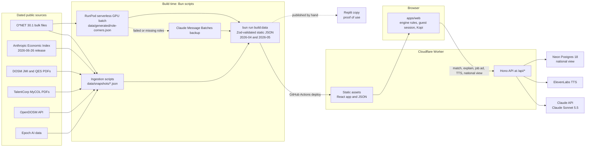

# Technical requirements

Kotak's technical specification: how the app is built, which data it uses, the exact engine rules, the API routes, the AI models and how it deploys. The builders work from it, and the team copies the [Technical Tools Declaration][td] from it ([#73]). It records decisions made in the [locked idea][kotak] and in issues #26 to #105, plus the hosting and database set-up of 22 October 2026; where a detail is not decided, it names the issue that owns it.

Contents:

1.  [Overview](#overview)
    1.  [Core rule: data decides, AI explains](#core-rule-data-decides-ai-explains)
    1.  [What AI may and may not do](#what-ai-may-and-may-not-do)
    1.  [Declaration crosswalk](#declaration-crosswalk)
1.  [System architecture](#system-architecture)
    1.  [Architecture summary](#architecture-summary)
    1.  [Components](#components)
    1.  [Data flow](#data-flow)
    1.  [Architecture diagram](#architecture-diagram)
    1.  [Client runtime](#client-runtime)
1.  [Stack](#stack)
    1.  [Languages, frameworks and libraries](#languages-frameworks-and-libraries)
    1.  [External APIs and cloud services](#external-apis-and-cloud-services)
1.  [Data sources](#data-sources)
    1.  [Datasets](#datasets)
    1.  [Licences and attribution](#licences-and-attribution)
    1.  [Four-layer hierarchy and fallbacks](#four-layer-hierarchy-and-fallbacks)
1.  [Engine](#engine)
    1.  [Engine schemas](#engine-schemas)
    1.  [Question order and levels](#question-order-and-levels)
    1.  [Verdict rules](#verdict-rules)
    1.  [Projections and scenarios](#projections-and-scenarios)
    1.  [Target level](#target-level)
    1.  [Fit score](#fit-score)
    1.  [Levels on matched roles](#levels-on-matched-roles)
    1.  [Gaps and roadmap order](#gaps-and-roadmap-order)
    1.  [What changed diff](#what-changed-diff)
    1.  [Static build](#static-build)
1.  [API routes](#api-routes)
    1.  [Rules for every route](#rules-for-every-route)
    1.  [Job match route](#job-match-route)
    1.  [Explanations route](#explanations-route)
    1.  [Job-ad extractor route](#job-ad-extractor-route)
    1.  [TTS route](#tts-route)
    1.  [National view routes](#national-view-routes)
    1.  [Health check](#health-check)
1.  [AI models](#ai-models)
    1.  [Models by task](#models-by-task)
    1.  [Claude Sonnet 5.5 request rules](#claude-sonnet-55-request-rules)
    1.  [Caching and pre-warming](#caching-and-pre-warming)
    1.  [Explanation verifier](#explanation-verifier)
    1.  [Batch generation and the Claude backup](#batch-generation-and-the-claude-backup)
1.  [Deployment and environments](#deployment-and-environments)
    1.  [Environments](#environments)
    1.  [Deploy pipeline](#deploy-pipeline)
    1.  [Data refresh](#data-refresh)
    1.  [Replit](#replit)
    1.  [RunPod](#runpod)
    1.  [Database](#database)
    1.  [Environment variables and secrets](#environment-variables-and-secrets)
1.  [Non-functional requirements](#non-functional-requirements)
    1.  [Accessibility](#accessibility)
    1.  [Viewports](#viewports)
    1.  [Performance and availability](#performance-and-availability)
    1.  [Privacy](#privacy)
    1.  [Privacy summary](#privacy-summary)
    1.  [Security](#security)
1.  [Known limitations and risks](#known-limitations-and-risks)
    1.  [Risk register](#risk-register)
    1.  [Limitations summary](#limitations-summary)
1.  [Traceability](#traceability)
1.  [See also](#see-also)

## Overview

Kotak shows a Malaysian worker which of their skills are rising or declining with AI, and what to do next. A cat counsellor, Kopi, asks 12 yes/no can-do questions. Kotak draws the user's 6 skill corners against what the role will need in 12 months, ranks 3 matched roles by fit score and builds a roadmap of free steps with a finish date. One button switches the Economic Index snapshot from April to May 2026, and the radar, verdicts, ranking and roadmap update. The [product flow][flow] and the [users][users] are in the locked idea.

[flow]: /docs/ideas/0007-kotak.md#product-flow
[users]: /docs/ideas/0007-kotak.md#users

### Core rule: data decides, AI explains

Fixed rules over dated, sourced data set every number and every verdict. AI only names, drafts and explains. The rule comes from CareerSphere's team: "the data decides; the AI interprets" ([winner teardowns][teardowns]). Every number on screen shows its source and its date.

Rules decide question order, levels, verdicts, targets, fit scores, role ranking, roadmap order, finish dates and the What Changed list. The engine functions that compute them make zero AI calls ([#37]).

[teardowns]: /docs/research/winner-teardowns.md

### What AI may and may not do

AI may:

- Group a job's own O\*NET tasks into 6 corners and name them. It may only use task IDs that belong to that occupation ([#74]).
- Draft the basic, working and advanced can-do statements, SDG tags, milestone time estimates and free-resource search links, in the batch ([#74]).
- Suggest the closest O\*NET occupation for a Malay or local job title. The user confirms it ([#43]).
- Write a 2-sentence explanation per corner and a short What Changed summary, citing the source names and dates it is given ([#43]).
- Pull skills from a pasted public job ad, as word-for-word quotes ([#48]).
- Voice Kopi's lines through text to speech ([#46]).

AI may not:

- Set or change a level, target, verdict, fit score, role rank, roadmap position or finish date ([#27]).
- Invent a task, job, course, statistic or quote. A claim without its source and date is a failure even if the app works ([anti-goals][anti-goals]).

Code enforces the boundary:

- A post-validator rejects batch output that references a task ID outside the occupation's own list ([#74]).
- A verifier rejects or strips any explanation that alters a verdict label or omits a dated citation, then falls back to a deterministic template ([#43]).
- The job-ad route keeps only quotes that appear word for word in the ad ([#48]).
- Every route validates its request and response with shared Zod schemas ([#27]).

### Declaration crosswalk

Copy each declaration section from the part of this document shown. The [declaration template][td] sets the word limits.

| Declaration section                   | Word limit | Source in this document                                                                              |
| ------------------------------------- | ---------- | ---------------------------------------------------------------------------------------------------- |
| 2.1 System architecture overview      | 200        | [Architecture summary](#architecture-summary) and the [diagram](#architecture-diagram)               |
| 2.2 Languages, frameworks & libraries | None       | [Languages, frameworks and libraries](#languages-frameworks-and-libraries)                           |
| 3.1 External APIs                     | None       | [External APIs and cloud services](#external-apis-and-cloud-services)                                |
| 3.2 Cloud platforms & deployment      | None       | [External APIs and cloud services](#external-apis-and-cloud-services), [Environments](#environments) |
| 4.1 AI models used in the solution    | None       | [Models by task](#models-by-task)                                                                    |
| 4.2 Datasets                          | None       | [Datasets](#datasets)                                                                                |
| 4.3 AI-assisted development tools     | 100        | Not in this document; [#73] collects it                                                              |
| 5 Sponsor-provided resources          | 100        | [Replit](#replit), [RunPod](#runpod), and the mentor session ([#98])                                 |
| 6.1 Data handling & privacy           | 150        | [Privacy summary](#privacy-summary)                                                                  |
| 6.2 Known limitations & risks         | 150        | [Limitations summary](#limitations-summary)                                                          |

## System architecture

### Architecture summary

This paragraph fits declaration section 2.1 (under 200 words).

Kotak is a web app. Before the demo, Bun scripts turn dated public data into static JSON: O\*NET 30.1, two Anthropic Economic Index snapshots (April and May 2026), DOSM Job Market Insights and Quarterly Employment Statistics, TalentCorp MyCOL, OpenDOSM and Epoch AI. A one-time batch on a RunPod serverless GPU groups each job's O\*NET tasks into 6 skill corners and drafts the can-do questions. The Claude Message Batches API fills any job that fails validation. A build step checks every file with Zod and fails if a number lacks a source or a date. GitHub Actions deploys one Cloudflare Worker. It serves the React app, the JSON snapshots and a Hono API. Fixed rules in the browser set every level, verdict, target, fit score and roadmap position. The API calls Claude Sonnet 5.5 to match local job titles, write cited explanations and read pasted job ads, and calls ElevenLabs for the cat's voice. It caches every answer. A Neon Postgres database stores anonymous check-ups for the national view. A copy runs on Replit for the proof of use.

### Components

| Component         | What it is                                                                                                                                  | Issues              |
| ----------------- | ------------------------------------------------------------------------------------------------------------------------------------------- | ------------------- |
| Bun monorepo      | Root workspaces for `apps/web`, `apps/api` and `packages/shared`, with shared TypeScript, lint and format scripts                           | [#29]               |
| `apps/web`        | React, Vite, Tailwind CSS, Recharts, Lucide and the Live2D cat. Runs the engine rules in the browser                                        | [#28], [#41]        |
| `apps/api`        | Hono routes for job match, explanations, job ads, TTS and the national view, with CORS middleware                                           | [#27]               |
| `packages/shared` | Zod schemas for engine data, guest session state and API payloads. Re-exports the engine schemas from [#40]                                 | [#29], [#40]        |
| Ingestion scripts | Bun scripts that write dated, validated files to `data/snapshots/`                                                                          | [#30]               |
| Engine module     | Pure TypeScript functions for verdicts, projections, targets, scoring, transfers, roadmaps and diffs. Runs at build time and in the browser | [#81], [#83], [#86] |
| Batch generator   | The corner and question prompt harness and its validator, run on a RunPod serverless GPU, with a Claude batch backup                        | [#74], [#77], [#79] |
| Static build      | `bun run build:data` joins everything into Zod-validated static JSON                                                                        | [#88]               |
| National view     | A Postgres table on Neon, its seed script and two Hono routes                                                                               | [#34]               |

Hono runs on the Cloudflare Workers runtime in production and on Bun locally and on Replit. Code in `apps/api` and in the engine module must therefore avoid Bun-only and Node-only APIs. Ingestion and build scripts run only under Bun.

### Data flow

1.  **Snapshot.** Ingestion scripts read each source, keep only the series the engine needs, attach source name, URL, vintage date and layer to every number, and write dated files to `data/snapshots/` ([#30]).
2.  **Generate.** The batch reads O\*NET tasks and writes `data/generated/role-corners.json`. Every role starts with `quality: "auto-generated"` ([#77]). The 3 demo roles are checked by hand and set to `"human-checked"` ([#104]).
3.  **Build.** `bun run build:data` joins roles, the alternate-title index, corners, the four-layer signals for `2026-04` and `2026-05`, and the demo diffs into static JSON. It fails on any missing source or date ([#88]).
4.  **Serve.** The Worker serves the app and the JSON as static assets. The app never runs ingestion or build scripts at runtime ([#28]).
5.  **Score.** The browser loads the active snapshot and runs the engine rules on the guest's answers ([#41]).
6.  **Explain.** The browser sends computed verdicts, levels and source metadata to the API. The API returns cited explanations and never changes a number ([#43]).
7.  **Aggregate.** A finished check-up posts its role code, 6 corner levels and date to Postgres ([#34], [#67]).
8.  **Refresh.** A scheduled workflow checks for new upstream releases, rebuilds the JSON and opens a commit or pull request with the snapshot diff ([#90]).

### Architecture diagram

[#56] exports this diagram as PNG or SVG for the README, PRD section 3.1 and declaration section 2.1.



### Client runtime

- **Guest session.** A Zod-validated `localStorage` store holds guest status, role code, goal, impact area, target role code, the 12 answers, follow-up answers, ticked milestones, custom weekly hours, pasted job-ad quotes, the TTS mute state and the active snapshot ID (`2026-04` or `2026-05`). A stored value that fails validation resets to clean defaults. A reset action clears the session ([#41]).
- **Snapshot loader.** It reads the precomputed slow and fast targets for the active snapshot, defaulting to April 2026, and calls the engine functions from [#83] for levels, fit scores, estimate labels and roadmap order. Switching to `2026-05` recomputes them synchronously ([#41]).
- **Screens.** Landing ([#54]), guest sign-in and dashboard ([#57]), check-up start and 12 questions ([#59]), Future Skills Radar ([#61]), matched roles ([#64]), roadmap ([#67]), What Changed and the demo switcher ([#69]), national view ([#72]) and the paste-a-job-ad panel ([#105]). The shell, transitions and the Loading, AI Error and No Match states are in [#51]. Kopi is in [#49].
- **Visual design.** `DESIGN.md` governs tokens, type, surfaces and components ([#31], [#32]).

## Stack

### Languages, frameworks and libraries

The issues pin no library versions. `bun.lock` records them once [#29] scaffolds the workspace. A dash means no version is set in the issues.

| Name                                                                  | Version | Purpose                                                               | Issues              |
| --------------------------------------------------------------------- | ------- | --------------------------------------------------------------------- | ------------------- |
| TypeScript                                                            | —       | The language of the app, API, engine and scripts                      | [#29]               |
| Bun                                                                   | —       | Package manager, workspaces, script runner and local server           | [#29]               |
| React                                                                 | —       | `apps/web` user interface                                             | [#29]               |
| Vite                                                                  | —       | `apps/web` build                                                      | [#29]               |
| Tailwind CSS                                                          | —       | Theme, tokens and utilities from `DESIGN.md`                          | [#32]               |
| Recharts                                                              | —       | Radar chart, readiness graph and national view charts                 | [#61], [#67], [#72] |
| Lucide                                                                | —       | The 60-icon registry                                                  | [#32]               |
| pixi-live2d-display, a PixiJS plugin                                  | —       | Renders the Live2D cat                                                | [#49]               |
| Live2D sample model Hijiki                                            | —       | Kopi the cat counsellor                                               | [#49]               |
| Hono                                                                  | —       | API routes, on the Workers runtime in production and on Bun elsewhere | [#27]               |
| Zod                                                                   | —       | Shared schemas for data files, session state and API payloads         | [#29], [#40]        |
| `@anthropic-ai/sdk`                                                   | —       | Claude Messages and Message Batches calls                             | [#43], [#79]        |
| Postgres on Neon                                                      | 18      | National view storage                                                 | [#34]               |
| Atkinson Hyperlegible Next, Atkinson Hyperlegible Mono, Shantell Sans | —       | Interface type, figures and Kopi's speech box                         | [#32]               |
| `cloudflare/wrangler-action`                                          | v4      | Deploy step in GitHub Actions ([deploy notes][deploy])                | [#62]               |
| RunPod serverless worker                                              | —       | vLLM, or an embedding and structured-output worker, for the batch     | [#77]               |

Licences go in `NOTICE.md` ([#47]). The repo docs state two of them: Lucide is ISC, and the Live2D model is under the Live2D Free Material License Agreement.

### External APIs and cloud services

| Service                       | Purpose                                                               | Access tier, plan or region                                                                                |
| ----------------------------- | --------------------------------------------------------------------- | ---------------------------------------------------------------------------------------------------------- |
| Anthropic Claude API          | Job-title match, explanations, job-ad extraction and the batch backup | Team API key; [#73] records the tier                                                                       |
| ElevenLabs Text to Speech API | Kopi's voice                                                          | A 34,000-credit budget ([deploy notes][deploy]); [#73] records the plan                                    |
| UN SDG API                    | Official target text and Malaysia's indicator 4.4.1 values            | Free, no key                                                                                               |
| OpenDOSM and data.gov.my API  | Malaysian labour and wage series                                      | Free, no key, 4 requests a minute                                                                          |
| Hugging Face Hub              | Economic Index files and new-release polling                          | Free, no key; anonymous limit of 3,000 resolver requests per 5 minutes                                     |
| O\*NET bulk downloads         | The occupation and task backbone                                      | Free, no key                                                                                               |
| Cloudflare Workers            | Hosts the app, the static JSON and the API                            | One Worker; the free plan allows 100,000 requests a day and 10 ms CPU per request ([deploy notes][deploy]) |
| GitHub Actions                | Deploys, data refresh and checks                                      | Repository workflows                                                                                       |
| Neon                          | Postgres 18 for the national view                                     | Project `kotak`, region `aws-ap-southeast-1`                                                               |
| Replit                        | A hand-published copy for the compulsory proof of use                 | Sponsor Replit Core, or the one free Starter app ([#99])                                                   |
| RunPod                        | Serverless GPU for the one-time batch                                 | Sponsor credit of US$25 per team ([brief][brief-credits])                                                  |

[brief-credits]: /docs/BRIEF.md#support-and-contacts

## Data sources

### Datasets

Every dataset is public or synthetic, and none holds personal data. Vintages and coverage come from the [trend data notes][trend], the [official demand notes][demand-official] and the [published demand notes][demand-published].

| Dataset                                      | Vintage used                                                                                                                                                                                                          | Malaysia coverage                                                                                                                                                                  | Issue        |
| -------------------------------------------- | --------------------------------------------------------------------------------------------------------------------------------------------------------------------------------------------------------------------- | ---------------------------------------------------------------------------------------------------------------------------------------------------------------------------------- | ------------ |
| O\*NET database                              | 30.1 for occupations, alternate titles, tasks, work activities and related roles; 30.3 Hot Technologies (May 2026) and 31.0 Emerging Tasks (late August 2026) on the same codes                                       | None: US O\*NET-SOC 2019 codes. About 893 occupations and about 56,500 alternate titles                                                                                            | [#44]        |
| O\*NET to ESCO and ISCO-08 crosswalk         | O\*NET's ESCO crosswalk; ESCO v1.2.1, updated 10 December 2025                                                                                                                                                        | Indirect, through ISCO-08                                                                                                                                                          | [#44]        |
| MASCO 2020 unit-group codes                  | 2020 edition; 4-digit codes attached by hand where title and code align                                                                                                                                               | Malaysia; about 300 of 490 unit groups line up with ISCO-08. Others carry `masco_unmatched: true`                                                                                  | [#44]        |
| Anthropic Economic Index                     | Release 2026-06-26 (`aei_claude_ai_2026-06-26.csv`, 219 MB), months April and May 2026, filtered to `MYS`, `SGP` and `GLOBAL`                                                                                         | Usage share for 198 Malaysian occupations in April and 243 in May. The automation and augmentation split only for 20 major groups and for work activities (20 in April, 23 in May) | [#50]        |
| DOSM Big Data Analytics: Job Market Insights | Quarterly, Q3 2019 (74,018 offerings) to Q2 2026 (555,509)                                                                                                                                                            | Online job offerings from private recruitment platforms, by major occupation group and top named roles                                                                             | [#52]        |
| DOSM Quarterly Employment Statistics         | Quarterly, Q1 2015 to Q2 2026; the Q2 2026 release is dated 13 August 2026                                                                                                                                            | Vacancies and jobs created by 5 economic activities and 3 skill categories                                                                                                         | [#55]        |
| TalentCorp MyCOL                             | Editions 2015/16 to 2024/25; 2024/25 lists 66 occupations across 18 sectors                                                                                                                                           | Critical occupations by 4-digit MASCO code. List scope changes between editions                                                                                                    | [#60]        |
| OpenDOSM series                              | `employment_sector` 2001 to 2025; `wages_occupation` 2010 to 2025, updated 21 September 2026; `wages_skill` 2010 to 2025; `lfs_qtr_sru_sex` 2017 Q1 to 2026 Q2; `lfs_qtr_sru_age`; `lfs_month`, latest row 2026-08-01 | Malaysia, by sector, major occupation group and skill category                                                                                                                     | [#63]        |
| Epoch AI data                                | October 2026: models (16 October) and benchmarks (19 October)                                                                                                                                                         | Global only                                                                                                                                                                        | [#66]        |
| UN SDG API                                   | Indicator 4.4.1 for Malaysia, 2015 and 2017 to 2024                                                                                                                                                                   | Malaysia, for indicator 4.4.1                                                                                                                                                      | [#47], [#58] |
| GitHub Innovation Graph, optional            | `MY` languages 2020 Q1 to 2026 Q1; topics 2021 Q1 to 2026 Q1                                                                                                                                                          | Malaysia, developer activity only                                                                                                                                                  | [#95]        |
| Synthetic profiles and sample rows           | Made by the team, labelled as samples                                                                                                                                                                                 | Not applicable                                                                                                                                                                     | [#34], [#88] |

JobStreet is not a source. Its terms ban automated collection, and DOSM's Job Market Insights already counts ads from the major private platforms ([live extras][extras]).

### Licences and attribution

Each licence fact below comes from the research notes or [#47]. Where they differ, both are given. `NOTICE.md` carries the full credit lines ([#47]).

- **O\*NET**: CC BY 4.0, with a fixed credit line and a modification notice for any change ([trend data notes][trend]). The notes quote the credit as "includes information from the O\*NET 31.0 Database … Used under the CC BY 4.0 license. O\*NET® is a trademark of USDOL/ETA". The credit names the database version used. The backbone is 30.1 ([#44]); [#47] writes the credit for 31.0. The ingestion script puts the credit and the modification notice in the emitted metadata header ([#44]).
- **ESCO**: free reuse for any purpose, provided "The use of ESCO shall be acknowledged by publishing the statement" from the ESCO FAQ ([trend data notes][trend]).
- **MASCO 2020**: "No part of this publication may be reproduced" (Ministry of Human Resources). Kotak stores only hand-checked codes, not a parsed copy ([trend data notes][trend]).
- **Anthropic Economic Index**: the README says "Data released under CC-BY, code released under MIT License", with no CC BY version; the YAML metadata says MIT ([trend data notes][trend]). [#47] writes "CC BY 4.0 / MIT". Credit Anthropic.
- **DOSM Quarterly Employment Statistics**: DOSM's terms allow commercial and non-commercial reuse with the exact attribution "Data source: Department of Statistics Malaysia." Every emitted record carries it ([official demand notes][demand-official], [#55]).
- **DOSM Job Market Insights**: DOSM copyright, and no open reuse licence was found ([published demand notes][demand-published]). Kotak extracts only the figures it needs and cites each with its release title, quarter, URL and a DOSM copyright citation ([#52]).
- **TalentCorp MyCOL**: no open data licence; the TalentCorp site says all rights reserved ([official demand notes][demand-official]). Kotak stores codes, edition presence and citations only ([#60]).
- **OpenDOSM**: CC BY 4.0 ([#63]).
- **Epoch AI**: "Creative Commons Attribution", version not stated ([trend data notes][trend]). The snapshot carries the credit and the retrieval date ([#66]).
- **UN SDG API**: the repo notes state no licence. [#47] adds its credit.
- **GitHub Innovation Graph**: CC0-1.0 ([#95]).
- **Lucide**: ISC ([#47]).
- **Live2D sample model Hijiki**: the Live2D Free Material License Agreement. Clause 4.1.1 says "the Customer may not Redistribute all or part of the Material to third party". The team accepted this risk on 22 October and credits Live2D Inc. in `NOTICE.md` ([mascot][mascot], [#47]).

No restricted dataset is committed as raw data ([#47]).

[mascot]: /docs/ideas/0007-kotak.md#mascot

### Four-layer hierarchy and fallbacks

Each layer has its own signal. For a given role, the engine collects only the layers at and above it ([#71]).

| Layer               | Signal                                             | Sources                                                                                                           |
| ------------------- | -------------------------------------------------- | ----------------------------------------------------------------------------------------------------------------- |
| 1. Sector           | Where money goes                                   | DOSM QES vacancies by sector; OpenDOSM `employment_sector`                                                        |
| 2. Occupation group | Job data with history; Malaysia's automation split | DOSM Job Market Insights by major group; Economic Index rows for 20 SOC major groups; OpenDOSM `wages_occupation` |
| 3. Role             | AI exposure, shortages, demand                     | Economic Index detailed-occupation usage; MyCOL editions; roles named in Job Market Insights                      |
| 4. Skill            | What employers ask for                             | O\*NET tasks and work activities; Economic Index work-activity and task rows; pasted job ads (visitor only)       |

Fallback rules:

1.  **Borrow and label.** When a layer has no Malaysian data, the engine borrows from the layer above, or uses global data, and labels the borrowed value ([#71]).
2.  **AI use on a corner.** Use the finest level published: task, then work activity, then detailed occupation, then major occupation group. Use Malaysia (`MYS`) first, then `GLOBAL`. Attach a fallback label whenever a higher layer or a global row is used ([#71]). The locked idea's chain stops at occupation; [#71] adds the major group.
3.  **How AI is used.** The automation and augmentation split for `MYS` exists only for work activities and major groups, so it resolves at work-activity level first, then major group, then `GLOBAL`, labelled ([trend data notes][trend]).
4.  **Role demand**, in order: the role's own count where Job Market Insights names it among a quarter's top roles; the role's presence across MyCOL editions, 2015/16 to 2024/25; its occupation group's Job Market Insights series; otherwise `Unknown`, which adds 0 to the target ([#71]).
5.  **Missing is not zero.** A suppressed Economic Index cell is stored as `null`, not `0` ([#50]).

Until skill-level demand history exists, each corner takes its role's demand direction. Corners differ through their AI data, not their demand. No open Malaysian series tracks demand for single skills ([engine][engine]).

Layer 1 and the OpenDOSM series are shown as context. The verdict uses only the three inputs in [Verdict rules](#verdict-rules). The optional signals in [#95] are labelled as developer or research activity and never override the demand fallback. The locked idea also lists Bursa sector indexes as Layer 1 context; no issue ingests them.

[engine]: /docs/ideas/0007-kotak.md#layered-hierarchy

## Engine

The engine is pure TypeScript. It runs at build time and in the browser, so the scenario toggle and the snapshot switch update the radar at once ([#81]). The rules below come from the [locked idea][kotak] and [#81], [#83] and [#86]; they agree unless a note says otherwise.

### Engine schemas

[#40] defines Zod schemas and types for:

- **Source files**: O\*NET occupations, alternate titles, tasks, intermediate and broad work activities, related roles, and ISCO and MASCO crosswalk rows.
- **Dated signal snapshots**: Economic Index rows, Job Market Insights quarters (`DosmDemandSchema`, [#52]), QES sector rows, OpenDOSM series, MyCOL editions (`MyColSchema`, [#60]) and Epoch AI context.
- **Batch output** (`RoleCornersSchema`, [#77]): up to 6 corners, the basic, working and advanced can-do statements, SDG tags, free resources, hour estimates and a quality label.
- **Engine output**: verdicts, slow and fast targets, fit-score breakdowns, What Changed diffs and provenance citations.

Field rules:

- Every numeric signal requires `source_name`, `source_url`, `vintage_date` and `geo_or_layer`. Undated records fail ([#40]).
- Projected values carry `is_estimate: true` ([#81]).
- Occupations without a verified MASCO match carry `masco_unmatched: true` ([#44]).
- The quality label is `"auto-generated"` or `"human-checked"` ([#77], [#104]).

### Question order and levels

The cat asks 2 yes/no questions for each of the 6 corners: 12 in all. The corners belong to the current role, or to the target role when the goal is "pivot with a target". Rising corners come first ([#59], [#83]).

Each corner has a basic, a working and an advanced can-do statement. The working statement comes first.

| First answer (working) | Second question | Second answer | Level |
| ---------------------- | --------------- | ------------- | ----- |
| Yes                    | Advanced        | Yes           | 3     |
| Yes                    | Advanced        | No            | 2     |
| No                     | Basic           | Yes           | 1     |
| No                     | Basic           | No            | 0     |

The radar labels these levels "self-reported" ([#61]).

### Verdict rules

Each corner gets three inputs from dated snapshots:

1.  **AI use on the corner**: the Economic Index usage share for the corner's tasks, resolved by the [fallback rules](#four-layer-hierarchy-and-fallbacks). It counts as rising when its projected 12-month change is more than 5%.
2.  **How AI is used**: mostly augmentation (people work with AI) or mostly automation (AI does the work), from the Economic Index collaboration split.
3.  **Demand for the role**: up, flat or down, from the demand fallback. Job Market Insights directions come from quarter-on-quarter and year-on-year changes ([#52]).

| AI use on the corner | How AI is used | Demand | Verdict                     |
| -------------------- | -------------- | ------ | --------------------------- |
| Rising               | Augmentation   | Any    | Rising: AI helps it scale   |
| Rising               | Automation     | Any    | Declining because of AI     |
| Not rising           | Any            | Up     | Rising: AI can't do it yet  |
| Not rising           | Any            | Flat   | Steady                      |
| Not rising           | Any            | Down   | Declining for other reasons |

Two more states:

- **Split**: the slow and fast scenarios give different verdicts, or sources point opposite ways. A Split corner returns and shows both futures.
- **Unknown**: fewer than two dated points. The app always shows it.

The status chips show five states: Rising, Steady, Declining, Split and Unknown ([#36]).

### Projections and scenarios

- **Horizon**: each trend runs 12 months ahead. Every projected value is labelled an estimate ([#81]). The radar labels the red line "Needed by Oct 2027" ([#61]), 12 months from today, while the latest data month is May 2026.
- **Slow**: keeps Malaysia's current pace of AI use.
- **Fast**: moves Malaysia halfway to Singapore's level, which raises every corner's projected AI-use growth.
- **Anchors**: kymil4's notes give May 2026 usage-per-capita indexes of 5.81 for Singapore and 0.87 for Malaysia. [#50] re-checks both against the release file before the engine uses them.
- **Formula**: the exact projection formula, within these rules, belongs to [#81].
- **AI advancement**: the Economic Index is the main signal. One dated line from Epoch AI adds what frontier models can now do ([#66]).

### Target level

The red line on the radar draws the target. Every new snapshot and the scenario toggle move it ([#81]).

```text
target = clamp(2.0 + ai_effect + demand_effect, 1.0, 3.0)

ai_effect     in [-1.0, +1.0]; its size grows with the corner's projected AI-use growth
              positive for augmentation, negative for automation
demand_effect = +0.5 if demand is up
                 0   if demand is flat or Unknown
                -0.5 if demand is down
```

The scaling curve of `ai_effect` within its bounds belongs to [#81]. The verdict labels still come from the [verdict table](#verdict-rules), not from the target.

### Fit score

```text
fit_score = sum over corners of min(user_level, target_level)
            / sum over corners of target_level
            x 100
```

The function returns the numerator, the denominator and each corner's term, so tapping the score shows the maths ([#83], [#64]).

### Levels on matched roles

Matched and backup roles come from O\*NET's related-occupations list, ranked by fit score. The screen shows 3 ranked roles. For "stay strong" it becomes "Your Job's Future": the current role, then 2 backup roles ([#64]).

A matched role reuses the 12 answers where its corners overlap the answered ones. The engine tries these rules in order ([#83]):

1.  The same intermediate work activity as an answered corner, weighted by shared task links. Label: "estimated from your answers".
2.  The same broad work activity. Label: "rough estimate".
3.  Otherwise level 0. Label: "not asked yet".

Across each job's 3 most related O\*NET roles, the first rule covers a median 44% of a matched role's task links, and the first two a median 73% (lower quartile 57%). When the user picks a role, the cat asks only its "not asked yet" corners, so the chosen role is fully covered ([#64]).

### Gaps and roadmap order

```text
gap_size  = target_level - user_level, for each corner where user_level < target_level
weeks     = total_hours / weekly_hours
```

- **Order**: rising gaps first, largest first; then Steady, Split and Unknown; Declining last, tagged "less important by 2027" ([#83]).
- **Milestone**: the next can-do statement, done for real, with an AI-drafted time estimate and one free resource: a guide, a video, a community or an HRD Corp-claimable programme ([#67]). The [context notes](/docs/CONTEXT.md#what-this-means-for-us) advise never calling a course "HRD Corp-claimable", because no working public list of claimable programmes exists. [#104] curates verified resources for the demo roles.
- **Weekly hours**: the default comes from part of the time AI could save the user on declining tasks, the AI dividend. The user can edit it, and the finish date updates at once ([#67], [#83]).
- **Length**: the finish date comes from total hours divided by weekly hours. [#28] and [#67] also call the roadmap "12-week", which this formula does not fix.
- **Practice project**: follows the user's impact area. Every corner and role has at least one SDG tag ([#67]).
- **Ticking**: the user ticks a milestone when they can honestly say yes to it. That raises the corner's level and updates the fit score and the readiness graph ([#67]).

### What changed diff

`diffSnapshots(role, userAnswers, prevSnapshot, nextSnapshot, scenario)` is a pure function. It compares corner AI use, targets, verdicts, matched-role fit scores and roadmap positions ([#86]).

Each diff item holds the corner name, old and new verdict, old and new target, old and new roadmap rank, and the dated source citation. Every item has before and after values, source names and snapshot dates ([#86]).

The demo roles come from a scan of the O\*NET catalogue between `2026-04` and `2026-05`. Only occupations where the real May data flips at least one corner verdict qualify ([#86]). The What Changed screen shows each changed corner with its old verdict, new verdict and cited source ([#69]).

### Static build

- **Command**: `bun run build:data`, in `scripts/build-data.ts` ([#88]).
- **Inputs**: O\*NET roles, the alternate-title search index, the corner batch output, the four-layer signals for `2026-04` and `2026-05`, and the demo role diffs.
- **Checks**: Zod validation of every file. The build exits non-zero if a number lacks a source URL or date, or if a demo role no longer flips a verdict.
- **Speed**: under 30 seconds.
- **Seed rows**: the build also writes labelled synthetic aggregates for the national view, at least 10 per occupation group ([#88]). They never count toward the 10-check-up threshold, which counts only rows where `is_sample = false` ([#34]). [#88] says the seed rows let "k-anonymity thresholds pass"; [#34] governs.
- **File budget**: each Economic Index snapshot file stays under 2 MB ([#50]).

## API routes

### Rules for every route

- **Validation**: Zod schemas from `packages/shared` validate every request and response ([#27]).
- **No numbers from AI**: AI routes never generate or alter a level, target, fit score or verdict ([#27]).
- **Keys**: API keys live on the server. They never reach the browser ([#46]).
- **Errors**: a failed AI call shows the AI Error state, with Kopi's error pose, a plain explanation, a retry button and the cached or deterministic fallback ([#51]).

### Job match route

- **Route**: `POST /api/roles/match` ([#43]).
- **Input**: a job title, in English, Malay or a local form.
- **Logic**: search O\*NET 30.1 titles and alternate titles first. When there is no exact match, ask Claude Sonnet 5.5 for the closest O\*NET occupation.
- **Output**: the matched occupation. An AI suggestion carries `needs_confirmation: true`, and the start screen shows a confirmation card and the "auto-generated" badge for unchecked roles ([#59]).
- **Acceptance**: "Jurutera Perisian" and "akauntan" return the closest O\*NET occupation with `needs_confirmation: true`.
- **Caching**: see [Caching and pre-warming](#caching-and-pre-warming).
- **Failure**: the No Match state offers the AI closest-role suggestion or popular Malaysian roles ([#51]).

### Explanations route

- **Route**: `POST /api/explanations` ([#43]).
- **Input**: the computed corner verdicts, user and target levels, and dated source metadata.
- **Output**: a 2-sentence explanation per corner and a short What Changed summary. Each cites the exact source names and dates it was given.
- **Checks**: the [explanation verifier](#explanation-verifier).
- **Failure**: the deterministic template. If the Claude API is overloaded, the app serves the cached answer with a cached label ([#78]).

### Job-ad extractor route

- **Route**: `POST /api/job-ad/extract` ([#48], [#105]).
- **Input**: the text of a pasted public job ad.
- **Output**: the skills Claude finds, each with its quote. Code drops every quote that does not appear word for word in the ad.
- **Scope**: results stay in that visitor's view and change no one else's verdicts. Shared evidence would need a person to approve each ad, which the prototype skips ([live extras][extras]).
- **Caching**: by a hash of the ad ([#48]).
- **Failure**: the panel is optional; the check-up continues without it ([#105]).

### TTS route

- **Route**: `POST /api/tts` ([#49], [#46]).
- **Input**: one of Kopi's lines.
- **Output**: audio. The client plays it when unmuted and cancels playback at once on mute or screen change ([#49]).
- **Models**: fixed lines are pre-generated with `eleven_v4` and audio tags and served as static MP3 files. Live lines use `eleven_v4_turbo` over the dialogue WebSocket. The fallback streams `eleven_v4` over HTTP with `POST /v1/text-to-speech/{voice_id}/stream`, always sending `model_id` ([deploy notes][deploy], [#46]).
- **Voice**: designed with ElevenLabs Voice Design ([deploy notes][deploy]). Avoid voices with a 2x credit multiplier.
- **Caching**: by a hash of text, voice and model ([#46]).
- **Failure**: a clear error, so the UI falls back to text only ([#46]).

### National view routes

The table `national_checkups` stores only `id`, `onet_role_code`, `corner_levels` (JSONB of 6 numbers from 0 to 3), `is_sample` (boolean) and `created_date` (date). It holds no names, user IDs or free text ([#34]).

- **`POST /api/national-view/checkups`**: records a finished check-up. The Zod schema rejects any payload with extra personal fields. It stores only role code, 6 corner levels and date ([#34]). The roadmap screen posts it when the check-up finishes ([#67]).
- **`GET /api/national-view/summary`**: aggregates rising skill gaps by role and occupation group. It returns real averages only when `COUNT(*) >= 10` over rows where `is_sample = false`. Otherwise it returns the labelled sample rows with `is_sample: true`. Once 10 real rows exist for a role code, it returns the real aggregate with `is_sample: false` ([#34]).
- **Screen**: filters by major occupation group or demo role. It shows the badge "Shown only for groups of 10 or more anonymous check-ups" and tags seed-backed groups "Sample Data (until n >= 10)". No single check-up row or identifier ever appears in the UI or a network response ([#72]).
- **Seed**: a seed script inserts labelled sample rows for the demo occupations and groups ([#34]).

### Health check

The deploy workflow's smoke check calls a live health endpoint and a static data file to confirm the app is awake ([#62]). [#62] names the paths.

## AI models

### Models by task

| Task                                                                          | Model                                                                           | Mode                           | Issues       |
| ----------------------------------------------------------------------------- | ------------------------------------------------------------------------------- | ------------------------------ | ------------ |
| Corners, can-do statements, SDG tags, hours, resource links, title embeddings | An open-weights model on a RunPod serverless GPU; [#77] names the model and GPU | One batch before the demo      | [#74], [#77] |
| Backup for occupations that fail validation or are missing                    | Claude, through the Message Batches API; [#79] names the model                  | Batch, on demand               | [#79]        |
| Local and Malay job titles to the closest O\*NET occupation                   | Claude Sonnet 5.5 (`claude-sonnet-5-5`)                                         | Live, cached                   | [#43]        |
| Corner explanations and the What Changed summary                              | Claude Sonnet 5.5 (`claude-sonnet-5-5`)                                         | Live, cached, verified         | [#43]        |
| Skills from a pasted job ad                                                   | Claude Sonnet 5.5 (`claude-sonnet-5-5`)                                         | Live, cached by ad hash        | [#48]        |
| Kopi's voice                                                                  | ElevenLabs `eleven_v4` (fixed lines) and `eleven_v4_turbo` (live lines)         | Pre-generated and live, cached | [#46]        |

All models are pre-trained and used as provided. None is fine-tuned or self-trained. The team chose live Claude calls through the Claude API on 22 October ([decisions][decisions]). The same day it moved from Claude Opus 5.5 to Claude Sonnet 5.5 for speed and cost.

[#77] also makes multilingual title embeddings in the batch. The job match route in [#43] searches titles and then asks Claude; it does not use the embeddings.

[decisions]: /docs/ideas/0007-kotak.md#decisions-so-far

### Claude Sonnet 5.5 request rules

These rules come from Anthropic's [models overview][models] and [migration guide][migration]:

- **Model ID**: `claude-sonnet-5-5`, with no date suffix.
- **Sampling**: Claude Sonnet 5.5 rejects non-default `temperature`, `top_p` and `top_k` values with HTTP 400. The issues ask for `temperature: 0` ([#43], [#79]). Requests leave these fields out. Repeatable answers come from the response cache and the verifier, not from sampling settings.
- **Thinking**: adaptive by default, and Kotak leaves it on. `output_config.effort` defaults to `high`, so each route sets it: `low` for title matching, where the user waits, and `medium` for explanations, which load in the background.
- **Structured output**: use `output_config.format` for JSON. Forced tool use (`tool_choice` of `any` or `tool`) returns HTTP 400.
- **Overload**: the API returns `529 overloaded_error` when it is "temporarily overloaded" ([errors][errors]). The routes then serve cached, labelled answers.

[models]: https://platform.claude.com/docs/en/about-claude/models/overview
[migration]: https://platform.claude.com/docs/en/about-claude/models/migration-guide
[errors]: https://platform.claude.com/docs/en/api/errors

### Caching and pre-warming

- **Claude responses**: keyed by a SHA-256 hash of the normalised request payload, in memory and in a persistent store ([#43]). The Workers runtime has no persistent local disk, so [#43] picks a store that runtime supports.
- **Repeat speed**: an identical request returns the cached payload in under 50 ms without calling the Anthropic API ([#43]).
- **Job ads**: keyed by a hash of the ad ([#48]).
- **Audio**: keyed by a hash of text, voice and model ([#46]).
- **Pre-warming**: the cache is filled for the 2 or 3 demo roles before the demo, and Kopi's fixed lines are pre-generated, so the live demo never waits on an external API ([#43], [#46]).

### Explanation verifier

After each generation, the verifier checks every explanation ([#43]):

1.  It rejects or strips any text that alters a verdict label.
2.  It rejects or strips any text that omits a dated citation.
3.  On rejection, it returns a deterministic template built from the same verdict, levels and sources.

The explanation never changes a numeric score or a verdict ([#43]).

### Batch generation and the Claude backup

1.  **Group.** For each occupation, group its core tasks by intermediate work activity (IWA). The 50 occupations with fewer than 6 core IWA groups add supplemental tasks or show fewer corners ([#74]).
2.  **Merge or split.** The model splits or merges uneven groups into 6 readable corners, using only task IDs that belong to that occupation. For graphic designers, 10 of 17 core tasks fall in one IWA ([#74]).
3.  **Draft.** For each corner: exactly 3 tiered can-do statements (`basic`, `working`, `advanced`), at least one SDG target tag (such as 4.4, 8.2 or 8.5), a milestone time estimate and free-resource search links ([#74]).
4.  **Validate.** A post-validator rejects any output that references a task ID outside the occupation's own list. Every corner must map to the occupation's own task IDs and IWA codes ([#74]).
5.  **Run.** A RunPod serverless GPU worker runs the batch across the O\*NET catalogue and writes `data/generated/role-corners.json` ([#77]).
6.  **Back up.** A Bun script on the Message Batches API runs the same prompt and validator for any missing or failed occupation, for any subset of O\*NET codes ([#79]).
7.  **Check.** People hand-check the 3 demo occupations, set `quality: "human-checked"` and curate verified free resources ([#104]). A law reviewer checks the legal roles ([#91]). All other roles stay `"auto-generated"` and the app labels them so.

## Deployment and environments

### Environments

| Environment | Where                                                             | Purpose                                               | Issues        |
| ----------- | ----------------------------------------------------------------- | ----------------------------------------------------- | ------------- |
| Local       | A developer machine with Bun                                      | `bun install`, `cp .env.example .env`, `bun run dev`  | [#76]         |
| Production  | One Cloudflare Worker, deployed by GitHub Actions                 | The live prototype link for judges                    | [#62]         |
| Preview     | Pull request previews, if the host supports them at no extra cost | Optional review builds                                | [#65]         |
| Replit      | The team's Replit account, published by hand                      | Compulsory proof of use only                          | [#68], [#102] |
| Batch GPU   | A RunPod serverless endpoint                                      | The one-time corner and question batch, and its proof | [#77], [#70]  |
| Database    | Neon Postgres 18, project `kotak`, region `aws-ap-southeast-1`    | The national view                                     | [#34]         |

This set-up, fixed on 22 October, replaces the Replit Reserved VM plan in [#65], [#68] and [#99]. The live link is the Cloudflare Worker; Replit holds only the proof-of-use copy.

### Deploy pipeline

`.github/workflows/deploy.yml` runs on push to `main` and on `workflow_dispatch` ([#62]):

1.  Install Bun.
2.  Run typecheck and tests.
3.  Build the Vite frontend and the Hono server bundle.
4.  Deploy with `cloudflare/wrangler-action@v4`, using the `CLOUDFLARE_API_TOKEN` and `CLOUDFLARE_ACCOUNT_ID` secrets. The token uses the "Edit Cloudflare Workers" template.
5.  Run the post-deploy smoke check against the live link.

Worker routing ([deploy notes][deploy]):

- One Worker serves the Vite build and the API.
- `not_found_handling = "single-page-application"` sends unknown paths to the app.
- `run_worker_first = ["/api/*"]` sends API paths to Hono.
- Static asset requests are free and unlimited.

Who can ship: any member with write access, by merging to `main` or by clicking "Run workflow". Secrets are not passed to workflows triggered from a fork, except `GITHUB_TOKEN` ([deploy notes][deploy]).

### Data refresh

`.github/workflows/refresh-data.yml` runs on a weekly `schedule` and on `workflow_dispatch` ([#90]):

1.  Poll the Hugging Face tree API for new `release_*` folders in `Anthropic/EconomicIndex`.
2.  Run the OpenDOSM and Epoch AI ingestion scripts. OpenDOSM calls stay at 4 requests a minute or fewer, with exponential backoff on HTTP 429 ([#63]).
3.  Run `bun run build:data` and validate every snapshot.
4.  When upstream data changed, open a commit or pull request with the snapshot diff summary.

The team pauses every workflow that pushes commits before the repository freeze at 7:59:59 AM MYT on 25 October 2026 ([#89]).

### Replit

Replit is compulsory, and proof must come from the team's own account ([brief][brief-rules]). The team publishes a copy on Replit by hand for that proof ([#68]):

- `.replit` at the repository root installs dependencies and starts the Bun server and the frontend.
- Replit Secrets hold the runtime variables, by the names in `.env.example`.
- Screenshots show the account name, the project URL, the run or version history, the Secrets names and the running app ([#68]). [#102] compiles them into `submission/REPLIT PROOF OF USE.pdf`.
- Plan: Replit Core from the sponsor code, if [#99] gets a working code and [#100] redeems it. Otherwise the one free Starter app, which "Includes 1 free published app. The deployment expires after 30 days" ([deploy notes][deploy], [#99]).

### RunPod

Any GPU work must run on RunPod, proved by a screenshot of the Pod ID or endpoint URL, the GPU type and the runtime ([brief][brief-rules]).

- The batch runs on a RunPod serverless GPU endpoint ([#77]).
- The handler code lives in `runpod/` and matches the workload in the README and the declaration ([#70]).
- Proof shows the endpoint, GPU type, worker logs, runtime and cost ([#77], [#70]). [#70] compiles `submission/RUNPOD PROOF OF USE.pdf` with an example `curl` command.

### Database

- Neon Postgres 18, project `kotak`, region `aws-ap-southeast-1`.
- `DATABASE_URL` holds Neon's pooled connection URL.
- The Postgres driver must run on the Workers runtime; [#34] picks it.

### Environment variables and secrets

Names only. Real values never enter the repository, `.env.example` or any submission document.

| Name                    | Used by                                   | Stored in                                                             | Status                                  |
| ----------------------- | ----------------------------------------- | --------------------------------------------------------------------- | --------------------------------------- |
| `ANTHROPIC_API_KEY`     | Claude routes and the batch backup script | GitHub repository secret; Worker secret; Replit Secrets; local `.env` | Set as a repository secret              |
| `ELEVENLABS_API_KEY`    | The TTS route and the line pre-generation | Same as above                                                         | Set as a repository secret              |
| `ELEVENLABS_VOICE_ID`   | The TTS route                             | Same as above                                                         | Named in [#53]                          |
| `DATABASE_URL`          | The national view routes                  | Same as above; Neon's pooled connection URL                           | Set as a repository secret              |
| `CLOUDFLARE_API_TOKEN`  | The deploy workflow                       | GitHub repository secret                                              | Set; "Edit Cloudflare Workers" template |
| `CLOUDFLARE_ACCOUNT_ID` | The deploy workflow                       | GitHub repository secret                                              | Set                                     |
| `RUNPOD_API_KEY`        | The batch script                          | GitHub repository secret; local `.env`                                | Added once the [#77] endpoint exists    |
| `RUNPOD_ENDPOINT_ID`    | The batch script                          | GitHub repository secret; local `.env`                                | Added once the [#77] endpoint exists    |

Rules:

- `.env.example` at the repository root lists placeholder names only ([#53]).
- `.gitignore` excludes `.env`, `.env.*` and local secret files ([#53]).
- Runtime keys reach the Worker as Worker secrets, never as client code ([deploy notes][deploy]).
- Scope the ElevenLabs key to text to speech with a credit quota ([deploy notes][deploy]).
- Before the repository goes public, scan the working tree and the full history for keys, `.env` files and credentials ([#103]).

## Non-functional requirements

### Accessibility

Kotak meets WCAG 2.2 AA in light and dark themes ([#75]):

- Contrast of at least 4.5:1 for normal text and 3:1 for large text and UI graphics.
- The whole flow, from Landing to What Changed, works with the keyboard alone: tab order, Enter and Space, and Escape on dialogs.
- Screen readers announce corner names, user levels, target levels and verdicts on the radar. The radar and the readiness graph have ARIA labels and visually hidden summary tables.
- Every control and chip has a visible focus ring and ARIA attributes ([#36]).
- The landing page scores 95 or more for accessibility in Lighthouse ([#54]).

Reduced motion: `prefers-reduced-motion`, or the in-app toggle, replaces the Live2D animation with static pose art and instant text, and replaces the box-opening transition with a simple fade ([#49], [#51], [#75]).

### Viewports

Every screen works at 390 px (phone) and 1440 px (desktop). Desktop shows a persistent sidebar and top bar; phone moves navigation into an accessible drawer ([#51]). Screens ask for one decision at a time ([#59]).

### Performance and availability

| Requirement                                            | Target           | Issue |
| ------------------------------------------------------ | ---------------- | ----- |
| A guest reaches a sourced roadmap                      | Under 3 minutes  | [#28] |
| An identical Claude request is served from cache       | Under 50 ms      | [#43] |
| Alternate-title lookup for common English titles       | Under 5 ms       | [#44] |
| `bun run build:data`                                   | Under 30 seconds | [#88] |
| Each Economic Index snapshot file                      | Under 2 MB       | [#50] |
| A teammate boots the app from the README's local steps | Under 5 minutes  | [#76] |

- **Live link**: the link must load without cold-start failures and stay up through judging ([#33]). The post-deploy smoke check confirms it after each deploy ([#62]). A remote smoke test from another network and device runs the judge path before submission ([#94]).
- **No live dependency for the demo**: scores, verdicts and the snapshot switch run in the browser from static JSON. Demo explanations and fixed voice lines are pre-warmed.
- **Worker limits**: the free plan allows 100,000 requests a day and 10 ms of CPU per request, not counting network waits ([deploy notes][deploy]). Heavy work stays in the browser and the build.

### Privacy

- **Guest only.** Email and password fields are disabled; only "Sign In as Guest" works ([#57]).
- **Local state.** The check-up lives in the browser's `localStorage` ([#41]).
- **No personal data.** No CV upload, no real CVs and no free-text profile. The demo uses synthetic profiles only ([non-goals][anti-goals]).
- **Anonymous aggregates.** The national view stores only role code, 6 corner levels and date, and shows totals only for groups of 10 or more real check-ups ([#34]).
- **Third parties.** A typed job title and a pasted public job ad go to the Anthropic API. Kopi's lines go to ElevenLabs as text.

### Privacy summary

This paragraph fits declaration section 6.1 (under 150 words).

Kotak has no accounts. Users sign in as a guest, and their check-up stays in the browser's local storage until they reset it. Kotak asks for no name, email, CV or free-text profile, and the demo uses synthetic profiles only. A finished check-up sends only the role code, 6 corner levels from 0 to 3 and the date to a Postgres database on Neon. It stores no names, IDs or free text. The national view shows totals only for groups of 10 or more real check-ups and labels sample rows. A typed job title or a pasted public job ad goes to the Anthropic API to find a role or skills. The result is cached by a hash and changes no other user's results. The cat's lines go to ElevenLabs as text. API keys stay in server secrets and never reach the browser or the repository.

### Security

- No API keys, passwords or credentials in the code, the prototype or any document ([#53], [#103]).
- Keys stay on the server; the browser calls only Kotak's own API ([#46]).
- Every route rejects payloads that fail its Zod schema ([#27]).
- Rendered job-ad quotes are text found in the visitor's own ad, checked word for word ([#48]).

## Known limitations and risks

### Risk register

| Risk                                                                           | Effect                                    | Mitigation or fallback                                                                                  | Issues               |
| ------------------------------------------------------------------------------ | ----------------------------------------- | ------------------------------------------------------------------------------------------------------- | -------------------- |
| The Claude API is overloaded (`529`) or down                                   | Explanations and title matches stall      | Cached, labelled answers; the deterministic explanation template; pre-warmed demo roles                 | [#43], [#78]         |
| A model invents a claim or changes a verdict                                   | A wrong or uncited explanation            | The verifier strips it and falls back to the template; engine functions make no AI calls                | [#43], [#37]         |
| A model invents a job-ad quote                                                 | A fake skill on the visitor's view        | Code drops any quote not found word for word in the ad                                                  | [#48]                |
| The Economic Index measures Claude usage, not jobs, and suppresses small cells | Biased or missing signals                 | Label it an AI usage signal; store suppressed cells as `null`; borrow from the layer above with a label | [#50], [#71]         |
| Two monthly points drive a 12-month projection                                 | Rough projections                         | Every projection is labelled an estimate; fewer than two points gives Unknown; Split shows both futures | [#81]                |
| No open Malaysian series tracks demand for single skills                       | Corners share their role's demand         | Corners differ through their AI data; the data card states the gap                                      | [#71], [#93]         |
| O\*NET is a US taxonomy, and the MASCO match is lossy                          | Wrong local labels                        | The user confirms AI title matches; unmatched roles carry `masco_unmatched: true`                       | [#43], [#44]         |
| The batch makes uneven or vague corners                                        | Weak questions for some jobs              | The task-ID validator; the "auto-generated" label; hand-checked demo and legal roles                    | [#74], [#104], [#91] |
| The RunPod batch is slow, throttled or fails validation                        | Missing roles                             | The Claude Message Batches backup for any subset of codes                                               | [#79]                |
| ElevenLabs fails or the credits run out                                        | No voice                                  | Pre-generated static MP3s; text-only fallback; a persistent mute                                        | [#46]                |
| The Worker hits its free-plan limits                                           | Failed API calls                          | Scoring runs in the browser; static assets are free and unlimited                                       | [#62]                |
| An open AI or TTS route is called by others                                    | Spent credits                             | Response caches; a TTS-only ElevenLabs key with a credit quota                                          | [#46], [#53]         |
| Job Market Insights, MyCOL and MASCO carry no open licence                     | A licence breach if raw tables ship       | Store only cited figures and codes; commit no restricted raw data                                       | [#47], [#52], [#60]  |
| The Live2D sample model cannot be redistributed under its licence              | A conflict with the Apache 2.0 repository | Risk accepted on 22 October; credit and terms in `NOTICE.md`                                            | [#47]                |
| pixi-live2d-display loads Live2D's Cubism Core runtime script                  | An undeclared third-party component       | Declare it in `NOTICE.md` and the declaration                                                           | [#47], [#73]         |
| A scheduled workflow commits after the deadline                                | Disqualification                          | Pause every committing workflow before the freeze                                                       | [#89]                |
| The Replit Core code stays expired                                             | No paid Replit plan                       | The one free Starter app, with the project link and history as proof                                    | [#99]                |

### Limitations summary

This paragraph fits declaration section 6.2 (under 150 words).

The Economic Index measures Claude usage, not jobs, and hides small cells. Kotak labels it an AI usage signal and, when Malaysian rows are missing, borrows from the layer above with a label. Two monthly points make the 12-month projections rough, so every projection is labelled an estimate, and fewer than two points gives Unknown. No open Malaysian series tracks demand for single skills, so corners share their role's demand. O\*NET is a US taxonomy, so the user confirms local title matches. Language models can invent text. A verifier rejects any explanation that changes a verdict or drops a dated citation and falls back to a template. Code drops job-ad quotes that are not word for word. If the Claude API is overloaded, the app serves cached, labelled answers. If text to speech fails, Kopi speaks in text only.

## Traceability

| Section                                                     | Issues that implement it                                                                      |
| ----------------------------------------------------------- | --------------------------------------------------------------------------------------------- |
| [Overview](#overview)                                       | [#27], [#37], [#56], [#93]                                                                    |
| [System architecture](#system-architecture)                 | [#26], [#28], [#29], [#41], [#51], [#56], [#88]                                               |
| [Stack](#stack)                                             | [#29], [#32], [#49], [#61], [#73]                                                             |
| [Data sources](#data-sources)                               | [#30], [#44], [#47], [#50], [#52], [#55], [#60], [#63], [#66], [#71], [#93], [#95]            |
| [Engine](#engine)                                           | [#37], [#40], [#59], [#64], [#67], [#69], [#81], [#83], [#86], [#88]                          |
| [API routes](#api-routes)                                   | [#27], [#34], [#43], [#46], [#48], [#72], [#105]                                              |
| [AI models](#ai-models)                                     | [#35], [#43], [#46], [#48], [#74], [#77], [#79], [#91], [#104]                                |
| [Deployment and environments](#deployment-and-environments) | [#33], [#53], [#62], [#65], [#68], [#70], [#89], [#90], [#99], [#100], [#101], [#102], [#103] |
| [Non-functional requirements](#non-functional-requirements) | [#28], [#34], [#36], [#41], [#49], [#51], [#54], [#57], [#75], [#78], [#94]                   |
| [Known limitations and risks](#known-limitations-and-risks) | [#43], [#46], [#47], [#48], [#79], [#89], [#99]                                               |
| Declaration and README that copy from this document         | [#39], [#56], [#73], [#76]                                                                    |

## See also

- [Locked idea: Kotak](/docs/ideas/0007-kotak.md), the source of the engine rules
- [Idea page](/docs/IDEA.md) and [product](/docs/PRODUCT.md)
- [Brief](/docs/BRIEF.md) and [context](/docs/CONTEXT.md)
- [Technical Tools Declaration template](/docs/sources/drive.google.com/technical-tools-declaration-template.md)
- Research: [trend data](/docs/research/trend-data.md), [official demand](/docs/research/demand-official.md), [published demand](/docs/research/demand-published.md), [skill signals](/docs/research/demand-skills.md), and [deploy and TTS](/docs/research/deploy-and-tts.md)

[td]: /docs/sources/drive.google.com/technical-tools-declaration-template.md
[kotak]: /docs/ideas/0007-kotak.md
[deploy]: /docs/research/deploy-and-tts.md
[extras]: /docs/ideas/0007-kotak.md#live-extras
[anti-goals]: /docs/ideas/0007-kotak.md#non-goals-and-anti-goals
[brief-rules]: /docs/BRIEF.md#rules-that-can-cost-us
[trend]: /docs/research/trend-data.md
[demand-official]: /docs/research/demand-official.md
[demand-published]: /docs/research/demand-published.md
[#26]: https://github.com/TolongLabs/sdc-hack/issues/26
[#27]: https://github.com/TolongLabs/sdc-hack/issues/27
[#28]: https://github.com/TolongLabs/sdc-hack/issues/28
[#29]: https://github.com/TolongLabs/sdc-hack/issues/29
[#30]: https://github.com/TolongLabs/sdc-hack/issues/30
[#31]: https://github.com/TolongLabs/sdc-hack/issues/31
[#32]: https://github.com/TolongLabs/sdc-hack/issues/32
[#33]: https://github.com/TolongLabs/sdc-hack/issues/33
[#34]: https://github.com/TolongLabs/sdc-hack/issues/34
[#35]: https://github.com/TolongLabs/sdc-hack/issues/35
[#36]: https://github.com/TolongLabs/sdc-hack/issues/36
[#37]: https://github.com/TolongLabs/sdc-hack/issues/37
[#39]: https://github.com/TolongLabs/sdc-hack/issues/39
[#40]: https://github.com/TolongLabs/sdc-hack/issues/40
[#41]: https://github.com/TolongLabs/sdc-hack/issues/41
[#43]: https://github.com/TolongLabs/sdc-hack/issues/43
[#44]: https://github.com/TolongLabs/sdc-hack/issues/44
[#46]: https://github.com/TolongLabs/sdc-hack/issues/46
[#47]: https://github.com/TolongLabs/sdc-hack/issues/47
[#48]: https://github.com/TolongLabs/sdc-hack/issues/48
[#49]: https://github.com/TolongLabs/sdc-hack/issues/49
[#50]: https://github.com/TolongLabs/sdc-hack/issues/50
[#51]: https://github.com/TolongLabs/sdc-hack/issues/51
[#52]: https://github.com/TolongLabs/sdc-hack/issues/52
[#53]: https://github.com/TolongLabs/sdc-hack/issues/53
[#54]: https://github.com/TolongLabs/sdc-hack/issues/54
[#55]: https://github.com/TolongLabs/sdc-hack/issues/55
[#56]: https://github.com/TolongLabs/sdc-hack/issues/56
[#57]: https://github.com/TolongLabs/sdc-hack/issues/57
[#58]: https://github.com/TolongLabs/sdc-hack/issues/58
[#59]: https://github.com/TolongLabs/sdc-hack/issues/59
[#60]: https://github.com/TolongLabs/sdc-hack/issues/60
[#61]: https://github.com/TolongLabs/sdc-hack/issues/61
[#62]: https://github.com/TolongLabs/sdc-hack/issues/62
[#63]: https://github.com/TolongLabs/sdc-hack/issues/63
[#64]: https://github.com/TolongLabs/sdc-hack/issues/64
[#65]: https://github.com/TolongLabs/sdc-hack/issues/65
[#66]: https://github.com/TolongLabs/sdc-hack/issues/66
[#67]: https://github.com/TolongLabs/sdc-hack/issues/67
[#68]: https://github.com/TolongLabs/sdc-hack/issues/68
[#69]: https://github.com/TolongLabs/sdc-hack/issues/69
[#70]: https://github.com/TolongLabs/sdc-hack/issues/70
[#71]: https://github.com/TolongLabs/sdc-hack/issues/71
[#72]: https://github.com/TolongLabs/sdc-hack/issues/72
[#73]: https://github.com/TolongLabs/sdc-hack/issues/73
[#74]: https://github.com/TolongLabs/sdc-hack/issues/74
[#75]: https://github.com/TolongLabs/sdc-hack/issues/75
[#76]: https://github.com/TolongLabs/sdc-hack/issues/76
[#77]: https://github.com/TolongLabs/sdc-hack/issues/77
[#78]: https://github.com/TolongLabs/sdc-hack/issues/78
[#79]: https://github.com/TolongLabs/sdc-hack/issues/79
[#81]: https://github.com/TolongLabs/sdc-hack/issues/81
[#83]: https://github.com/TolongLabs/sdc-hack/issues/83
[#86]: https://github.com/TolongLabs/sdc-hack/issues/86
[#88]: https://github.com/TolongLabs/sdc-hack/issues/88
[#89]: https://github.com/TolongLabs/sdc-hack/issues/89
[#90]: https://github.com/TolongLabs/sdc-hack/issues/90
[#91]: https://github.com/TolongLabs/sdc-hack/issues/91
[#93]: https://github.com/TolongLabs/sdc-hack/issues/93
[#94]: https://github.com/TolongLabs/sdc-hack/issues/94
[#95]: https://github.com/TolongLabs/sdc-hack/issues/95
[#98]: https://github.com/TolongLabs/sdc-hack/issues/98
[#99]: https://github.com/TolongLabs/sdc-hack/issues/99
[#100]: https://github.com/TolongLabs/sdc-hack/issues/100
[#101]: https://github.com/TolongLabs/sdc-hack/issues/101
[#102]: https://github.com/TolongLabs/sdc-hack/issues/102
[#103]: https://github.com/TolongLabs/sdc-hack/issues/103
[#104]: https://github.com/TolongLabs/sdc-hack/issues/104
[#105]: https://github.com/TolongLabs/sdc-hack/issues/105
