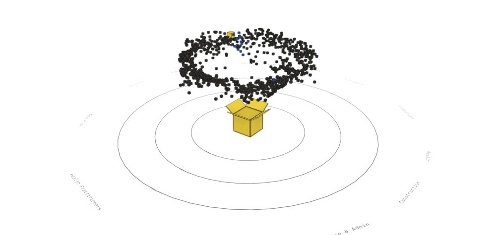
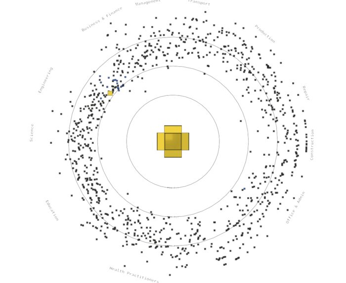
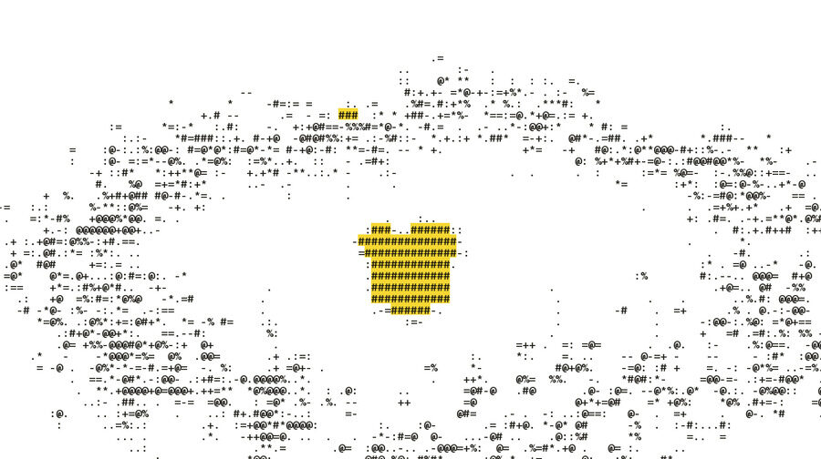

# 3D space brainstorm

Ideas for the 3D spatial space in the [final plan](/docs/analyses/final-plan.md#build-priorities), gathered on 30 October from three sources: [mkdir.directory](https://mkdir.directory/) and the directories it ranks, [Awwwards](https://www.awwwards.com/), and 31 searches on X. Every picture here is a Blender render of the engine's real numbers for Aina, from a sweep of all 923 jobs on main (6666ef8), not a sketch. Start with [the one-day cut](#the-one-day-cut); the idea bank is for after the gate.

Contents:

1.  [What the data allows](#what-the-data-allows)
1.  [Recommended: Aina's orbit](#recommended-ainas-orbit)
1.  [Alternative: the market field](#alternative-the-market-field)
1.  [The one-day cut](#the-one-day-cut)
1.  [Idea bank by beat](#idea-bank-by-beat)
    1.  [The box opens](#the-box-opens)
    1.  [Same answers, new month](#same-answers-new-month)
    1.  [The AI future flips](#the-ai-future-flips)
    1.  [Aina's marker](#ainas-marker)
    1.  [The 2D key](#the-2d-key)
    1.  [Look and feel](#look-and-feel)
1.  [Build path](#build-path)
1.  [Decisions before building](#decisions-before-building)
1.  [Sources](#sources)

## What the data allows

The sweep ran Aina's answers (Working, Web Developers, 10 hours a week) through the engine's fit for every job, in both months and both futures. It reproduces her 47% fit on her own job. The app itself shows this fit for only 21 jobs, hers and her 20 related roles, so the other 902 are the engine's numbers that no screen shows yet.

- **April has no growth axis.** Every one of the 5,520 skills has one dated point, so every verdict is Unknown and every growth projection is null. Fit still exists but is coarse (0 to 50), and slow equals fast, because both futures need a trend.
- **May has one.** Mean AI-use growth per job, over 12 months, runs from −100% to +265% in the slow future (median +42%), and from −26% to +1,071% in the fast future (median +235%). 184 jobs sit at zero or below in the slow future, so a plain log axis breaks; use a signed log.
- **The flip moves fit very little.** 588 of 923 jobs move by at least 1 point (211 up, 377 down), but only 85 move by 3 or more and 9 by 5 or more, at most 9. Aina's own job moves from 47 to 46. The plan's "753 jobs, up to 15" holds only if each job is scored as its own check-up, which the app never does.
- **The flip moves growth a lot.** Fast multiplies each skill's growing AI use by 3.84 and divides shrinking use by it: one parameter, the same for every skill. A job's height mixes its skills, so jobs lift by different ratios; Aina's goes from +75% to +440%. Four jobs have zero growth in both futures and don't move.
- **Grouping:** the SOC major group (22 groups) covers every job; MASCO is missing for 898 of 923. 39 jobs get 0 fit because her answers reach none of their skills.
- **Pay stays out.** Ringgit pay comes from the server, 10 jobs per request, so the space can't carry it for 923 jobs.

So the honest flip is mostly a lift, with a small sideways shift for hundreds of jobs. Any layout has to make a 1-point move visible without exaggerating it.

## Recommended: Aina's orbit

Aina's answers sit in the open yellow box at the centre. Each job is a small ink box: its distance from the centre is 100 minus her fit (closer is better, with rings at 25%, 50% and 75%), its sector is its SOC major group, and its height is AI-use growth, labelled an estimate. Her own job is the yellow box just outside the 50% ring, and its 20 related roles are blue (`color/map/suggested`).

Why it wins:

- It continues a motion DESIGN.md already owns: the page transition opens the box in three beats. Here the jobs then pour out of Aina's box onto their rings.
- It centres Aina. The question on stage is "what does this mean for her?", and every distance is measured from her answers.
- April to May is the strongest picture in the set: hollow boxes lying flat ("Kotak said Unknown: it won't guess") fill with ink and rise once a second dated point exists.
- Job Hunt, an Awwwards nominee from 29 October, draws 186 job applications radiating from one centre, so the form reads, and it shows that labels pile up at that count.

Its weak spots: seen from above, it hides growth, and a 1-point fit move is a few pixels on a ring. So the flip marks movers by colour, not by distance, and the 2D key morphs the orbit into the field's flat chart (below).

## Alternative: the market field

The plan's original proposal, in 3D: fit runs left to right, AI-use growth runs up, and each job group gets its own row in depth. Its 2D key is free: animate the camera from perspective to orthographic, front-on, and the field flattens into the plan's chart of fit against growth. It is the more literal chart but the weaker story, because nothing centres Aina, and with 923 stems it reads as a dense forest.

## The one-day cut

The gate is 31 October, after the panel. Build only this, in this order, and stop at the first item that isn't smooth on the pitch laptop:

1.  One instanced scene of 923 boxes in the chosen layout, from a baked file, with Aina's box yellow and labelled.
1.  The month load: April's hollow boxes on the floor, then May's filled boxes rising, with a dated count in the corner.
1.  The flip: the field lifts, movers of 1 point or more turn pink, and the corner says "588 jobs moved · at most 9 · Aina 1".
1.  The 2D key: an HTML table of all 923 jobs with each number's source and date, and one key to show it.
1.  Reduced motion: one still frame per state, no animation.

Everything else in the bank waits until the gate passes.

## Idea bank by beat

Each idea names where it came from. Ideas marked **(rendered)** are in the pictures above.

### The box opens

- Jobs pour out of Aina's box and land on their rings, best fits first; a mid-flight frame is **(rendered)**.
- The box is first drawn in ASCII glyphs, like Kopi's entrance, then turns solid as the lid opens. [ASCII Logo in Three.js][ascii-logo] draws a real 3D solid as glyphs, and a [shape-aware ASCII shader][verse-ascii] keeps edges crisp. Glyphs stay ink, and yellow fills the cells behind them, because yellow text is banned.
- The 923 jobs start as points on the box's skin and fly off when it opens ([Surface Sampling tutorial][surface-sampling]).
- The lid is tactile: it opens on click and turns on drag, on a white page, like this [CD case lid in three.js][cd-case]. Model the flaps in Blender and ship them as glTF, as in this [box-cat rig from Blender][box-cat] and the [Codrops Blender to three.js recipe][codrops-blender].

[ascii-logo]: https://tympanus.net/Tutorials/ASCIILogo/
[verse-ascii]: https://x.com/verse_/status/2022823327748812911
[surface-sampling]: https://tympanus.net/Tutorials/SurfaceSampling/
[cd-case]: https://x.com/ann_nnng/status/2109257723246501895
[box-cat]: https://x.com/InnombrableGame/status/2056818063924740100
[codrops-blender]: https://tympanus.net/codrops/2025/04/08/3d-world-in-the-browser-with-blender-and-three-js/

### Same answers, new month

- April's hollow boxes lie flat on the floor, then fill with ink and rise to their growth when May loads **(rendered)**. Dithered fill could stand for Unknown, so the print "develops" into solid ink ([Codrops dithering shader][dither], [dither demo and code by @niccolofanton][dither-x]).
- A scan line sweeps May in across the field, as on [Lidar Drone Scanning][lidar].
- April stays behind as a faint layer under May, so "same answers, new month" is two layers in one space ([space-time cube by @CraigTaylorViz][space-time]).
- A receipt in the corner counts up in mono: "5,520 skills · Unknown → 2,064 Rising · 2,063 Steady · 1,383 Declining · 9 Split · 1 Unknown · May 2026 [n]". [Job Hunt][job-hunt] and [1000 Whales][whales] both lead with a dated count, and mkdir.directory's own vote counter rolls its digits and jumps straight to the value under reduced motion.

[dither]: https://tympanus.net/codrops/2025/06/04/building-a-real-time-dithering-shader/
[dither-x]: https://x.com/niccolofanton/status/1921921634023182621
[lidar]: https://www.awwwards.com/sites/lidar-drone-scanning
[space-time]: https://x.com/CraigTaylorViz/status/2030964935946104863
[job-hunt]: https://www.awwwards.com/sites/job-hunt
[whales]: https://www.awwwards.com/sites/1000-whales

### The AI future flips

- Store two positions per job, slow and fast, and animate one blend value, so 923 boxes move in one draw call ([particle morph demo by Pavel Mazhuga][morph], [react-three-fiber morph by @joelbqz][morph-r3f]).
- Flip in two beats, because two things change. First the field lifts, and the presenter says why: one parameter, 3.84, the same for every skill. Then the jobs whose fit moved by 1 point or more turn pink, while Aina's barely moves.
- Pink trails join each mover to a hollow ghost at its slow position **(rendered)**. Because the lift dominates, the trails run mostly upward, so colour does more work than the trails.
- The switch is the app's own `ScenarioControl`, named like [fromearth / 2050][fromearth]'s "now or 2050", with the receipt "588 moved · at most 9 · Aina 1".

[morph]: https://x.com/PMazhuga/status/1895451661780607347
[morph-r3f]: https://x.com/joelbqz/status/1987567313990848589
[fromearth]: https://www.awwwards.com/sites/fromearth-2050

### Aina's marker

- Hers is the only yellow box, with an ink outline; label only her box and the one under the pointer, never all 923.
- A "you are here" radius around her, as in this [UMAP hackathon winner][umap-you], makes her related roles a visible neighbourhood.
- Click a box and the camera flies to it and opens a card of sourced numbers, with arrow keys stepping through jobs, as in [Body Layout][body-layout]; [Rechroma][rechroma] pairs each 3D point with a flat card of exact values the same way.
- Kopi peeks out of the centre box as still art on a flat card, not Live2D, so the laptop runs one WebGL scene at a time.

[umap-you]: https://x.com/michlu2/status/1909329543695081938
[body-layout]: https://yourinsides.com/
[rechroma]: https://www.awwwards.com/sites/rechroma

### The 2D key

- The orbit unfolds into the field's flat chart: each box flies from its ring to its place on a fit-against-growth scatter, with the same two-position blend as the flip. [tesseract][tesseract] unfolds a flat view into 3D the same way.
- For the field, one key animates the camera from perspective to orthographic and the 3D flattens into the chart ([perspective-to-orthographic dolly zoom][dolly]) **(rendered)**.
- The canvas sits over its own HTML table of all 923 jobs, with fit and growth in both futures and each source and date, so the 2D view exists even if WebGL fails ([WC 2026 Data Portraits][wc26], [Apple's Embedding Atlas][atlas] with its linked table).
- The swap between 3D and 2D reuses the theme switch's ASCII ring sweep, the scene turning to glyphs as it flattens **(rendered as a still)**.

[tesseract]: https://www.awwwards.com/sites/tesseract
[dolly]: https://x.com/threejsresource/status/1884526911499768311
[wc26]: https://www.awwwards.com/sites/wc-2026-data-portraits
[atlas]: https://x.com/NirantK/status/1954081728525742365

### Look and feel

- Ink outlines instead of shadows, on white, in light mode; dark mode inverts to the dark tokens. [Moebius-style outlines by Maxime Heckel][moebius] do this as a post-process, and [monolayer][monolayer] shows how flat it can stay.
- Yellow for Aina and blue for related roles reuse existing tokens. Pink for movement is a new use of `color/accent/chosen`, which today marks only the answer just picked, so agree it with AlaskanTuna first.
- [aino.agency][aino] (#181818 on #f5f5f0) and [Giza World][giza] (black dots on white) are the closest references in tone. The style passes that went viral on X (ASCII, dither) are common now, so use them only where they carry meaning, such as Unknown.

[moebius]: https://x.com/MaximeHeckel/status/1944049868248371229
[monolayer]: https://www.awwwards.com/sites/monolayer
[aino]: https://www.awwwards.com/sites/aino-agency
[giza]: https://world.gizatech.xyz/

## Build path

- **Stack:** `three` 0.186, `@react-three/fiber` 9.8 (its peer range is React 19.0 to 19.3, and the app is on 19.3.1) and `@react-three/drei` 10.7, lazy-loaded on the space's route, the way Kopi's Live2D already loads on demand. Pixi 6 stays for Live2D only.
- **Scene:** one `InstancedMesh` of 923 boxes plus one for stems. At this count, performance isn't the constraint; an [InstancedMesh of 8K earthquakes][quakes] reportedly holds 60 fps. The risks are heavy post-processing and per-box HTML labels.
- **Data:** a job's targets don't depend on the user, only the fit does. Bake per job, at build time, its group, its targets for each month and future, its growth, and the links that carry answers across jobs; then compute the fit in the browser with the engine's own functions, from the session's answers. Computing everything in the browser would mean parsing all 923 job files, about 40 MB. A file baked for Aina alone is faster to build but matches 2D only for her answers.
- **Laptop gate:** follow mkdir.directory's own WebGL footer. Pause when off-screen, cap the pixel ratio at 2, recover from a lost context, draw one still frame under reduced motion, and wait for fonts.
- **Keys for the driver:** the space needs its own keys, because only `/`, Escape, arrows and 1 to 4 on Questions are bound today. For example, F flips the future, M loads the month and D shows 2D.
- **Blender's part:** the box and flaps as glTF, the slide's hero render, and frames for the backup video (#386), drawn from the same sweep.

[quakes]: https://x.com/AhmedShahnab/status/2024091529846153439

## Decisions before building

1.  **Which number to say.** The plan's 3D-space paragraph says the flip moves "753 of the 923 jobs by at least 1 fit point, up to 15". The fit the engine gives for Aina's answers moves 588 jobs, at most 9. Change the plan to the number the space draws.
1.  **Job growth is our aggregate.** The engine has growth per skill, not per job. The renders use the mean of a job's skills; the legend must say so, and the radar's per-skill numbers stay the proof.
1.  **The sector angle means only the group.** Within a sector, jobs sit in alphabetical order. Say so in the legend, and never draw a surface between jobs, because that would invent numbers.
1.  **Motion needs a line in DESIGN.md.** Its Motion section lists each animation and keeps all others to hover and focus. The live demo moment already covers the month load ("animate each change so a judge can follow it"); the jobs leaving the box and the flip need their own lines, with their reduced-motion versions.
1.  **Orbit or field.** The orbit tells Aina's story and continues the box; the field is the literal chart and gets its 2D key for free. Both need the HTML table.

## Sources

- [mkdir.directory](https://mkdir.directory/), and through it [mesh3d.gallery](https://mesh3d.gallery/directory), [Codrops](https://tympanus.net/codrops/) and [movin.design](https://movin.design/shaders/)
- Awwwards: the sites linked above, from its Three.js, WebGL, 3D and data visualization listings
- X: the posts linked above, from 31 searches on 30 October; none with traction showed a 3D map of jobs or careers
- The sweep: `computeCheckup` (`packages/sdk/src/checkup.ts`), `projectAiUsage` (`packages/shared/src/rules/verdicts.ts`) and Aina's answers in `video/shots.json`
