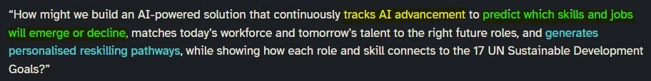
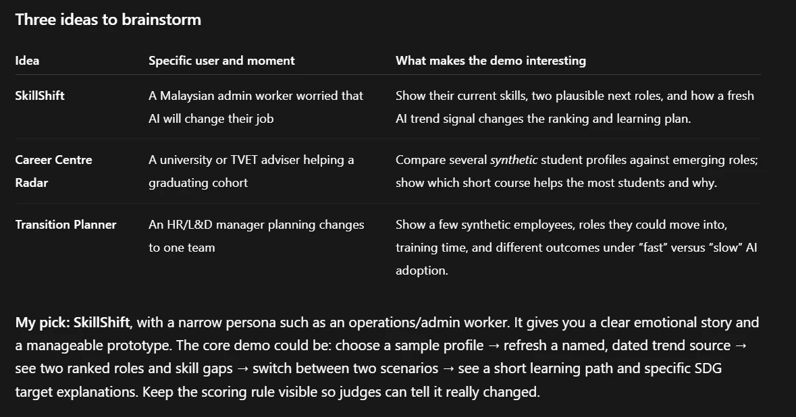
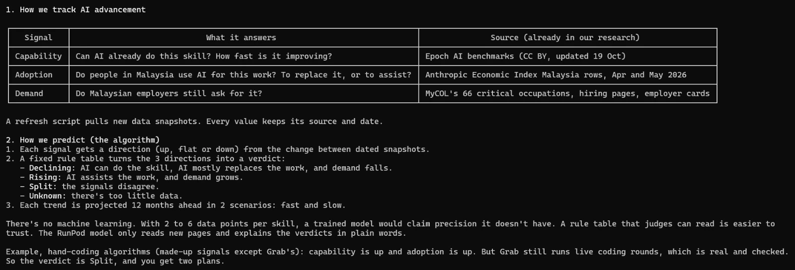
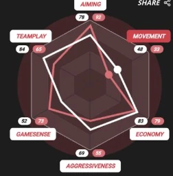
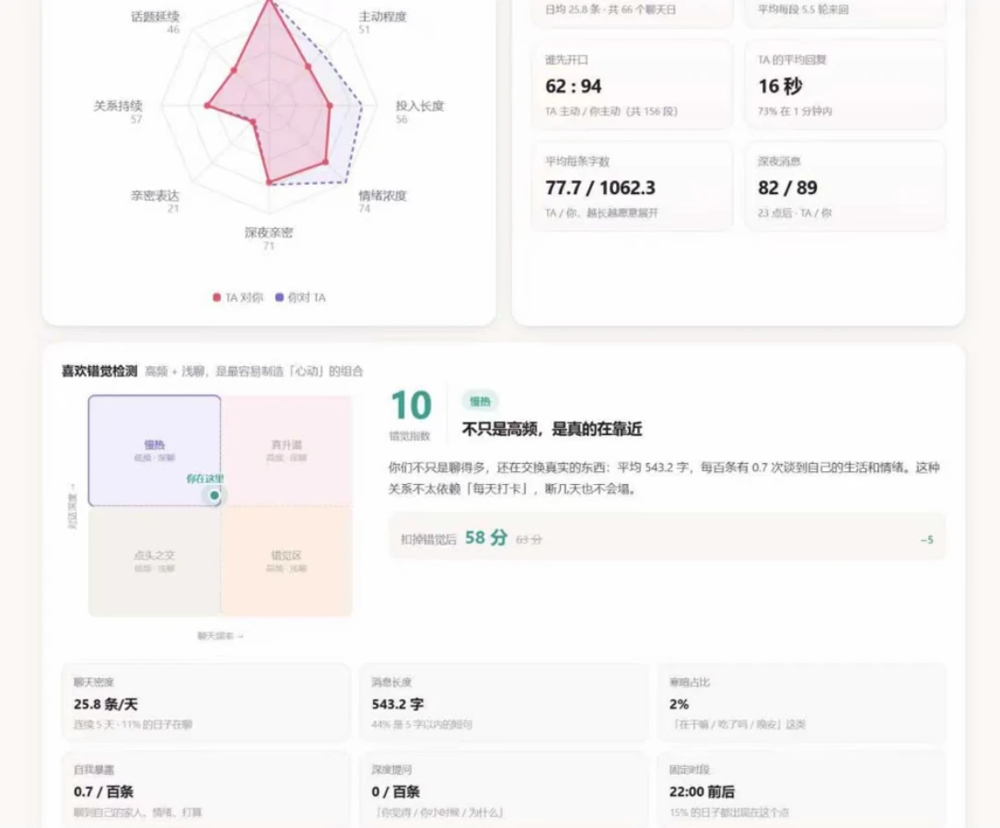

# Ideation meeting transcript

What our team said at its internal Google Meet call on Wednesday 21 October 2026, from 9:19 PM to 10:57 PM MYT, to pick a target user and settle the project idea for Domain 1 ([problem statement](/docs/sources/drive.google.com/domain-1-aiversecity.md)). It feeds the next round of ideation after the [idea ranking](/docs/ideas/0000-ranking.md).

Times count from the start of the recording, which began after the call had started; the call dropped at about 00:56:20 and the team rejoined in a new call at 00:57:30. Speakers were identified from Meet's speaking outline on the recording, then checked against what they said. The text merges two machine transcriptions, OpenAI's gpt-transcribe and whisper-1, checked against each other. Doubtful words are marked _(as heard: "...")_; fillers, false starts, swearing and off-topic banter are trimmed.

Contents:

1.  [Where the meeting landed](#where-the-meeting-landed)
    1.  [Decided](#decided)
    1.  [Ruled out](#ruled-out)
    1.  [Still open](#still-open)
1.  [Speakers](#speakers)
1.  [Images](#images)
1.  [Messages](#messages)

## Where the meeting landed

### Decided

- **Target user: individual workers** (01:22:19 to 01:26:56): someone already working who wants to stay secure in their current job, or someone who wants to pivot to another field, either with a target in mind or asking for a direction. Companies (00:11:49), students and fresh graduates (00:09:16, 00:55:16) and trainers (00:20:35) were weighed first.
- **Flow**: onboarding questions about the user's current skills and goal (01:05:30), then questions tailored from what the backend knows to find skill gaps (00:46:37), then an analysis that gives reasons and cites sources (01:04:09), then a reskilling roadmap (00:49:44).
- **Output** (01:27:08 to 01:34:04): a hexagon (radar) chart of the skills a role is expected to need against the user's current skills, a study-plan timeline with milestones to tick off, and suggestions such as free classes and videos.
- **Backend signals**: scrape job boards for the number of openings per field and the skills in job descriptions (01:02:19), and read financial reports and indexes for where the money is going, such as the S&P 500, Bursa Malaysia and the US non-farm payroll, tracking both global and Malaysian sources (01:06:25 to 01:14:13). A layered scraping hierarchy was floated (01:21:15).
- **Suggestions are advisory but sourced**: the app suggests and the user decides, and each suggestion cites the data behind it (01:03:08 to 01:04:38).
- **A working prototype**, using Replit and RunPod, with about 80% of the concept working (01:15:48).
- **Deadline**: Sunday 8 AM (01:34:56), that is 7:59:59 AM on 25 October ([brief](/docs/BRIEF.md#deadlines)).

### Ruled out

- **Our own AI benchmark** from experts' answer sheets (00:26:44 to 00:31:09): no reliable source within a hackathon, and the product would just be a dashboard.
- **Training people ourselves**: the problem statement asks for a pathway, not training (00:32:10).
- **Input from heads of department or experts** (00:58:52 to 01:00:44): not feasible for a hackathon, and not sustainable across industries.
- **Social media sentiment**, for now (01:14:24 to 01:16:24): too noisy and too much work for three days.

### Still open

- How to predict which skills will emerge or decline, the problem statement's second part (00:50:30, 01:32:19).
- The hexagon's axes, and whether they differ by industry (01:30:10 to 01:30:57).
- The prototype's focus field: tech (01:16:42) or law (01:17:24).
- How the AI picks the right questions (01:04:52).
- How deep to scrape, and which sources come first (01:13:34, 01:20:00).
- Who builds, given everyone's week (01:35:27 to 01:35:53).

## Speakers

- **Hee Zi Jie**: recorded the meeting.
- **Js Chew**: called "Jun Song" by the others. Shared their screen from 00:14:20 to 00:46:30.
- **Jin Siang**: Meet name "jin siang", called "Jin" by the others; studies law.
- **L Hao**: dropped off at about 00:44 when their laptop died and came back at 00:46:20, shown for a while as a second tile named "Hao".
- **Speaker unknown**: a line whose speaker the recording doesn't show.

Yu Kang, the fifth member, wasn't on the call.

## Images

The images the team referred to, supplied after the meeting.

**Problem statement keywords.** Js Chew showed this on screen at 00:18 and from 00:33:20 to 00:46:30: the Domain 1 question with its three key phrases highlighted, "tracks AI advancement", "predict which skills and jobs will emerge or decline" and "generates personalised reskilling pathways".

**Three ideas from AI.** Js Chew's Codex chat, on screen from 00:14:20: SkillShift for an admin worker worried about AI, Career Centre Radar for a university or TVET adviser, and Transition Planner for an HR or L&D manager, with Codex's pick, SkillShift.

**Tracking and prediction explained.** An AI explanation of the first two key phrases, not shown on screen during the recording: three signals (capability from Epoch AI benchmarks, adoption from the Anthropic Economic Index's Malaysia rows, and demand from MyCOL's critical occupations and hiring pages), and a fixed rule table that turns their directions into a Declining, Rising, Split or Unknown verdict, projected 12 months ahead in a fast and a slow scenario.

**Hexagon chart.** Jin Siang's example for the skills chart, posted in the team's WhatsApp group at 10:52 PM (about 01:32:30): a game's six-axis radar comparing two players on aiming, movement, economy, aggressiveness, game sense and teamplay. In Jin Siang's idea, one line is the skills a role is expected to need and the other the user's own.

**Hexagon chart, fuller example.** Jin Siang's fuller reference: a Chinese chat-analysis page whose radar compares how two people message each other on seven axes, such as initiative, message length and emotional intensity, with a quadrant that places the pair by chat frequency and depth.

## Messages

**[00:00:00] Js Chew:** _(as heard: "You know, direct against.")_ It will be really hard for us to build public-facing capability, no? So in a sense we still have to shrink the domain, which brings to what — sorry, I don't know the other guy's name — more or less the company internal themselves. They'll probably foresee and they need a team with that skill, but then it becomes company internal training, you know what I mean? So I don't know, man, this problem doesn't really make sense to me. It feels really hard to, I mean, to expose as a hackathon thing.

**[00:00:47] Hee Zi Jie:** But we're assigned this domain, so we still need to build a solution for it. How do we proceed from here?

**[00:00:52] L Hao:** Bro, I think the scope of this hackathon is way too advanced for a hackathon.

**[00:01:02] Js Chew:** When they say the UN Sustainable Development, is it the same as...

**[00:01:08] L Hao:** Yeah, it's basically the framework they want all the uni assignments and stuff to follow. It's like the 17 statements. Actually, bro, I looked at the ideas, and I'm just not sure how unique we have to be.

**[00:01:35] Hee Zi Jie:** Because everyone is forced to build the same kind of system.

**[00:01:39] Js Chew:** Yeah, it's gonna be very generic, bro, because the scope is so big. When they say those things, are we aiming to solve just one of them, or the more the merrier?

**[00:02:01] Hee Zi Jie:** I think it's best to scope down lah, to one goal to overcome. Then that's enough already.

**[00:02:13] Js Chew:** But there's quite a lot of them that involve those kinds of zero hunger, clean water. What's it supposed to do? I mean, those are not necessarily the ones we're targeting, but maybe in other scope. From what I see so far, maybe one of them was quality education, decent work and...

**[00:02:36] L Hao:** Yeah, I think the UN stuff is just a guideline. Usually you won't get all 17; you just get two or three of them.

**[00:02:44] Js Chew:** I mean, the nature of this track maybe suits part of it. So as long as we come up with a solution, naturally it fits.

**[00:02:55] Hee Zi Jie:** I think most importantly, you just need to know the solution you're building. The outcome is telling the users how they're going to reskill themselves. And then for the reskilling roles, we just simply take one or two of the 17 UN SDGs and assign them to the roles, something like that.

**[00:03:26] Js Chew:** But when they say track AI advancement, how exactly? How replaceable we are? What kind of matrix?

**[00:03:42] Hee Zi Jie:** I'm pretty sure there's an index for that. I don't know, I'm not well-versed in data analytics.

**[00:03:49] Js Chew:** Well, maybe we can build our own matrix. For example, you can roughly split the skills into, I don't know, maybe management, communication, technical. And the technical might vary depending on the industry. Then maybe each industry has its own indicator. And that could be scraping from, I don't know, job boards based on the skills that are required. It shows the uptrend, so we tend to show the AI advancement towards that. I don't know, it could be that AI is pretty advanced, so we can achieve a lot of things that back then we couldn't. That's why there's a high demand for it. Or naturally it's the other way around: it currently shows the uptrend, so it means AI is not as good at achieving it. So that's the natural way of thinking. The first one that I mentioned is how generally it becomes. _(as heard: "Then myself clear.")_ I'm just waffling.

**[00:05:25] L Hao:** This one is about what?

**[00:05:27] Js Chew:** Yeah, because we are talking about, I mean, I'm looking at the highlighted part. There's three parts, right? One was track AI advancement, second was predicting, and third is give a reskilling pathway. So I'm talking about the first two. How are we supposed to track AI advancement? Well, I could imagine maybe we can do scraping, I don't know, through job boards, to show the upwards and downwards trend, but that could mean two things. And that could translate into a matrix in AI advancement. For example, if we show an uptrend, naturally what we think is this job needs more workforce, which means currently in the talent market there's not enough of these kinds of people, right? Or at least these are the talent that are most required. So far, make sense?

**[00:06:37] Js Chew:** But what would that mean in AI advancement? Does that mean AI is good in that direction or bad in that direction? There's two ways of thinking about it. The most natural way is we are hiring more people, so naturally we think AI is not good at that industry. This part makes sense because it cannot achieve it yet; that's why they're still hiring these, right? But it could be the other way around. For example, because AI was so good at this that back then we couldn't deploy as much work in coding, but now we can, and that's why we're hiring more people to do this, so we can scale faster. And then that becomes kind of a contradictory bit. But anyway, we don't need a very good matrix for indicating that. I'm just waffling on how it might be possible to achieve the first part.

**[00:07:39] L Hao:** But then again, how do we differentiate the signals, right?

**[00:07:44] Js Chew:** And low-key, it really just feels like summarising the Indeed postings or LinkedIn. There's not much that I think feels innovative enough.

**[00:08:02] L Hao:** Yeah, at the end of the day, it's just scraping.

**[00:08:05] Hee Zi Jie:** I think for how we track the AI advancement and also how we _(as heard: "treat")_ it, that part can be engineered using AI. That one we can _(as heard: "let Claude" / "black box")_ figure out. But for the product, this is the part I'm more concerned about. How do we build the product? What target user are we building it for right now?

**[00:08:32] Js Chew:** Even if we are targeting companies, it also really varies depending on the industry. Even if we were to suggest them to reskill themselves, for Jin's kind of case, he's a lawyer. If he works in a law firm, we're not going to tell them they need to reskill themselves in using AI to code, right? So even for product-facing companies, it also depends on the sector they're working in. And I think we have to keep the scope straightforward lah. I mean, narrow it down a bit.

**[00:09:16] Hee Zi Jie:** Yeah, I feel like it's not as impactful if we build the solution for companies, because like you say, only certain sectors like tech or IT are most affected by AI, right? For Jin, in law firms, AI still can't really replace most of their workflows. But for tech and IT, the impact caused by AI is quite significant. So it's only these certain sectors. But if we position the product itself for students, say fresh grads, I think it would be more impactful. I don't know if this makes sense or not. What do you guys think?

**[00:10:14] Js Chew:** Yeah, I agree lah. But again, it depends on the sector that you're studying.

**[00:10:18] L Hao:** I think we should focus on those most impacted by AI. That's easier.

**[00:10:30] Js Chew:** How should I say it? The most impacted might not just be us. It might be a curveball that hits them out of nowhere. For example, the grammar checking kind of thing. You remember there used to be those teaching platforms? They were teaching, but then they died because they couldn't teach as much _(as heard: "course")_ as what a $20 plan could do for them. So how do you define... I mean, in general, I still feel this is too big. Even if you're facing just students, maybe certain kinds of students, but then that keeps the scope uninteresting or unsexy.

**[00:11:34] Hee Zi Jie:** We scope down step by step lah. So do you guys want to do it for the companies or for universities first?

**[00:11:49] Js Chew:** Personally, I think... well, it depends. Depends on the judge, right? If it's more towards monetisation, then it makes sense to have company. But if it's more towards what kind of impact, for example, if we release this out and host it ourselves, then students might be interested or benefit from this. But then it means it's most likely that we're not gonna get any money and run everything with love. So personally, I would lean towards company, because it feels like a clearer direction. At least there's a question to solve. But then again, the industry kind of matters.

**[00:12:51] L Hao:** So just to get this straight: if we build it for companies, we basically let the hiring managers use our software and then somehow help them filter out who's the best candidates that suit the skills for their role. Is that correct?

**[00:13:08] Js Chew:** That's part of the target, right? There's three groups of people that we're targeting, according to what my GPT said. One was SkillShift. Two was Career Centre Radar. That's what it says. Let me share my screen. This is what it says. Can you guys see?

**[00:14:04] Speaker unknown:** Yeah.

**[00:14:11] Js Chew:** So this is what Hao was asking just now. And this is probably what Zi Jie was initially saying. And this is like a risk awareness kind of thing. So it depends on which one we can... how can I say, _(as heard: "emotional story")_?

**[00:14:42] L Hao:** Yeah, actually, now that I'm reading it, I think SkillShift sounds...

**[00:14:47] Js Chew:** But yeah, again, it's kind of _(as heard: "vary")_, right? But anyway, we have to have some sort of indicator to show... The main thing is money, right? You know what I mean? After all, this kind of thing is mainly to earn a living. So it's more towards what kind of way we can earn money.

**[00:15:23] Hee Zi Jie:** You need skills so you can earn more, right?

**[00:15:27] Js Chew:** Yeah, but your skill has to be the money-earning kind. If it's, I don't know, who can sweep the floor the best, there's a limit you can hit, you know what I mean? I admit I'm exaggerating a bit, but it's kind of like that. So it's filtering out those kinds of skills that bring you money. But it's generally very broad, you know? Like, communication skills bring you money.

_[Off-topic banter omitted.]_

**[00:16:32] L Hao:** Anyway, we were just discussing which approach we should take, from the perspective of the company or the fresh grads.

**[00:16:47] Jin Siang:** Wait, what was the topic about again?

**[00:16:51] Hee Zi Jie:** Yeah, _(as heard: "near the WhatsApp")_, I sent every resource there already.

**[00:16:56] Jin Siang:** Bro, I'm damn busy lah. I just got home at nine o'clock. I was in traffic for three hours straight. My lecture ended before me. I do not know, man.

**[00:17:12] Hee Zi Jie:** Okay, so basically, our _(as heard: "main")_ required us to build a solution, and this solution has two halves. The first half is we need to build an engine. This engine basically tracks the AI advancement happening in either industry, globally, locally, whatever. Tracking is one thing. The other thing is it will predict which skills and jobs will emerge or decline, say in the next five years, next two years, something like that. This is the engine, the one that has something to do with AI predictive models and stuff.

**[00:17:58] Hee Zi Jie:** The second half is the product side. How are we going to present this product? Are we building this solution for companies, for universities, or for individual use? This is what we are currently discussing right now.

**[00:18:19] Js Chew:** And it seems there are three tracks that _(as heard: "myGPT")_ is recommending; these two were included just now. One was universities, helping those students. The second was a company, or a team within a company that plans how they can help the workers gain some skills. And this one is people who have their own awareness that they might actually be affected, and are considering learning some skills. This is what it was suggesting.

**[00:19:02] Jin Siang:** Okay, let me speak out my thing. First of all, I think it's really nice. You just mentioned that there will be some person training someone to prepare for AI, right?

**[00:19:17] Hee Zi Jie:** Yeah, this is how it helps you reskill. The main purpose of people reskilling themselves is so that they can get a better job, right? And a better job means a higher-paying salary. So that's the main goal.

**[00:19:35] Jin Siang:** Okay, I know, I understand everything now. You see, I've got a different approach. Since we're talking about trainers that train people to better skill themselves, right? However, I've got a disappointment with universities, because I'm in UM right now, and how they counterplay AI was by holding examinations physically, which is very, very disappointing, because that's not how it's supposed to counter AI. They should be coming out with questions that even AI couldn't answer, or that require such critical thinking or creativity that's never been seen before that an AI couldn't help with. That's what I was expecting, but apparently not: we're expecting a physical exam. So I'm pretty disappointed with the university part.

**[00:20:35] Jin Siang:** I was thinking maybe we do it from the perspective of a trainer that would prepare laypersons or other people. They come to us, and then we train them on how to prepare, or how to at least be talented in the AI era. What do you think about that?

**[00:21:00] Js Chew:** Yeah, how are you going to do that?

**[00:21:03] Jin Siang:** How am I going to do that?

**[00:21:05] Hee Zi Jie:** Yeah, how are you going to do that?

**[00:21:07] L Hao:** Yeah, where do we find the trainer, is the question.

**[00:21:10] Jin Siang:** Me myself as a trainer? What do you mean?

**[00:21:13] Js Chew:** No, you can't just say, "This is our solution: you have me, then I just coach you so that you can _(as heard: "attack AI")_." You know what I mean? What's your software solution?

**[00:21:26] Jin Siang:** What's the software solution?

**[00:21:28] Js Chew:** Or at least the AI-integrated software solution.

**[00:21:32] Jin Siang:** Actually, I think the prediction thing is kind of bullshit lah. I don't know, I don't think the AI can expect something to be replaced like that. _(as heard: "Use Jeff and like, yes, yes, no, no.")_

**[00:21:48] Hee Zi Jie:** It's probably not giving a definitive answer, but it's going to give you a _(as heard: "true score")_, percentage-based. It's still up to you to believe whether you think it will emerge or decline, but the numbers, the true score, is what the AI will predict for you.

**[00:22:09] L Hao:** Yeah, my only concern is that if we want to do that, we need to somehow find a way to scrape all those, and I'm not sure how complex it will be.

**[00:22:18] Hee Zi Jie:** There should be a way to do that. I mean, that's the backend engineering side of things; I believe _(as heard: "the cloud")_ can handle that. But I think the most important part is how we are going to present this solution, because that's what the judges care about the most.

**[00:22:41] Jin Siang:** Solution for target user group. For track number two, the product solution for a specific user group, what does it mean?

**[00:22:57] Hee Zi Jie:** Which one? Track number two?

**[00:22:59] Jin Siang:** Is it track number two, or _(as heard: "for domain number one")_?

**[00:23:03] L Hao:** Okay, so for domain one, we have to do two things.

**[00:23:05] Jin Siang:** For domain one, is it?

**[00:23:08] Hee Zi Jie:** Yeah.

**[00:23:08] Jin Siang:** _(as heard: "How am I going to get the AI out of the solution?")_

**[00:23:15] Js Chew:** Yeah, this is the question I was asking you, Jin, just now. I get what you meant just now, but how can we translate that? Because essentially you're saying it's not enough; we basically have to do something that AI itself cannot do. But how can we translate that into a solution? That's the tricky part.

**[00:23:42] L Hao:** Yeah, at this point, it's like letting AI train people on how to use AI.

**[00:23:48] Js Chew:** Like _(as heard: "Klingy")_, maybe? Are you guys aware of it?

**[00:23:51] Jin Siang:** From my understanding, I actually see this as something like how the Chinese AI _(as heard: "dilutes")_ Anthropic or Claude, isn't it? So my way of thinking about how we get the predictions is, for example, we get a lawyer, and the lawyer drafts something first, and then we let AI draft something similar as well, and we mark it. But isn't it just AI training? And then we rate the predictions on how close or how highly rated they are: we mark the AI's paper and then we rate it. So this way we can tell... we get a lot of those, what do you call it, very expert kind of people. For example, you've got lawyers, you've got doctors and everything, and they come out with their own homework, their own work.

**[00:25:04] Js Chew:** Yeah, that's actually AI training. I think I've seen that, last year was it? There's actually a platform that does exactly what you mentioned. They hire doctors and experts, like advanced engineers who are good at their domain, and the company pays these people for the time they spend doing exactly what you said, like _(as heard: "redirecting")_. And we're talking about a company that has billions to throw around, because if we're the only one handling this, it might be a bit difficult. So are you saying we can build a platform that lets people do this, and we can use that as a resource to teach someone else?

**[00:25:58] Jin Siang:** No, my original intention was: if the AI gets rated higher on law, for example, then it basically means law is likely to be replaced by AI, right? So one day, when the AI scores 100%, then... I don't know why I'm hearing... is it me? Is it an echo?

**[00:26:28] L Hao:** Not too sure what's going on, but yeah. So what you're saying is that, depending on how much people use AI in their work, we use that to determine whether AI is advancing or retreating.

**[00:26:44] Jin Siang:** No, no, no. I'm saying we come out with an answer sheet, and then we compare how likely the AI is to come out with the exact same answer. So when one day the AI comes out with exactly 100%, then it basically means that, for example, contract law has been totally replaced already, because the AI could do what a senior contract lawyer would do. So that means it's replaced. By that, we rate several fields, for example engineering, software engineering, or law, and then we can see how much they score on each and tell how close they are to totally replacing this field, isn't it?

**[00:27:42] L Hao:** Yeah, so in a way, it's like the benchmarks. Basically something like a benchmark.

**[00:27:46] Jin Siang:** It's just we use the stats as how much it's going to be replacing people.

**[00:27:53] L Hao:** Right, but we can only assume it will keep advancing, because it will get smarter.

**[00:27:59] Jin Siang:** Yeah, so that's when we'd see which categories get replaced first, right? For example, if it's scoring 90% in software engineering already, then it means it's getting replaced in maybe one or two years. But if it's scoring like 10, 20 marks in the law field, maybe IP law specifically, they're so terrible at IP law, then it's likely saying IP law is still good. And then maybe in constitutional law they did it so, so well and score like 60, then it maybe means a constitutional lawyer is no longer needed.

**[00:28:37] Jin Siang:** But then I do not know how to rate the creativity part, because I think creativity is the only thing that we couldn't rate. Maybe we could aim, like, in these hackathons, because creativity is something I don't think an AI could do. When we talk about law, sometimes we need to be really creative, and I do not know how to rate how creative an AI is.

**[00:29:08] L Hao:** Yeah, I think your concept is correct. It depends on how the AI scores on certain benchmarks in which field, but then we have to rely on the people that do the benchmarking, right?

**[00:29:25] Js Chew:** Yeah, so my first concern would be how reliable our benchmark and our source of benchmark are, and how we can find those people. Are we going to pay them to generate this kind of shit for us? And how reliable is this method? Maybe we take an exam twice: the first time we score very good, the second time we score very bad. Am I really good or am I really bad? You know what I mean. So it needs to run a couple of times. And in general, for this hackathon itself, I think this idea might not be too feasible, as in we couldn't really get the source. Most likely, the source we'd get is asking Claude or GPT to generate the benchmark for us, which contradicts the point of it.

**[00:30:33] L Hao:** Yeah, I mean, at most we'd have to fetch the data from the benchmark websites, which already did all these experiments for us. There's no way we can do it on our own, honestly.

**[00:30:42] Js Chew:** Yeah, so in a way we're still relying on those mainstream sources, right? So it doesn't really differentiate us from those generic benchmarks. And second, even if we _(as heard: "indicate")_... then second, the product part: what are we going to do?

**[00:31:07] L Hao:** True, we're just a dashboard, you know.

**[00:31:09] Js Chew:** Yeah, right. We basically just tell them how smart the AI is. I'm not saying it's not okay, but it will probably be quite hard in this hackathon to do such things. But I think the idea is quite nice, as in, just now, the one I thought Jin was talking about could be a direction: maybe we train it, then we have a really, really good AI, then we can use that to teach someone, and it becomes a teaching platform. But then again, that's basically training our own AI model, and that's super, super hard. I don't think a hackathon that pays us 3,000 can achieve that. So yeah, my idea just now isn't feasible, but I thought it's pretty funny that I totally misthought what you were talking about.

**[00:32:10] Hee Zi Jie:** By the way, I also want to specify one thing. If you read the domain description, our end goal is not actually to train someone. What we are supposed to do is generate a pathway: we tell you what you should do, what you should learn, and that's it. We stop at that. We don't train them, like, say the person wants to be skilled in law-related things, and then we come up with a full training plan in that context to train that person.

**[00:32:59] L Hao:** Right, we only redirect them to what they should do, instead of doing the training themselves.

**[00:33:13] Jin Siang:** Wait, wait, okay, I think I've got an idea already, because I didn't finish reading the question. So now you're saying that since the ultimate answer is not to educate them but to give them a pathway, right? So now we actually use AI to come up with questions. Imagine you're in an interview, and the interviewer actually comes out with a paper that is AI-generated, so the AI updates itself in relation to this law.

**[00:33:47] Jin Siang:** I've actually experienced this. For example, I was at some company in Bursa Malaysia, interviewing for some roles regarding Bursa Malaysia, and they would come out with AI-generated documents related to Bursa Malaysia things, like the listing: how do you cope with the listing, what are the corporate governance kinds of things. So it comes out with a question. Last time, I was given a contract, and there were some elements missing within the contract. Let's say it came out as three papers, and each of the three papers had different missing elements inside, and I'm asked to vet the paper to see if I could find out what is missing. So this is a contract-related paper, and I'm reading through it. Let's just say I've missed out section six, which is _(as heard: "the law that guards")_. In contract law, you have to say which law we use if it's breached, for example Malaysia law, but then it's disappeared, it's vanished from the contract. So I have to find it, and if I don't find it, it means there's some problem in my contract learning, so I need to enhance my contract law.

**[00:35:19] Jin Siang:** Same thing goes for software engineering: maybe there's an HTML kind of question with something missing. They do three, five papers and throw it back into the AI, and then the AI comes up with an answer saying, oh, it seems like your contract is not that good. So it's like an overall examination, but then it tells you specifically which part you're weak at.

**[00:35:50] Js Chew:** I'm not saying... okay, I'm always the no guy. It's like, I don't know how to solve this particular legal problem, and I'm a bad software engineer. You know what I mean?

**[00:36:05] L Hao:** Yeah, I think for law it actually applies well, but for software engineering, it's... there's a lot. There's never enough things for you to learn.

**[00:36:17] Js Chew:** There's always something for you to learn.

**[00:36:18] L Hao:** Also, the thing about software engineering is that we are being outpaced by AI, so how we should be training them on AI usage instead of...

**[00:36:27] Jin Siang:** It generally tells him your pathway is: learn something new lah, just learn AI, because that's what you're missing, right?

**[00:36:38] Js Chew:** Yes, I don't know how to do this legal problem, but it has nothing to do with if I'm working as a finance worker, I mean, as a finance trader. But then how am I going to be prepared for that? I mean, yeah, it kind of explains itself, but...

**[00:37:09] Jin Siang:** No, no, no. You see, you learn several subjects in your university, right? But then when you come in practice, does each subject represent one industry or not? For example, if you are doing finance, there could be macro finance, micro finance, there could be accounting, everything; there's so many things. But when it comes in practice, when you are working, all of these things are into something like one paper. You get what I mean?

**[00:37:47] Jin Siang:** So when we talk about contract, right, contract is a very, very broad kind of thing. Within contract, there is tenancy agreement, there's trust deeds, there's this and that. But then what are the sub-subjects that you're weak at? That's where the AI will come out and tell you. For example, within contract specifically, or let's say trust deeds: when it comes to insurance trust, insurance trust is your worst part, because you do not know how to draft an insurance trust or you have got specific knowledge missing. So it's like the AI comes out with the overall examination, but then it could tell you specifically which part you are weak at.

**[00:38:42] Js Chew:** So that means I need to take a very heavy exam, and that's like the whole product?

**[00:38:49] Jin Siang:** It doesn't have to be a very, very heavy exam, because the whole thing about the examination is to tell you which part you are weak at. This is not a university exam where if you fail it, then you fucked up. This is something that gives you a notification saying, oh, I am weak at this. Because sometimes you couldn't imagine some questions or some problems that you have never met. Just, you couldn't imagine an alien: if I ask you to imagine an alien, it comes out with the _(as heard: "ED")_ kind of looking alien. You wouldn't think of something you've never seen before, because that's what is integrated inside your brain. So when the AI comes out with questions, it does not intentionally set up a trap. But because you lack of knowledge in that part, you straight away skip it, because you thought this is normal. But this is not normal. Just because you lack of knowledge in this certain area, you thought this is normal, which flags the AI, saying that you are lack of knowledge in this place.

**[00:39:54] Js Chew:** Partially, I agree with you. But second, the problem comes with AI advancement, right? It means AI is pretty good at asking you this kind of question, so it's most likely pretty good at the industry that you are preparing for, which means you kind of lack the point of studying those. In contrast, we should study those things that the AI couldn't really ask you. But in that case, you kind of challenge it something that it doesn't really know or can imagine of, and so it kind of loses the point of finding that, oh, I'm weak at what AI is not good for, because we are using AI to prepare for it.

**[00:40:44] Jin Siang:** Then you turn the table over, okay? We are the people who come up with questions, and then we let the AI answer, and then we want to see where it's missing. So isn't this the AI training again? Don't you think this is AI training again?

**[00:41:05] Js Chew:** No, it's probably not. It's just that if both of us, meaning me and AI, are unfamiliar with the industry, and this product is going to be an AI-powered solution... Am I... you guys hear me? I mean, did you guys follow what I'm trying to bring up? I get his point, but the contradicting part, I'm not sure whether it matters or not. You know what I mean?

**[00:41:43] L Hao:** Yeah, I think it doesn't really apply to certain fields. Okay, you're saying accounting, law: yeah, if you're missing a contract, that's very easy to detect. But software engineering, you can't just apply this exam thing to it.

**[00:41:58] Js Chew:** Yeah, that's quite something that is hard to just say like that.

**[00:42:06] L Hao:** Or, for example, how your software engineering examination looks like, but...

**[00:42:15] Js Chew:** No, no, no. For example, say my dad runs an estate, right? That's definitely not something AI is good at. And again, there's two ways of thinking about it. One thing is AI is not taking over this, so I can probably work in that industry, but I probably don't need an AI solution for that. And in order for our software, according to your perspective, you can ask AI to train me on how well I know about estate. But the problem is maybe it doesn't know estate, or maybe it knows really well but it doesn't really know how to run or manage it. You know what I mean? Then it becomes like: I'm not familiar with that industry, I'm trying to get into it, but even AI doesn't really know, because AI is not good at it. And that's where the opportunity is, but it kind of contradicts the purpose. So again, it depends on what kind of scope or the direction that we are going to, because covering all aspects, it's impossible.

**[00:43:32] Hee Zi Jie:** In my opinion, what about we use Jin Siang's idea, but with a limitation? The final end goal is not to let you get a new job, but to secure your current job. So we have the input part: we track the AI advancement, so the backend knows what's going on in the world right now. Let me just use the software engineering context. Let's say in software engineering you need to start learning about these stacks, like this AI stack, that AI stack. When it asks you those specially tailored Q&A questions, it catches you lacking insights on certain tech advancements and that kind of stuff, and then it hints that you need to start learning about these things, because based on the app's findings, there is a gap in your current skill set, which the app would suggest you improve in that aspect. So it's like making you more job-secure instead of finding a new job, a new gig, something like that.

**[00:45:11] Jin Siang:** I think I could elaborate this a bit. You see, you mentioned that we have got the data on which specific area is missing within the skill set, right? So since we have got data, maybe we can draw out a _(as heard: "cookie")_ saying that, after we have got a lot of data, we can start suggesting people to start working on those areas where a group of people is very weak. For example, let's say in the software engineering part, the _(as heard: "LoA")_ language. So the prediction is: a lot of people lack knowledge on this one, but then the AI predicts that this could be some hotspot, the next big thing in the tech industry. Yeah, yeah. So that's the data gathering thing.

**[00:46:12] L Hao:** _(as heard: "You're sure, why did I miss")_ My laptop kind of died.

**[00:46:19] Hee Zi Jie:** Wait, wait, since when did you leave the meeting?

**[00:46:22] L Hao:** Like five minutes ago. Since the moment you actually start with your idea, yeah, I think so.

**[00:46:37] Hee Zi Jie:** So what I was talking about is: our backend has a layer to check how AI advances in the world, globally, locally, or in whichever scope you set. So the backend has the knowledge; it has a pattern of how things are advancing. Using this information, it will create a very tailored kind of question set to ask the user.

**[00:47:20] Hee Zi Jie:** So let's say in the context of software engineering: in recent years, because of these XYZ factors happening, the AI predicts that the next big thing is this AI stack and that AI stack. And during the Q&A session, it somehow manages to gauge that you're missing this understanding, or you don't know about this stack, or you don't know how to implement some new technology, that kind of stuff. Then the system will highlight that gap of yours and suggest you refine your skill in this aspect, instead of telling you to get a new job or something like that. I don't know if that summarises what I said.

**[00:48:40] L Hao:** Hello, can you hear me?

**[00:48:48] Js Chew:** Maybe unmute on your computer or something. Hello? No, no, no, I mean I'm talking to Hao. Hello, can you hear me?

**[00:49:05] L Hao:** Yeah, I can now. Okay, so I think the idea is to let people know what they should study, right? I have an intern who's from JB. He recently just told me that a lot of people hire for data centres, right? And apparently the top skill they want for data centres is Kubernetes. But I think the main thing we want to solve is how do people know that Kubernetes is the main thing for data centres. So ideally in our hackathon, maybe we try to let the users know what skill they need if they want to transition to a data centre role, something like that.

**[00:49:44] Hee Zi Jie:** So on the app side, we first need to understand what the user is trying to achieve, and then, based on what knowledge our app has, we create a tailored set of questions, ask the user, and try to identify the gaps in the skill set. Then we come up with a roadmap or a report analysis, saying what they should do, what you should start learning now to...

**[00:50:30] Js Chew:** But this is more towards if you were to become one of them, right? It's not predicting what skills would emerge or decline. You can be a Kubernetes engineer or expert, or you can be whatever they want, then how are we going to predict whether that skill is going to be high demand or low demand?

**[00:51:11] L Hao:** True lah, you never know when the data centers are gonna _(as heard: "zap up")_.

**[00:51:15] Jin Siang:** So you see, actually, to tell which industry or which skill is going to rise and which is going to fall, you really need to do comparison, right? But then the other limitation, as we have mentioned, is we couldn't imagine something we've never seen. It's just like how the AI couldn't come out with questions where he was never trained. He never imagined that question before as well. So maybe I was thinking the only thing, if it's possible to tell if an industry or a certain field is rising or falling, is actually to compare the expectations of AI.

**[00:52:01] Jin Siang:** So the AI would basically come out with its own expectation based on what he was trained on. And then the other thing is the expectations from a certain industry. For example, let's just say software engineering, I'm not very clear about this, so we ask the seniors, or we ask maybe the HR, the head of department, what kind of value do they value the most. Not really value lah, but what kind of knowledge do they think is more important?

**[00:52:41] Jin Siang:** And then we compare it with the AI's expectation, so we can see what is missing and what is needed. But how can I tell who would be correct? For example, the head of department says having the skill to do Python or to drive an AI is a really important skill, but then the AI says the other way. So I do not know who to trust, who to believe, whose expectation is correct. That's the limitation I have.

**[00:53:12] Js Chew:** I think there's maybe two things to be solved within the suggestion. The first thing is, where do we get those people? Again, this is a hackathon project, so you can't just rely on experts' input. And second, even if there are people _(as heard: "that are going to improve")_, meaning we limit to a certain industry and somehow manage to find those people, different people could have different expectations. For example, if you are an HOD, what you are seeing is someone that can bring in the deal, and maybe they are bad at using AI, but it's fine. But if you are a salesperson, then maybe AI could help you in communication, I don't know. So different people would have different expectations. Then what do you mean by, like, how?

**[00:54:15] Jin Siang:** Because we are, not training, but helping out: we are from the perspective of the fresh graduates. We are from the view of fresh graduates, so we know what is expected by the head of departments. For example, we have head of department _(as heard: "mothers")_ here, and I'm in the law industry, so specifically if we want data from the law industry, maybe I can come up with something, as well as we have got the risk management department here. So when you are saying how does it work if it contradicts: it really focuses on certain industries only. Certain values in certain industries could be very important, but then when it comes to the other, it goes the opposite.

**[00:55:16] Jin Siang:** So we only look at certain industries, because it cannot be the law degree looking for software engineering work, right? Of course, likely that's not the case. So our target audience is the fresh graduates. When the fresh graduate is a law degree, then we show them the law degree data: this is the expectations of the head of department or the HR, but then the other thing is, this is the expectations from the AI. So when there is a gap, it's the fresh graduates themselves to decide who to believe and where to train. Because when we show them the data, they should know what they want to do. If they are so kiasi, so afraid of losing it, then they just do everything, the expectations of the head of department as well as the expectations of the AI. That's all we can suggest.

**[00:56:08] Js Chew:** So you are saying the generation of the personalized reskilling pathways come from finding their own gap, like between the...

_[The call dropped at about 00:56:20; the team rejoined in a new call at 00:57:30.]_

**[00:57:33] Js Chew:** Yeah, so I'm saying, because actually, looking back to the problem statement, the third part wasn't really answered clearly to me. It feels like you are relying on the candidate to use that to explore, and somehow just find that he should fill in the gaps, all of the gaps, himself.

**[00:57:56] Jin Siang:** Oh, it's very easy. You see, if we give suggestions from the perspective of AI, then there will be problems as well. It really depends on our algorithm at this point. Do we believe in the head of department, or do we believe in the expectations of AI, or do we actually go between all the gaps? Like, the head of department is not expecting this skill, even the AI is not expecting this skill, so do we ask the candidates to go through this? It really is our algorithm already, so it's easy. But how do you come up with the algorithm?

**[00:58:35] Js Chew:** Yeah, that's the whole point, right?

**[00:58:38] Jin Siang:** Then you have to justify your algorithm. Just use research data to prove that the algorithm we are using right now, why does it work and how does it work.

**[00:58:52] Js Chew:** I think that's a bit not feasible, because the first thing is, how do you get a head of department to give you a concise feedback? That's the first problem to solve.

**[00:59:05] Hee Zi Jie:** And I think it's worth mentioning that human input training for our engine is just not possible for our hackathon context. If we want to have a specialist kind of opinionated, suggestive system, I don't think that's possible yet. So on the _(as heard: "balance")_ side, our predictive model still needs to rely on global indexes, some data analytics kind of stuff, to build a predictive model.

**[00:59:44] Js Chew:** If I were to argue, the more realistic one, which might be a bit unrealistic, is to scrape those job boards, to just track the rising and declining...

**[01:00:00] Hee Zi Jie:** Patterns, right? Or like text, like the descriptions of the job boards...

**[01:00:05] L Hao:** Like each job listing, there will be the skills needed, right? Then we just track from there. Is that what you mean?

**[01:00:09] Js Chew:** Yeah, this is slightly ambitious, but if we jump a little bit, maybe we can reach, kind of thing, in my opinion. The one, it may need some engineering brainstorming.

**[01:00:23] Hee Zi Jie:** Yeah, in scraping the thing, right?

**[01:00:23] L Hao:** Yeah, I do see the value in Jin's idea, like you have to get the HODs and stuff. But then, unfortunately, for a hackathon I don't think it's within scope. Initially I was thinking we have an onboarding system for the HODs, and then they can just give their input through a form, and then that will be used in our model. But then I don't think it's feasible, unfortunately.

**[01:00:44] Hee Zi Jie:** Yeah, and it's not sustainable long term. So let's say our app wants to cater for a lot of industries, a lot of users from different industries who also want to use our app to know what they should reskill, then does that mean we have to consult 1,000-plus HODs? I don't think that's sustainable in the long run. So the more reliable approach is still scraping data.

**[01:01:19] Jin Siang:** Okay, you know what? The replacement of HR department is actually a very honest answer: how many slots are being offered. For example, if nowadays we see decreased offers for software engineering, then it basically means this industry is fucked up. So that's the replacement of HR department. So when we see a certain industry doesn't want people anymore... I think the most significant one is the anime drawing kind of people. Basically, I see all of them are being fired. So that's the most significant thing. They don't hire anymore, which means that our AI would suggest, you know what, if you want to get a job, then try to avoid this kind of area, maybe.

**[01:02:19] L Hao:** Yeah, I agree. So in the end, we are still relying on website scraping on the job boards. The first indicator is the number of job openings for a certain industry, and secondly, from the description, we see what skills they still need. And then we just quantify this data and somehow use it in our predictive model.

**[01:02:42] Js Chew:** Actually, if you think about it, what industry is having a huge opening is the question finance people are asking also. They are looking at where the money is generated. So it's hard to have just a single _(as heard: "matrix")_, maybe.

**[01:03:08] Hee Zi Jie:** I mean, at the end of the day, the answers generated from the app, it tells you what to reskill. Those are just suggestive lah, not 100% definitive. It's like what AI tells you: you also should not 100% believe it. So does our app. We just suggest you to reskill on these aspects, but don't 100% believe it.

**[01:03:41] Jin Siang:** Yeah, but I think if you say it this way, then the very heavy part, or the most important part, is to justify our suggestions. So for example, we are backed by a lot of data, a lot of research, saying that, oh, you have to believe in our suggestions because we are backed by so many research, right?

**[01:04:04] L Hao:** Yeah, we need the sources. We do need to back it up.

**[01:04:09] Hee Zi Jie:** So for example, I'm a software engineer. I use this app, and it asks me a set of questions, and after I answer the questions, the app's AI goes through and highlights, say, that I need to refine my skills on Kubernetes. Why? Then there's a brief reasoning explaining why, why, why, and then the cited sources, like ChatGPT. Is that what you mean?

**[01:04:38] L Hao:** Yeah, something like that. And our selling point is, I guess, our data set: we actually did the scraping. Compared to ChatGPT just fetching from links, we do actually scrape.

**[01:04:52] Hee Zi Jie:** I think we also need to figure out how the AI asks the correct questions, because these questions can't be just any sort of generic questions to gauge your weaknesses. It has to have some sort of framework.

**[01:05:19] L Hao:** Like, someone is a software engineer, right? And then somehow they just fill the form, and then how do we determine that he wants to pivot to a data centre worker, for example?

**[01:05:30] Hee Zi Jie:** The question of why he wants to pivot to data centre as an engineer, there should be an onboarding question at the very start of the workflow. So you can't just walk in the app and then answer the questions. You need to answer a set of questions.

**[01:05:55] L Hao:** Yeah, like, where do you want to go in the future, or something like that.

**[01:06:00] Hee Zi Jie:** It's like a personality test. You need to answer a set of fixed questions first, then the AI will only have the context and know what to ask you, right?

**[01:06:16] L Hao:** And so the onboarding, and then the form, and then the analysis. So it's just _(as heard: "instead of form")_, okay.

**[01:06:25] Jin Siang:** And then also, for the justification of our suggestions part, maybe we could read all the listed companies' reports. For example, if you see a certain industry, like copper, it raises in price just because there are so many coppers need to use to build all the data centres as well as those electric generations kind of stuff. So that's how we justify these industries, because that's what Jun Song actually said, right? Where the money flows is probably where the big thing coming. Yeah, the indicator.

**[01:07:11] Jin Siang:** Don't worry, the report is listed publicly lah, so should be able to read it.

**[01:07:15] Hee Zi Jie:** I know, but when it comes to scraping, why scraping is hard to do is you need to let the AI agent know what to scrape.

**[01:07:27] Jin Siang:** The S&P 500, all the reports from S&P 500. Like the charts from the reports.

**[01:07:34] L Hao:** Yeah, yeah. Like the...

**[01:07:37] Jin Siang:** The financial earnings stuff. Yeah, financial earnings mainly, because Jun Song suggested that's where the money goes, right?

**[01:07:44] L Hao:** Okay. So on the user part, we have the onboarding input and then analysis, and then on the backend part, we'll be scraping from job boards and the financial reports.

**[01:07:55] Hee Zi Jie:** Yeah, the backend engineering is actually the hardest.

**[01:07:58] L Hao:** The tougher, yeah. Everything rests on that thing, bro, on the backend. God bless.

**[01:08:06] Hee Zi Jie:** I mean, if the concept is sound, I think that should be enough to secure us to the finals. This is not an easy domain, because it's both backend and also product engineering. Okay, is there anything you guys still want to suggest?

**[01:08:38] Jin Siang:** I think that's it from me. _(as heard: "One more")_ inspiration words from Jun Song?

_[Off-topic banter omitted.]_

**[01:08:55] Js Chew:** So to sum up, what we finally decided is to scrape and analyse, pretty much.

**[01:09:06] Hee Zi Jie:** So, okay, I'll sum everything up. From what we discussed so far, I think on the backend side, we are going to be scraping major sources like S&P 500. This is the global index, right? And then we may also need to start looking into major reports. I don't know what kind of global indexes are out there that can be used to input for good AI predicting stuff.

**[01:09:43] Js Chew:** If you were to argue, there are some indexes on the employment rate and unemployment rate within different industries. I think there are, like, farmers... I don't know what it's called, non-farming kind of thing, those kind of indexes. I mean, if we are talking about AI, probably we're not talking about the farming one. I think there's an index, I don't know what it is, but there are those reports. I think Fed, I mean not just Fed, it is Fed. It's called the NFP.

**[01:10:26] Jin Siang:** Yeah, it's non-farm payroll.

**[01:10:26] Js Chew:** And all sorts of the employment, unemployment across different industries, that sort of thing.

**[01:10:36] Jin Siang:** But then, you want me to play devil's advocate? Because this is the US index, or the US data, and we are living in Malaysia. So if we scrape the S&P 500, maybe it don't apply in Malaysia, because you know how Malaysia is, like Bursa 500.

**[01:10:51] L Hao:** So we are scraping KLCI or what? Bursa?

**[01:10:58] Jin Siang:** Yeah, possibly we can do that, because from my understanding, only like 10% of the companies in Bursa Malaysia is actually making profit, and that's true if you search it up. So how do you justify, or how do you make a very strong sense? It really depends on the target that you scrape on, right? If you're supposed to mention Malaysia, and then you go scrape, you see all the construction: I can tell you, like 100% of the construction stocks actually fucks up.

_[Off-topic banter omitted.]_

**[01:11:50] L Hao:** Is there a global index actually, not just US and Malaysia?

**[01:11:58] Jin Siang:** The S&P 500 is global, sir.

**[01:11:58] Js Chew:** No, no, no, I think he mean by generally the whole world one.

**[01:12:06] Jin Siang:** Yeah, the S&P 500 is actually the whole world. No, no, no, it's just because the US companies are the major part; it doesn't mean that it's not a global index. They got Chinese companies inside as well.

**[01:12:22] Js Chew:** No, no, no, I mean they're listed on US stock, that's why they are like S&P 500. But there are some other, just like solely India, solely Korea, those kind of indexes. I mean, if you combine them together, then it forms a global index.

**[01:12:40] Jin Siang:** Yeah, as well as, since you mentioned the Korean index, when we read about the index, you can really tell which part actually forms the economic. For example, in Korea, it's mainly SK Hynix and Samsung. So you can tell, if you have got certain skills specifically on this kind of hardware-related computer kind of thing, IT hardware kind of thing, then you are likely to find yourself a job, which is something worth to add in. But yeah, we are making it so much, so big. In Malaysia as well, like Petronas.

_[Off-topic banter omitted.]_

**[01:13:34] Hee Zi Jie:** What worries me the most is, since we are going to be suggesting what to reskill, I'm more concerned about the depth of what we need to scrape in order we have this kind of information for our AI to ask the correct questions.

**[01:13:55] Js Chew:** I think it's okay that we include both, I mean S&P and Malaysia. Malaysia one _(as heard: "don't need to explain")_, but globally I think also makes sense to track on what the best unicorns are investing in, right?

**[01:14:13] Jin Siang:** The global trend, I mean, it would affect Malaysia in some ways, but yeah, I think it makes sense. Yeah, we can argue.

**[01:14:24] Hee Zi Jie:** Index as a data is one thing, but I also don't know, should we involve social media scraping or not? It's like...

**[01:14:33] Jin Siang:** For what? Social media scraping for what?

**[01:14:38] Hee Zi Jie:** For better context, so your AI knows what to ask you, right? So it's not solely based on what it observes from the indexes only; it also asks you questions based on what it knows from social media, like what people are talking on.

**[01:14:58] L Hao:** Yeah, like the social media sentiment, is it? Sentimental analysis.

**[01:15:02] Jin Siang:** But I thought, if you have got data from all the indexes, it's like attending a lecture, but then when you _(as heard: "scroll")_ the social medias, it's like listening to the table beside you when you're eating in a mamak.

**[01:15:20] Hee Zi Jie:** Yeah, that's why you will need to have some mechanism, like cleaning, those kind of... And this is why I say backend engineering is hard for this project.

**[01:15:33] Js Chew:** Don't we just have like three more days to submit?

**[01:15:37] Hee Zi Jie:** Yeah, actually.

**[01:15:39] Js Chew:** But it's just an idea, was it? Do we need to submit a working prototype?

**[01:15:44] Hee Zi Jie:** Yo, I'm not sure. I think we can submit a Figma.

**[01:15:48] L Hao:** No, no, no, I think we need to submit a working prototype.

**[01:15:48] Hee Zi Jie:** Because they told us to use some platform called RunPod and also Replit, so yeah, we're definitely expected to build a working prototype, but not perfect lah. So if 80% of the concept is there and it actually works, like, you have your problem and then it actually comes up with a solution, an output, then that can be considered as a complete prototype.

**[01:16:24] Js Chew:** So far there's three, right? If I were to say to pick two, I won't choose social media. Then it will be too much work.

**[01:16:34] Hee Zi Jie:** Yeah, we need to brainstorm for the backend. It's not going to be easy; that's why I say web scraping is difficult.

**[01:16:42] L Hao:** Yeah, I think we do want to focus on a particular field for the prototype, like tech field, because we can't go scraping everything, right?

**[01:16:54] Js Chew:** But it's kind of like, it means that you are assuming that AI is taking over in tech, which is _(as heard: "what that is")_. But you might miss out something though, you know what I mean? Currently the trend is semiconductor and those kind of thing, but it's very foreseeable that those kind of energy kind of thing also require engineering; it's just that the money wasn't there yet.

**[01:17:24] Jin Siang:** I think we can do law first, because I think law is really a very interesting industry. First of all, it's because, like, how low they actually scored for the law benchmark. And then the other thing is, law is basically the backbone of all corporations. You see all the listed company, they're actually standing on the shoulder of law. If they're not, then...

**[01:17:50] Js Chew:** Sure, but are you a real lawyer yet? You're not a real lawyer! But that's kind of the point, because, in my perspective, this proposal feels a bit weird. I'm not saying we should change direction, I'm just complaining a bit, but the direction feels like we just say you should go and take a bar exam, and that's about it, you know what I mean? Everyone knows that if I want to be a lawyer, I need to take a bar exam. But then maybe we can arguably say, oh, we tell you maybe you should work as an IP or like the internet, I mean, web law, those kind of thing. But how are we going to get that solution itself? Like you say, make that backed by some source instead of saying just trust me, this is a trend, you know what I mean?

**[01:18:59] Js Chew:** But anyway, the big framework is to scrape things, and I think that alone is big enough. Then we can figure out other things later.

**[01:19:12] Hee Zi Jie:** I mean, it doesn't have to be perfect, 100% accurate, but it's suggesting you to take action though, rather than not suggesting you to not do anything.

**[01:19:27] Js Chew:** Yeah, I mean, no shit, I know I need to take a bar exam to be a lawyer, right?

**[01:19:31] L Hao:** But how is that supposed to help me?

**[01:19:34] Hee Zi Jie:** So I think in terms of the output side of things, we have to be clear on what exactly you have to reskill on. It's not like...

**[01:19:46] L Hao:** Yeah, it's not like you have to take the bar to become a lawyer. It's like what fields in law that you should learn, like AI law, cybersecurity law. We need to make sure our backend engineering and... Yeah, I can differentiate that.

**[01:20:00] Hee Zi Jie:** It's like, in what specific aspect do you have to reskill on? Which is actually why I'm concerned about the scraping side of things: how do we ensure our backend has enough useful information for our AI to do the telltale stuff of things?

**[01:20:25] Js Chew:** Even there's, like, we call it S&P 500, right? But I think 90% of them are losing money. It's like 10% that earns up, I don't know, that even out, they still give you like 60%, if you know what I mean. So basically those top 10 companies are dragging the whole S&P up, and they are all dragging down by the other 490 companies. So it kind of shows that there's a trend that's very heavy-weighted on the top, but very loose on the bottom. And so, in a sense, we should bias towards the most earning ones, but how do you indicate those things? You know what I mean?

**[01:21:15] Hee Zi Jie:** In my opinion, for the predictive model side of things, like knowing what to scrape, I think we can build a layered hierarchy kind of thing. Okay, we have a major layer, like the _(as heard: "taiko")_ stuff we need to scrape, and then it goes down to a second layer of things to scrape. A layered hierarchy, something like that, so the AI knows what to scrape based on this framework. Maybe it's too complicated. I think it's your technical side.

**[01:22:01] Js Chew:** Yeah, I mean, I can say very easy, like, just go and scrape everything, bro. It's nothing really special, but it's irresponsible. So it's like the pipeline, you know, the scraping pipeline. You can do however technical you want.

**[01:22:19] Hee Zi Jie:** Okay, never mind, backend stuff we discussed already. So can we agree on the target user? I feel like from what we discussed so far, we are building the app for individual users, am I right?

**[01:22:34] Speaker unknown:** Yes.

**[01:22:36] Hee Zi Jie:** Individual users. Workers. Yeah, individual workers. Like say I'm an existing software engineer and I want to be more job secure, so I use this app and then I know what I'm lacking in. Or maybe say I'm working as a lawyer, and I want to pivot to software engineering one day. So I just want to test my existing skill set, my existing understanding of this industry, and then the AI just asks this set of questions and then tells me, oh, you should start learning this, you should start learning that, if you want to pivot to that industry.

**[01:23:17] Js Chew:** By the way, I'm not sure if this would be relevant. I remember listening to an interview. The guy, he used to be in the front-end team of, I think it was, Meta or Microsoft, and then he eventually became, like, the AI research. But even in between, he pivoted multiple times. First off, he was in front-end. Then because he was working with the backend team, he knows someone, so among most of the front-end guys, he knows the backend the most. And then later on, he was hired as the backend guy. Then while he was working on backend, he built some sort of skill set. Then slowly, when you want to pivot to machine learning, you need someone that knows some sort of coding, then you just learn the concept of AI, and later on you pivot to machine learning.

**[01:24:25] Js Chew:** So my point is, if initially you are in some industry that feels completely unrelated with that, maybe you can start off with some bridging kind of thing. I mean, it might be easier to say than to do. But maybe we can ask the user to input their current skill sets and maybe the eventual direction, or even if they don't have one, they can let AI propose. And then we can try to find what gap they can be filling in between in order to achieve the final goal. You know what I mean?

**[01:25:08] Hee Zi Jie:** Yeah, I think that's part of the plan, the onboarding part. You have to figure out the main questions to ask a person. And maybe we can specify their target, I guess, if they have one. And then eventually it comes back to the question...

**[01:25:31] Js Chew:** How can we implement the algorithm so good that it actually understands?

**[01:25:35] Hee Zi Jie:** Like I said, it's suggestive, so it doesn't have to be...

**[01:25:40] L Hao:** Whatever, bro, we just _(as heard: "log")_, bro.

**[01:25:42] Hee Zi Jie:** You don't let the app dictate your future. That's all I can say.

**[01:25:48] Js Chew:** Okay, bro. Tell the organiser that you should decide your own future, so you should not rely on AI.

**[01:25:54] Hee Zi Jie:** Bro, I mean, this is the fundamentals of AI. You never 100% trust in AI's output.

**[01:26:06] Js Chew:** I think overall, that's the direction.

**[01:26:09] Hee Zi Jie:** So, okay, for individual users, two types of individual users: the existing working individual who just wants to make themselves more secure in their current position, or that kind of individual who wants to pivot to another industry. Is this what you guys...

**[01:26:41] Js Chew:** I think among the second one, can slightly further separate: they don't know where to pivot and asking for a direction, or they already have something in mind and wondering how they can get there.

**[01:26:56] Hee Zi Jie:** Right, okay. That can be settled in the onboarding.

**[01:27:08] Hee Zi Jie:** Is there anything you guys want to brainstorm for the outputs? Like, in what kind of format do you guys want to present the... a roadmap?

**[01:27:21] Jin Siang:** I want a hexagon kind of thing, and then it shows what skill it's predicted to require, and then what skill do you have, so you know which part is missing, right? It's like a hexagon, like a star kind of thing.

**[01:27:34] Hee Zi Jie:** Okay. I think a roadmap, maybe?

**[01:27:53] Js Chew:** Basically how you can get there. It's like a study plan kind of timeline roadmap.

**[01:28:01] Hee Zi Jie:** Yeah, I guess that works.

**[01:28:04] Js Chew:** And let them take check on it, like whether they've done this milestone and when they can move on to the next thing.

**[01:28:12] Hee Zi Jie:** Okay, sure. Wait, Jin Siang, can you elaborate on the hexagon thing? Because I don't know how to complement it with the reskilling part of things. In my opinion, the hexagon thing is to indicate... a hexagon is like six angles, right? And then each angle represents one aspect, and the hexagon is supposed to draw the shape to represent in which aspect is stronger or weaker?

**[01:29:04] Jin Siang:** No, so you see two things. First of all, you see the expectation skills by AI, maybe in shades or in a darker colour, so you'd straight away be able to tell what you are missing already. And then the suggestions, for the roadmap part, it's something like the reading of the figure. It's like reading out a chart. You got the description part, right? So the description part is basically the what-to-do, roadmap kind of thing. I don't know if you still get what I mean.

**[01:29:43] Js Chew:** You're speaking of hexagon, right? I find something fun. You can check on the group chat.

**[01:29:48] Jin Siang:** Yeah, something like this, but not the Chinese five-star thing.

**[01:30:01] Js Chew:** Sorry to interrupt. Continue, please.

**[01:30:05] Hee Zi Jie:** No, I'm just like, I don't know how to position this in the...

**[01:30:10] L Hao:** Yeah, I think, Jin Siang, you can ask your Codex to generate, because I'm not sure what quantities to represent in the hexagon as well. Like, what should each point have, the six points?

**[01:30:21] Js Chew:** Yeah, I think if you were to argue for different industry, the skill sets might have different kind of indicator, or the matrix that you're tracking on. For example, for a software engineer, you don't really need to be creative, but if you're a front-end engineer, then maybe you need to be more creative. Or maybe for a lawyer, you gotta be creative, but not so creative, those kind of things, then the matrix might differ. So maybe it really depends on the industry.

**[01:30:57] L Hao:** So that would be like a personality test already.

**[01:31:03] Hee Zi Jie:** I was thinking about the JoJo hexagon thing, you know.

**[01:31:08] L Hao:** The Stand hexagon. Oh, yeah.

**[01:31:12] Hee Zi Jie:** But I really don't know how to fit in for our context, especially when you need to plug in with the backend as well, right? I mean, it's interesting, but if you have an example that we can take a look at, then I guess we can consider implementing it.

**[01:31:35] Js Chew:** Oh, _(as heard: "show directly")_ your La Liga, the football kind of thing, the chart one, you remember?

**[01:31:44] L Hao:** Which one? Our assignment?

**[01:31:47] Js Chew:** Yeah, the year one football.

**[01:31:50] L Hao:** Oh yeah, I remember that.

**[01:31:53] Js Chew:** Do you still have that project?

**[01:31:54] L Hao:** We had an assignment. I think it's in my old laptop, I have to search it.

**[01:32:00] Js Chew:** I mean, it's nothing too fancy, it's just related to this, so I'm just bringing it up.

**[01:32:08] Hee Zi Jie:** Okay, so I guess if that's everything, I'll just... Oh yeah, also, there's the three highlights, right?

**[01:32:19] L Hao:** So the first one, it tracks AI advancement, so I think our analysis does it. And then the second, it predicts which skills and jobs will emerge or decline. So do we actually include this in the analysis as well?

**[01:32:32] Jin Siang:** I've sent something like this, so you can see. So this is like, for example, the red colour line represents what the AI would expect, the skills that you would need. But then maybe the white colour, the actual one that you own, something like that.

**[01:32:53] Speaker unknown:** Wait, the red one is supposed to represent what?

**[01:32:57] Jin Siang:** The expectations of skills that you would need. So on every industry, it's a bit different, the matrix is a bit different.

**[01:33:08] Speaker unknown:** Okay, and the white one is your current skill?

**[01:33:12] Jin Siang:** Yeah, so you can straight away tell already which part you're missing, right?

**[01:33:16] Speaker unknown:** Okay, I think I get what you're saying. So essentially, what you want to do is try to get your white colour pattern to match the red colour pattern.

**[01:33:26] Jin Siang:** Yeah, or even much, much greater than the expectations, like hitting all the parts.

**[01:33:34] Speaker unknown:** Equals or more than.

**[01:33:38] Jin Siang:** Yeah, so straight away, just reading the chart already, you can tell.

**[01:33:44] Speaker unknown:** Okay, I see. This is interesting. But then, good luck mapping this out, bro.

**[01:33:50] Speaker unknown:** We trust in Claude, bro.

**[01:33:55] Hee Zi Jie:** Shoutout to Opus 5.5, man.

**[01:33:57] L Hao:** Yeah, we trust in Claude, bro.

**[01:34:04] Jin Siang:** And for the suggestions part, right, it's actually something like a reading down there saying that to enhance this skill kind of thing, or what you want to do to enhance this skill. For example, you can go to, you know, some of the universities have got free classes, just attend the class or something, or watch this Indian video to learn about IT or something.

**[01:34:31] Hee Zi Jie:** Yeah, okay, can. So then I transcribe this session and then I run another round of brainstorming.

_[Off-topic banter omitted.]_

**[01:34:56] Hee Zi Jie:** Our deadline, by the way, is on Sunday, 8 AM in the morning. It's not Sunday 11:59 PM.

**[01:35:06] Js Chew:** Who set the timeline to like 8 AM, bro?

**[01:35:10] Hee Zi Jie:** I think it's almost guaranteed that you're not going to be sleeping on either Friday or Saturday.

**[01:35:27] L Hao:** God bless you, bro, because I think Jun Song will be in...

**[01:35:31] Js Chew:** Yeah, I'm in Jakarta and I have some project to work on also, so.

**[01:35:38] L Hao:** It's me and you, bro.

**[01:35:41] Hee Zi Jie:** Yeah, I'll see what I can do.

**[01:35:44] Jin Siang:** Wah, I'm also busy leh. I've got meetings for two days, Thursday and Friday.

**[01:35:53] Hee Zi Jie:** Bro, I think at the end of the day, the building part, you really need to _(as heard: "armgong")_ on either me or the Yu Kang person.

**[01:36:01] Js Chew:** Yeah, he can prompt like one million changes. Also, why is Yu Kang not in the call?

**[01:36:11] Hee Zi Jie:** You know what time is it in Australia right now?

**[01:36:15] Jin Siang:** Isn't it just like one o'clock something, maximum? It's one o'clock. Which part is he in?

**[01:36:21] Hee Zi Jie:** He's still studying right now. He's studying his master's, so he _(as heard: "sleep")_.

**[01:36:24] L Hao:** Wait, he's started already?

**[01:36:26] Hee Zi Jie:** Yeah, he's started already.

**[01:36:27] Js Chew:** Which part is he in?

**[01:36:29] Hee Zi Jie:** I don't know which part lah. Sydney?

_[A few words in Mandarin.]_

**[01:36:41] L Hao:** Oh, okay. I think that's it lah.

_[Off-topic banter omitted.]_

**[01:36:49] Hee Zi Jie:** I'll leave the meeting, I need to start transcribing this already.

_[Goodbyes omitted.]_
