# Opening briefing slides

Every slide shown during the SDC Hackathon 2026 online orientation, the opening ceremony and preliminary round briefing held on Zoom on 19 October 2026, each with its image and its text. The [transcript](transcript.md) covers what was said and the [meeting chat](chat.md) what attendees typed.

Slides were captured from the screen share whenever it changed, including stills from the organisers' tutorial videos. Sponsor slides shown from about 8:09 PM to 8:16 PM, between slides 07 and 08, are missing because the capture lost the screen share; what was said then, including RunPod's introduction, is in the transcript from 00:20:20 to 00:26:50. [covered] marks text hidden behind a video callout, a cursor or a name label.

Contents:

1.  [Slide 01: SDC Hackathon 2026 online orientation](#slide-01-sdc-hackathon-2026-online-orientation)
1.  [Slide 02: What will we cover tonight](#slide-02-what-will-we-cover-tonight)
1.  [Slide 03: House rules](#slide-03-house-rules)
1.  [Slide 04: Organising chairperson](#slide-04-organising-chairperson)
1.  [Slide 05: AIverseCity, diamond sponsor](#slide-05-aiversecity-diamond-sponsor)
1.  [Slide 06: ORION AI Youth Community membership benefits](#slide-06-orion-ai-youth-community-membership-benefits)
1.  [Slide 07: Alphared Solutions, platinum sponsor](#slide-07-alphared-solutions-platinum-sponsor)
1.  [Slide 08: Replit, tech sponsor](#slide-08-replit-tech-sponsor)
1.  [Slide 09: Kracked Devs, tech sponsor](#slide-09-kracked-devs-tech-sponsor)
1.  [Slide 10: Programme timeline](#slide-10-programme-timeline)
1.  [Slide 11: Event timeline](#slide-11-event-timeline)
1.  [Slide 12: Competition briefing](#slide-12-competition-briefing)
1.  [Slide 13: Contest protocol agenda](#slide-13-contest-protocol-agenda)
1.  [Slide 14: Participant Drive](#slide-14-participant-drive)
1.  [Slide 15: Find your way: participant resources](#slide-15-find-your-way-participant-resources)
1.  [Slide 16: The folder map](#slide-16-the-folder-map)
1.  [Slide 17: Drive step 1: Domain 1](#slide-17-drive-step-1-domain-1)
1.  [Slide 18: Drive step 2: Domain 2](#slide-18-drive-step-2-domain-2)
1.  [Slide 19: Drive step 3: Official handbooks](#slide-19-drive-step-3-official-handbooks)
1.  [Slide 20: Drive step 4: Participant guideline](#slide-20-drive-step-4-participant-guideline)
1.  [Slide 21: Drive step 5: GitHub sample folder](#slide-21-drive-step-5-github-sample-folder)
1.  [Slide 22: Drive step 6: Template for docs](#slide-22-drive-step-6-template-for-docs)
1.  [Slide 23: Drive step 9: Apache 2.0 tutorial](#slide-23-drive-step-9-apache-20-tutorial)
1.  [Slide 24: Drive step 10: Mentorship booking and submission](#slide-24-drive-step-10-mentorship-booking-and-submission)
1.  [Slide 25: Drive tour recap](#slide-25-drive-tour-recap)
1.  [Slide 26: Two domains](#slide-26-two-domains)
1.  [Slide 27: Rules for both domains](#slide-27-rules-for-both-domains)
1.  [Slide 28: Preliminary round rubric](#slide-28-preliminary-round-rubric)
1.  [Slide 29: AI usage policy](#slide-29-ai-usage-policy)
1.  [Slide 30: Academic integrity](#slide-30-academic-integrity)
1.  [Slide 31: How to submit](#slide-31-how-to-submit)
1.  [Slide 32: Submit your repo: what judges need to see](#slide-32-submit-your-repo-what-judges-need-to-see)
1.  [Slide 33: Repo step: make the template public](#slide-33-repo-step-make-the-template-public)
1.  [Slide 34: Repo step: submission template and proof of use](#slide-34-repo-step-submission-template-and-proof-of-use)
1.  [Slide 35: Repo step: what the README must include](#slide-35-repo-step-what-the-readme-must-include)
1.  [Slide 36: Repo step: Apache 2.0 licence](#slide-36-repo-step-apache-20-licence)
1.  [Slide 37: Repo step: paste it on the Submit page](#slide-37-repo-step-paste-it-on-the-submit-page)
1.  [Slide 38: Repo tutorial recap](#slide-38-repo-tutorial-recap)
1.  [Slide 39: What your repo needs](#slide-39-what-your-repo-needs)
1.  [Slide 40: Repo step: create a submission folder](#slide-40-repo-step-create-a-submission-folder)
1.  [Slide 41: What counts as proof of use](#slide-41-what-counts-as-proof-of-use)
1.  [Slide 42: Repo step: fill in the README](#slide-42-repo-step-fill-in-the-readme)
1.  [Slide 43: Repo step: commit and push](#slide-43-repo-step-commit-and-push)
1.  [Slide 44: Submission tutorial recap](#slide-44-submission-tutorial-recap)
1.  [Slide 45: Preliminary submission](#slide-45-preliminary-submission)
1.  [Slide 46: Tools and GitHub rules](#slide-46-tools-and-github-rules)
1.  [Slide 47: Deadline](#slide-47-deadline)
1.  [Slide 48: Submit early](#slide-48-submit-early)
1.  [Slide 49: Presentation format](#slide-49-presentation-format)
1.  [Slide 50: Penalties](#slide-50-penalties)
1.  [Slide 51: FAQs](#slide-51-faqs)
1.  [Slide 52: Questions? Ask us on Discord](#slide-52-questions-ask-us-on-discord)
1.  [Slide 53: Website and Discord demonstration](#slide-53-website-and-discord-demonstration)
1.  [Slide 54: Good luck, teams](#slide-54-good-luck-teams)
1.  [Slide 55: Discord tour: introductions](#slide-55-discord-tour-introductions)
1.  [Slide 56: Discord tour: announcements](#slide-56-discord-tour-announcements)
1.  [Slide 57: Discord tour: ask-tech](#slide-57-discord-tour-ask-tech)
1.  [Slide 58: Discord tour: open a ticket](#slide-58-discord-tour-open-a-ticket)
1.  [Slide 59: Discord tour: ticket channel](#slide-59-discord-tour-ticket-channel)
1.  [Slide 60: The SDC Hackathon website](#slide-60-the-sdc-hackathon-website)
1.  [Slide 61: Live domain allocation](#slide-61-live-domain-allocation)
1.  [Slide 62: Domain assignment page](#slide-62-domain-assignment-page)
1.  [Slide 63: Domain assignment lists](#slide-63-domain-assignment-lists)
1.  [Slide 64: Q&A session](#slide-64-qa-session)
1.  [Slide 65: Thank you for joining](#slide-65-thank-you-for-joining)

## Slide 01: SDC Hackathon 2026 online orientation

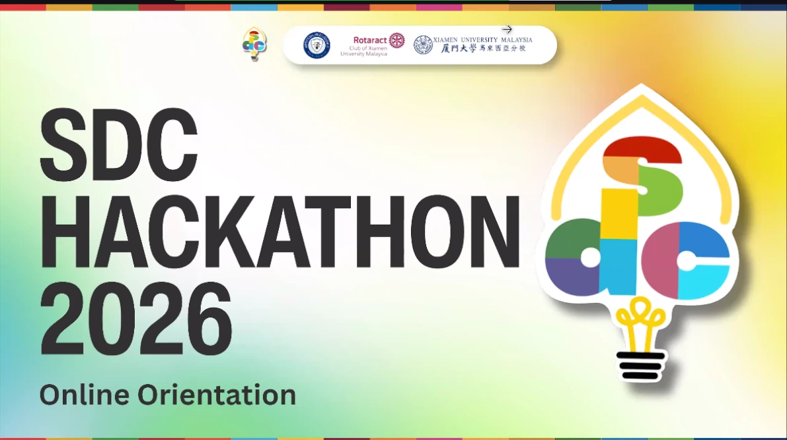

**SDC Hackathon 2026**

_Title card._

Online Orientation

## Slide 02: What will we cover tonight

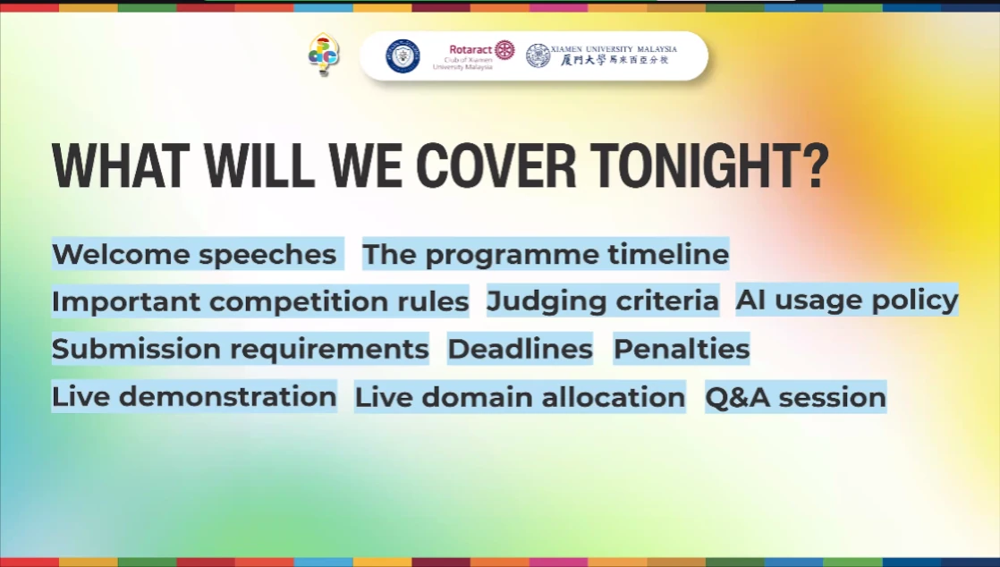

**What Will We Cover Tonight?**

- Welcome speeches
- The programme timeline
- Important competition rules
- Judging criteria
- AI usage policy
- Submission requirements
- Deadlines
- Penalties
- Live demonstration
- Live domain allocation
- Q&A session

## Slide 03: House rules

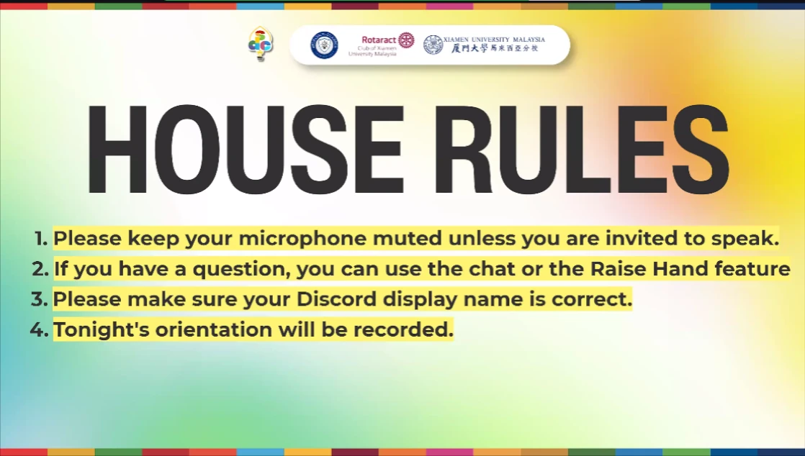

**House Rules**

1. Please keep your microphone muted unless you are invited to speak.
2. If you have a question, you can use the chat or the Raise Hand feature
3. Please make sure your Discord display name is correct.
4. Tonight's orientation will be recorded.

## Slide 04: Organising chairperson

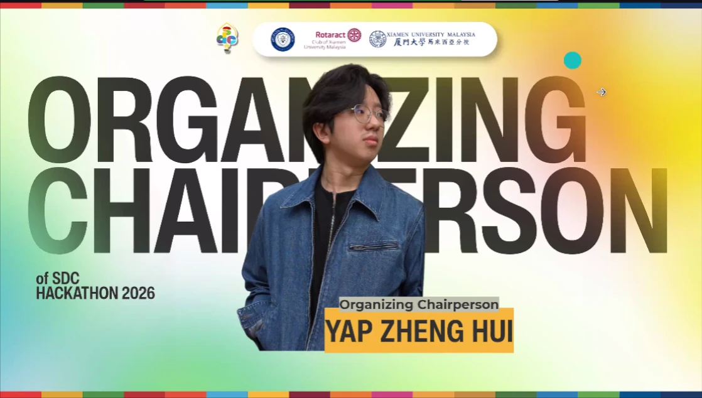

**Organizing Chairperson**

of SDC Hackathon 2026

Organizing Chairperson

Yap Zheng Hui

## Slide 05: AIverseCity, diamond sponsor

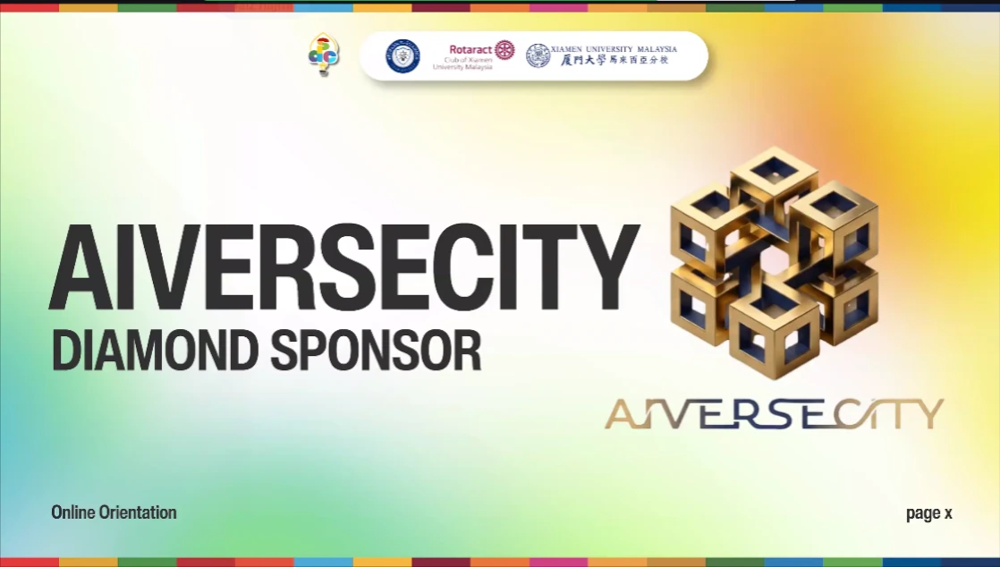

**AIverseCity**

Diamond Sponsor

Online Orientation

page x

## Slide 06: ORION AI Youth Community membership benefits

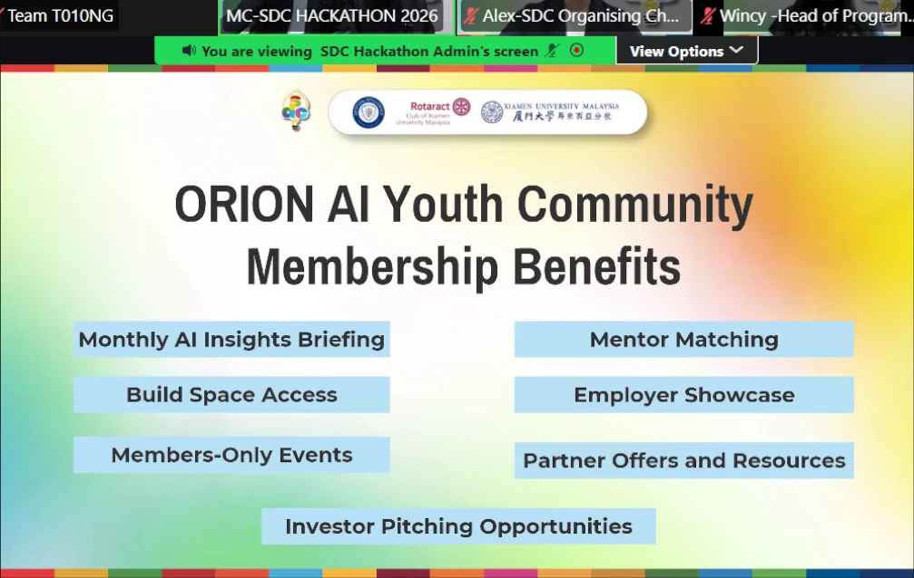

**ORION AI Youth Community Membership Benefits**

- Monthly AI Insights Briefing
- Mentor Matching
- Build Space Access
- Employer Showcase
- Members-Only Events
- Partner Offers and Resources
- Investor Pitching Opportunities

## Slide 07: Alphared Solutions, platinum sponsor

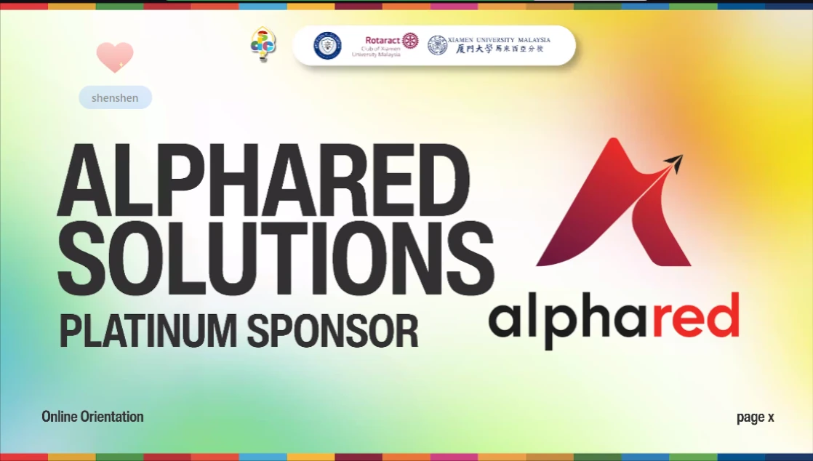

**Alphared Solutions**

Platinum Sponsor

Online Orientation

page x

## Slide 08: Replit, tech sponsor

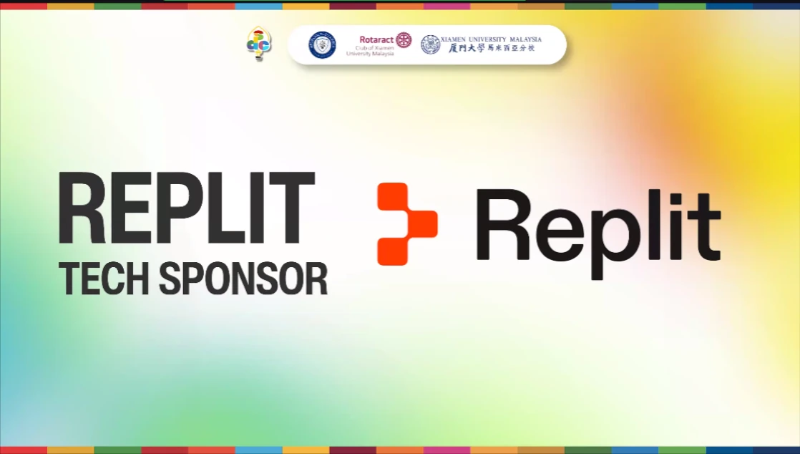

**Replit**

Tech Sponsor

## Slide 09: Kracked Devs, tech sponsor

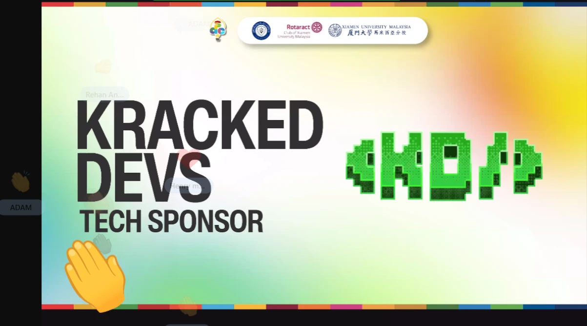

**Kracked Devs**

Tech Sponsor

## Slide 10: Programme timeline

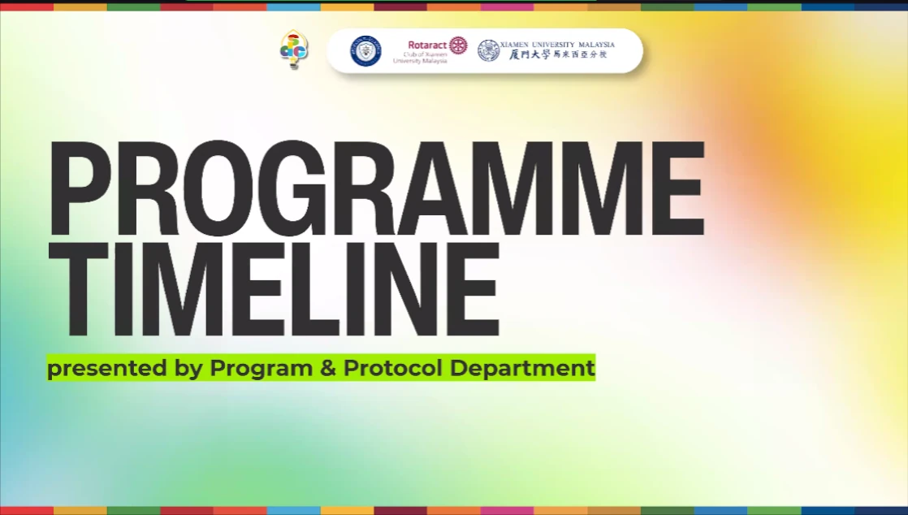

**Programme Timeline**

_Section title card._

presented by Program & Protocol Department

## Slide 11: Event timeline

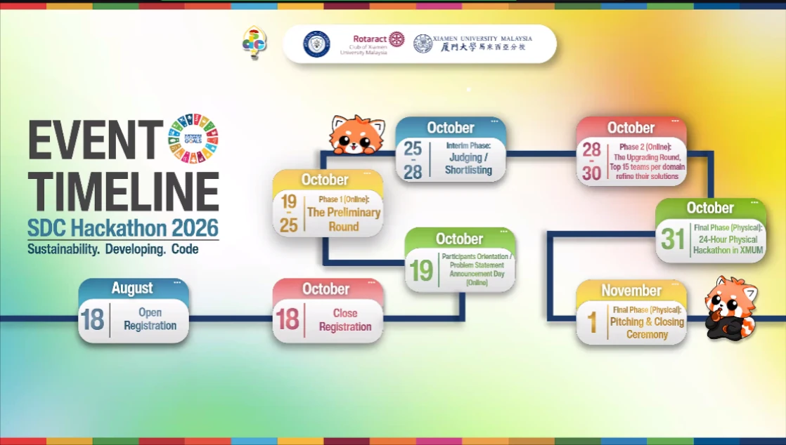

**Event Timeline**

SDC Hackathon 2026

Sustainability. Developing. Code

| Date          | Event                                                                                 |
| ------------- | ------------------------------------------------------------------------------------- |
| August 18     | Open Registration                                                                     |
| October 18    | Close Registration                                                                    |
| October 19    | Participants Orientation / Problem Statement Announcement Day (Online)                |
| October 19–25 | Phase 1 (Online): The Preliminary Round                                               |
| October 25–28 | Interim Phase: Judging / Shortlisting                                                 |
| October 28–30 | Phase 2 (Online): The Upgrading Round, Top 15 teams per domain refine their solutions |
| October 31    | Final Phase (Physical): 24-Hour Physical Hackathon in XMUM                            |
| November 1    | Final Phase (Physical): Pitching & Closing Ceremony                                   |

## Slide 12: Competition briefing

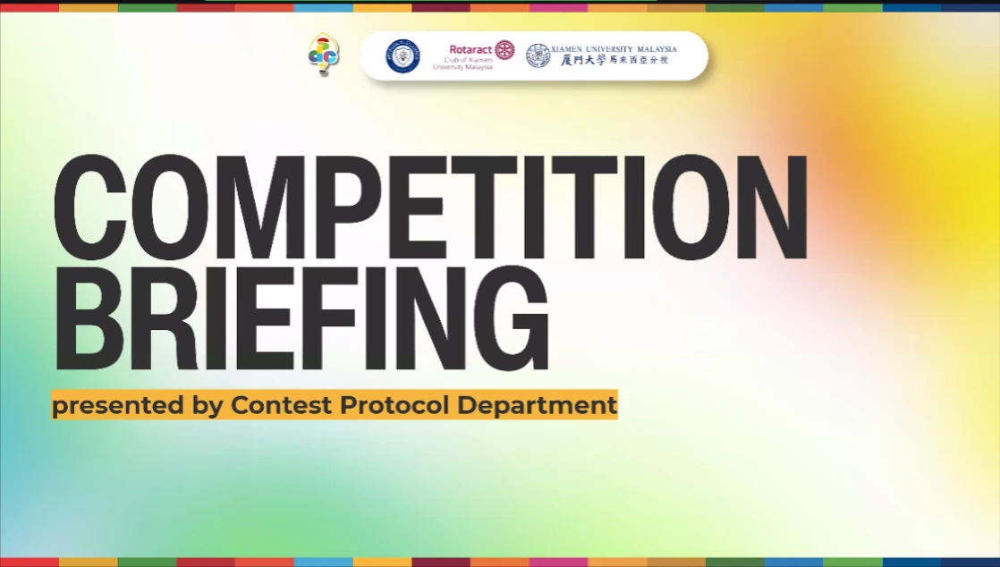

**Competition Briefing**

_Section title card._

presented by Contest Protocol Department

## Slide 13: Contest protocol agenda

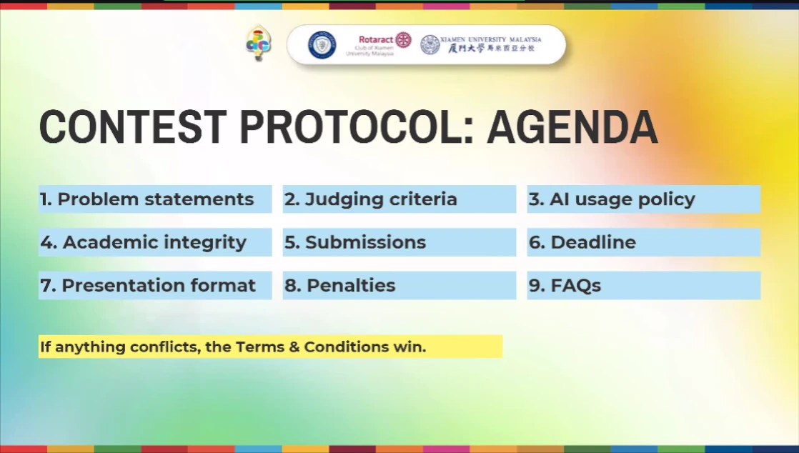

**Contest Protocol: Agenda**

1. Problem statements
2. Judging criteria
3. AI usage policy
4. Academic integrity
5. Submissions
6. Deadline
7. Presentation format
8. Penalties
9. FAQs

If anything conflicts, the Terms & Conditions win.

## Slide 14: Participant Drive

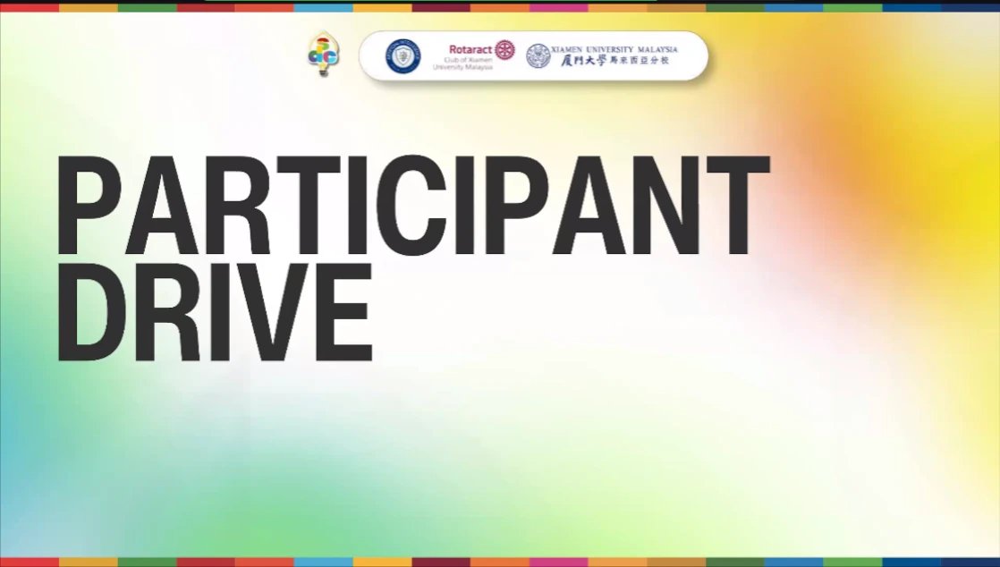

**Participant Drive**

_Section title card._

## Slide 15: Find your way: participant resources

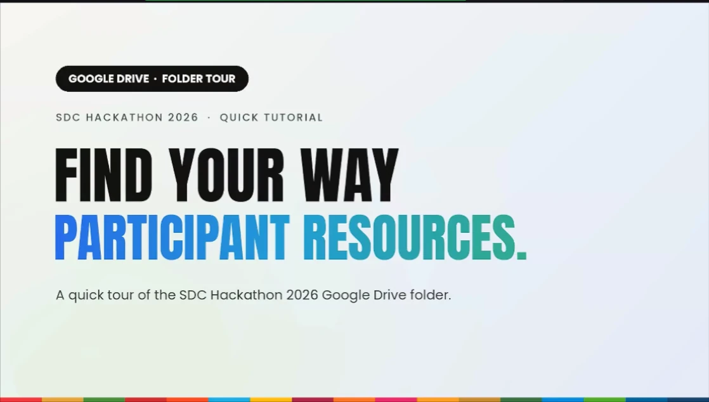

Google Drive · Folder Tour

SDC Hackathon 2026 · Quick Tutorial

**Find Your Way**

**Participant Resources.**

A quick tour of the SDC Hackathon 2026 Google Drive folder.

## Slide 16: The folder map

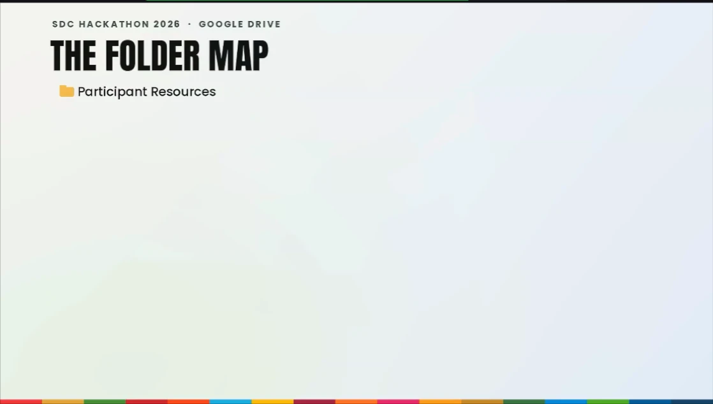

SDC Hackathon 2026 · Google Drive

**The Folder Map**

_Only the top-level folder is shown in this frame._

- Participant Resources

## Slide 17: Drive step 1: Domain 1

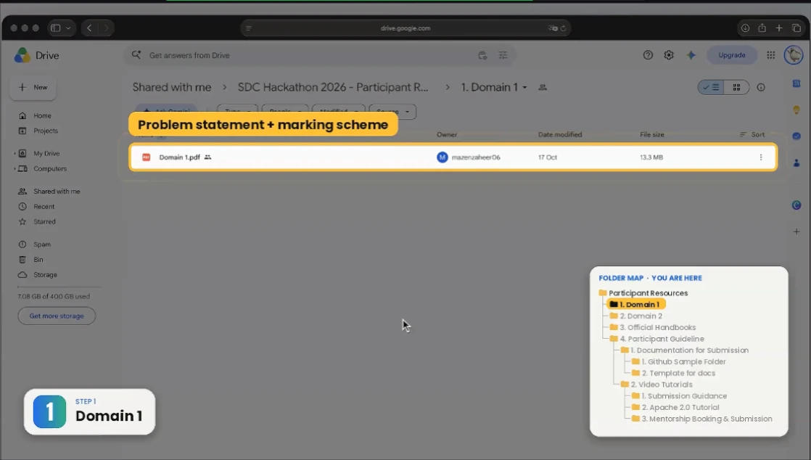

_Still from the Drive tour video: the Domain 1 folder in Google Drive._

**Step 1: Domain 1**

Location: Shared with me > SDC Hackathon 2026 - Participant R... > 1. Domain 1

Callout: **Problem statement + marking scheme**, highlighting the file below.

- Domain 1.pdf

**Folder map · You are here**

- Participant Resources
  - **1. Domain 1**
  - 2\. Domain 2
  - 3\. Official Handbooks
  - 4\. Participant Guideline
    - 1\. Documentation for Submission
      - 1\. Github Sample Folder
      - 2\. Template for docs
    - 2\. Video Tutorials
      - 1\. Submission Guidance
      - 2\. Apache 2.0 Tutorial
      - 3\. Mentorship Booking & Submission

## Slide 18: Drive step 2: Domain 2

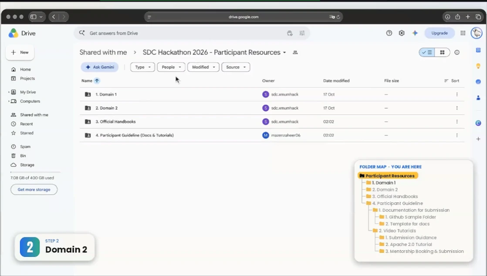

_Still from the Drive tour video: the top-level Participant Resources folder in Google Drive._

**Step 2: Domain 2**

Location: Shared with me > SDC Hackathon 2026 - Participant Resources

- 1\. Domain 1
- 2\. Domain 2
- 3\. Official Handbooks
- 4\. Participant Guideline (Docs & Tutorials)

**Folder map · You are here**

- **Participant Resources**
  - 1\. Domain 1
  - 2\. Domain 2
  - 3\. Official Handbooks
  - 4\. Participant Guideline
    - 1\. Documentation for Submission
      - 1\. Github Sample Folder
      - 2\. Template for docs
    - 2\. Video Tutorials
      - 1\. Submission Guidance
      - 2\. Apache 2.0 Tutorial
      - 3\. Mentorship Booking & Submission

## Slide 19: Drive step 3: Official handbooks

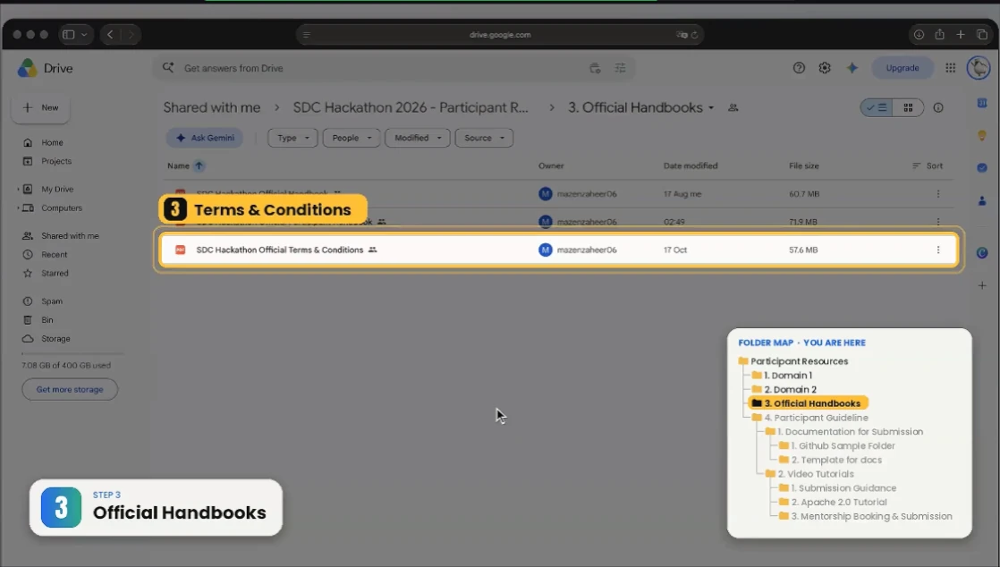

_Still from the Drive tour video: the Official Handbooks folder in Google Drive._

**Step 3: Official Handbooks**

Location: Shared with me > SDC Hackathon 2026 - Participant R... > 3. Official Handbooks

Callout: **3 Terms & Conditions**, highlighting the third file.

- SDC Hackathon Official Handbook
- [covered]
- SDC Hackathon Official Terms & Conditions

**Folder map · You are here**

- Participant Resources
  - 1\. Domain 1
  - 2\. Domain 2
  - **3. Official Handbooks**
  - 4\. Participant Guideline
    - 1\. Documentation for Submission
      - 1\. Github Sample Folder
      - 2\. Template for docs
    - 2\. Video Tutorials
      - 1\. Submission Guidance
      - 2\. Apache 2.0 Tutorial
      - 3\. Mentorship Booking & Submission

## Slide 20: Drive step 4: Participant guideline

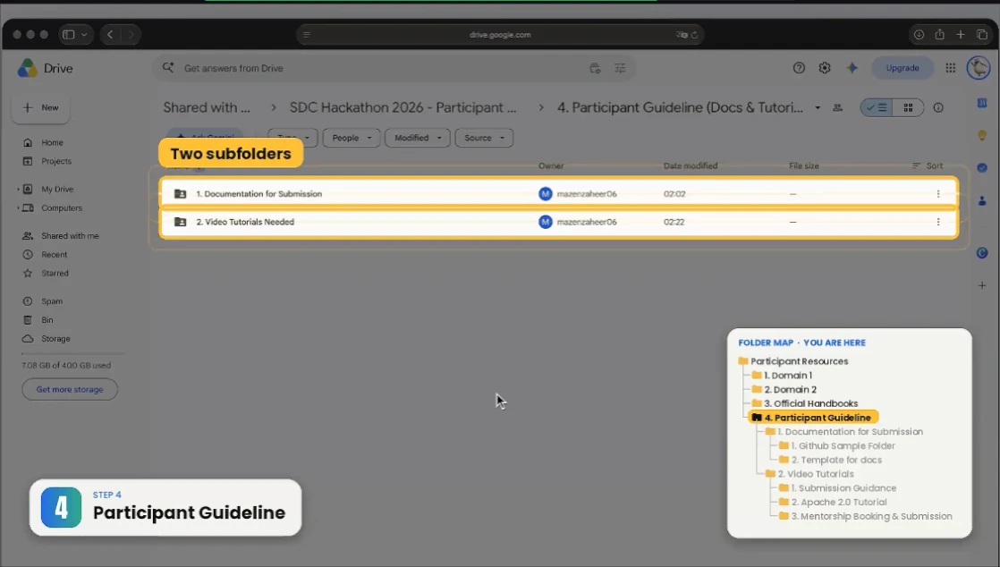

_Still from the Drive tour video: the Participant Guideline folder in Google Drive._

**Step 4: Participant Guideline**

Location: Shared with ... > SDC Hackathon 2026 - Participant ... > 4. Participant Guideline (Docs & Tutori...

Callout: **Two subfolders**, highlighting both folders below.

- 1\. Documentation for Submission
- 2\. Video Tutorials Needed

**Folder map · You are here**

- Participant Resources
  - 1\. Domain 1
  - 2\. Domain 2
  - 3\. Official Handbooks
  - **4. Participant Guideline**
    - 1\. Documentation for Submission
      - 1\. Github Sample Folder
      - 2\. Template for docs
    - 2\. Video Tutorials
      - 1\. Submission Guidance
      - 2\. Apache 2.0 Tutorial
      - 3\. Mentorship Booking & Submission

## Slide 21: Drive step 5: GitHub sample folder

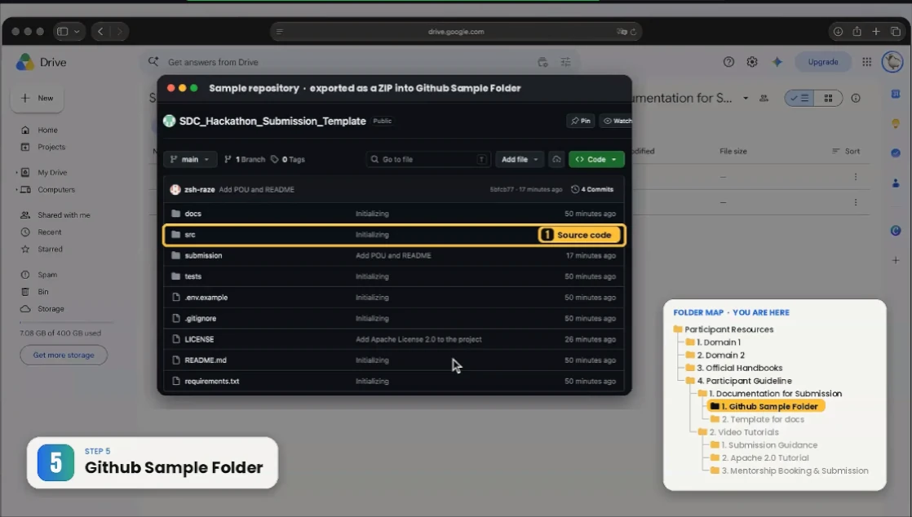

_Still from the Drive tour video: a GitHub repository window overlaid on the Google Drive folder._

**Step 5: Github Sample Folder**

Window caption: **Sample repository · exported as a ZIP into Github Sample Folder**

Repository: SDC_Hackathon_Submission_Template (Public) · main · 1 Branch · 0 Tags · 4 Commits · latest commit "Add POU and README"

Callout: **1 Source code**, highlighting the src folder.

| Name             | Last commit message                   |
| ---------------- | ------------------------------------- |
| docs             | Initializing                          |
| src              | Initializing                          |
| submission       | Add POU and README                    |
| tests            | Initializing                          |
| .env.example     | Initializing                          |
| .gitignore       | Initializing                          |
| LICENSE          | Add Apache License 2.0 to the project |
| README.md        | Initializing                          |
| requirements.txt | Initializing                          |

**Folder map · You are here**

- Participant Resources
  - 1\. Domain 1
  - 2\. Domain 2
  - 3\. Official Handbooks
  - 4\. Participant Guideline
    - 1\. Documentation for Submission
      - **1. Github Sample Folder**
      - 2\. Template for docs
    - 2\. Video Tutorials
      - 1\. Submission Guidance
      - 2\. Apache 2.0 Tutorial
      - 3\. Mentorship Booking & Submission

## Slide 22: Drive step 6: Template for docs

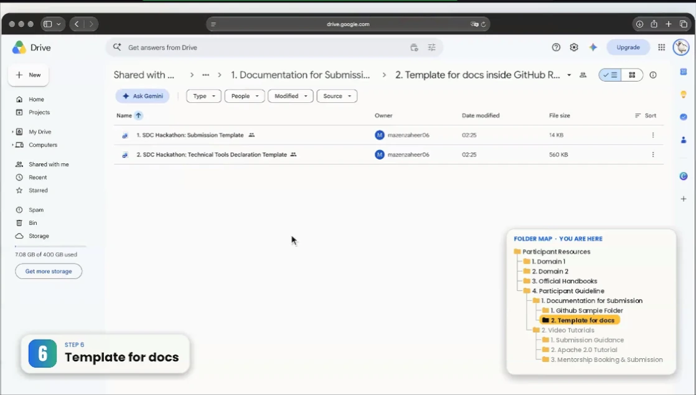

_Still from the Drive tour video: the Template for docs folder in Google Drive._

**Step 6: Template for docs**

Location: Shared with ... > ... > 1. Documentation for Submissi... > 2. Template for docs inside GitHub R...

- 1\. SDC Hackathon: Submission Template
- 2\. SDC Hackathon: Technical Tools Declaration Template

**Folder map · You are here**

- Participant Resources
  - 1\. Domain 1
  - 2\. Domain 2
  - 3\. Official Handbooks
  - 4\. Participant Guideline
    - 1\. Documentation for Submission
      - 1\. Github Sample Folder
      - **2. Template for docs**
    - 2\. Video Tutorials
      - 1\. Submission Guidance
      - 2\. Apache 2.0 Tutorial
      - 3\. Mentorship Booking & Submission

## Slide 23: Drive step 9: Apache 2.0 tutorial

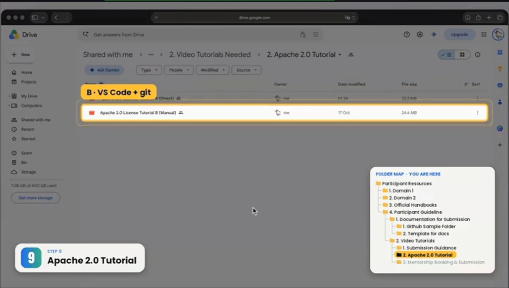

_Still from the Drive tour video: the Apache 2.0 Tutorial folder in Google Drive._

**Step 9: Apache 2.0 Tutorial**

Location: Shared with me > ... > 2. Video Tutorials Needed > 2. Apache 2.0 Tutorial

Callout: **B · VS Code + git**, highlighting the second file.

- [covered] A (Direct)
- Apache 2.0 License Tutorial B (Manual)

**Folder map · You are here**

- Participant Resources
  - 1\. Domain 1
  - 2\. Domain 2
  - 3\. Official Handbooks
  - 4\. Participant Guideline
    - 1\. Documentation for Submission
      - 1\. Github Sample Folder
      - 2\. Template for docs
    - 2\. Video Tutorials
      - 1\. Submission Guidance
      - **2. Apache 2.0 Tutorial**
      - 3\. Mentorship Booking & Submission

## Slide 24: Drive step 10: Mentorship booking and submission

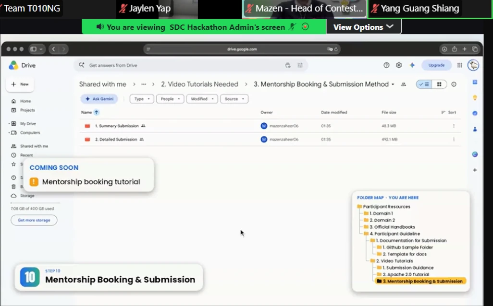

_Still from the Drive tour video: the Mentorship Booking & Submission Method folder in Google Drive._

**Step 10: Mentorship Booking & Submission**

Location: Shared with me > ... > 2. Video Tutorials Needed > 3. Mentorship Booking & Submission Method

- 1\. Summary Submission
- 2\. Detailed Submission

Callout: **Coming soon**: Mentorship booking tutorial

**Folder map · You are here**

- Participant Resources
  - 1\. Domain 1
  - 2\. Domain 2
  - 3\. Official Handbooks
  - 4\. Participant Guideline
    - 1\. Documentation for Submission
      - 1\. Github Sample Folder
      - 2\. Template for docs
    - 2\. Video Tutorials
      - 1\. Submission Guidance
      - 2\. Apache 2.0 Tutorial
      - **3. Mentorship Booking & Submission**

## Slide 25: Drive tour recap

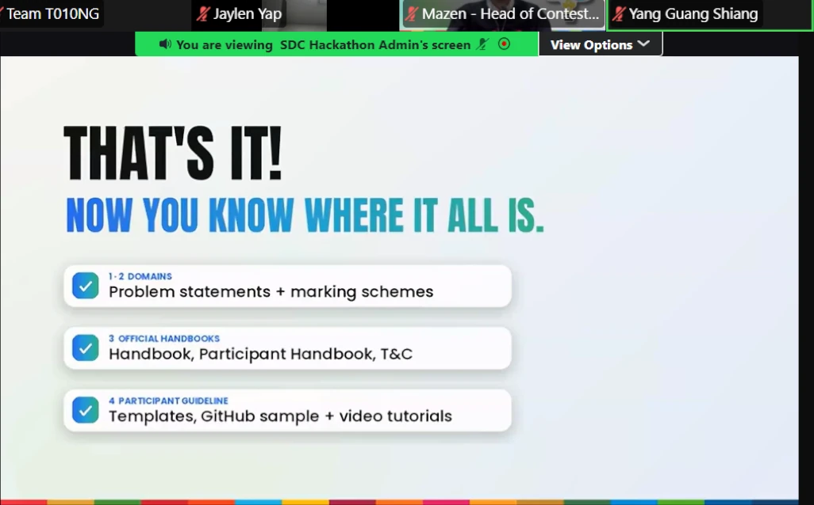

**That's it!**

**Now you know where it all is.**

- **1·2 Domains:** Problem statements + marking schemes
- **3 Official Handbooks:** Handbook, Participant Handbook, T&C
- **4 Participant Guideline:** Templates, GitHub sample + video tutorials

## Slide 26: Two domains

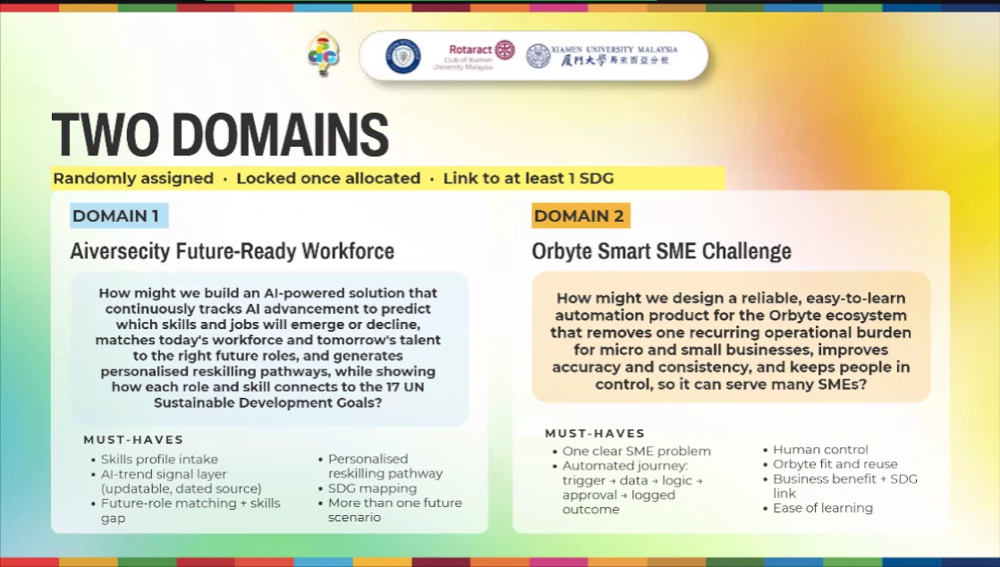

**Two domains**

Randomly assigned · Locked once allocated · Link to at least 1 SDG

**Domain 1: Aiversecity Future-Ready Workforce**

How might we build an AI-powered solution that continuously tracks AI advancement to predict which skills and jobs will emerge or decline, matches today's workforce and tomorrow's talent to the right future roles, and generates personalised reskilling pathways, while showing how each role and skill connects to the 17 UN Sustainable Development Goals?

**Must-haves**

- Skills profile intake
- AI-trend signal layer (updatable, dated source)
- Future-role matching + skills gap
- Personalised reskilling pathway
- SDG mapping
- More than one future scenario

**Domain 2: Orbyte Smart SME Challenge**

How might we design a reliable, easy-to-learn automation product for the Orbyte ecosystem that removes one recurring operational burden for micro and small businesses, improves accuracy and consistency, and keeps people in control, so it can serve many SMEs?

**Must-haves**

- One clear SME problem
- Automated journey: trigger → data → logic → approval → logged outcome
- Human control
- Orbyte fit and reuse
- Business benefit + SDG link
- Ease of learning

## Slide 27: Rules for both domains

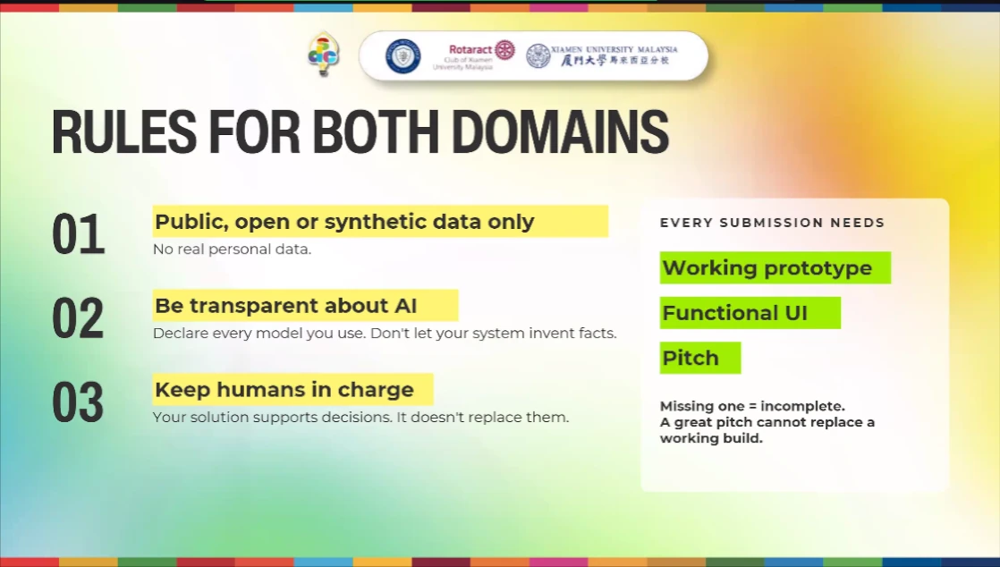

**Rules for both domains**

- **01 Public, open or synthetic data only:** No real personal data.
- **02 Be transparent about AI:** Declare every model you use. Don't let your system invent facts.
- **03 Keep humans in charge:** Your solution supports decisions. It doesn't replace them.

**Every submission needs**

- Working prototype
- Functional UI
- Pitch

**Missing one = incomplete. A great pitch cannot replace a working build.**

## Slide 28: Preliminary round rubric

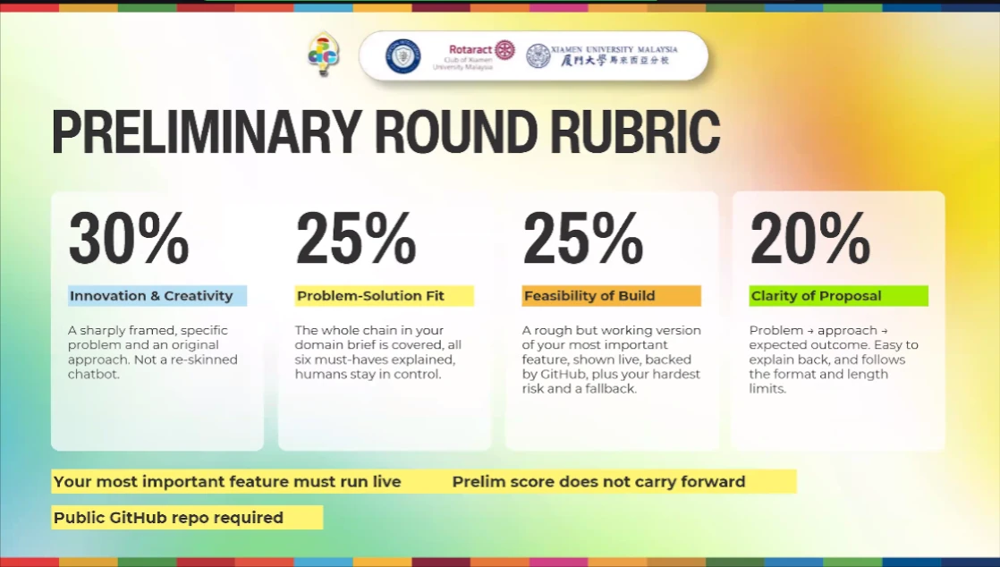

**Preliminary round rubric**

| Weight | Criterion               | Description                                                                                                                      |
| ------ | ----------------------- | -------------------------------------------------------------------------------------------------------------------------------- |
| 30%    | Innovation & Creativity | A sharply framed, specific problem and an original approach. Not a re-skinned chatbot.                                           |
| 25%    | Problem-Solution Fit    | The whole chain in your domain brief is covered, all six must-haves explained, humans stay in control.                           |
| 25%    | Feasibility of Build    | A rough but working version of your most important feature, shown live, backed by GitHub, plus your hardest risk and a fallback. |
| 20%    | Clarity of Proposal     | Problem → approach → expected outcome. Easy to explain back, and follows the format and length limits.                           |

- Your most important feature must run live
- Prelim score does not carry forward
- Public GitHub repo required

## Slide 29: AI usage policy

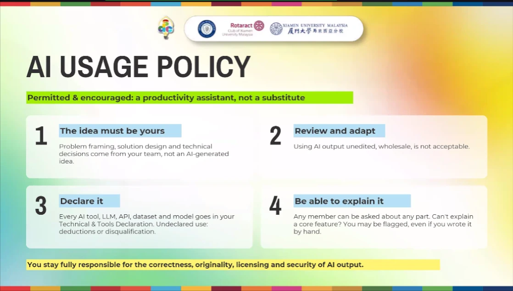

**AI usage policy**

Permitted & encouraged: a productivity assistant, not a substitute

- **1 The idea must be yours:** Problem framing, solution design and technical decisions come from your team, not an AI-generated idea.
- **2 Review and adapt:** Using AI output unedited, wholesale, is not acceptable.
- **3 Declare it:** Every AI tool, LLM, API, dataset and model goes in your Technical & Tools Declaration. Undeclared use: deductions or disqualification.
- **4 Be able to explain it:** Any member can be asked about any part. Can't explain a core feature? You may be flagged, even if you wrote it by hand.

You stay fully responsible for the correctness, originality, licensing and security of AI output.

## Slide 30: Academic integrity

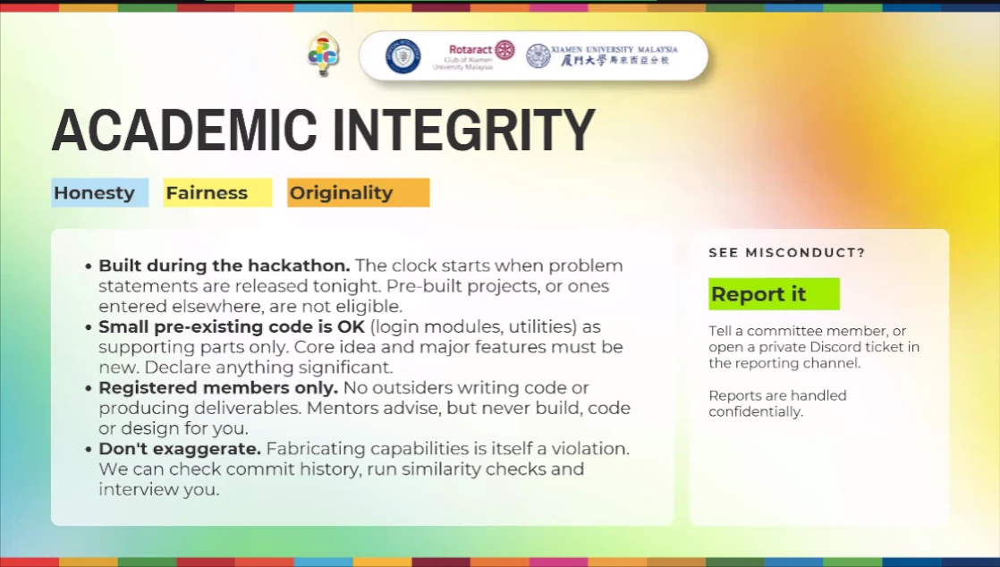

**Academic integrity**

Honesty · Fairness · Originality

- **Built during the hackathon.** The clock starts when problem statements are released tonight. Pre-built projects, or ones entered elsewhere, are not eligible.
- **Small pre-existing code is OK** (login modules, utilities) as supporting parts only. Core idea and major features must be new. Declare anything significant.
- **Registered members only.** No outsiders writing code or producing deliverables. Mentors advise, but never build, code or design for you.
- **Don't exaggerate.** Fabricating capabilities is itself a violation. We can check commit history, run similarity checks and interview you.

**See misconduct?**

**Report it**

Tell a committee member, or open a private Discord ticket in the reporting channel.

Reports are handled confidentially.

## Slide 31: How to submit

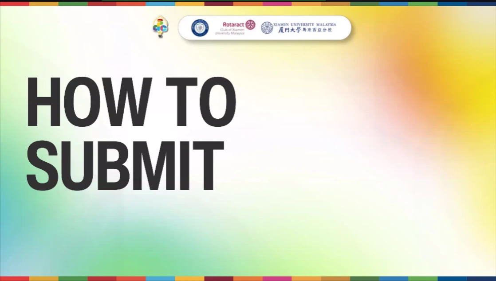

**How to submit**

_Section title card._

## Slide 32: Submit your repo: what judges need to see

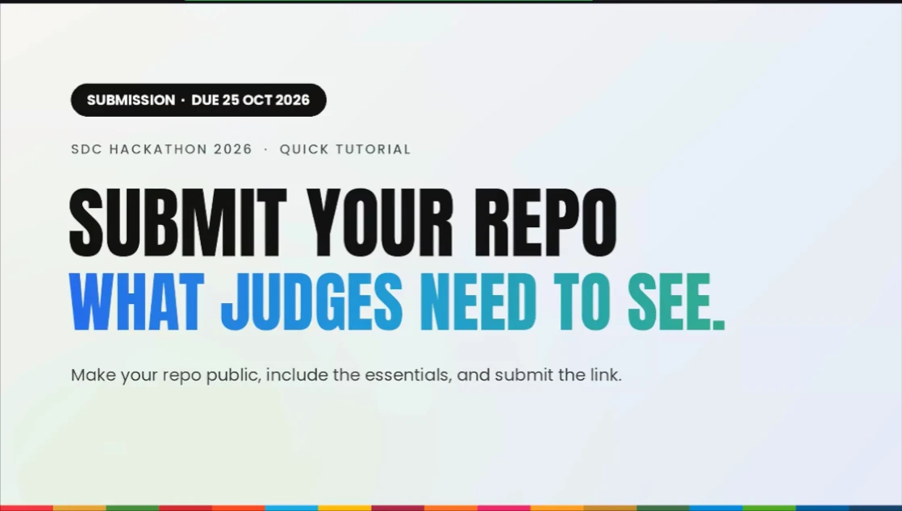

Submission · Due 25 Oct 2026

SDC Hackathon 2026 · Quick tutorial

**Submit your repo**

**What judges need to see.**

Make your repo public, include the essentials, and submit the link.

## Slide 33: Repo step: make the template public

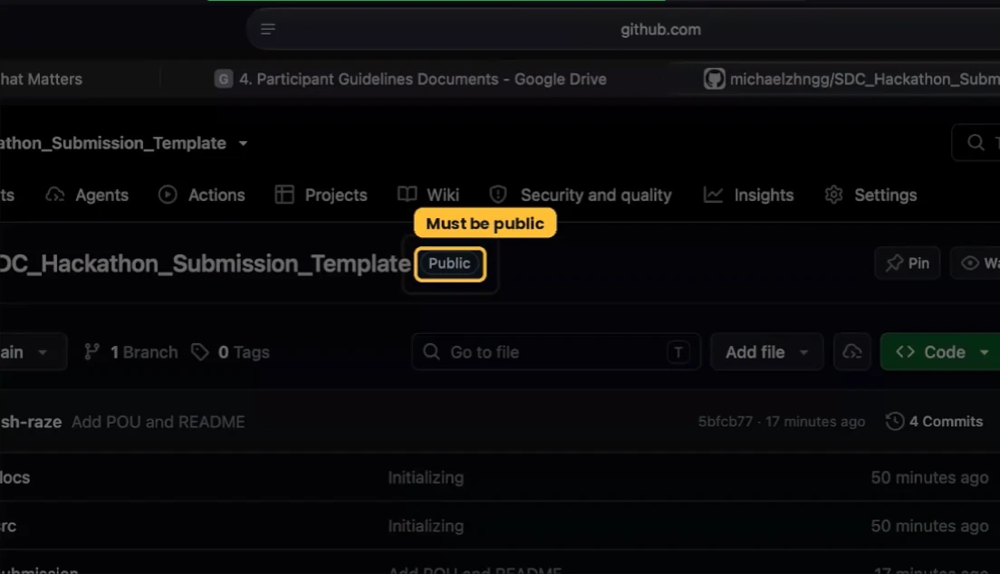

_Still from the repo tutorial video: the SDC_Hackathon_Submission_Template repository on GitHub, zoomed in on its visibility badge._

Callout: **Must be public**, highlighting the **Public** badge next to the repository name.

Visible repo details: main · 1 Branch · 0 Tags · 4 Commits · latest commit "Add POU and README"; the file list (docs, src, submission) is cut off at the frame edge.

## Slide 34: Repo step: submission template and proof of use

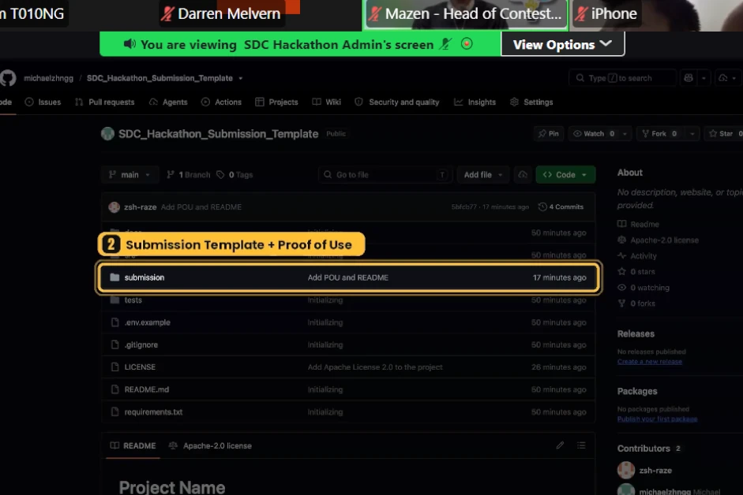

_Still from the submission tutorial video: the SDC_Hackathon_Submission_Template repository on GitHub, with the `submission` folder highlighted._

**2 · Submission Template + Proof of Use**

Repository: [username] / SDC_Hackathon_Submission_Template (Public) · branch `main` · 1 Branch · 0 Tags · 4 Commits · latest commit "Add POU and README"

| File or folder           | Last commit message                   |
| ------------------------ | ------------------------------------- |
| [covered]                | [covered]                             |
| [covered]                | [covered]                             |
| submission (highlighted) | Add POU and README                    |
| tests                    | Initializing                          |
| .env.example             | Initializing                          |
| .gitignore               | Initializing                          |
| LICENSE                  | Add Apache License 2.0 to the project |
| README.md                | Initializing                          |
| requirements.txt         | Initializing                          |

About panel: Readme · Apache-2.0 license. README preview heading: Project Name.

## Slide 35: Repo step: what the README must include

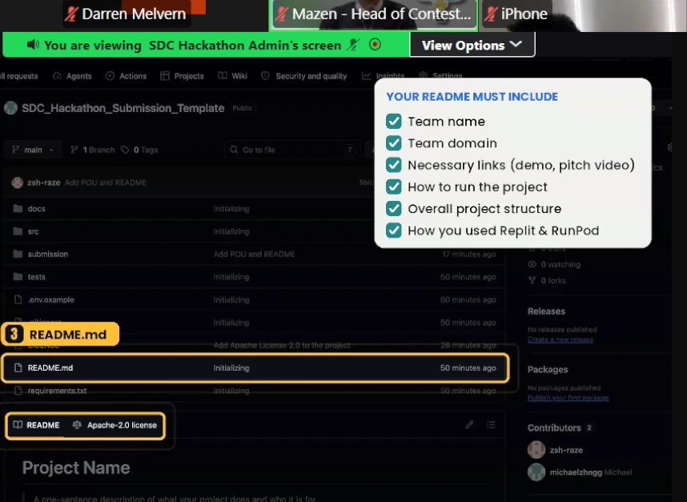

_Still from the submission tutorial video: the template repository on GitHub, with README.md and the README / Apache-2.0 license tabs highlighted and a checklist panel overlaid._

**3 · README.md**

**Your README must include**

- Team name
- Team domain
- Necessary links (demo, pitch video)
- How to run the project
- Overall project structure
- How you used Replit & RunPod

Visible files: docs, src, submission, tests, .env.example, .gitignore, LICENSE, README.md (highlighted), requirements.txt. README preview: "Project Name" and "A one-sentence description of what your project does and who it is for."

## Slide 36: Repo step: Apache 2.0 licence

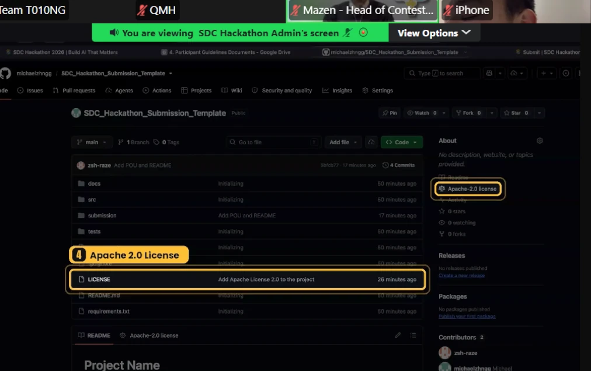

_Still from the submission tutorial video: the template repository on GitHub, with the LICENSE file and the Apache-2.0 license link in the About panel highlighted._

**4 · Apache 2.0 License**

Highlighted file: LICENSE, last commit "Add Apache License 2.0 to the project". Highlighted About entry: Apache-2.0 license.

## Slide 37: Repo step: paste it on the Submit page

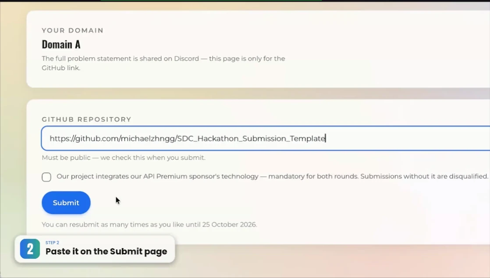

_Still from the submission tutorial video: the GitHub Repository field on the SDC Submit page._

**Step 2: Paste it on the Submit page**

**Your domain**

Domain A

The full problem statement is shared on Discord — this page is only for the GitHub link.

**GitHub repository**

Field: https://github.com/[username]/SDC_Hackathon_Submission_Template

Must be public — we check this when you submit.

Checkbox: Our project integrates our API Premium sponsor's technology — mandatory for both rounds. Submissions without it are disqualified.

Button: Submit

You can resubmit as many times as you like until 25 October 2026.

## Slide 38: Repo tutorial recap

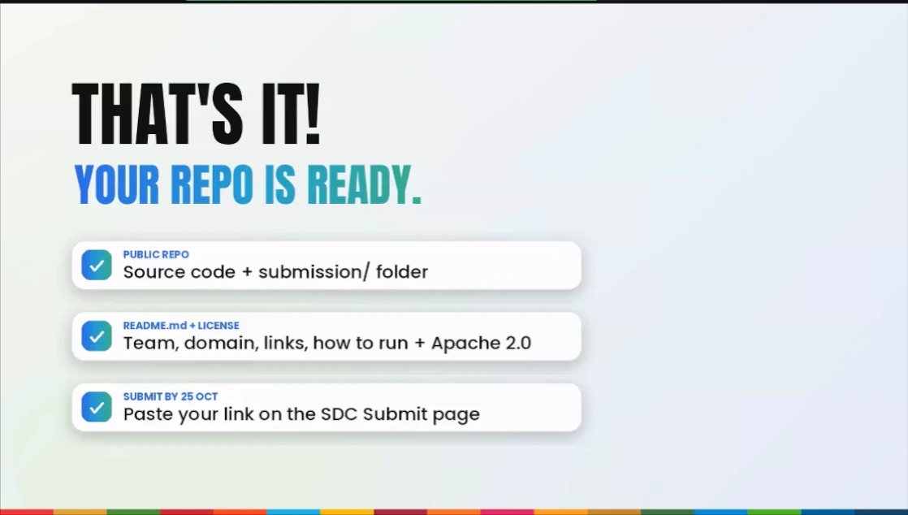

**That's it!**

**Your repo is ready.**

- **Public repo:** Source code + submission/ folder
- **README.md + LICENSE:** Team, domain, links, how to run + Apache 2.0
- **Submit by 25 Oct:** Paste your link on the SDC Submit page

## Slide 39: What your repo needs

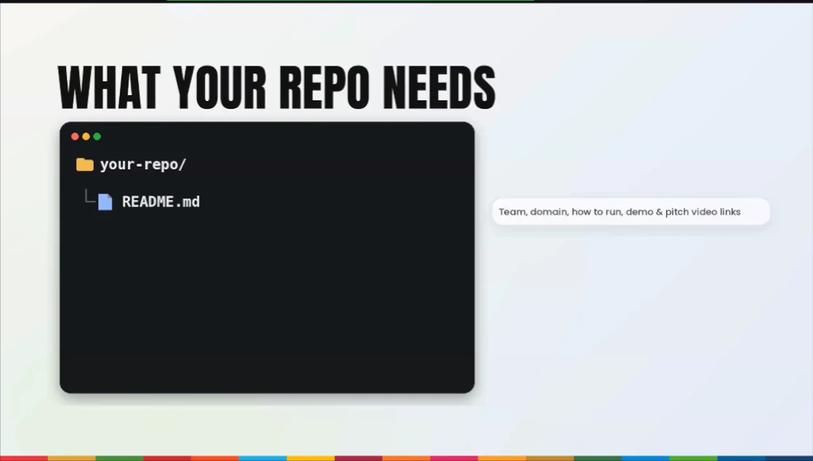

**What your repo needs**

```
your-repo/
└ README.md
```

Note beside README.md: Team, domain, how to run, demo & pitch video links

## Slide 40: Repo step: create a submission folder

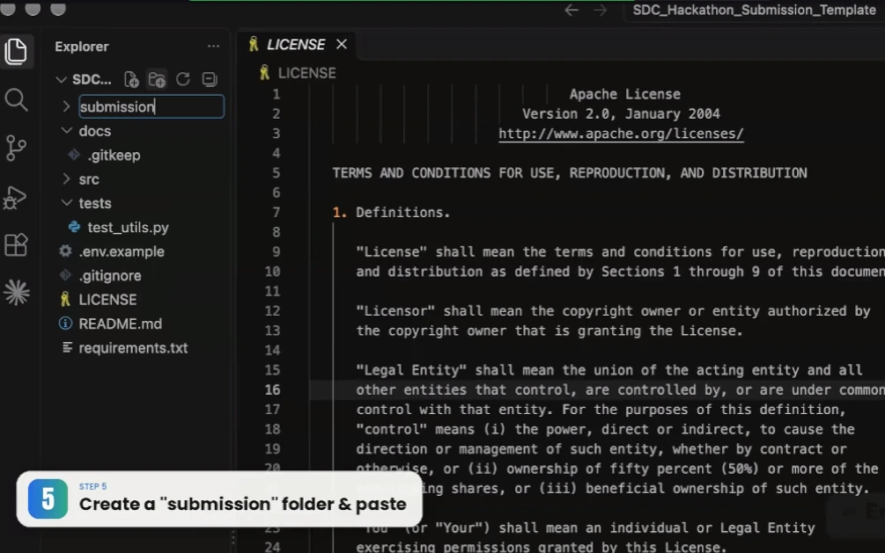

_Still from the submission tutorial video: VS Code with the SDC_Hackathon_Submission_Template folder open, a new folder being named "submission" in the Explorer, and the LICENSE file (Apache License, Version 2.0, January 2004) open in the editor._

**Step 5: Create a "submission" folder & paste**

Explorer: submission (new folder being named), docs (.gitkeep), src, tests (test_utils.py), .env.example, .gitignore, LICENSE, README.md, requirements.txt

## Slide 41: What counts as proof of use

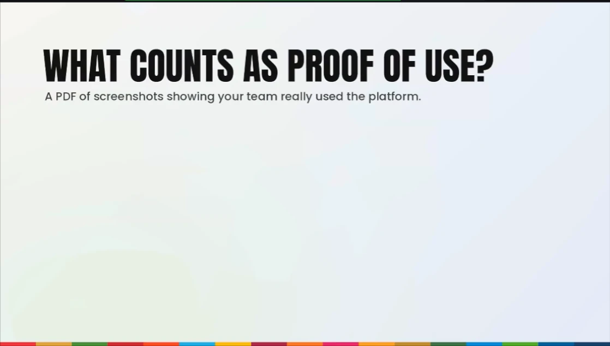

**What counts as proof of use?**

A PDF of screenshots showing your team really used the platform.

## Slide 42: Repo step: fill in the README

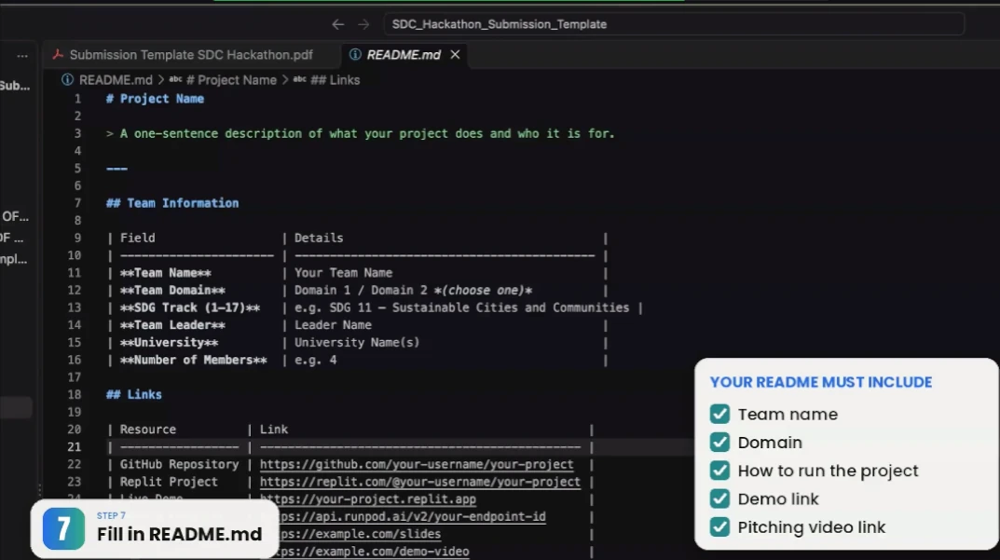

_Still from the submission tutorial video: the template's README.md open in VS Code (next to a "Submission Template SDC Hackathon.pdf" tab), with a checklist panel overlaid._

**Step 7: Fill in README.md**

**Your README must include**

- Team name
- Domain
- How to run the project
- Demo link
- Pitching video link

README.md as shown in the editor (lines 1 to 27):

```markdown
# Project Name

> A one-sentence description of what your project does and who it is for.

---

## Team Information

| Field                 | Details                                          |
| --------------------- | ------------------------------------------------ |
| **Team Name**         | Your Team Name                                   |
| **Team Domain**       | Domain 1 / Domain 2 _(choose one)_               |
| **SDG Track (1–17)**  | e.g. SDG 11 – Sustainable Cities and Communities |
| **Team Leader**       | Leader Name                                      |
| **University**        | University Name(s)                               |
| **Number of Members** | e.g. 4                                           |

## Links

| Resource          | Link                                            |
| ----------------- | ----------------------------------------------- |
| GitHub Repository | https://github.com/your-username/your-project   |
| Replit Project    | https://replit.com/@your-username/your-project  |
| Live Demo         | https://your-project.replit.app                 |
| [covered]         | [covered]ps://api.runpod.ai/v2/your-endpoint-id |
| [covered]         | [covered]ps://example.com/slides                |
| [covered]         | [covered]ps://example.com/demo-video            |
```

## Slide 43: Repo step: commit and push

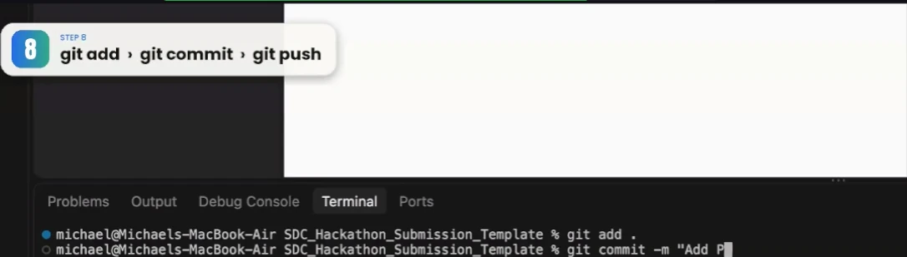

_Still from the submission tutorial video: the VS Code terminal with git commands being typed._

**Step 8: git add › git commit › git push**

```
[username] SDC_Hackathon_Submission_Template % git add .
[username] SDC_Hackathon_Submission_Template % git commit -m "Add P
```

## Slide 44: Submission tutorial recap

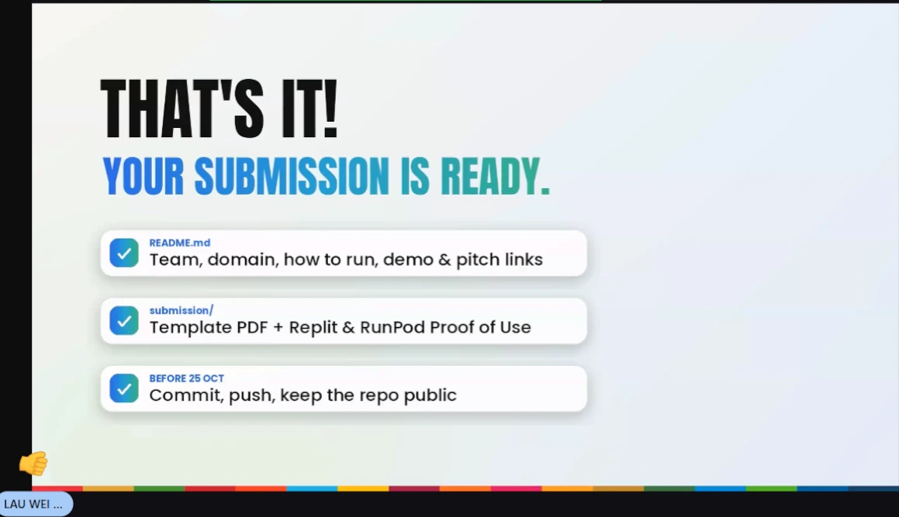

**That's it!**

**Your submission is ready.**

- **README.md:** Team, domain, how to run, demo & pitch links
- **submission/:** Template PDF + Replit & RunPod Proof of Use
- **Before 25 Oct:** Commit, push, keep the repo public

## Slide 45: Preliminary submission

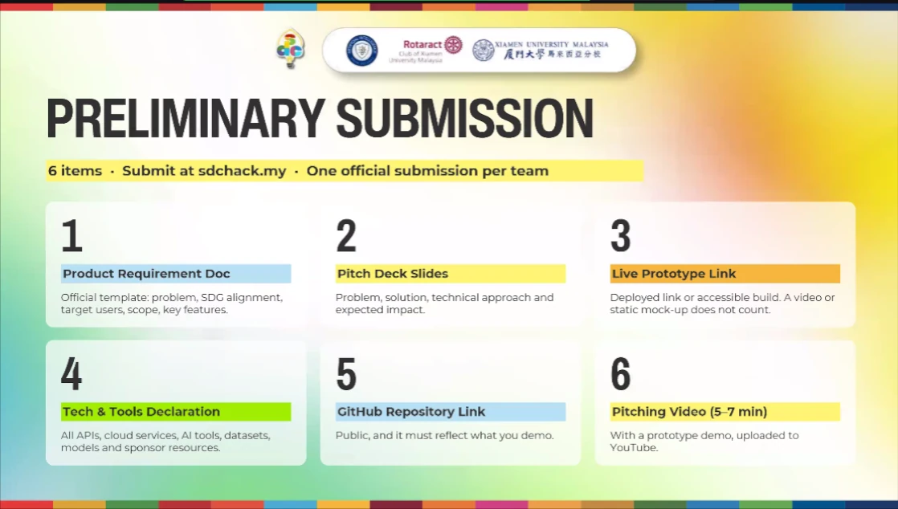

**Preliminary submission**

6 items · Submit at sdchack.my · One official submission per team

| #   | Item                     | Details                                                                       |
| --- | ------------------------ | ----------------------------------------------------------------------------- |
| 1   | Product Requirement Doc  | Official template: problem, SDG alignment, target users, scope, key features. |
| 2   | Pitch Deck Slides        | Problem, solution, technical approach and expected impact.                    |
| 3   | Live Prototype Link      | Deployed link or accessible build. A video or static mock-up does not count.  |
| 4   | Tech & Tools Declaration | All APIs, cloud services, AI tools, datasets, models and sponsor resources.   |
| 5   | GitHub Repository Link   | Public, and it must reflect what you demo.                                    |
| 6   | Pitching Video (5–7 min) | With a prototype demo, uploaded to YouTube.                                   |

## Slide 46: Tools and GitHub rules

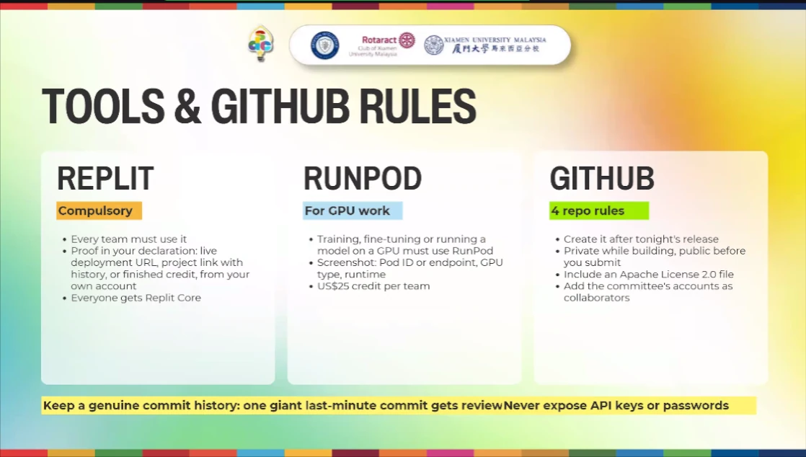

**Tools & GitHub rules**

**Replit**

_Compulsory_

- Every team must use it
- Proof in your declaration: live deployment URL, project link with history, or finished credit, from your own account
- Everyone gets Replit Core

**RunPod**

_For GPU work_

- Training, fine-tuning or running a model on a GPU must use RunPod
- Screenshot: Pod ID or endpoint, GPU type, runtime
- US$25 credit per team

**GitHub**

_4 repo rules_

- Create it after tonight's release
- Private while building, public before you submit
- Include an Apache License 2.0 file
- Add the committee's accounts as collaborators

Keep a genuine commit history: one giant last-minute commit gets review

Never expose API keys or passwords

## Slide 47: Deadline

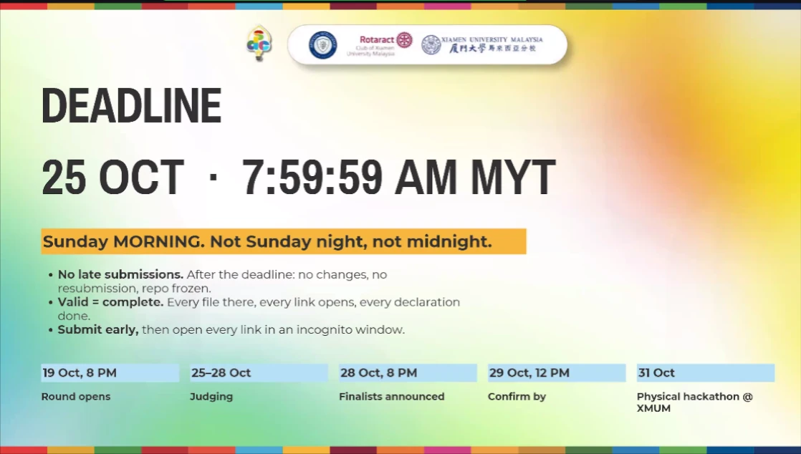

**Deadline**

**25 Oct · 7:59:59 AM MYT**

Sunday MORNING. Not Sunday night, not midnight.

- **No late submissions.** After the deadline: no changes, no resubmission, repo frozen.
- **Valid = complete.** Every file there, every link opens, every declaration done.
- **Submit early,** then open every link in an incognito window.

| Date          | Milestone                 |
| ------------- | ------------------------- |
| 19 Oct, 8 PM  | Round opens               |
| 25–28 Oct     | Judging                   |
| 28 Oct, 8 PM  | Finalists announced       |
| 29 Oct, 12 PM | Confirm by                |
| 31 Oct        | Physical hackathon @ XMUM |

## Slide 48: Submit early

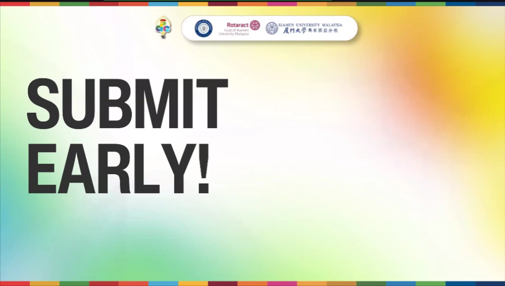

**Submit early!**

_Title card._

## Slide 49: Presentation format

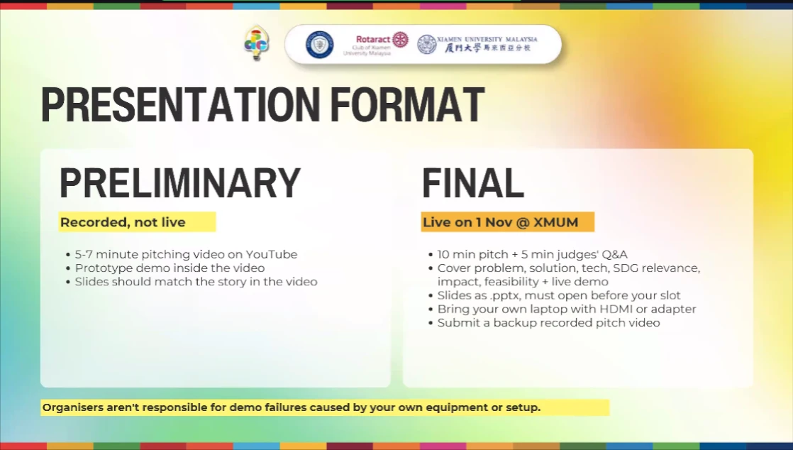

**Presentation format**

**Preliminary**

_Recorded, not live_

- 5-7 minute pitching video on YouTube
- Prototype demo inside the video
- Slides should match the story in the video

**Final**

_Live on 1 Nov @ XMUM_

- 10 min pitch + 5 min judges' Q&A
- Cover problem, solution, tech, SDG relevance, impact, feasibility + live demo
- Slides as .pptx, must open before your slot
- Bring your own laptop with HDMI or adapter
- Submit a backup recorded pitch video

Organisers aren't responsible for demo failures caused by your own equipment or setup.

## Slide 50: Penalties

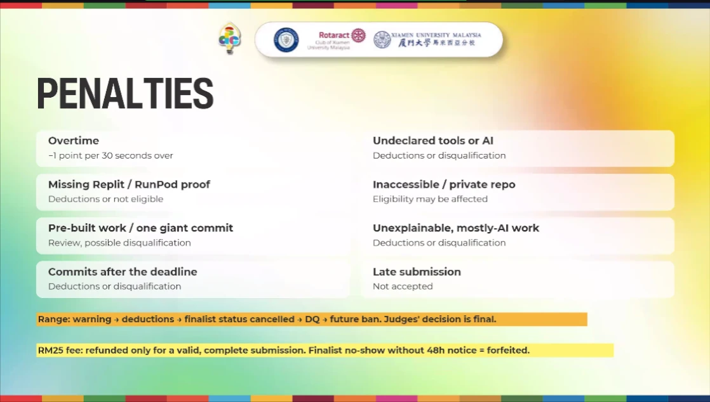

**Penalties**

| Penalty                           | Consequence                       |
| --------------------------------- | --------------------------------- |
| Overtime                          | −1 point per 30 seconds over      |
| Undeclared tools or AI            | Deductions or disqualification    |
| Missing Replit / RunPod proof     | Deductions or not eligible        |
| Inaccessible / private repo       | Eligibility may be affected       |
| Pre-built work / one giant commit | Review, possible disqualification |
| Unexplainable, mostly-AI work     | Deductions or disqualification    |
| Commits after the deadline        | Deductions or disqualification    |
| Late submission                   | Not accepted                      |

Range: warning → deductions → finalist status cancelled → DQ → future ban. Judges' decision is final.

RM25 fee: refunded only for a valid, complete submission. Finalist no-show without 48h notice = forfeited.

## Slide 51: FAQs


**FAQs**

| Question                | Answer                                                                              |
| ----------------------- | ----------------------------------------------------------------------------------- |
| Change team members?    | No. One team per person; unregistered people can't contribute.                      |
| Change our domain?      | No. Randomly assigned and locked.                                                   |
| Is a dataset provided?  | No. Use public, open or self-collected data. Credit sources; no real personal data. |
| Required language?      | No. But Replit is a must, and GPU work goes through RunPod.                         |
| Can we use AI tools?    | Yes. Declare them and be ready to explain everything.                               |
| Missed an announcement? | Discord is official. "I didn't see it" isn't accepted.                              |
| Can mentors write code? | No. Feedback only. Book slots early, bring specific questions.                      |
| GitHub or Replit down?  | Organisers assess it and announce any extension on Discord.                         |
| Formal questions?       | Official Discord, or sdc.xmumhack@gmail.com                                         |

## Slide 52: Questions? Ask us on Discord


**Questions?**

**Ask us on Discord**

- Build something original
- Declare everything you used
- Keep your commit history honest
- Submit early: before 7:59:59 AM, Sunday 25 Oct

## Slide 53: Website and Discord demonstration


**website & discord**

**Demonstration**

_Section title card._

## Slide 54: Good luck, teams


**Good luck, teams.**

SDC Hackathon 2026

_Closing title card with the SDC logo and the red panda mascot waving._

## Slide 55: Discord tour: introductions


_Still from the Discord tour video: the #introductions channel of the SDC HACK 1.0 server._

- Server: SDC HACK 1.0 (Boost Goal: 0/33 Boosts); search box "Search SDC HACK 1.0"
- Channel: #introductions, topic "Introduce yourself: name, university, skills, and what you want to build."
- Sidebar: Events, Browse Channels, Members; Voice Channels: Lounge; internal-xmum-committee category: committee-announcements, committee-general, meeting-notes, mod-chat, ops-checklist, incident-log, test-channel, main meeting, tech, pr/pi, promotional
- Main pane: participants' introduction posts and introduction threads (October 9 and 10, 2026)
- Member list: Technical Team — 2, Committee — 1, Online — 22

Caption: "Finally, let's explore our official"

## Slide 56: Discord tour: announcements


_Still from the Discord tour video: the #announcements channel._

- Channel: #announcements, topic "Official event announcements. Read-only for participants."
- Sidebar: committee channels (outreach, logistics-ga, creatives, technical-team); WELCOME & INFO: welcome, rules-and-conduct, announcements; HELP DESK: ask-the-organizers, open-ticket, ticket-0004 (NEW); TEXT CHANNELS: introductions, general, looking-for-team (thread "[ANNOUNCEMENT] New "Find Team..."), feedbacks, ask-tech
- Main pane: organiser announcements tagging @Members and @Verified: Participant, including one under the heading "For those who hasn't claimed the verified (after payment) role:" telling participants to ask their team leader for the Discord role claim link on the SDC website (https://sdchack.my/portal), and a welcome post with a link preview of the website: "SDC Hackathon 2026 | Build AI That Matters" — "A 2-week hybrid AI hackathon built around the UN Sustainable Development Goals. RM 16,000 in prizes. 19 Oct – 1 Nov 2026."
- Preview banner image: "XMUM AI Club • Rotaract Club · 19 Oct – 1 Nov 2026", "SDC Hackathon 2026", "Build AI that matters.", "RM 16,000 · 17 SDGs · Teams of 1-5", "Open to every student at a Malaysian university"
- Member list: Technical Team — 2, Committee — 1, Online — 22

Caption: "Next, we know that building projects can"

## Slide 57: Discord tour: ask-tech


_Still from the Discord tour video: the #ask-tech forum channel, with the cursor on New Post._

- Channel: ask-tech (forum); "Search or create a post...", **New Post** button, Sort & View
- Moderator-only panel "Get Started (0 of 5 Completed)" ("Only moderators can see this"):
  - Set recommended permissions: "Forums that let everyone post typically see more engagement." (roles: Technical Team, Committee, Verified: Participant)
  - Create post guidelines: "Make rules for posters to follow."
  - Create tags: "Help people organize their posts into subcategories and filter searches."
  - Set a default reaction for posts: "Choose the default emoji people will use to react to a post."
  - Make the first post!: "Start the conversation and get things going. See Examples"
- Member list: Technical Team — 2, Committee — 1, Online — 16

Caption: "any bugs on our platform, or if you need"

## Slide 58: Discord tour: open a ticket


_Still from the Discord tour video: a support ticket channel (#ticket-0004) opened from the Help Desk._

- Channel: #ticket-0004; HELP DESK category: ask-the-organizers, open-ticket, ticket-0004, closed-0006
- Ticket Tool (APP) welcome message (October 16, 2026): "Support will be with you shortly. To close this press the close button" — "TicketTool.xyz - Ticketing without clutter", with a **Close** button
- Main pane: a participant's question (with a screenshot of the "Your team" page) about whether teammates receive the email or log in with the leader's account, and a technical-team reply that teams should log in with the one leader account and that probably only the leader email receives notifications
- Member list: Technical Team — 2, Committee — 3, Online — 2, Offline — 38

Caption: "for you and our committee. Once your"

## Slide 59: Discord tour: ticket channel


_Still from the Discord tour video: a closed ticket channel (#closed-0006)._

- "Welcome to #closed-0006!" — "This is the start of the #closed-0006 private channel."
- Buttons: Add members or roles, Edit Channel
- Roles with access: carl-bot, Organizing Chairperson, Vice Organizing Chairperson, Committee, Role Bot
- Ticket Tool (APP) welcome message (October 16, 2026): "Support will be with you shortly. To close this press the close button" — "TicketTool.xyz - Ticketing without clutter", with a **Close** button
- "Ticket Closed by" the participant, followed by "Support team ticket controls": **Transcript**, **Open**, **Delete**
- Member list: Technical Team — 2, Committee — 3, Online — 2, Offline — 37

Caption: "here to ensure you have a smooth"

## Slide 60: The SDC Hackathon website


_Screenshot of the SDC Hackathon website home page (sdchack.my) in a browser, shared on Zoom._

- Top banner: "Registration open · RM50 + RM25 refundable deposit · Register →"
- Navigation: SDC Hackathon · About · Domains · Prizes · Sponsors · FAQ · Discord icon · **Log in** · **Register Your Team →**
- XMUM AI Club · XMUM Rotaract Club · 19 Oct – 1 Nov 2026
- **SDC Hackathon 2026**
- **Build AI that matters.**
- SDC (Sustainably Developing Code) is a 2-week hybrid AI hackathon built around the UN Sustainable Development Goals. RM 16,000 in prizes. Open to foundation, diploma, and undergraduate students at a Malaysian university.
- Buttons: **Register Your Team →**, See how it works ↓
- Online preliminaries + physical finals at Xiamen University Malaysia
- No team yet? Find teammates · See who's looking
- Info cards: Registration closes 02 days 04 hrs 23 min 56 sec; 17 SDGs · 2 Domains — Every goal is in play; RM 16,000 — Total Prize Pool; 1–5 per team — Beginners welcome
- Red panda mascot illustration, and a row of UN SDG goal tiles along the bottom

Caption: "community, and our tech support are here"

## Slide 61: Live domain allocation


**Live domain allocation**

presented by SDC Hackathon 2026 Organizing Chairperson

_Section title card._

## Slide 62: Domain assignment page


_Screenshot of the sdchack.my/domain-assignment page in a browser, before the draw._

- Top banner: "Opening ceremony live now · Problem statement reveal, online"
- Orientation Day
- **Domain assignment**
- Waiting for the draw. This page updates on its own — no need to refres[covered]
- **Total team : 245**
- A cloud of tags with every registered team's name (not listed here)

## Slide 63: Domain assignment lists


_Screenshot of the sdchack.my/domain-assignment page after the draw, showing the two domain lists side by side._

- Top banner: "Opening ceremony live now · Problem statement reveal, online"
- **Total team : 245**
- **Domain 1 - AIVERSECITY** (123)
- **Domain 2 - ALPHA RED** (122)
- Each column lists its assigned team names; the lists continue below the visible area.

## Slide 64: Q&A session


**Q&A session**

_Section title card._

## Slide 65: Thank you for joining


**Thank you**

**For [covered]oining SDC Hackathon 2026**

_Closing title card._
