# Workshop 1 Cloudflare slides

Every slide of "AI agents on Cloudflare", the 30-minute deck Cheong Nan Feng, Head of Solutions at Alpha Red Solutions, presented at SDC Hackathon 2026 Workshop 1 on Zoom on 20 October 2026, each with its image and its text. The [transcript](transcript.md) covers what was said, and the [Orbyte slides](slides-orbyte.md) the second half of the workshop.

The deck isn't in the workshop's Drive folder, so the slides were captured from the organisers' recording. Several slides build in steps (for example "4 / 5"); each image shows the furthest step reached on screen. Links on the slides are marked (link) because their addresses weren't visible. Code is copied as shown, so it keeps the slides' own formatting. The demo theme is "Build Weekend", a fictional event the slides use for examples.

Contents:

1.  [Slide 01: AI agents on Cloudflare](#slide-01-ai-agents-on-cloudflare)
1.  [Slide 02: The demo stack](#slide-02-the-demo-stack)
1.  [Slide 03: Prompting and context](#slide-03-prompting-and-context)
1.  [Slide 04: Workers AI](#slide-04-workers-ai)
1.  [Slide 05: A deadline answer from supplied context](#slide-05-a-deadline-answer-from-supplied-context)
1.  [Slide 06: Streaming responses](#slide-06-streaming-responses)
1.  [Slide 07: Workers AI streaming](#slide-07-workers-ai-streaming)
1.  [Slide 08: A streaming FAQ answer](#slide-08-a-streaming-faq-answer)
1.  [Slide 09: Retrieval-augmented generation](#slide-09-retrieval-augmented-generation)
1.  [Slide 10: AI Search and Workers AI](#slide-10-ai-search-and-workers-ai)
1.  [Slide 11: A deadline answer from a retrieved source](#slide-11-a-deadline-answer-from-a-retrieved-source)
1.  [Slide 12: Tool calling](#slide-12-tool-calling)
1.  [Slide 13: Workers AI function calling](#slide-13-workers-ai-function-calling)
1.  [Slide 14: A tool reads the example draft](#slide-14-a-tool-reads-the-example-draft)
1.  [Slide 15: Agent loop](#slide-15-agent-loop)
1.  [Slide 16: An agent loop on Workers](#slide-16-an-agent-loop-on-workers)
1.  [Slide 17: A draft check with tool results](#slide-17-a-draft-check-with-tool-results)
1.  [Slide 18: State and memory](#slide-18-state-and-memory)
1.  [Slide 19: D1 and Agent state](#slide-19-d1-and-agent-state)
1.  [Slide 20: A draft that survives reload](#slide-20-a-draft-that-survives-reload)
1.  [Slide 21: Structured extraction](#slide-21-structured-extraction)
1.  [Slide 22: Clairic on Workers AI](#slide-22-clairic-on-workers-ai)
1.  [Slide 23: A message becomes a draft proposal](#slide-23-a-message-becomes-a-draft-proposal)
1.  [Slide 24: Structured decisions](#slide-24-structured-decisions)
1.  [Slide 25: Clef on Workers AI](#slide-25-clef-on-workers-ai)
1.  [Slide 26: A Clef routing decision](#slide-26-a-clef-routing-decision)
1.  [Slide 27: Human approval](#slide-27-human-approval)
1.  [Slide 28: Workers and storage](#slide-28-workers-and-storage)
1.  [Slide 29: A confirmed project submission](#slide-29-a-confirmed-project-submission)
1.  [Slide 30: Scheduled tasks](#slide-30-scheduled-tasks)
1.  [Slide 31: Agents SDK scheduling](#slide-31-agents-sdk-scheduling)
1.  [Slide 32: A status check after 30 seconds](#slide-32-a-status-check-after-30-seconds)
1.  [Slide 33: CLI and MCP](#slide-33-cli-and-mcp)
1.  [Slide 34: Cloudflare CLI and MCP](#slide-34-cloudflare-cli-and-mcp)
1.  [Slide 35: One deadline, two interfaces](#slide-35-one-deadline-two-interfaces)
1.  [Slide 36: Agent harness](#slide-36-agent-harness)
1.  [Slide 37: Harnesses on Durable Objects](#slide-37-harnesses-on-durable-objects)
1.  [Slide 38: Pause after the lookup, then resume](#slide-38-pause-after-the-lookup-then-resume)
1.  [Slide 39: AG-UI](#slide-39-ag-ui)
1.  [Slide 40: Workers streams and AG-UI](#slide-40-workers-streams-and-ag-ui)
1.  [Slide 41: Tool events make FAQ progress visible](#slide-41-tool-events-make-faq-progress-visible)
1.  [Slide 42: The full working product](#slide-42-the-full-working-product)
1.  [Slide 43: Related Cloudflare features](#slide-43-related-cloudflare-features)
1.  [Slide 44: Official tutorials and pricing](#slide-44-official-tutorials-and-pricing)

## Slide 01: AI agents on Cloudflare

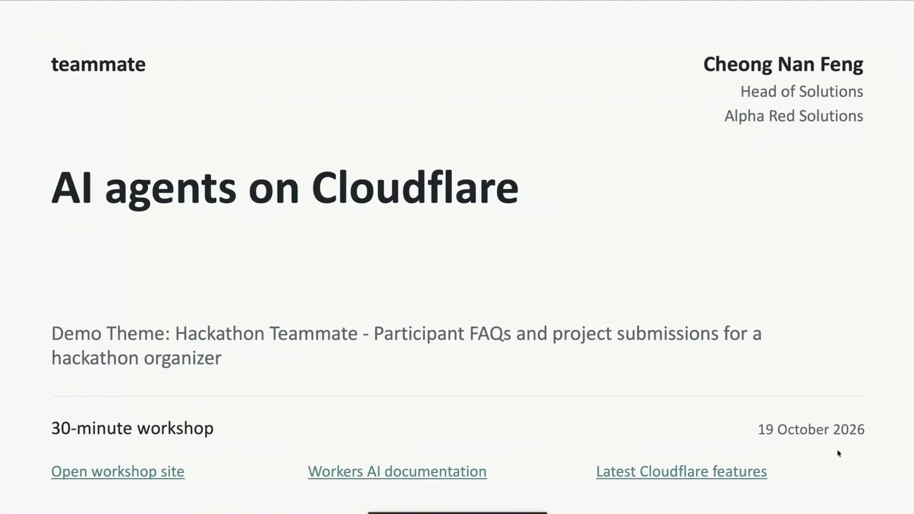

**teammate**

**Cheong Nan Feng**

Head of Solutions

Alpha Red Solutions

**AI agents on Cloudflare**

Demo Theme: Hackathon Teammate - Participant FAQs and project submissions for a hackathon organizer

30-minute workshop

19 October 2026

Open workshop site (link)

Workers AI documentation (link)

Latest Cloudflare features (link)

## Slide 02: The demo stack

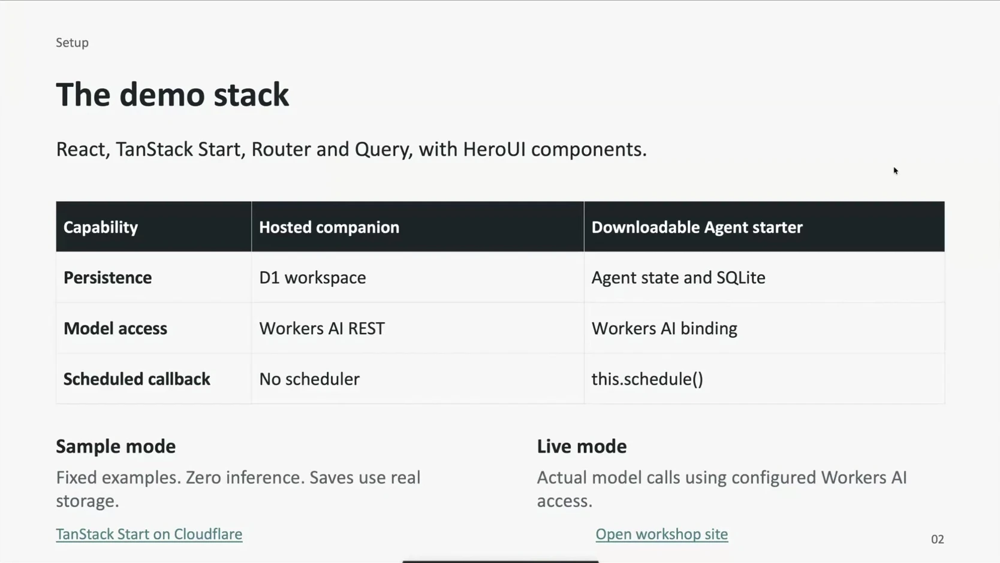

_Setup_

**The demo stack**

React, TanStack Start, Router and Query, with HeroUI components.

| Capability         | Hosted companion | Downloadable Agent starter |
| ------------------ | ---------------- | -------------------------- |
| Persistence        | D1 workspace     | Agent state and SQLite     |
| Model access       | Workers AI REST  | Workers AI binding         |
| Scheduled callback | No scheduler     | this.schedule()            |

**Sample mode**

Fixed examples. Zero inference. Saves use real storage.

**Live mode**

Actual model calls using configured Workers AI access.

TanStack Start on Cloudflare (link)

Open workshop site (link)

## Slide 03: Prompting and context

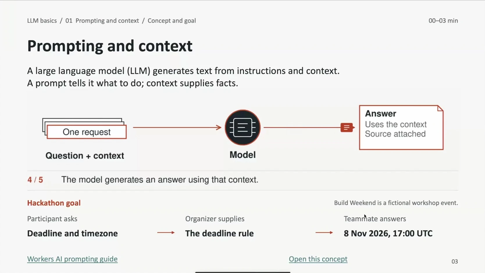

_LLM basics / 01 Prompting and context / Concept and goal · 00–03 min_

**Prompting and context**

A large language model (LLM) generates text from instructions and context.

A prompt tells it what to do; context supplies facts.

_Diagram: a stacked "One request" box, labelled "Question + context", points to a "Model" icon, which points through a message chip to an "Answer" note reading "Uses the context" and "Source attached"._

**4 / 5** The model generates an answer using that context.

**Hackathon goal**

Build Weekend is a fictional workshop event.

Participant asks **Deadline and timezone** → Organizer supplies **The deadline rule** → Teammate answers **8 Nov 2026, 17:00 UTC**

Workers AI prompting guide (link)

Open this concept (link)

## Slide 04: Workers AI

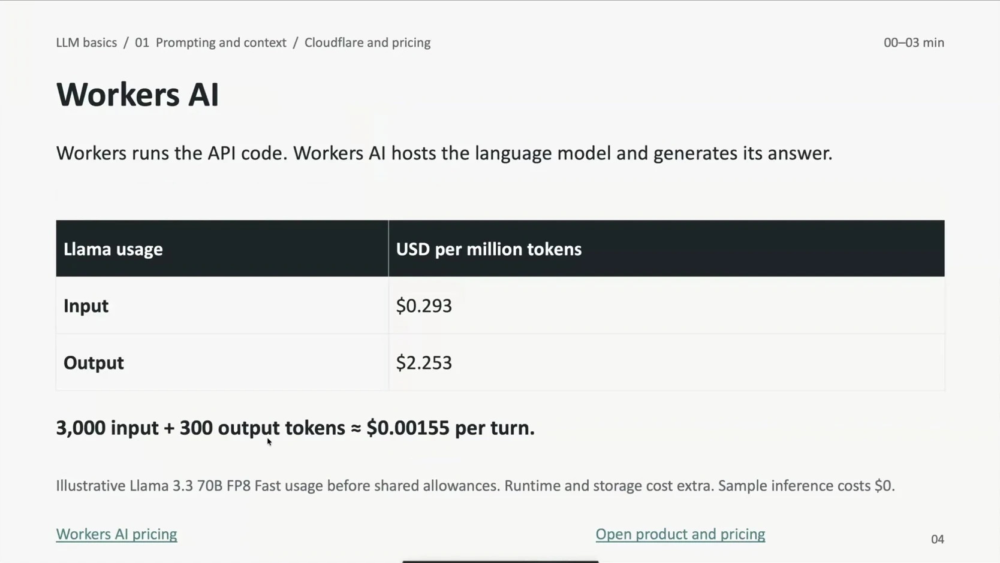

_LLM basics / 01 Prompting and context / Cloudflare and pricing · 00–03 min_

**Workers AI**

Workers runs the API code. Workers AI hosts the language model and generates its answer.

| Llama usage | USD per million tokens |
| ----------- | ---------------------- |
| Input       | $0.293                 |
| Output      | $2.253                 |

**3,000 input + 300 output tokens ≈ $0.00155 per turn.**

Illustrative Llama 3.3 70B FP8 Fast usage before shared allowances. Runtime and storage cost extra. Sample inference costs $0.

Workers AI pricing (link)

Open product and pricing (link)

## Slide 05: A deadline answer from supplied context

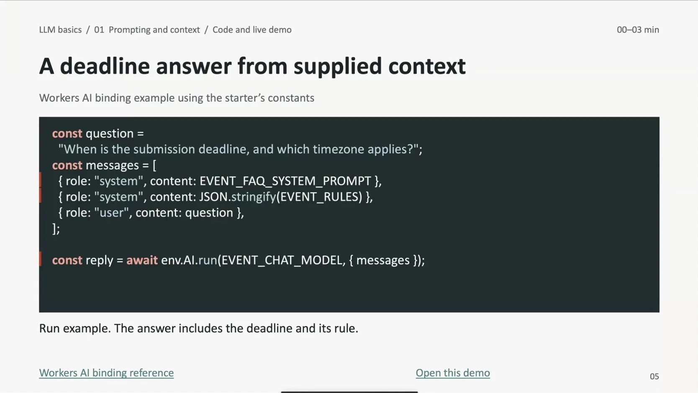

_LLM basics / 01 Prompting and context / Code and live demo · 00–03 min_

**A deadline answer from supplied context**

Workers AI binding example using the starter’s constants

<!-- prettier-ignore -->
```ts
const question =
  "When is the submission deadline, and which timezone applies?";
const messages = [
  { role: "system", content: EVENT_FAQ_SYSTEM_PROMPT },
  { role: "system", content: JSON.stringify(EVENT_RULES) },
  { role: "user", content: question },
];

const reply = await env.AI.run(EVENT_CHAT_MODEL, { messages });
```

Run example. The answer includes the deadline and its rule.

Workers AI binding reference (link)

Open this demo (link)

## Slide 06: Streaming responses

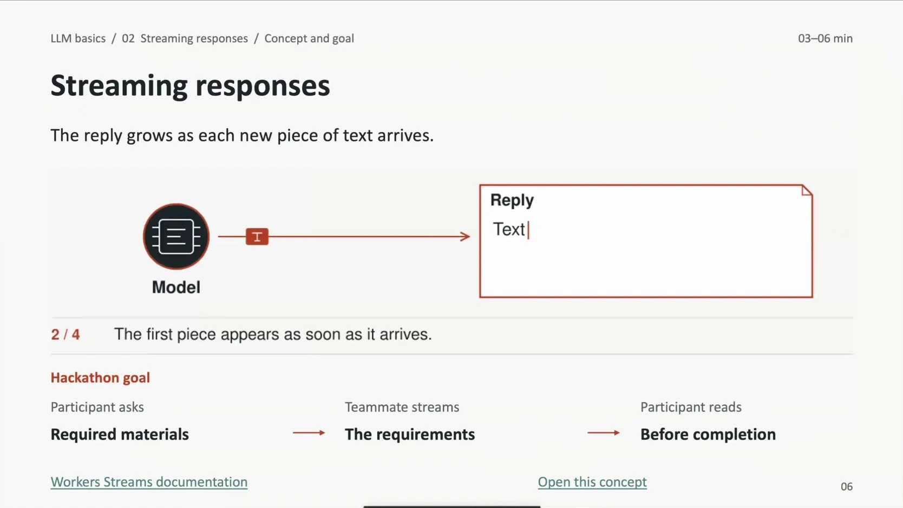

_LLM basics / 02 Streaming responses / Concept and goal · 03–06 min_

**Streaming responses**

The reply grows as each new piece of text arrives.

_Diagram: a "Model" icon points through a text-cursor chip to a "Reply" box showing "Text" followed by a typing cursor._

**2 / 4** The first piece appears as soon as it arrives.

**Hackathon goal**

Participant asks **Required materials** → Teammate streams **The requirements** → Participant reads **Before completion**

Workers Streams documentation (link)

Open this concept (link)

## Slide 07: Workers AI streaming

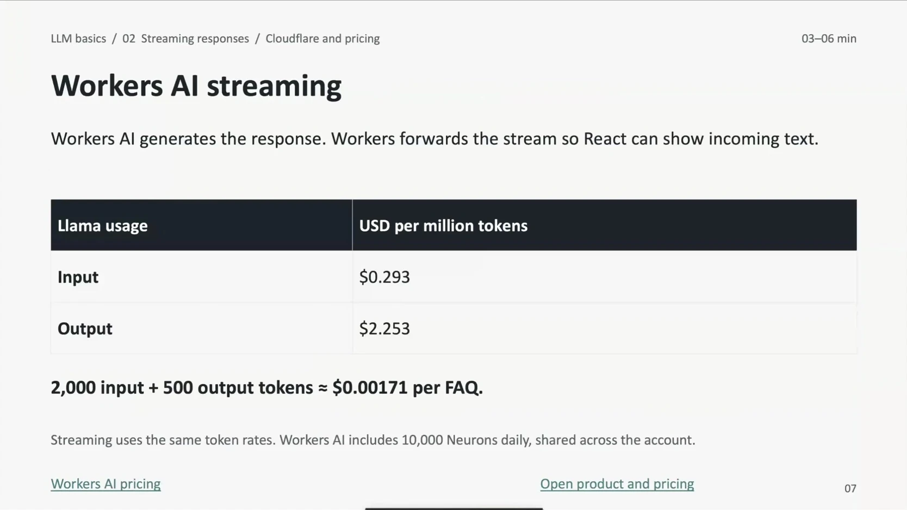

_LLM basics / 02 Streaming responses / Cloudflare and pricing · 03–06 min_

**Workers AI streaming**

Workers AI generates the response. Workers forwards the stream so React can show incoming text.

| Llama usage | USD per million tokens |
| ----------- | ---------------------- |
| Input       | $0.293                 |
| Output      | $2.253                 |

**2,000 input + 500 output tokens ≈ $0.00171 per FAQ.**

Streaming uses the same token rates. Workers AI includes 10,000 Neurons daily, shared across the account.

Workers AI pricing (link)

Open product and pricing (link)

## Slide 08: A streaming FAQ answer

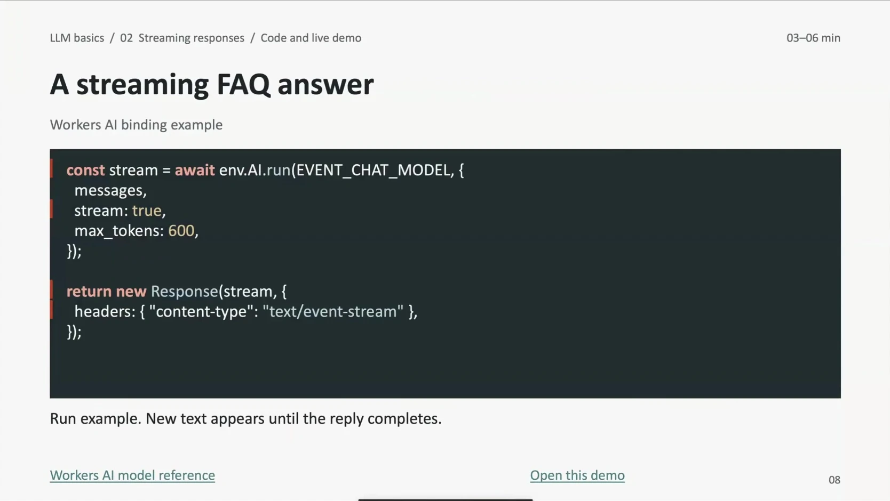

_LLM basics / 02 Streaming responses / Code and live demo · 03–06 min_

**A streaming FAQ answer**

Workers AI binding example

<!-- prettier-ignore -->
```ts
const stream = await env.AI.run(EVENT_CHAT_MODEL, {
  messages,
  stream: true,
  max_tokens: 600,
});

return new Response(stream, {
  headers: { "content-type": "text/event-stream" },
});
```

Run example. New text appears until the reply completes.

Workers AI model reference (link)

Open this demo (link)

## Slide 09: Retrieval-augmented generation

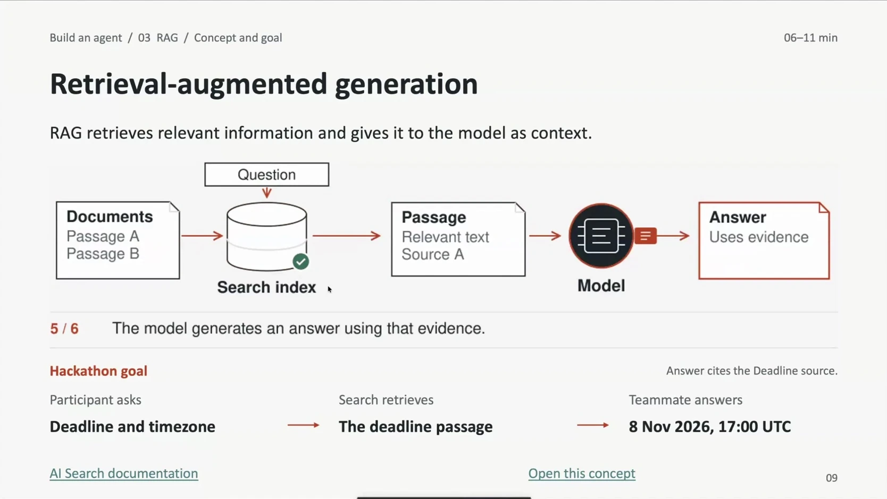

_Build an agent / 03 RAG / Concept and goal · 06–11 min_

**Retrieval-augmented generation**

RAG retrieves relevant information and gives it to the model as context.

_Diagram: a "Documents" note ("Passage A", "Passage B") points to a "Search index" database marked with a tick, which also receives a "Question" box from above; the index points to a "Passage" note ("Relevant text", "Source A"), which points to a "Model" icon, which points through a message chip to an "Answer" note reading "Uses evidence"._

**5 / 6** The model generates an answer using that evidence.

**Hackathon goal**

Answer cites the Deadline source.

Participant asks **Deadline and timezone** → Search retrieves **The deadline passage** → Teammate answers **8 Nov 2026, 17:00 UTC**

AI Search documentation (link)

Open this concept (link)

## Slide 10: AI Search and Workers AI

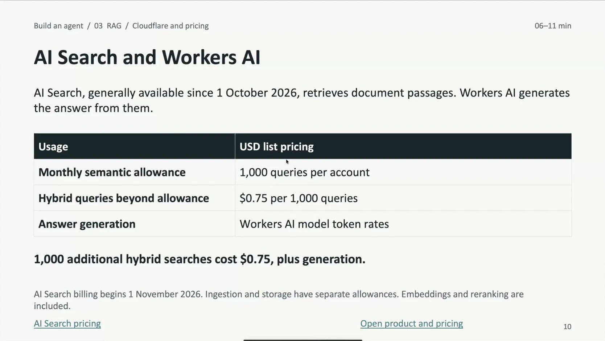

_Build an agent / 03 RAG / Cloudflare and pricing · 06–11 min_

**AI Search and Workers AI**

AI Search, generally available since 1 October 2026, retrieves document passages. Workers AI generates the answer from them.

| Usage                           | USD list pricing             |
| ------------------------------- | ---------------------------- |
| Monthly semantic allowance      | 1,000 queries per account    |
| Hybrid queries beyond allowance | $0.75 per 1,000 queries      |
| Answer generation               | Workers AI model token rates |

**1,000 additional hybrid searches cost $0.75, plus generation.**

AI Search billing begins 1 November 2026. Ingestion and storage have separate allowances. Embeddings and reranking are included.

AI Search pricing (link)

Open product and pricing (link)

## Slide 11: A deadline answer from a retrieved source

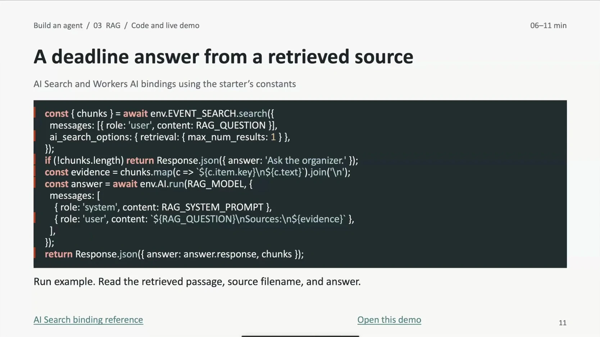

_Build an agent / 03 RAG / Code and live demo · 06–11 min_

**A deadline answer from a retrieved source**

AI Search and Workers AI bindings using the starter’s constants

<!-- prettier-ignore -->
```ts
const { chunks } = await env.EVENT_SEARCH.search({
  messages: [{ role: 'user', content: RAG_QUESTION }],
  ai_search_options: { retrieval: { max_num_results: 1 } },
});
if (!chunks.length) return Response.json({ answer: 'Ask the organizer.' });
const evidence = chunks.map(c => `${c.item.key}\n${c.text}`).join('\n');
const answer = await env.AI.run(RAG_MODEL, {
  messages: [
    { role: 'system', content: RAG_SYSTEM_PROMPT },
    { role: 'user', content: `${RAG_QUESTION}\nSources:\n${evidence}` },
  ],
});
return Response.json({ answer: answer.response, chunks });
```

Run example. Read the retrieved passage, source filename, and answer.

AI Search binding reference (link)

Open this demo (link)

## Slide 12: Tool calling

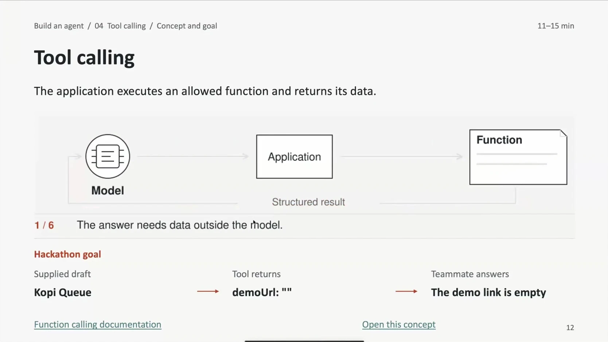

_Build an agent / 04 Tool calling / Concept and goal · 11–15 min_

**Tool calling**

The application executes an allowed function and returns its data.

_Diagram: a "Model" icon points to an "Application" box, which points to a "Function" note; a return line labelled "Structured result" runs from the function back to the model (arrows faded at this build step)._

**1 / 6** The answer needs data outside the model.

**Hackathon goal**

Supplied draft **Kopi Queue** → Tool returns **demoUrl: ""** → Teammate answers **The demo link is empty**

Function calling documentation (link)

Open this concept (link)

## Slide 13: Workers AI function calling

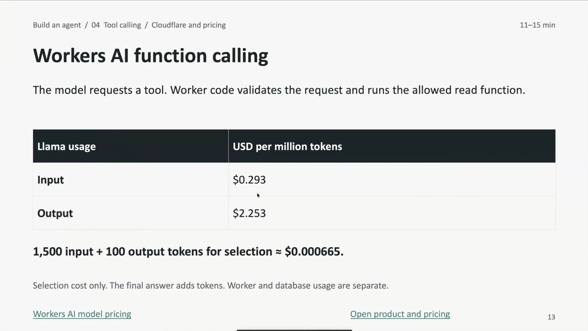

_Build an agent / 04 Tool calling / Cloudflare and pricing · 11–15 min_

**Workers AI function calling**

The model requests a tool. Worker code validates the request and runs the allowed read function.

| Llama usage | USD per million tokens |
| ----------- | ---------------------- |
| Input       | $0.293                 |
| Output      | $2.253                 |

**1,500 input + 100 output tokens for selection ≈ $0.000665.**

Selection cost only. The final answer adds tokens. Worker and database usage are separate.

Workers AI model pricing (link)

Open product and pricing (link)

## Slide 14: A tool reads the example draft

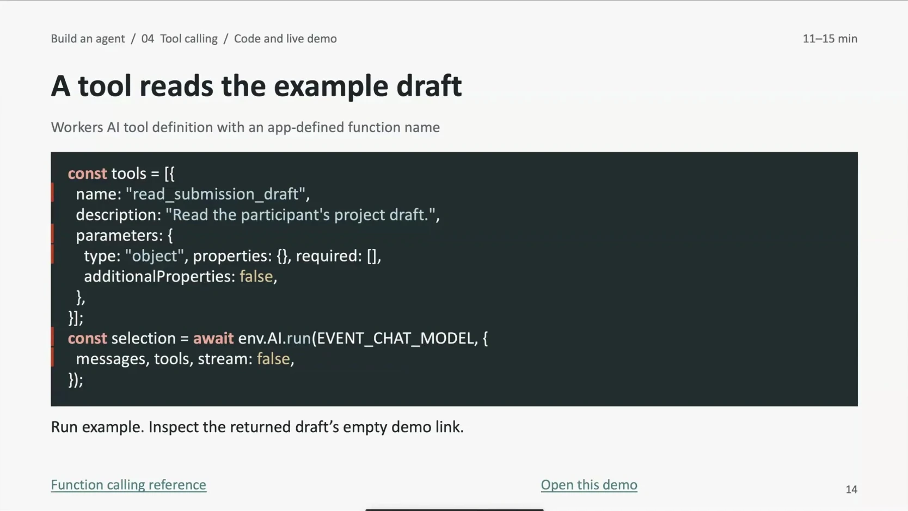

_Build an agent / 04 Tool calling / Code and live demo · 11–15 min_

**A tool reads the example draft**

Workers AI tool definition with an app-defined function name

<!-- prettier-ignore -->
```ts
const tools = [{
  name: "read_submission_draft",
  description: "Read the participant's project draft.",
  parameters: {
    type: "object", properties: {}, required: [],
    additionalProperties: false,
  },
}];
const selection = await env.AI.run(EVENT_CHAT_MODEL, {
  messages, tools, stream: false,
});
```

Run example. Inspect the returned draft’s empty demo link.

Function calling reference (link)

Open this demo (link)

## Slide 15: Agent loop

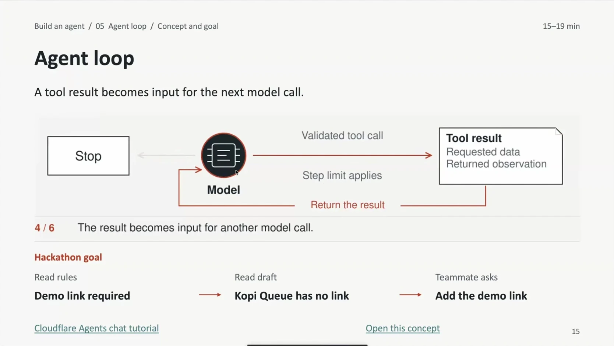

_Build an agent / 05 Agent loop / Concept and goal · 15–19 min_

**Agent loop**

A tool result becomes input for the next model call.

_Diagram: a "Model" icon sends a "Validated tool call" arrow to a "Tool result" note ("Requested data", "Returned observation"); a red "Return the result" line loops back into the model, with "Step limit applies" between them; a faded arrow leads from the model to a "Stop" box._

**4 / 6** The result becomes input for another model call.

**Hackathon goal**

Read rules **Demo link required** → Read draft **Kopi Queue has no link** → Teammate asks **Add the demo link**

Cloudflare Agents chat tutorial (link)

Open this concept (link)

## Slide 16: An agent loop on Workers

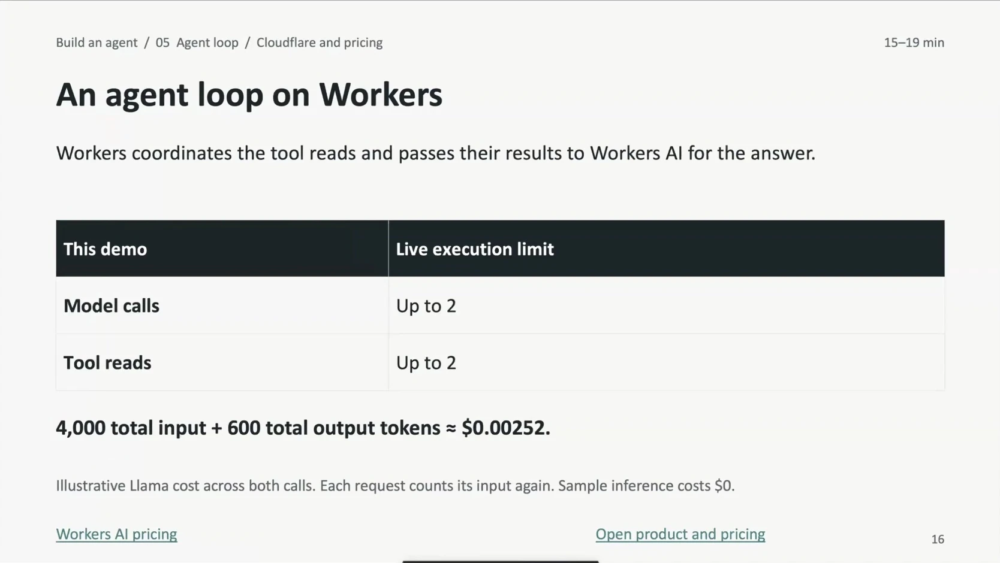

_Build an agent / 05 Agent loop / Cloudflare and pricing · 15–19 min_

**An agent loop on Workers**

Workers coordinates the tool reads and passes their results to Workers AI for the answer.

| This demo   | Live execution limit |
| ----------- | -------------------- |
| Model calls | Up to 2              |
| Tool reads  | Up to 2              |

**4,000 total input + 600 total output tokens ≈ $0.00252.**

Illustrative Llama cost across both calls. Each request counts its input again. Sample inference costs $0.

Workers AI pricing (link)

Open product and pricing (link)

## Slide 17: A draft check with tool results

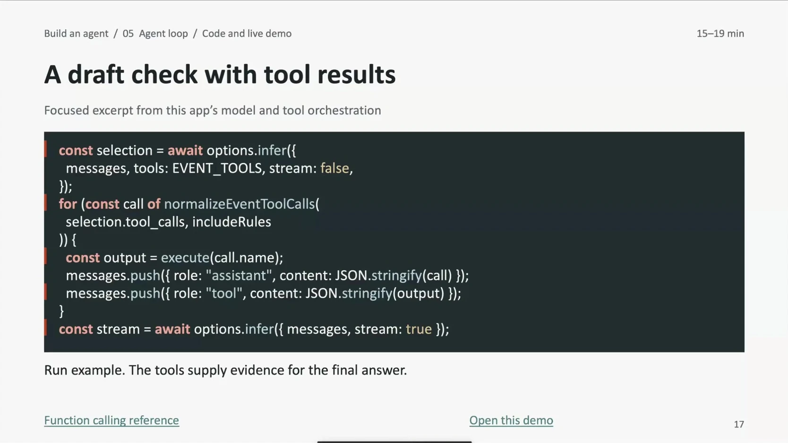

_Build an agent / 05 Agent loop / Code and live demo · 15–19 min_

**A draft check with tool results**

Focused excerpt from this app’s model and tool orchestration

<!-- prettier-ignore -->
```ts
const selection = await options.infer({
  messages, tools: EVENT_TOOLS, stream: false,
});
for (const call of normalizeEventToolCalls(
  selection.tool_calls, includeRules
)) {
  const output = execute(call.name);
  messages.push({ role: "assistant", content: JSON.stringify(call) });
  messages.push({ role: "tool", content: JSON.stringify(output) });
}
const stream = await options.infer({ messages, stream: true });
```

Run example. The tools supply evidence for the final answer.

Function calling reference (link)

Open this demo (link)

## Slide 18: State and memory

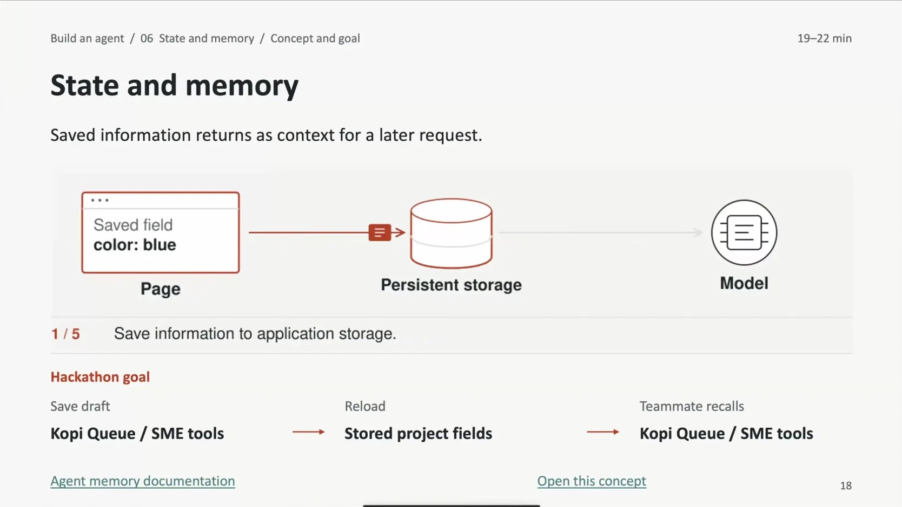

_Build an agent / 06 State and memory / Concept and goal · 19–22 min_

**State and memory**

Saved information returns as context for a later request.

_Diagram: a "Page" window showing "Saved field" and "color: blue" points through a message chip to a "Persistent storage" database, which has a faded arrow to a "Model" icon._

**1 / 5** Save information to application storage.

**Hackathon goal**

Save draft **Kopi Queue / SME tools** → Reload **Stored project fields** → Teammate recalls **Kopi Queue / SME tools**

Agent memory documentation (link)

Open this concept (link)

## Slide 19: D1 and Agent state

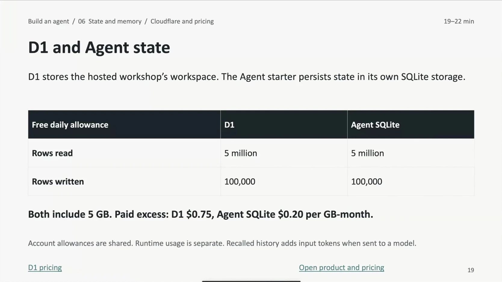

_Build an agent / 06 State and memory / Cloudflare and pricing · 19–22 min_

**D1 and Agent state**

D1 stores the hosted workshop’s workspace. The Agent starter persists state in its own SQLite storage.

| Free daily allowance | D1        | Agent SQLite |
| -------------------- | --------- | ------------ |
| Rows read            | 5 million | 5 million    |
| Rows written         | 100,000   | 100,000      |

**Both include 5 GB. Paid excess: D1 $0.75, Agent SQLite $0.20 per GB-month.**

Account allowances are shared. Runtime usage is separate. Recalled history adds input tokens when sent to a model.

D1 pricing (link)

Open product and pricing (link)

## Slide 20: A draft that survives reload

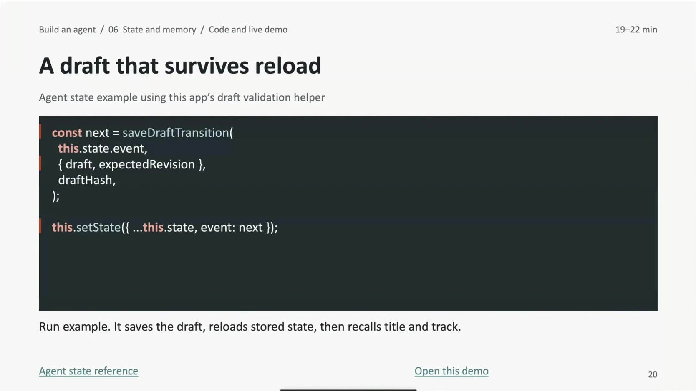

_Build an agent / 06 State and memory / Code and live demo · 19–22 min_

**A draft that survives reload**

Agent state example using this app’s draft validation helper

<!-- prettier-ignore -->
```ts
const next = saveDraftTransition(
  this.state.event,
  { draft, expectedRevision },
  draftHash,
);

this.setState({ ...this.state, event: next });
```

Run example. It saves the draft, reloads stored state, then recalls title and track.

Agent state reference (link)

Open this demo (link)

## Slide 21: Structured extraction

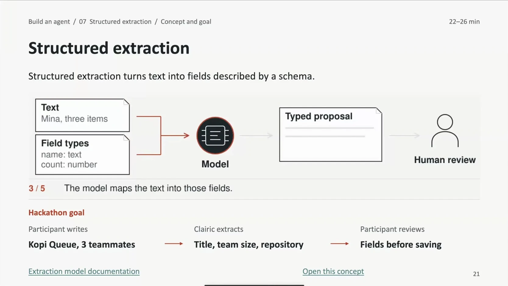

_Build an agent / 07 Structured extraction / Concept and goal · 22–26 min_

**Structured extraction**

Structured extraction turns text into fields described by a schema.

_Diagram: a "Text" note ("Mina, three items") and a "Field types" note ("name: text", "count: number") join into one arrow to a "Model" icon, which has a faded arrow to a blank "Typed proposal" note, which has a faded arrow to a person icon labelled "Human review"._

**3 / 5** The model maps the text into those fields.

**Hackathon goal**

Participant writes **Kopi Queue, 3 teammates** → Clairic extracts **Title, team size, repository** → Participant reviews **Fields before saving**

Extraction model documentation (link)

Open this concept (link)

## Slide 22: Clairic on Workers AI

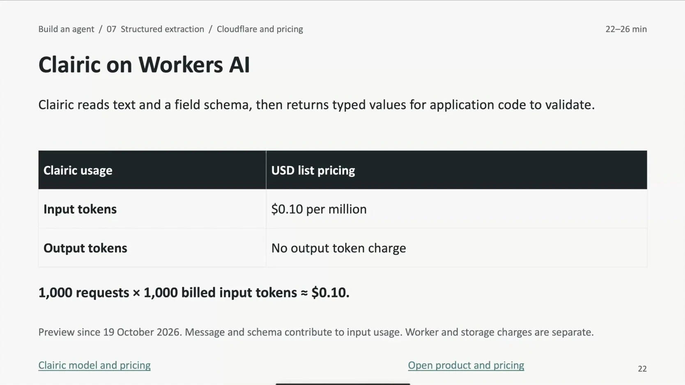

_Build an agent / 07 Structured extraction / Cloudflare and pricing · 22–26 min_

**Clairic on Workers AI**

Clairic reads text and a field schema, then returns typed values for application code to validate.

| Clairic usage | USD list pricing       |
| ------------- | ---------------------- |
| Input tokens  | $0.10 per million      |
| Output tokens | No output token charge |

**1,000 requests × 1,000 billed input tokens ≈ $0.10.**

Preview since 19 October 2026. Message and schema contribute to input usage. Worker and storage charges are separate.

Clairic model and pricing (link)

Open product and pricing (link)

## Slide 23: A message becomes a draft proposal

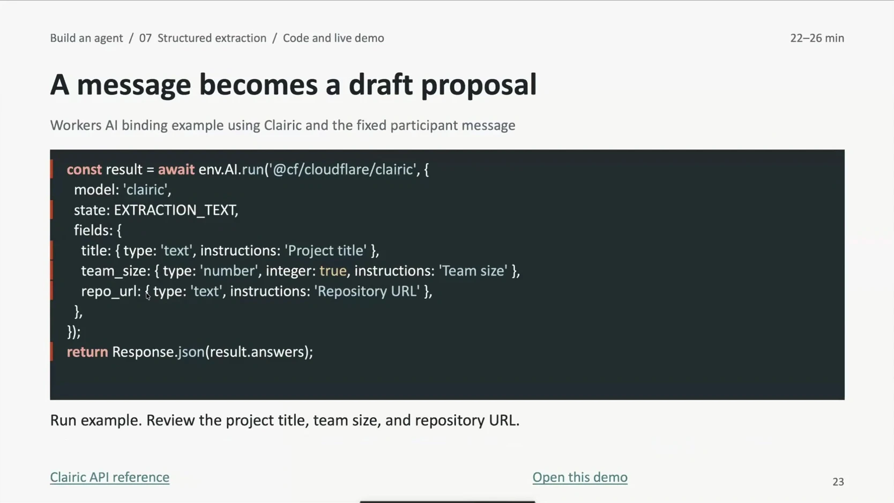

_Build an agent / 07 Structured extraction / Code and live demo · 22–26 min_

**A message becomes a draft proposal**

Workers AI binding example using Clairic and the fixed participant message

<!-- prettier-ignore -->
```ts
const result = await env.AI.run('@cf/cloudflare/clairic', {
  model: 'clairic',
  state: EXTRACTION_TEXT,
  fields: {
    title: { type: 'text', instructions: 'Project title' },
    team_size: { type: 'number', integer: true, instructions: 'Team size' },
    repo_url: { type: 'text', instructions: 'Repository URL' },
  },
});
return Response.json(result.answers);
```

Run example. Review the project title, team size, and repository URL.

Clairic API reference (link)

Open this demo (link)

## Slide 24: Structured decisions

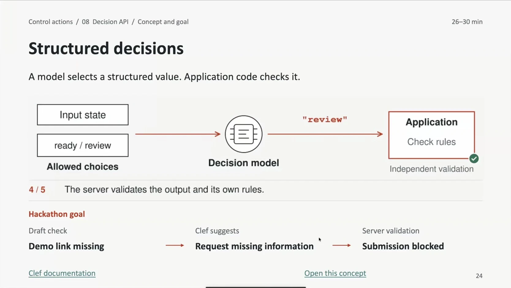

_Control actions / 08 Decision API / Concept and goal · 26–30 min_

**Structured decisions**

A model selects a structured value. Application code checks it.

_Diagram: two boxes, "Input state" and "ready / review", labelled "Allowed choices" → arrow → "Decision model" icon → arrow labelled `"review"` → red-bordered "Application / Check rules" box with a green tick, labelled "Independent validation"._

4 / 5 The server validates the output and its own rules.

**Hackathon goal**

_Three steps joined by arrows: Draft check: Demo link missing → Clef suggests: Request missing information → Server validation: Submission blocked._

Clef documentation (link)

Open this concept (link)

## Slide 25: Clef on Workers AI

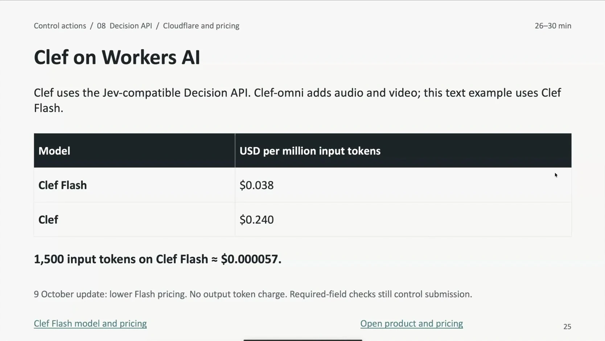

_Control actions / 08 Decision API / Cloudflare and pricing · 26–30 min_

**Clef on Workers AI**

Clef uses the Jev-compatible Decision API. Clef-omni adds audio and video; this text example uses Clef Flash.

| Model      | USD per million input tokens |
| ---------- | ---------------------------- |
| Clef Flash | $0.038                       |
| Clef       | $0.240                       |

**1,500 input tokens on Clef Flash ≈ $0.000057.**

9 October update: lower Flash pricing. No output token charge. Required-field checks still control submission.

Clef Flash model and pricing (link)

Open product and pricing (link)

## Slide 26: A Clef routing decision

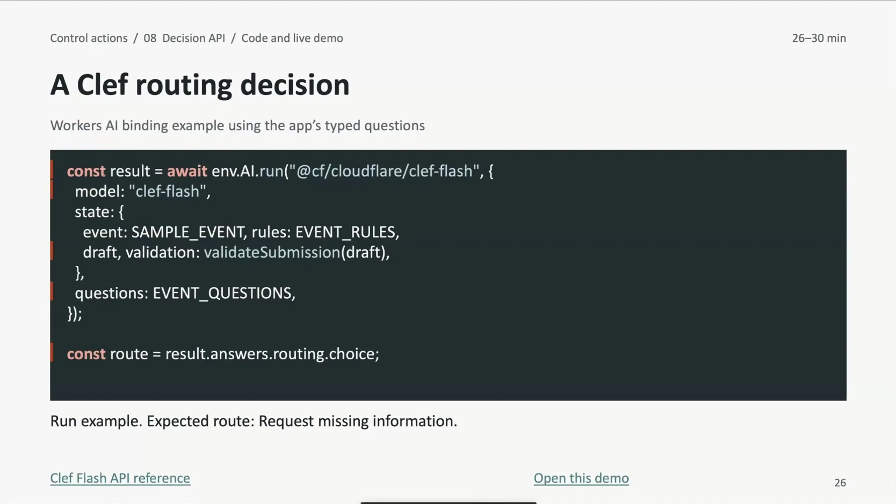

_Control actions / 08 Decision API / Code and live demo · 26–30 min_

**A Clef routing decision**

Workers AI binding example using the app’s typed questions

<!-- prettier-ignore -->
```ts
const result = await env.AI.run("@cf/cloudflare/clef-flash", {
  model: "clef-flash",
  state: {
    event: SAMPLE_EVENT, rules: EVENT_RULES,
    draft, validation: validateSubmission(draft),
  },
  questions: EVENT_QUESTIONS,
});

const route = result.answers.routing.choice;
```

Run example. Expected route: Request missing information.

Clef Flash API reference (link)

Open this demo (link)

## Slide 27: Human approval

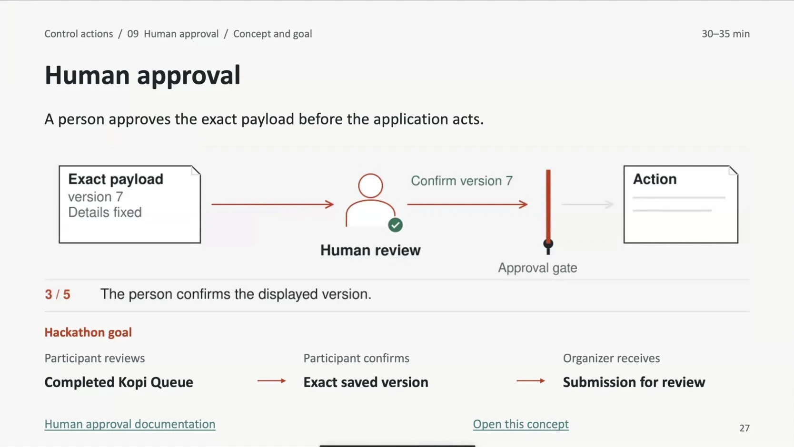

_Control actions / 09 Human approval / Concept and goal · 30–35 min_

**Human approval**

A person approves the exact payload before the application acts.

_Diagram: "Exact payload / version 7 / Details fixed" document → arrow → person icon with a green tick, labelled "Human review" → arrow labelled "Confirm version 7" → red vertical bar labelled "Approval gate" → faded arrow → blank "Action" document._

3 / 5 The person confirms the displayed version.

**Hackathon goal**

_Three steps joined by arrows: Participant reviews: Completed Kopi Queue → Participant confirms: Exact saved version → Organizer receives: Submission for review._

Human approval documentation (link)

Open this concept (link)

## Slide 28: Workers and storage

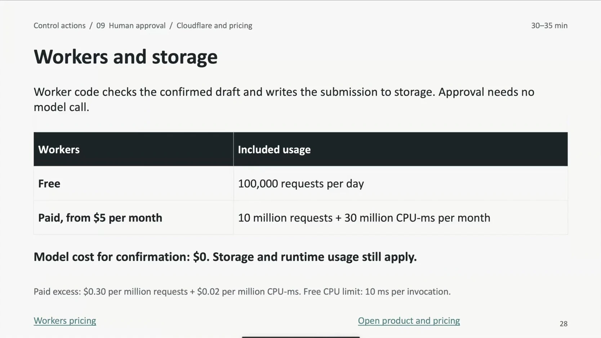

_Control actions / 09 Human approval / Cloudflare and pricing · 30–35 min_

**Workers and storage**

Worker code checks the confirmed draft and writes the submission to storage. Approval needs no model call.

| Workers                 | Included usage                                    |
| ----------------------- | ------------------------------------------------- |
| Free                    | 100,000 requests per day                          |
| Paid, from $5 per month | 10 million requests + 30 million CPU-ms per month |

**Model cost for confirmation: $0. Storage and runtime usage still apply.**

Paid excess: $0.30 per million requests + $0.02 per million CPU-ms. Free CPU limit: 10 ms per invocation.

Workers pricing (link)

Open product and pricing (link)

## Slide 29: A confirmed project submission

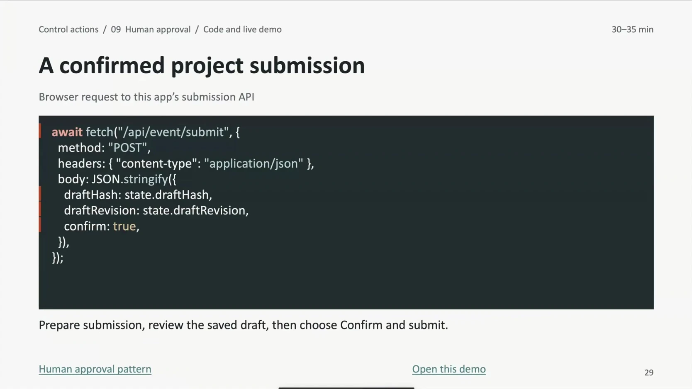

_Control actions / 09 Human approval / Code and live demo · 30–35 min_

**A confirmed project submission**

Browser request to this app’s submission API

<!-- prettier-ignore -->
```ts
await fetch("/api/event/submit", {
  method: "POST",
  headers: { "content-type": "application/json" },
  body: JSON.stringify({
    draftHash: state.draftHash,
    draftRevision: state.draftRevision,
    confirm: true,
  }),
});
```

Prepare submission, review the saved draft, then choose Confirm and submit.

Human approval pattern (link)

Open this demo (link)

## Slide 30: Scheduled tasks

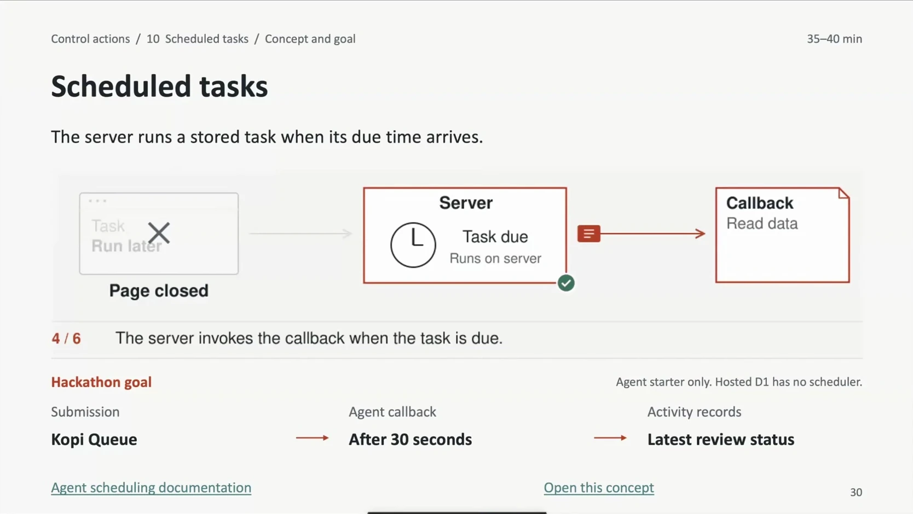

_Control actions / 10 Scheduled tasks / Concept and goal · 35–40 min_

**Scheduled tasks**

The server runs a stored task when its due time arrives.

_Diagram: faded browser window reading "Task / Run later", crossed out with an X and labelled "Page closed" → faded arrow → red-bordered "Server" box with a clock, "Task due / Runs on server" and a green tick → red message icon and arrow → red-bordered "Callback / Read data" document._

4 / 6 The server invokes the callback when the task is due.

**Hackathon goal**

Agent starter only. Hosted D1 has no scheduler.

_Three steps joined by arrows: Submission: Kopi Queue → Agent callback: After 30 seconds → Activity records: Latest review status._

Agent scheduling documentation (link)

Open this concept (link)

## Slide 31: Agents SDK scheduling

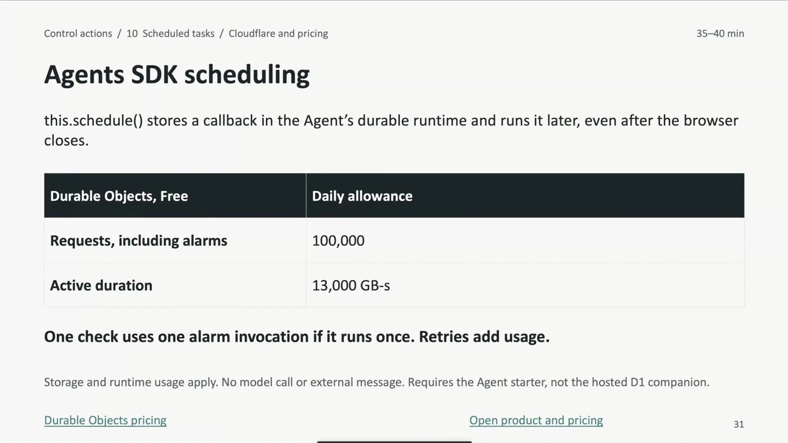

_Control actions / 10 Scheduled tasks / Cloudflare and pricing · 35–40 min_

**Agents SDK scheduling**

this.schedule() stores a callback in the Agent’s durable runtime and runs it later, even after the browser closes.

| Durable Objects, Free      | Daily allowance |
| -------------------------- | --------------- |
| Requests, including alarms | 100,000         |
| Active duration            | 13,000 GB-s     |

**One check uses one alarm invocation if it runs once. Retries add usage.**

Storage and runtime usage apply. No model call or external message. Requires the Agent starter, not the hosted D1 companion.

Durable Objects pricing (link)

Open product and pricing (link)

## Slide 32: A status check after 30 seconds

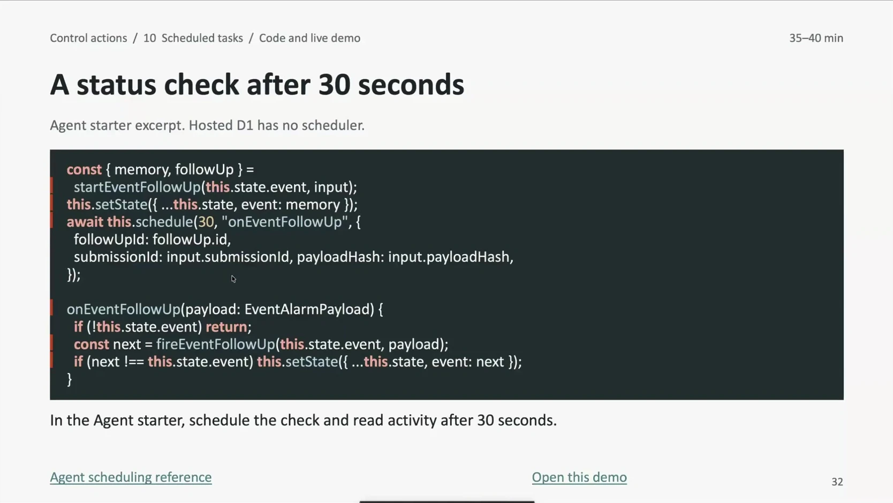

_Control actions / 10 Scheduled tasks / Code and live demo · 35–40 min_

**A status check after 30 seconds**

Agent starter excerpt. Hosted D1 has no scheduler.

<!-- prettier-ignore -->
```ts
const { memory, followUp } =
  startEventFollowUp(this.state.event, input);
this.setState({ ...this.state, event: memory });
await this.schedule(30, "onEventFollowUp", {
  followUpId: followUp.id,
  submissionId: input.submissionId, payloadHash: input.payloadHash,
});

onEventFollowUp(payload: EventAlarmPayload) {
  if (!this.state.event) return;
  const next = fireEventFollowUp(this.state.event, payload);
  if (next !== this.state.event) this.setState({ ...this.state, event: next });
}
```

In the Agent starter, schedule the check and read activity after 30 seconds.

Agent scheduling reference (link)

Open this demo (link)

## Slide 33: CLI and MCP

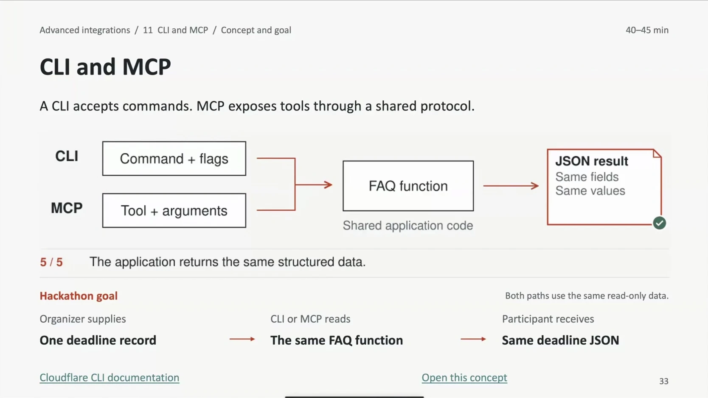

_Advanced integrations / 11 CLI and MCP / Concept and goal · 40–45 min_

**CLI and MCP**

A CLI accepts commands. MCP exposes tools through a shared protocol.

_Diagram: a "CLI" row with a "Command + flags" box and an "MCP" row with a "Tool + arguments" box, whose arrows join → "FAQ function" box labelled "Shared application code" → arrow → red-bordered "JSON result / Same fields / Same values" document with a green tick._

5 / 5 The application returns the same structured data.

**Hackathon goal**

Both paths use the same read-only data.

_Three steps joined by arrows: Organizer supplies: One deadline record → CLI or MCP reads: The same FAQ function → Participant receives: Same deadline JSON._

Cloudflare CLI documentation (link)

Open this concept (link)

## Slide 34: Cloudflare CLI and MCP

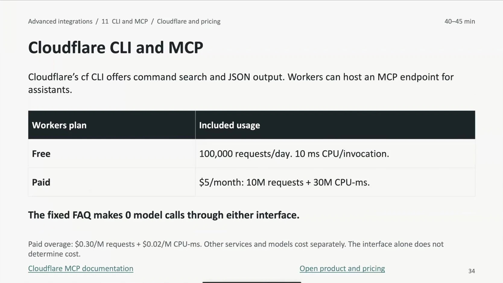

_Advanced integrations / 11 CLI and MCP / Cloudflare and pricing · 40–45 min_

**Cloudflare CLI and MCP**

Cloudflare’s cf CLI offers command search and JSON output. Workers can host an MCP endpoint for assistants.

| Workers plan | Included usage                              |
| ------------ | ------------------------------------------- |
| Free         | 100,000 requests/day. 10 ms CPU/invocation. |
| Paid         | $5/month: 10M requests + 30M CPU-ms.        |

**The fixed FAQ makes 0 model calls through either interface.**

Paid overage: $0.30/M requests + $0.02/M CPU-ms. Other services and models cost separately. The interface alone does not determine cost.

Cloudflare MCP documentation (link)

Open product and pricing (link)

## Slide 35: One deadline, two interfaces

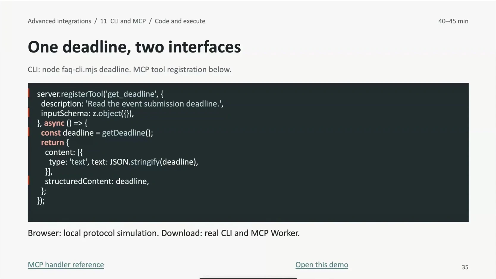

_Advanced integrations / 11 CLI and MCP / Code and execute · 40–45 min_

**One deadline, two interfaces**

CLI: node faq-cli.mjs deadline. MCP tool registration below.

<!-- prettier-ignore -->
```ts
server.registerTool('get_deadline', {
  description: 'Read the event submission deadline.',
  inputSchema: z.object({}),
}, async () => {
  const deadline = getDeadline();
  return {
    content: [{
      type: 'text', text: JSON.stringify(deadline),
    }],
    structuredContent: deadline,
  };
});
```

Browser: local protocol simulation. Download: real CLI and MCP Worker.

MCP handler reference (link)

Open this demo (link)

## Slide 36: Agent harness

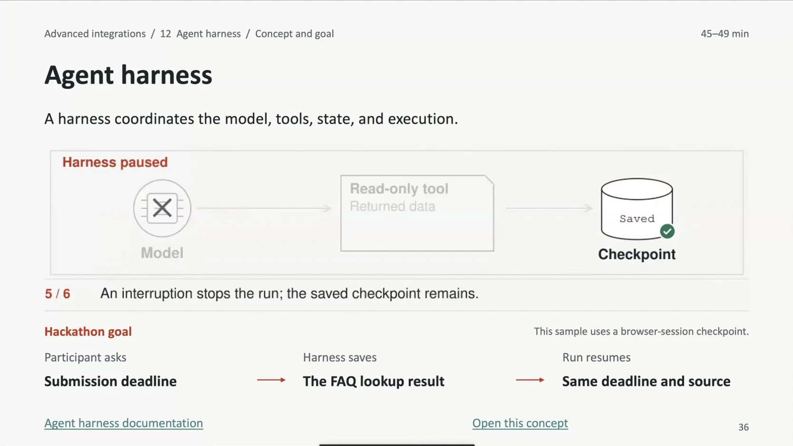

_Advanced integrations / 12 Agent harness / Concept and goal · 45–49 min_

**Agent harness**

A harness coordinates the model, tools, state, and execution.

_Diagram: panel headed "Harness paused" in red; faded "Model" icon marked with an X → faded arrow → faded "Read-only tool / Returned data" document → faded arrow → "Saved" cylinder with a green tick, labelled "Checkpoint"._

5 / 6 An interruption stops the run; the saved checkpoint remains.

**Hackathon goal**

This sample uses a browser-session checkpoint.

_Three steps joined by arrows: Participant asks: Submission deadline → Harness saves: The FAQ lookup result → Run resumes: Same deadline and source._

Agent harness documentation (link)

Open this concept (link)

## Slide 37: Harnesses on Durable Objects

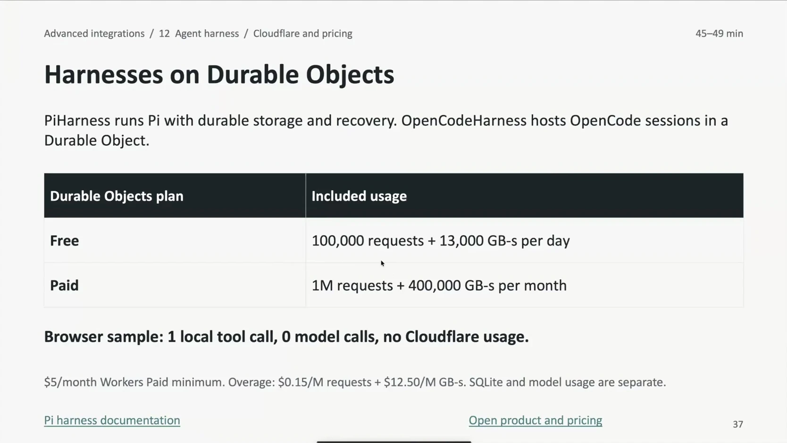

_Advanced integrations / 12 Agent harness / Cloudflare and pricing · 45–49 min_

**Harnesses on Durable Objects**

PiHarness runs Pi with durable storage and recovery. OpenCodeHarness hosts OpenCode sessions in a Durable Object.

| Durable Objects plan | Included usage                         |
| -------------------- | -------------------------------------- |
| Free                 | 100,000 requests + 13,000 GB-s per day |
| Paid                 | 1M requests + 400,000 GB-s per month   |

**Browser sample: 1 local tool call, 0 model calls, no Cloudflare usage.**

$5/month Workers Paid minimum. Overage: $0.15/M requests + $12.50/M GB-s. SQLite and model usage are separate.

Pi harness documentation (link)

Open product and pricing (link)

## Slide 38: Pause after the lookup, then resume

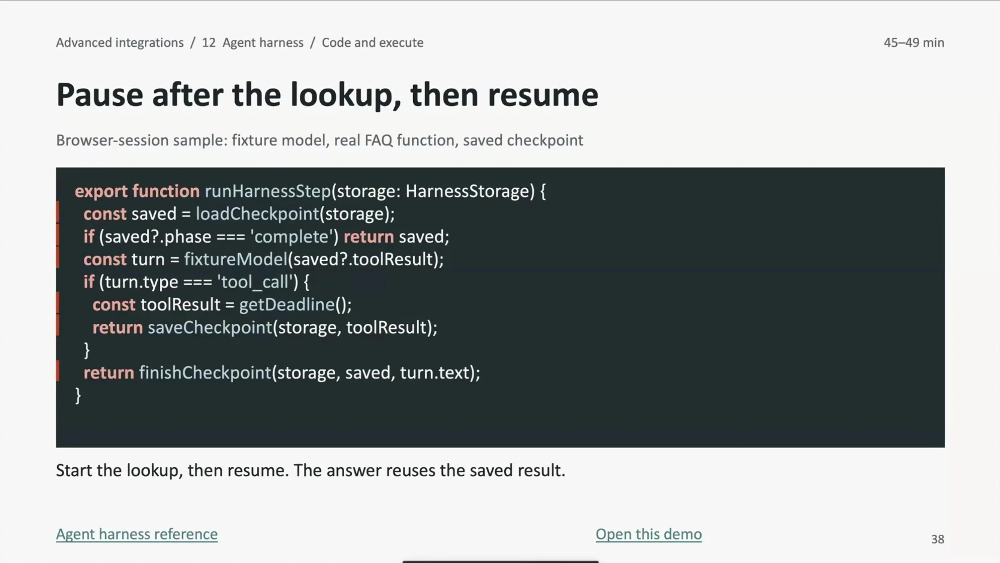

_Advanced integrations / 12 Agent harness / Code and execute · 45–49 min_

**Pause after the lookup, then resume**

Browser-session sample: fixture model, real FAQ function, saved checkpoint

<!-- prettier-ignore -->
```ts
export function runHarnessStep(storage: HarnessStorage) {
  const saved = loadCheckpoint(storage);
  if (saved?.phase === 'complete') return saved;
  const turn = fixtureModel(saved?.toolResult);
  if (turn.type === 'tool_call') {
    const toolResult = getDeadline();
    return saveCheckpoint(storage, toolResult);
  }
  return finishCheckpoint(storage, saved, turn.text);
}
```

Start the lookup, then resume. The answer reuses the saved result.

Agent harness reference (link)

Open this demo (link)

## Slide 39: AG-UI

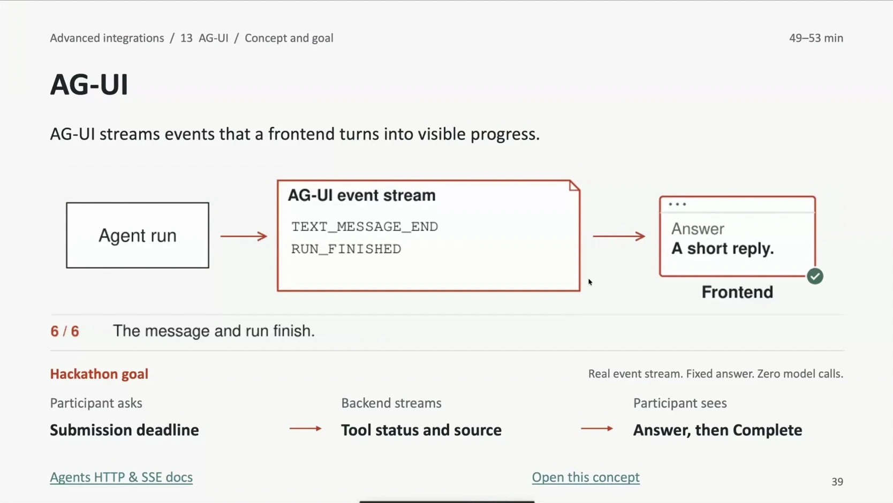

_Advanced integrations / 13 AG-UI / Concept and goal · 49–53 min_

**AG-UI**

AG-UI streams events that a frontend turns into visible progress.

_Diagram: "Agent run" box → arrow → red-bordered "AG-UI event stream" document listing `TEXT_MESSAGE_END` and `RUN_FINISHED` → arrow → red-bordered browser window showing "Answer / A short reply." with a green tick, labelled "Frontend"._

6 / 6 The message and run finish.

**Hackathon goal**

Real event stream. Fixed answer. Zero model calls.

_Three steps joined by arrows: Participant asks: Submission deadline → Backend streams: Tool status and source → Participant sees: Answer, then Complete._

Agents HTTP & SSE docs (link)

Open this concept (link)

## Slide 40: Workers streams and AG-UI

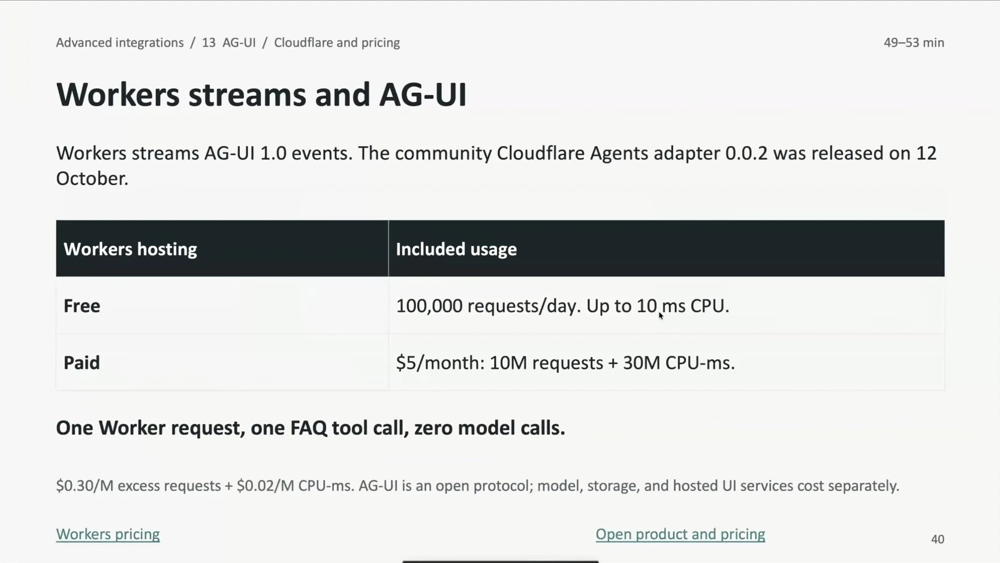

_Advanced integrations / 13 AG-UI / Cloudflare and pricing · 49–53 min_

**Workers streams and AG-UI**

Workers streams AG-UI 1.0 events. The community Cloudflare Agents adapter 0.0.2 was released on 12 October.

| Workers hosting | Included usage                         |
| --------------- | -------------------------------------- |
| Free            | 100,000 requests/day. Up to 10 ms CPU. |
| Paid            | $5/month: 10M requests + 30M CPU-ms.   |

**One Worker request, one FAQ tool call, zero model calls.**

$0.30/M excess requests + $0.02/M CPU-ms. AG-UI is an open protocol; model, storage, and hosted UI services cost separately.

Workers pricing (link)

Open product and pricing (link)

## Slide 41: Tool events make FAQ progress visible

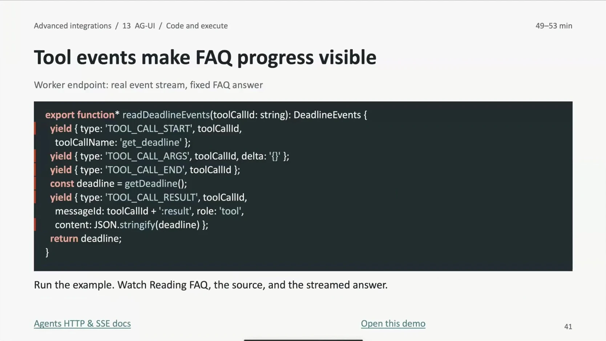

_Advanced integrations / 13 AG-UI / Code and execute · 49–53 min_

**Tool events make FAQ progress visible**

Worker endpoint: real event stream, fixed FAQ answer

<!-- prettier-ignore -->
```ts
export function* readDeadlineEvents(toolCallId: string): DeadlineEvents {
  yield { type: 'TOOL_CALL_START', toolCallId,
    toolCallName: 'get_deadline' };
  yield { type: 'TOOL_CALL_ARGS', toolCallId, delta: '{}' };
  yield { type: 'TOOL_CALL_END', toolCallId };
  const deadline = getDeadline();
  yield { type: 'TOOL_CALL_RESULT', toolCallId,
    messageId: toolCallId + ':result', role: 'tool',
    content: JSON.stringify(deadline) };
  return deadline;
}
```

Run the example. Watch Reading FAQ, the source, and the streamed answer.

Agents HTTP & SSE docs (link)

Open this demo (link)

## Slide 42: The full working product

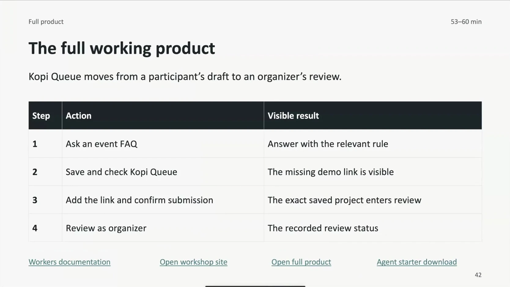

_Full product · 53–60 min_

**The full working product**

Kopi Queue moves from a participant’s draft to an organizer’s review.

| Step | Action                              | Visible result                        |
| ---- | ----------------------------------- | ------------------------------------- |
| 1    | Ask an event FAQ                    | Answer with the relevant rule         |
| 2    | Save and check Kopi Queue           | The missing demo link is visible      |
| 3    | Add the link and confirm submission | The exact saved project enters review |
| 4    | Review as organizer                 | The recorded review status            |

Workers documentation (link)

Open workshop site (link)

Open full product (link)

Agent starter download (link)

## Slide 43: Related Cloudflare features

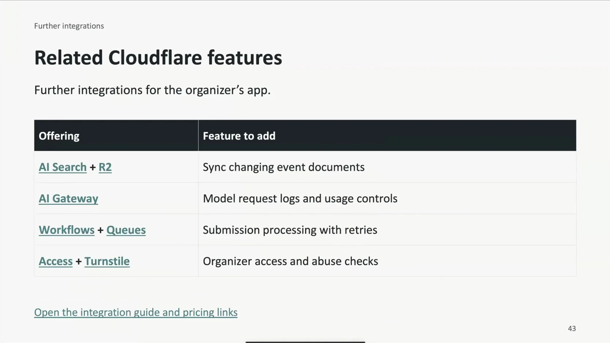

_Further integrations_

**Related Cloudflare features**

Further integrations for the organizer’s app.

| Offering                         | Feature to add                        |
| -------------------------------- | ------------------------------------- |
| AI Search (link) + R2 (link)     | Sync changing event documents         |
| AI Gateway (link)                | Model request logs and usage controls |
| Workflows (link) + Queues (link) | Submission processing with retries    |
| Access (link) + Turnstile (link) | Organizer access and abuse checks     |

Open the integration guide and pricing links (link)

## Slide 44: Official tutorials and pricing

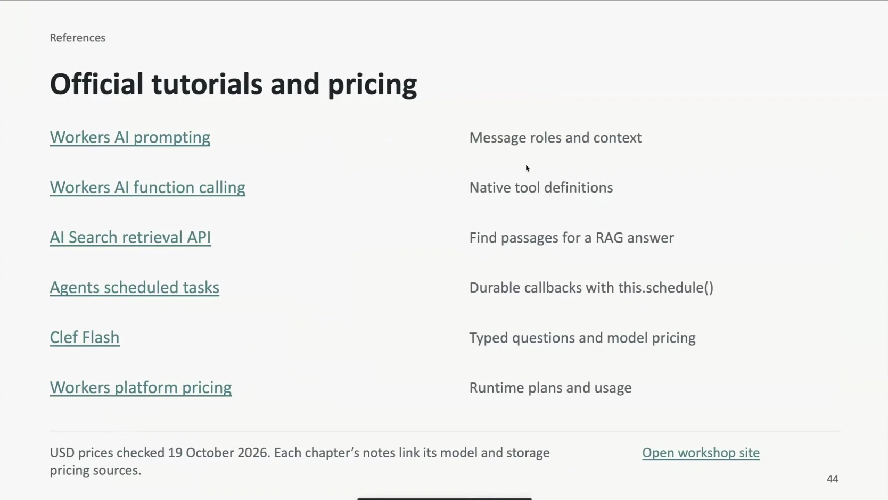

_References_

**Official tutorials and pricing**

- Workers AI prompting (link): Message roles and context
- Workers AI function calling (link): Native tool definitions
- AI Search retrieval API (link): Find passages for a RAG answer
- Agents scheduled tasks (link): Durable callbacks with this.schedule()
- Clef Flash (link): Typed questions and model pricing
- Workers platform pricing (link): Runtime plans and usage

USD prices checked 19 October 2026. Each chapter’s notes link its model and storage pricing sources.

Open workshop site (link)
