# Workshop 1 Orbyte slides

All 39 pages of "Orbyte: Business vision & strategy", the Alpha Red deck shared as "1. SDC Hackathon: Orbyte Introduction" in the workshop's [Drive folder](https://drive.google.com/drive/folders/1sWs2gnuY_Mfa_SCvHzEpS1Tw4XYvXYgF), each with its image and its text. KC Cheah, Founder and CEO of Alpha Red, presented pages 1 to 15 at SDC Hackathon 2026 Workshop 1 on 20 October 2026, before a live demo of the product; pages 16 to 39, including the module appendix, weren't shown. The [transcript](transcript.md) covers what was said. Orbyte is the Domain 2 partner's platform; see the [Domain 2 problem statement](/docs/sources/drive.google.com/domain-2-orbyte.md).

Images are rendered from the PDF. Contact details on page 23 are left out.

Contents:

1.  [Slide 01: Orbyte](#slide-01-orbyte)
1.  [Slide 02: SMEs don't need more software](#slide-02-smes-dont-need-more-software)
1.  [Slide 03: The hidden cost isn't the subscription](#slide-03-the-hidden-cost-isnt-the-subscription)
1.  [Slide 04: AI alone isn't the answer](#slide-04-ai-alone-isnt-the-answer)
1.  [Slide 05: Imagine one place to run your business](#slide-05-imagine-one-place-to-run-your-business)
1.  [Slide 06: Meet Orbyte](#slide-06-meet-orbyte)
1.  [Slide 07: Why we are not another all-in-one portal](#slide-07-why-we-are-not-another-all-in-one-portal)
1.  [Slide 08: One platform. An expanding world of business tools](#slide-08-one-platform-an-expanding-world-of-business-tools)
1.  [Slide 09: We don't have to build everything](#slide-09-we-dont-have-to-build-everything)
1.  [Slide 10: One platform underneath everything](#slide-10-one-platform-underneath-everything)
1.  [Slide 11: The foundation every module builds on](#slide-11-the-foundation-every-module-builds-on)
1.  [Slide 12: Pay for 12 users, not 80 licences](#slide-12-pay-for-12-users-not-80-licences)
1.  [Slide 13: Pay for usage, not seats](#slide-13-pay-for-usage-not-seats)
1.  [Slide 14: Start small. Add what you need](#slide-14-start-small-add-what-you-need)
1.  [Slide 15: The more connected the business, the smarter Orbyte becomes](#slide-15-the-more-connected-the-business-the-smarter-orbyte-becomes)
1.  [Slide 16: From data to understanding](#slide-16-from-data-to-understanding)
1.  [Slide 17: Three pillars of Orbyte](#slide-17-three-pillars-of-orbyte)
1.  [Slide 18: The Orbyte flywheel](#slide-18-the-orbyte-flywheel)
1.  [Slide 19: From SuperApp to SME operating system](#slide-19-from-superapp-to-sme-operating-system)
1.  [Slide 20: One ecosystem. Value for everyone](#slide-20-one-ecosystem-value-for-everyone)
1.  [Slide 21: The destination](#slide-21-the-destination)
1.  [Slide 22: Built by Alpha Red](#slide-22-built-by-alpha-red)
1.  [Slide 23: Orbyte](#slide-23-orbyte)
1.  [Slide 24: People](#slide-24-people)
1.  [Slide 25: Your HR system stays](#slide-25-your-hr-system-stays)
1.  [Slide 26: eLeave](#slide-26-eleave)
1.  [Slide 27: eClaim](#slide-27-eclaim)
1.  [Slide 28: eOT](#slide-28-eot)
1.  [Slide 29: Work](#slide-29-work)
1.  [Slide 30: Daily work status](#slide-30-daily-work-status)
1.  [Slide 31: Monthly project focus](#slide-31-monthly-project-focus)
1.  [Slide 32: eLeave knows who is away](#slide-32-eleave-knows-who-is-away)
1.  [Slide 33: Platform foundation, in detail](#slide-33-platform-foundation-in-detail)
1.  [Slide 34: Hiring](#slide-34-hiring)
1.  [Slide 35: Post the job](#slide-35-post-the-job)
1.  [Slide 36: eSign](#slide-36-esign)
1.  [Slide 37: Sign without leaving the platform](#slide-37-sign-without-leaving-the-platform)
1.  [Slide 38: Connect](#slide-38-connect)
1.  [Slide 39: Connect the services](#slide-39-connect-the-services)

## Slide 01: Orbyte

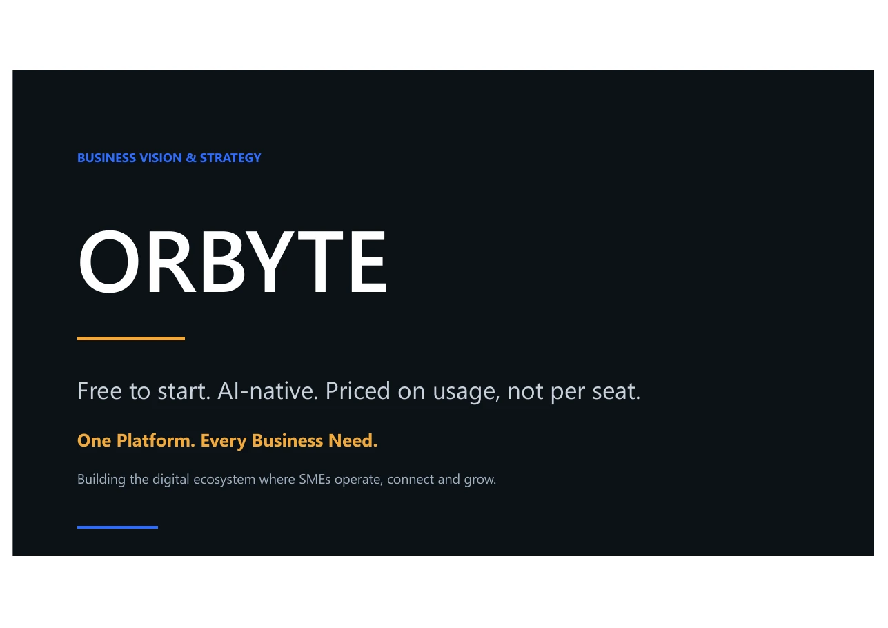

**BUSINESS VISION & STRATEGY**

**ORBYTE**

Free to start. AI-native. Priced on usage, not per seat.

**One Platform. Every Business Need.**

Building the digital ecosystem where SMEs operate, connect and grow.

## Slide 02: SMEs don't need more software

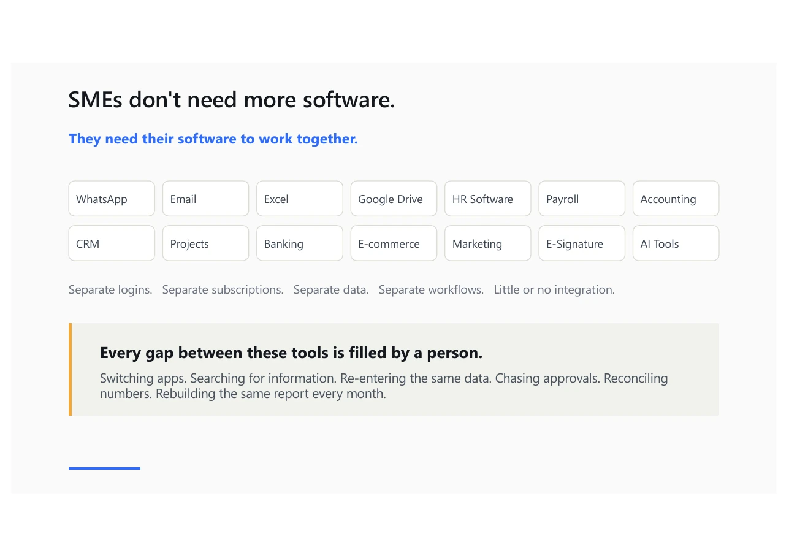

**SMEs don't need more software.**

**They need their software to work together.**

- WhatsApp
- Email
- Excel
- Google Drive
- HR Software
- Payroll
- Accounting
- CRM
- Projects
- Banking
- E-commerce
- Marketing
- E-Signature
- AI Tools

Separate logins. Separate subscriptions. Separate data. Separate workflows. Little or no integration.

**Every gap between these tools is filled by a person.**

Switching apps. Searching for information. Re-entering the same data. Chasing approvals. Reconciling numbers. Rebuilding the same report every month.

## Slide 03: The hidden cost isn't the subscription

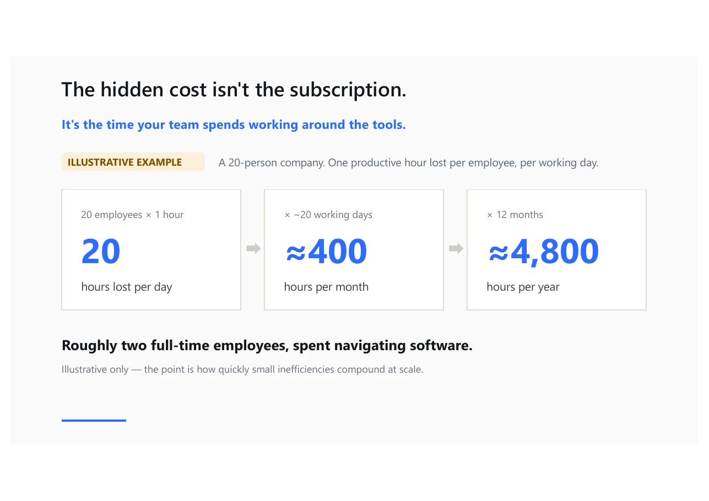

**The hidden cost isn't the subscription.**

**It's the time your team spends working around the tools.**

**ILLUSTRATIVE EXAMPLE**

A 20-person company. One productive hour lost per employee, per working day.

_Diagram: three boxes linked left to right by arrows. Box 1: "20 employees × 1 hour", "20", "hours lost per day". Box 2: "× ~20 working days", "≈400", "hours per month". Box 3: "× 12 months", "≈4,800", "hours per year"._

**Roughly two full-time employees, spent navigating software.**

Illustrative only — the point is how quickly small inefficiencies compound at scale.

## Slide 04: AI alone isn't the answer

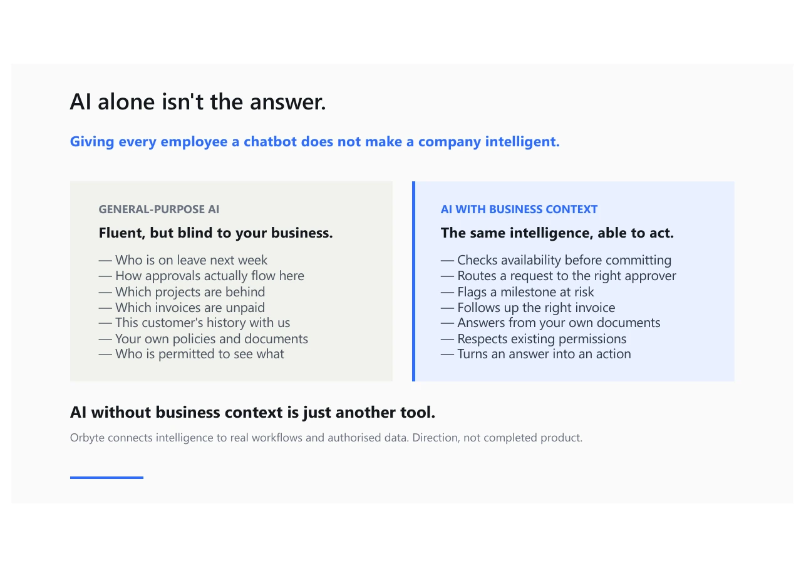

**AI alone isn't the answer.**

**Giving every employee a chatbot does not make a company intelligent.**

**GENERAL-PURPOSE AI**

**Fluent, but blind to your business.**

- Who is on leave next week
- How approvals actually flow here
- Which projects are behind
- Which invoices are unpaid
- This customer's history with us
- Your own policies and documents
- Who is permitted to see what

**AI WITH BUSINESS CONTEXT**

**The same intelligence, able to act.**

- Checks availability before committing
- Routes a request to the right approver
- Flags a milestone at risk
- Follows up the right invoice
- Answers from your own documents
- Respects existing permissions
- Turns an answer into an action

**AI without business context is just another tool.**

Orbyte connects intelligence to real workflows and authorised data. Direction, not completed product.

## Slide 05: Imagine one place to run your business

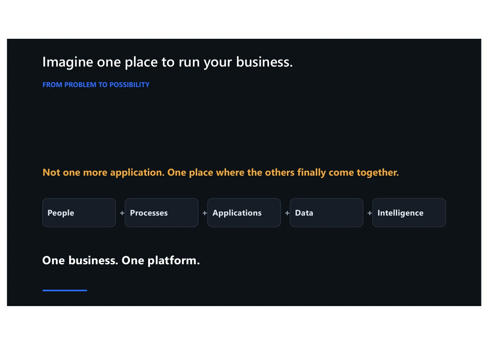

**Imagine one place to run your business.**

**FROM PROBLEM TO POSSIBILITY**

**Not one more application. One place where the others finally come together.**

_Diagram: five boxes joined by plus signs: People + Processes + Applications + Data + Intelligence._

**One business. One platform.**

## Slide 06: Meet Orbyte

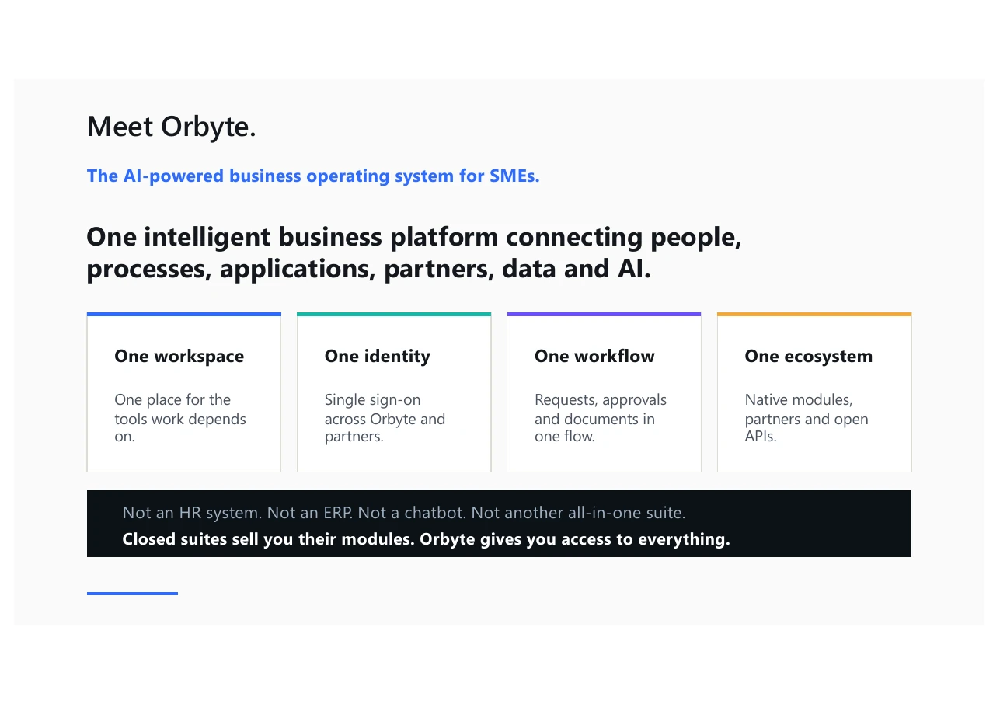

**Meet Orbyte.**

**The AI-powered business operating system for SMEs.**

**One intelligent business platform connecting people, processes, applications, partners, data and AI.**

**One workspace**

One place for the tools work depends on.

**One identity**

Single sign-on across Orbyte and partners.

**One workflow**

Requests, approvals and documents in one flow.

**One ecosystem**

Native modules, partners and open APIs.

Not an HR system. Not an ERP. Not a chatbot. Not another all-in-one suite.

**Closed suites sell you their modules. Orbyte gives you access to everything.**

## Slide 07: Why we are not another all-in-one portal

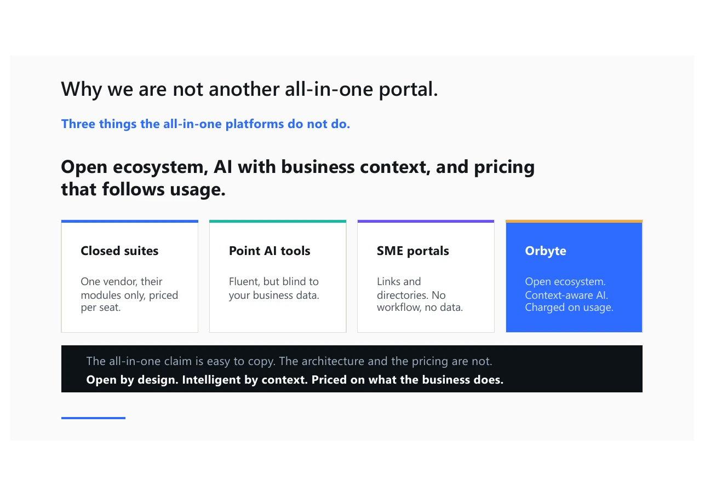

**Why we are not another all-in-one portal.**

**Three things the all-in-one platforms do not do.**

**Open ecosystem, AI with business context, and pricing that follows usage.**

**Closed suites**

One vendor, their modules only, priced per seat.

**Point AI tools**

Fluent, but blind to your business data.

**SME portals**

Links and directories. No workflow, no data.

**Orbyte**

Open ecosystem. Context-aware AI. Charged on usage.

The all-in-one claim is easy to copy. The architecture and the pricing are not.

**Open by design. Intelligent by context. Priced on what the business does.**

## Slide 08: One platform. An expanding world of business tools

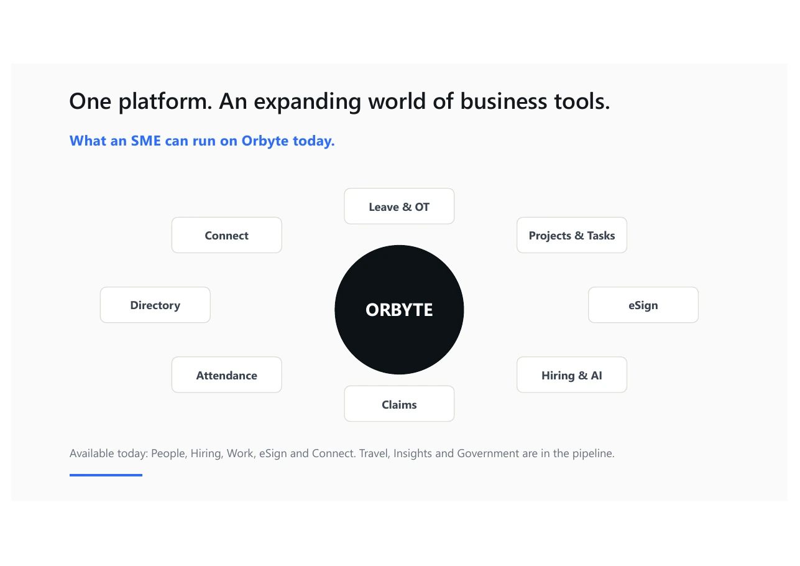

**One platform. An expanding world of business tools.**

**What an SME can run on Orbyte today.**

_Diagram: a central "ORBYTE" circle surrounded by eight boxes, clockwise from the top: Leave & OT, Projects & Tasks, eSign, Hiring & AI, Claims, Attendance, Directory, Connect._

Available today: People, Hiring, Work, eSign and Connect. Travel, Insights and Government are in the pipeline.

## Slide 09: We don't have to build everything

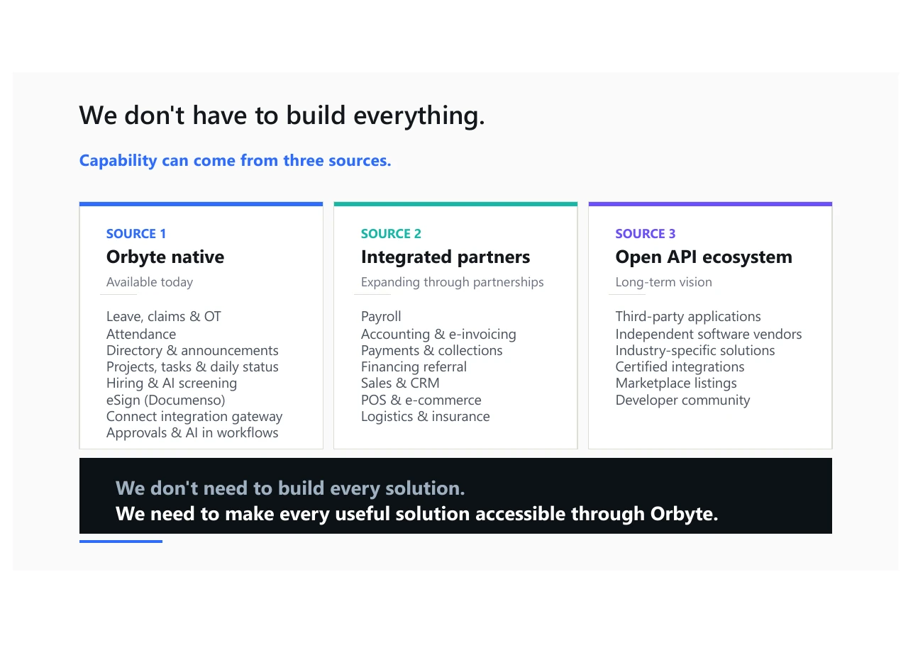

**We don't have to build everything.**

**Capability can come from three sources.**

**SOURCE 1**

**Orbyte native**

Available today

- Leave, claims & OT
- Attendance
- Directory & announcements
- Projects, tasks & daily status
- Hiring & AI screening
- eSign (Documenso)
- Connect integration gateway
- Approvals & AI in workflows

**SOURCE 2**

**Integrated partners**

Expanding through partnerships

- Payroll
- Accounting & e-invoicing
- Payments & collections
- Financing referral
- Sales & CRM
- POS & e-commerce
- Logistics & insurance

**SOURCE 3**

**Open API ecosystem**

Long-term vision

- Third-party applications
- Independent software vendors
- Industry-specific solutions
- Certified integrations
- Marketplace listings
- Developer community

**We don't need to build every solution.**

**We need to make every useful solution accessible through Orbyte.**

## Slide 10: One platform underneath everything

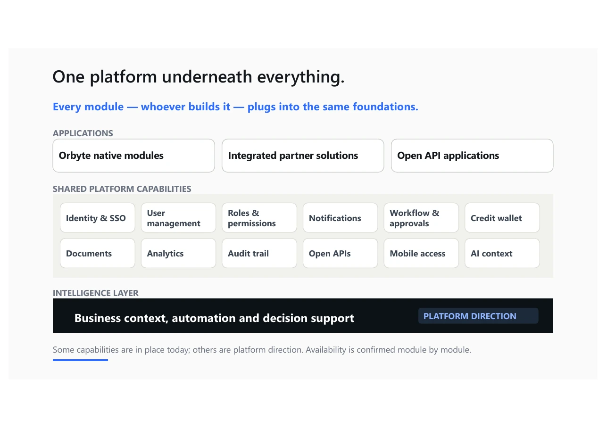

**One platform underneath everything.**

**Every module — whoever builds it — plugs into the same foundations.**

**APPLICATIONS**

- Orbyte native modules
- Integrated partner solutions
- Open API applications

**SHARED PLATFORM CAPABILITIES**

- Identity & SSO
- User management
- Roles & permissions
- Notifications
- Workflow & approvals
- Credit wallet
- Documents
- Analytics
- Audit trail
- Open APIs
- Mobile access
- AI context

**INTELLIGENCE LAYER**

**Business context, automation and decision support**

**PLATFORM DIRECTION**

Some capabilities are in place today; others are platform direction. Availability is confirmed module by module.

## Slide 11: The foundation every module builds on

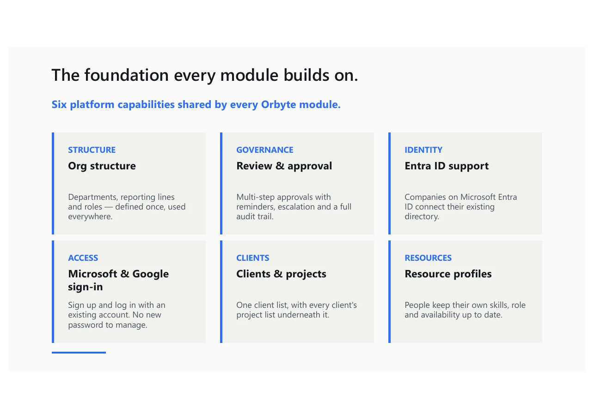

**The foundation every module builds on.**

**Six platform capabilities shared by every Orbyte module.**

**STRUCTURE**

**Org structure**

Departments, reporting lines and roles — defined once, used everywhere.

**GOVERNANCE**

**Review & approval**

Multi-step approvals with reminders, escalation and a full audit trail.

**IDENTITY**

**Entra ID support**

Companies on Microsoft Entra ID connect their existing directory.

**ACCESS**

**Microsoft & Google sign-in**

Sign up and log in with an existing account. No new password to manage.

**CLIENTS**

**Clients & projects**

One client list, with every client's project list underneath it.

**RESOURCES**

**Resource profiles**

People keep their own skills, role and availability up to date.

## Slide 12: Pay for 12 users, not 80 licences

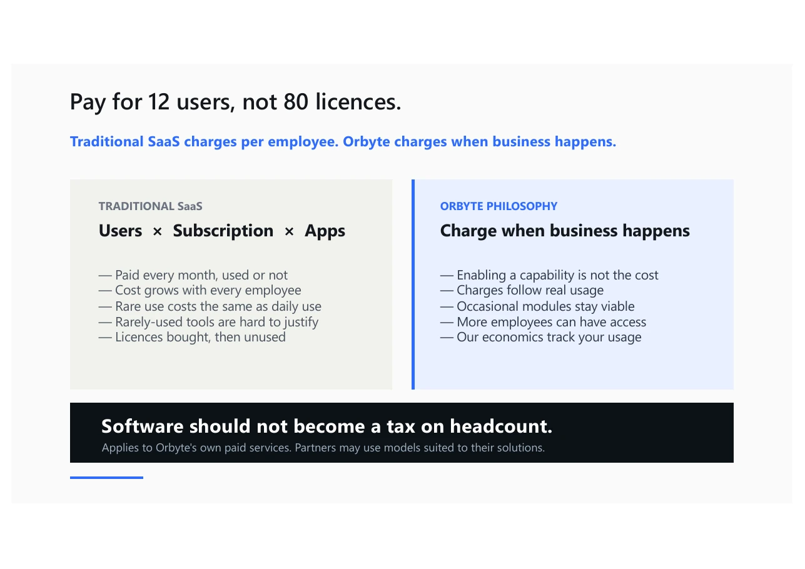

**Pay for 12 users, not 80 licences.**

**Traditional SaaS charges per employee. Orbyte charges when business happens.**

**TRADITIONAL SaaS**

**Users × Subscription × Apps**

- Paid every month, used or not
- Cost grows with every employee
- Rare use costs the same as daily use
- Rarely-used tools are hard to justify
- Licences bought, then unused

**ORBYTE PHILOSOPHY**

**Charge when business happens**

- Enabling a capability is not the cost
- Charges follow real usage
- Occasional modules stay viable
- More employees can have access
- Our economics track your usage

**Software should not become a tax on headcount.**

Applies to Orbyte's own paid services. Partners may use models suited to their solutions.

## Slide 13: Pay for usage, not seats

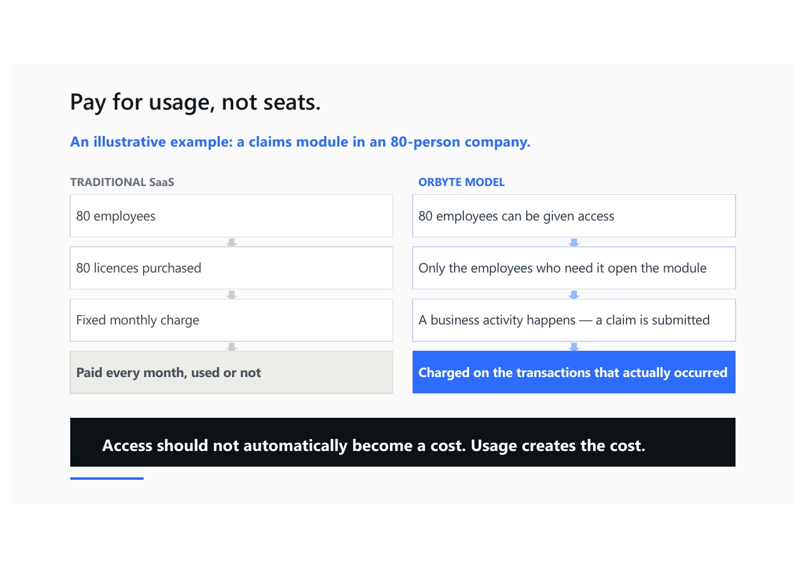

**Pay for usage, not seats.**

**An illustrative example: a claims module in an 80-person company.**

**TRADITIONAL SaaS**

_Diagram: four boxes linked top to bottom by arrows: "80 employees" → "80 licences purchased" → "Fixed monthly charge" → "Paid every month, used or not"._

**ORBYTE MODEL**

_Diagram: four boxes linked top to bottom by arrows: "80 employees can be given access" → "Only the employees who need it open the module" → "A business activity happens — a claim is submitted" → "Charged on the transactions that actually occurred"._

**Access should not automatically become a cost. Usage creates the cost.**

## Slide 14: Start small. Add what you need

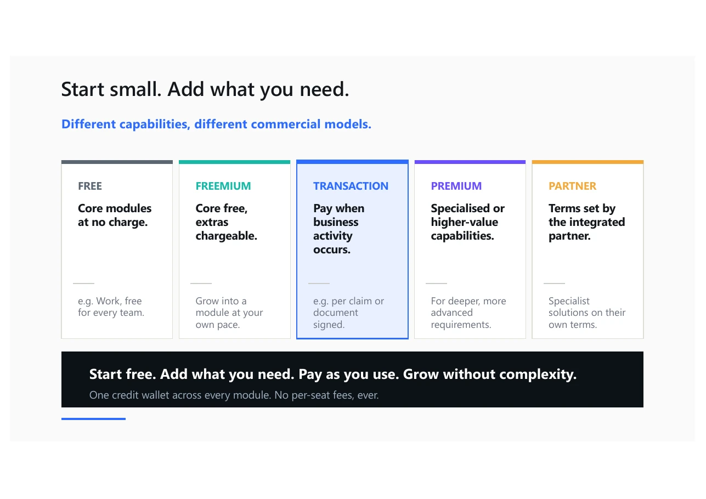

**Start small. Add what you need.**

**Different capabilities, different commercial models.**

**FREE**

**Core modules at no charge.**

e.g. Work, free for every team.

**FREEMIUM**

**Core free, extras chargeable.**

Grow into a module at your own pace.

**TRANSACTION**

**Pay when business activity occurs.**

e.g. per claim or document signed.

**PREMIUM**

**Specialised or higher-value capabilities.**

For deeper, more advanced requirements.

**PARTNER**

**Terms set by the integrated partner.**

Specialist solutions on their own terms.

**Start free. Add what you need. Pay as you use. Grow without complexity.**

One credit wallet across every module. No per-seat fees, ever.

## Slide 15: The more connected the business, the smarter Orbyte becomes

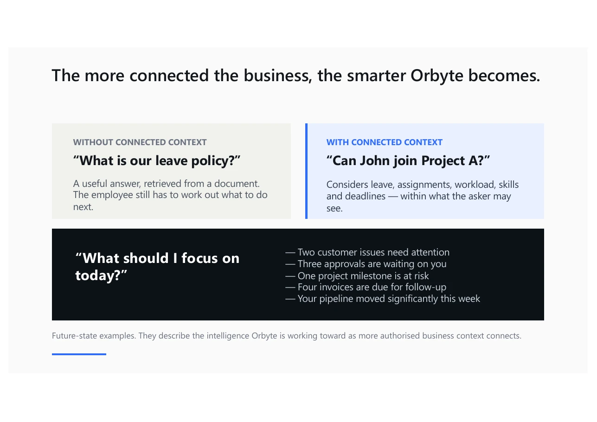

**The more connected the business, the smarter Orbyte becomes.**

**WITHOUT CONNECTED CONTEXT**

**“What is our leave policy?”**

A useful answer, retrieved from a document. The employee still has to work out what to do next.

**WITH CONNECTED CONTEXT**

**“Can John join Project A?”**

Considers leave, assignments, workload, skills and deadlines — within what the asker may see.

**“What should I focus on today?”**

- Two customer issues need attention
- Three approvals are waiting on you
- One project milestone is at risk
- Four invoices are due for follow-up
- Your pipeline moved significantly this week

Future-state examples. They describe the intelligence Orbyte is working toward as more authorised business context connects.

## Slide 16: From data to understanding

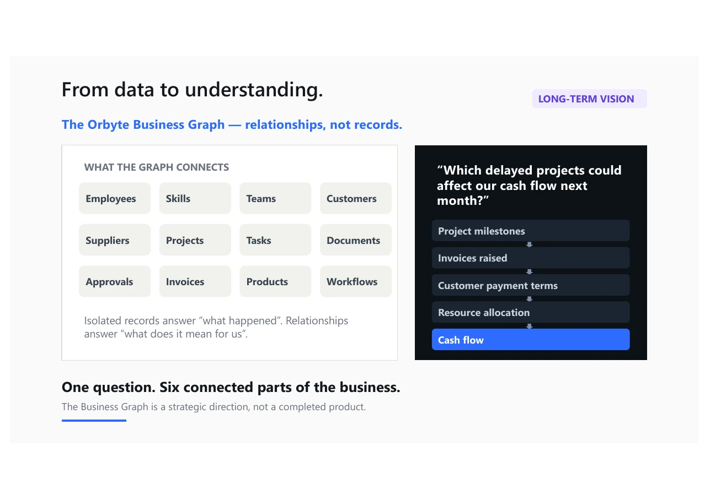

**From data to understanding.**

**LONG-TERM VISION**

**The Orbyte Business Graph — relationships, not records.**

**WHAT THE GRAPH CONNECTS**

- Employees
- Skills
- Teams
- Customers
- Suppliers
- Projects
- Tasks
- Documents
- Approvals
- Invoices
- Products
- Workflows

Isolated records answer “what happened”. Relationships answer “what does it mean for us”.

**“Which delayed projects could affect our cash flow next month?”**

_Diagram: five boxes linked top to bottom by arrows: Project milestones → Invoices raised → Customer payment terms → Resource allocation → Cash flow (highlighted)._

**One question. Six connected parts of the business.**

The Business Graph is a strategic direction, not a completed product.

## Slide 17: Three pillars of Orbyte

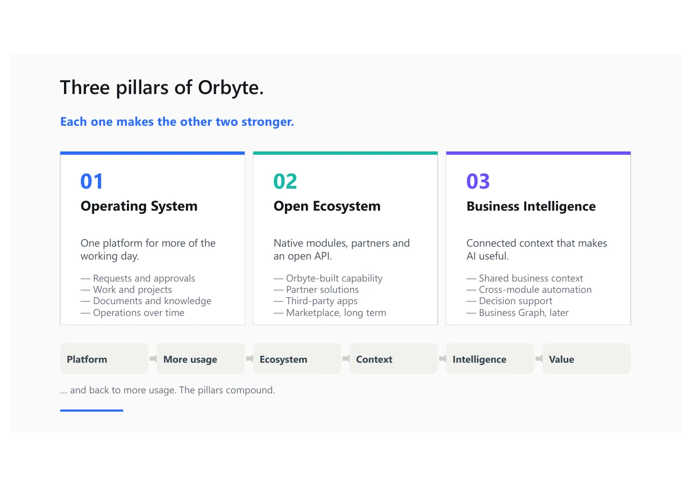

**Three pillars of Orbyte.**

**Each one makes the other two stronger.**

**01**

**Operating System**

One platform for more of the working day.

- Requests and approvals
- Work and projects
- Documents and knowledge
- Operations over time

**02**

**Open Ecosystem**

Native modules, partners and an open API.

- Orbyte-built capability
- Partner solutions
- Third-party apps
- Marketplace, long term

**03**

**Business Intelligence**

Connected context that makes AI useful.

- Shared business context
- Cross-module automation
- Decision support
- Business Graph, later

_Diagram: six boxes linked left to right by arrows: Platform → More usage → Ecosystem → Context → Intelligence → Value._

… and back to more usage. The pillars compound.

## Slide 18: The Orbyte flywheel

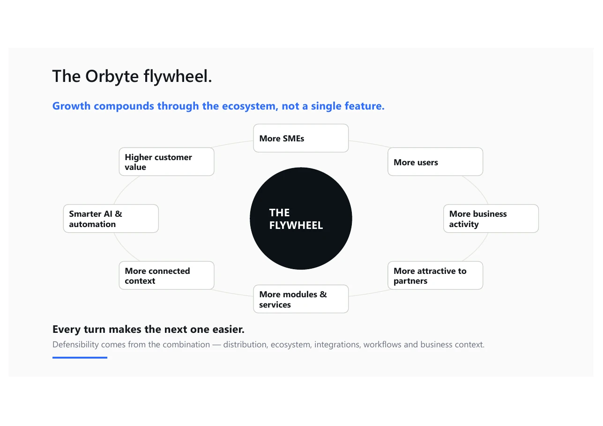

**The Orbyte flywheel.**

**Growth compounds through the ecosystem, not a single feature.**

_Diagram: a central "THE FLYWHEEL" circle inside a ring of eight boxes, clockwise from the top: More SMEs, More users, More business activity, More attractive to partners, More modules & services, More connected context, Smarter AI & automation, Higher customer value._

**Every turn makes the next one easier.**

Defensibility comes from the combination — distribution, ecosystem, integrations, workflows and business context.

## Slide 19: From SuperApp to SME operating system

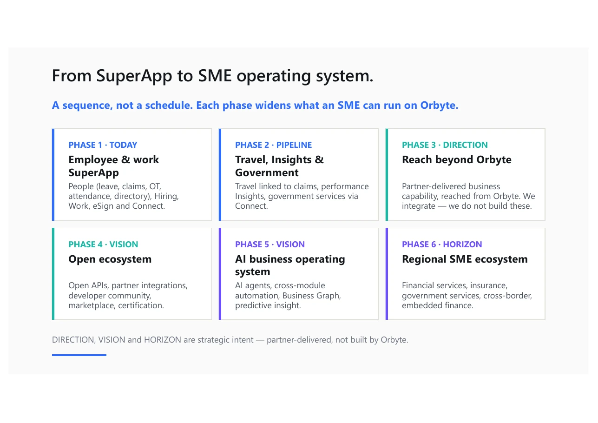

**From SuperApp to SME operating system.**

**A sequence, not a schedule. Each phase widens what an SME can run on Orbyte.**

**PHASE 1 · TODAY**

**Employee & work SuperApp**

People (leave, claims, OT, attendance, directory), Hiring, Work, eSign and Connect.

**PHASE 2 · PIPELINE**

**Travel, Insights & Government**

Travel linked to claims, performance Insights, government services via Connect.

**PHASE 3 · DIRECTION**

**Reach beyond Orbyte**

Partner-delivered business capability, reached from Orbyte. We integrate — we do not build these.

**PHASE 4 · VISION**

**Open ecosystem**

Open APIs, partner integrations, developer community, marketplace, certification.

**PHASE 5 · VISION**

**AI business operating system**

AI agents, cross-module automation, Business Graph, predictive insight.

**PHASE 6 · HORIZON**

**Regional SME ecosystem**

Financial services, insurance, government services, cross-border, embedded finance.

DIRECTION, VISION and HORIZON are strategic intent — partner-delivered, not built by Orbyte.

## Slide 20: One ecosystem. Value for everyone

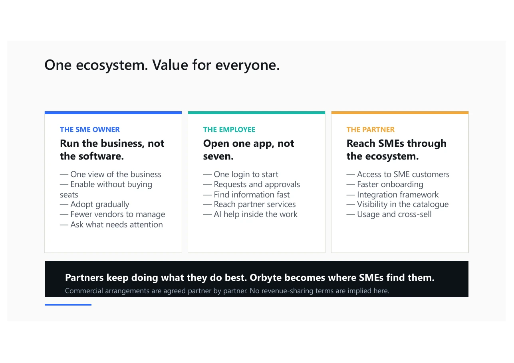

**One ecosystem. Value for everyone.**

**THE SME OWNER**

**Run the business, not the software.**

- One view of the business
- Enable without buying seats
- Adopt gradually
- Fewer vendors to manage
- Ask what needs attention

**THE EMPLOYEE**

**Open one app, not seven.**

- One login to start
- Requests and approvals
- Find information fast
- Reach partner services
- AI help inside the work

**THE PARTNER**

**Reach SMEs through the ecosystem.**

- Access to SME customers
- Faster onboarding
- Integration framework
- Visibility in the catalogue
- Usage and cross-sell

**Partners keep doing what they do best. Orbyte becomes where SMEs find them.**

Commercial arrangements are agreed partner by partner. No revenue-sharing terms are implied here.

## Slide 21: The destination

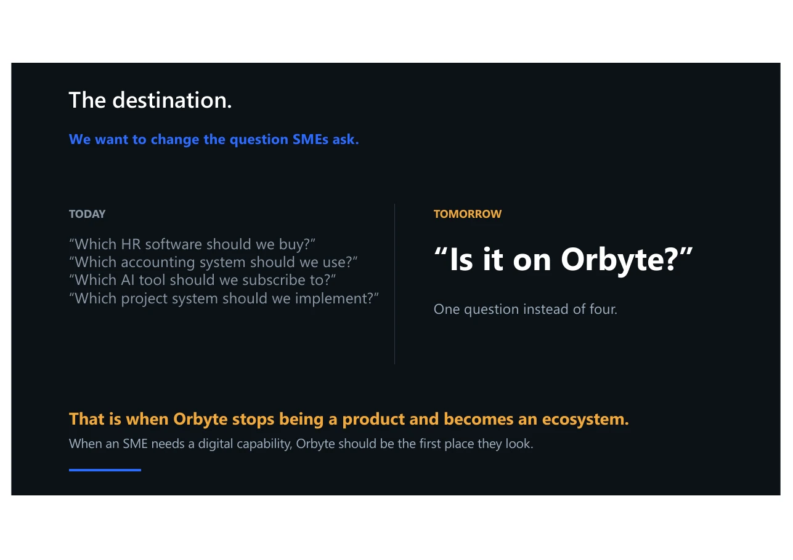

**The destination.**

**We want to change the question SMEs ask.**

**TODAY**

“Which HR software should we buy?”

“Which accounting system should we use?”

“Which AI tool should we subscribe to?”

“Which project system should we implement?”

**TOMORROW**

**“Is it on Orbyte?”**

One question instead of four.

**That is when Orbyte stops being a product and becomes an ecosystem.**

When an SME needs a digital capability, Orbyte should be the first place they look.

## Slide 22: Built by Alpha Red

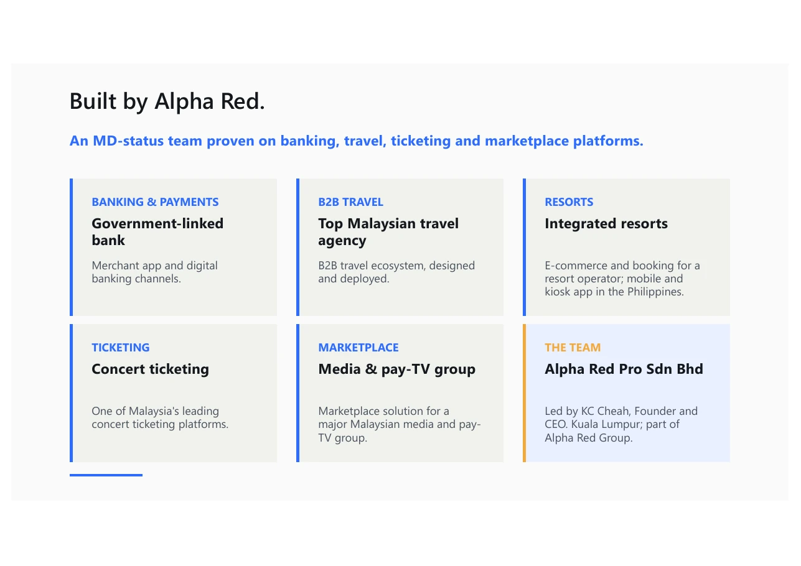

**Built by Alpha Red.**

**An MD-status team proven on banking, travel, ticketing and marketplace platforms.**

**BANKING & PAYMENTS**

**Government-linked bank**

Merchant app and digital banking channels.

**B2B TRAVEL**

**Top Malaysian travel agency**

B2B travel ecosystem, designed and deployed.

**RESORTS**

**Integrated resorts**

E-commerce and booking for a resort operator; mobile and kiosk app in the Philippines.

**TICKETING**

**Concert ticketing**

One of Malaysia's leading concert ticketing platforms.

**MARKETPLACE**

**Media & pay-TV group**

Marketplace solution for a major Malaysian media and pay-TV group.

**THE TEAM**

**Alpha Red Pro Sdn Bhd**

Led by KC Cheah, Founder and CEO. Kuala Lumpur; part of Alpha Red Group.

## Slide 23: Orbyte

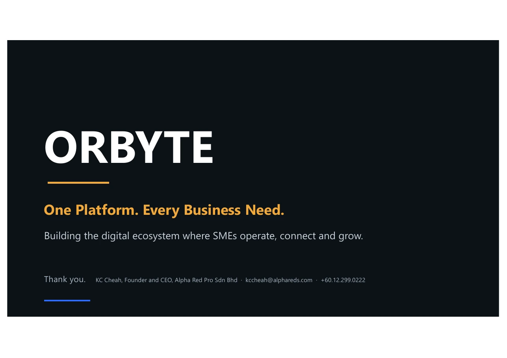

**ORBYTE**

**One Platform. Every Business Need.**

Building the digital ecosystem where SMEs operate, connect and grow.

Thank you.

KC Cheah, Founder and CEO, Alpha Red Pro Sdn Bhd · [contact details omitted]

## Slide 24: People

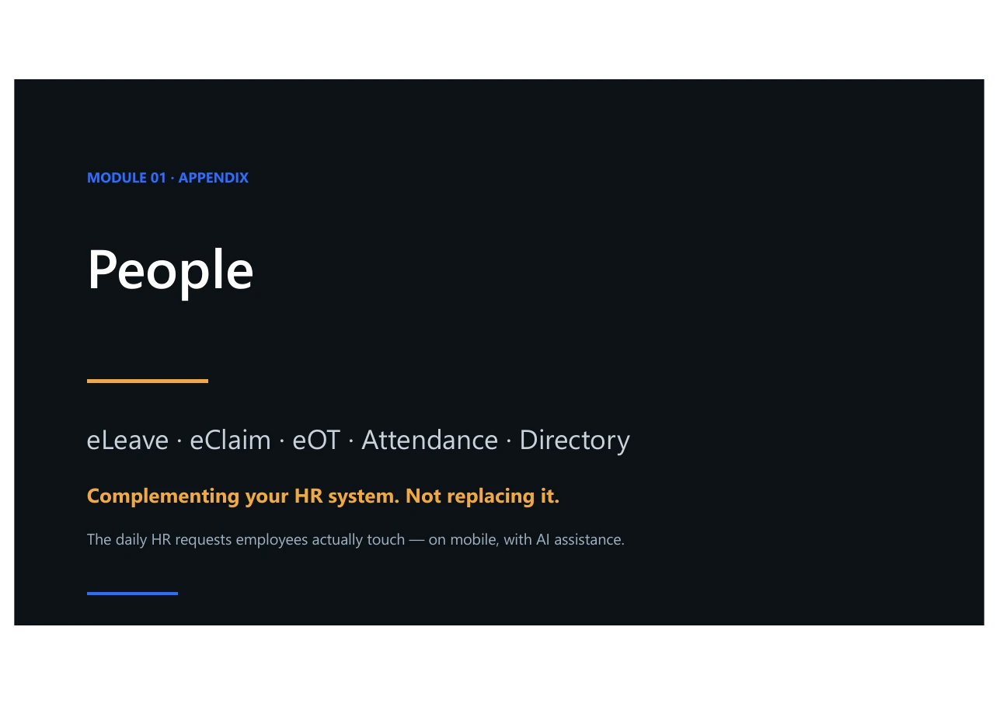

_MODULE 01 · APPENDIX_

**People**

eLeave · eClaim · eOT · Attendance · Directory

**Complementing your HR system. Not replacing it.**

The daily HR requests employees actually touch — on mobile, with AI assistance.

## Slide 25: Your HR system stays

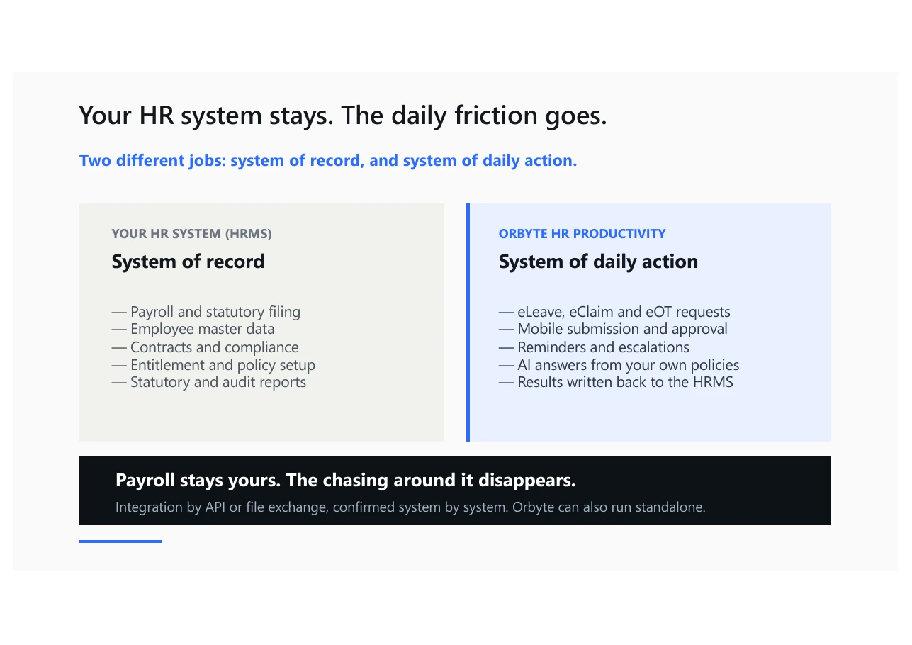

**Your HR system stays. The daily friction goes.**

**Two different jobs: system of record, and system of daily action.**

**YOUR HR SYSTEM (HRMS)**

**System of record**

- Payroll and statutory filing
- Employee master data
- Contracts and compliance
- Entitlement and policy setup
- Statutory and audit reports

**ORBYTE HR PRODUCTIVITY**

**System of daily action**

- eLeave, eClaim and eOT requests
- Mobile submission and approval
- Reminders and escalations
- AI answers from your own policies
- Results written back to the HRMS

**Payroll stays yours. The chasing around it disappears.**

Integration by API or file exchange, confirmed system by system. Orbyte can also run standalone.

## Slide 26: eLeave

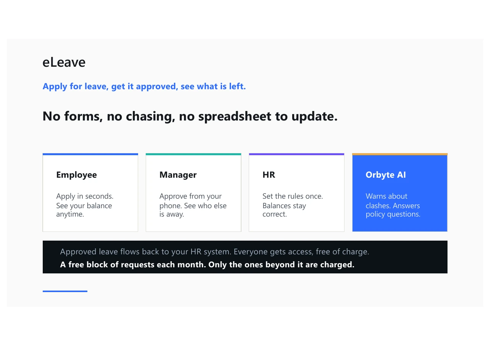

**eLeave**

**Apply for leave, get it approved, see what is left.**

**No forms, no chasing, no spreadsheet to update.**

**Employee**

Apply in seconds. See your balance anytime.

**Manager**

Approve from your phone. See who else is away.

**HR**

Set the rules once. Balances stay correct.

**Orbyte AI**

Warns about clashes. Answers policy questions.

Approved leave flows back to your HR system. Everyone gets access, free of charge.

**A free block of requests each month. Only the ones beyond it are charged.**

## Slide 27: eClaim

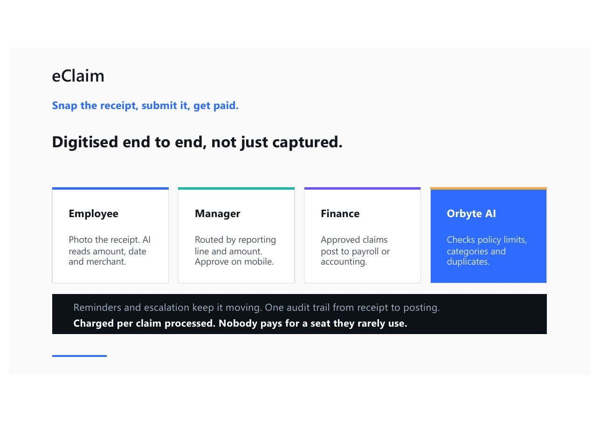

**eClaim**

**Snap the receipt, submit it, get paid.**

**Digitised end to end, not just captured.**

**Employee**

Photo the receipt. AI reads amount, date and merchant.

**Manager**

Routed by reporting line and amount. Approve on mobile.

**Finance**

Approved claims post to payroll or accounting.

**Orbyte AI**

Checks policy limits, categories and duplicates.

Reminders and escalation keep it moving. One audit trail from receipt to posting.

**Charged per claim processed. Nobody pays for a seat they rarely use.**

## Slide 28: eOT

**eOT**

**Agree the overtime before the hours are worked.**

**No arguments at payroll about who approved what.**

**Employee**

Ask first, work with it approved.

**Manager**

Decide before the hours are spent.

**Payroll**

Approved hours, already totalled.

**Orbyte AI**

Adds up the hours. Flags odd patterns.

Approved overtime reaches payroll with a full trail of who agreed to it.

**Charged per overtime request. Quiet months cost nothing.**

## Slide 29: Work

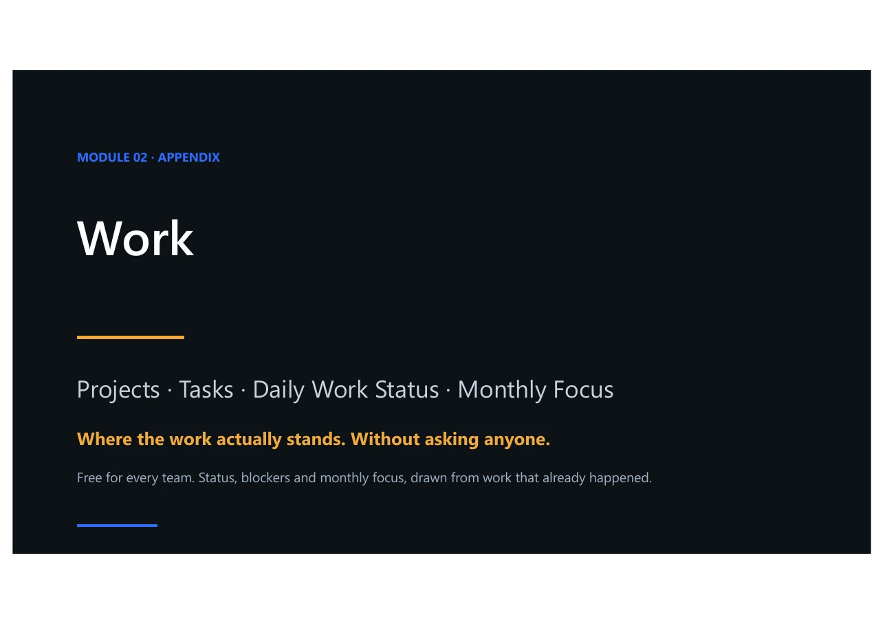

_MODULE 02 · APPENDIX_

**Work**

Projects · Tasks · Daily Work Status · Monthly Focus

**Where the work actually stands. Without asking anyone.**

Free for every team. Status, blockers and monthly focus, drawn from work that already happened.

## Slide 30: Daily work status

**Daily Work Status**

**Done, next, and stuck — for every person, every day.**

**The daily update, without anyone chasing for it.**

**Team member**

Show your work without writing a report.

**Team lead**

See progress and blockers without asking.

**Owner**

One daily view across all projects.

**Orbyte AI**

Writes the update from real activity.

Public holidays and approved leave are shown, so quiet days explain themselves.

**Part of Work, which is free for every team.**

## Slide 31: Monthly project focus

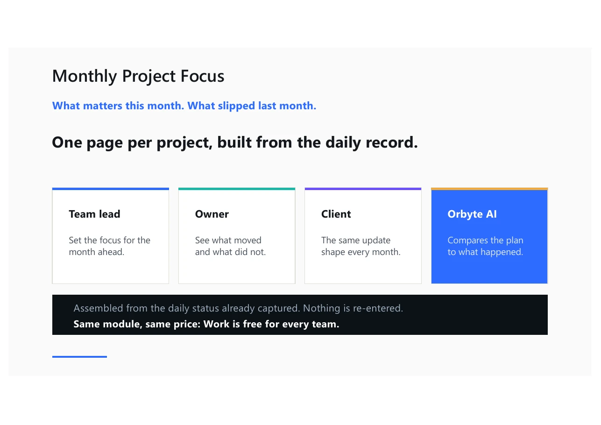

**Monthly Project Focus**

**What matters this month. What slipped last month.**

**One page per project, built from the daily record.**

**Team lead**

Set the focus for the month ahead.

**Owner**

See what moved and what did not.

**Client**

The same update shape every month.

**Orbyte AI**

Compares the plan to what happened.

Assembled from the daily status already captured. Nothing is re-entered.

**Same module, same price: Work is free for every team.**

## Slide 32: eLeave knows who is away

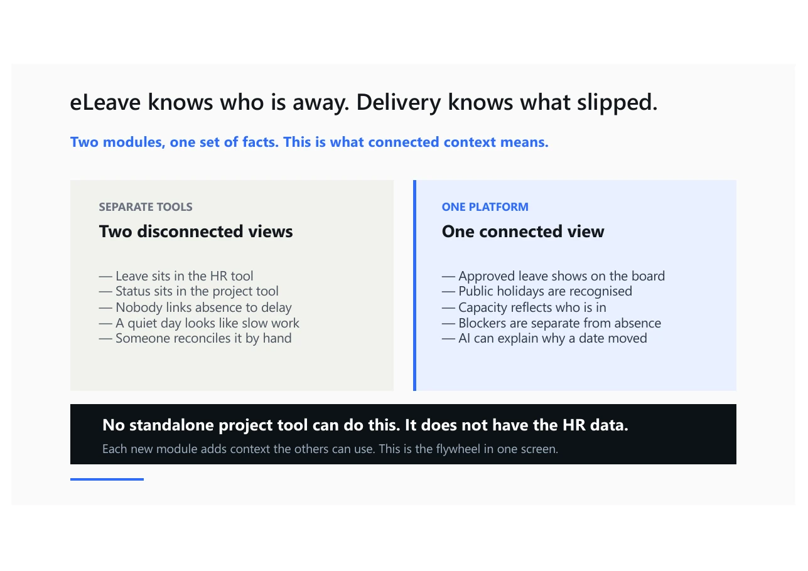

**eLeave knows who is away. Delivery knows what slipped.**

**Two modules, one set of facts. This is what connected context means.**

**SEPARATE TOOLS**

**Two disconnected views**

- Leave sits in the HR tool
- Status sits in the project tool
- Nobody links absence to delay
- A quiet day looks like slow work
- Someone reconciles it by hand

**ONE PLATFORM**

**One connected view**

- Approved leave shows on the board
- Public holidays are recognised
- Capacity reflects who is in
- Blockers are separate from absence
- AI can explain why a date moved

**No standalone project tool can do this. It does not have the HR data.**

Each new module adds context the others can use. This is the flywheel in one screen.

## Slide 33: Platform foundation, in detail

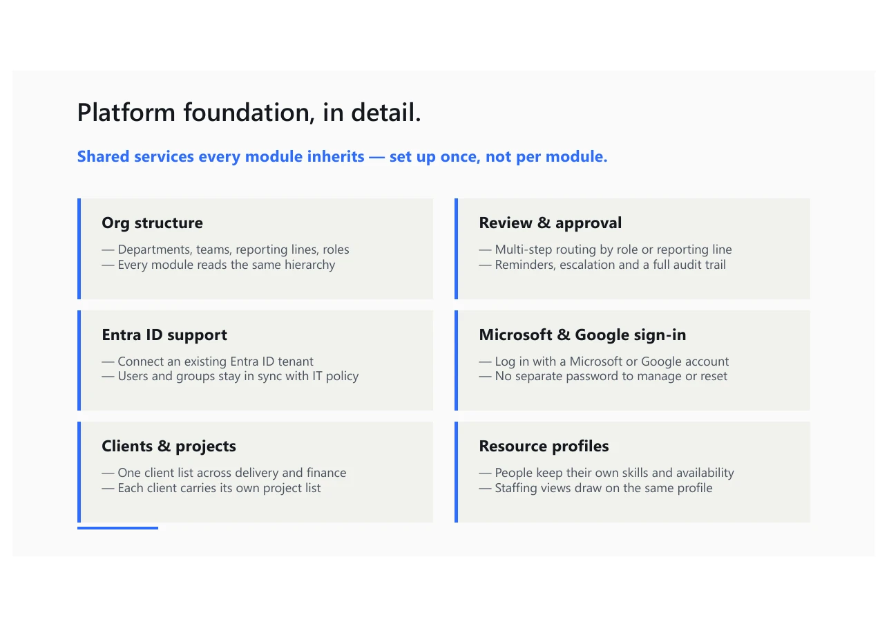

**Platform foundation, in detail.**

**Shared services every module inherits — set up once, not per module.**

**Org structure**

- Departments, teams, reporting lines, roles
- Every module reads the same hierarchy

**Review & approval**

- Multi-step routing by role or reporting line
- Reminders, escalation and a full audit trail

**Entra ID support**

- Connect an existing Entra ID tenant
- Users and groups stay in sync with IT policy

**Microsoft & Google sign-in**

- Log in with a Microsoft or Google account
- No separate password to manage or reset

**Clients & projects**

- One client list across delivery and finance
- Each client carries its own project list

**Resource profiles**

- People keep their own skills and availability
- Staffing views draw on the same profile

## Slide 34: Hiring

_MODULE 03 · APPENDIX_

**Hiring**

Job Posting · AI Candidate Screening

**Post the role once. AI reads every applicant first.**

Job posts, applications, AI screening with scored reasons, and stage tracking — inside the client portal.

## Slide 35: Post the job

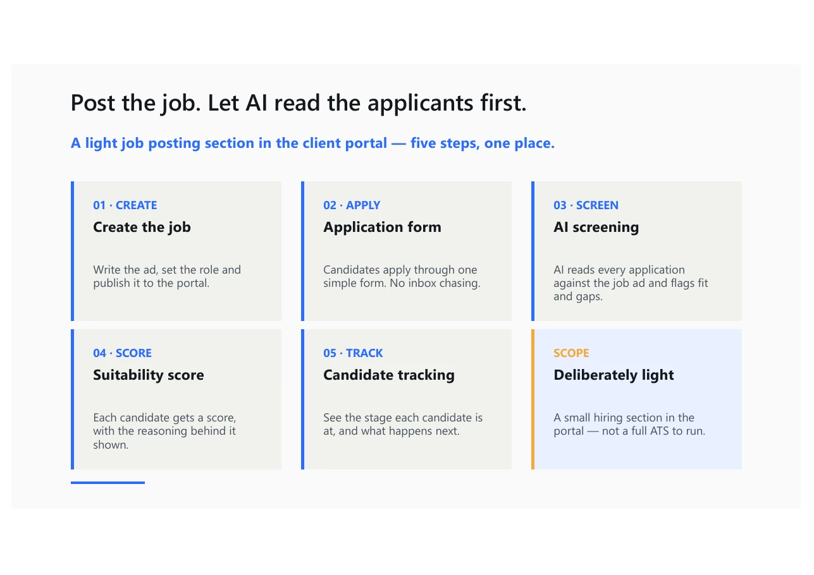

**Post the job. Let AI read the applicants first.**

**A light job posting section in the client portal — five steps, one place.**

**01 · CREATE**

**Create the job**

Write the ad, set the role and publish it to the portal.

**02 · APPLY**

**Application form**

Candidates apply through one simple form. No inbox chasing.

**03 · SCREEN**

**AI screening**

AI reads every application against the job ad and flags fit and gaps.

**04 · SCORE**

**Suitability score**

Each candidate gets a score, with the reasoning behind it shown.

**05 · TRACK**

**Candidate tracking**

See the stage each candidate is at, and what happens next.

**SCOPE**

**Deliberately light**

A small hiring section in the portal — not a full ATS to run.

## Slide 36: eSign

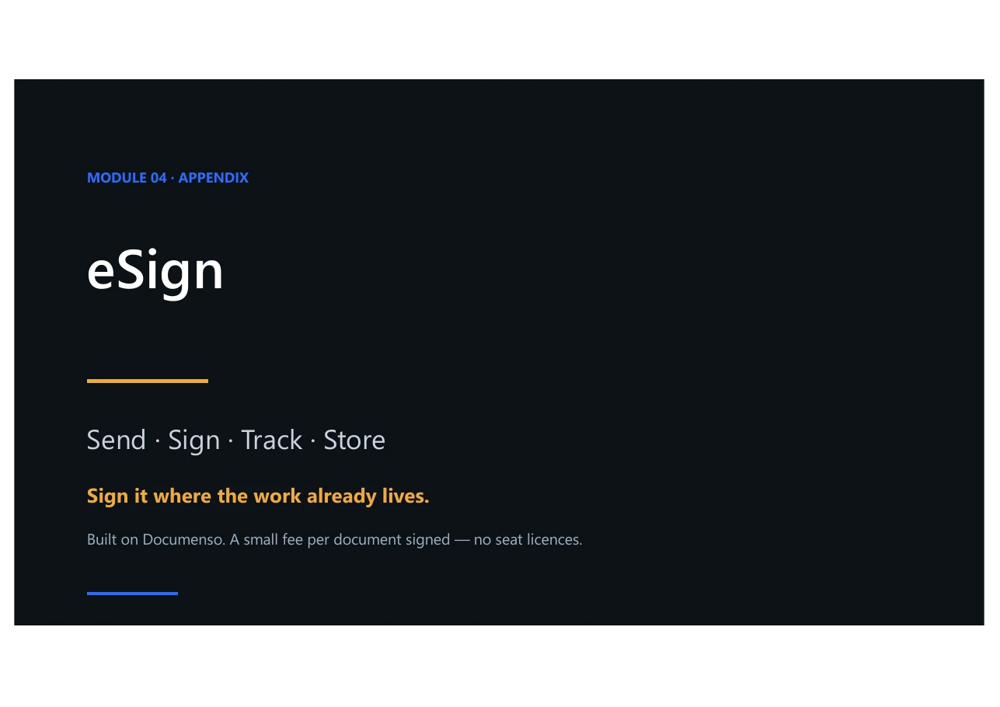

_MODULE 04 · APPENDIX_

**eSign**

Send · Sign · Track · Store

**Sign it where the work already lives.**

Built on Documenso. A small fee per document signed — no seat licences.

## Slide 37: Sign without leaving the platform

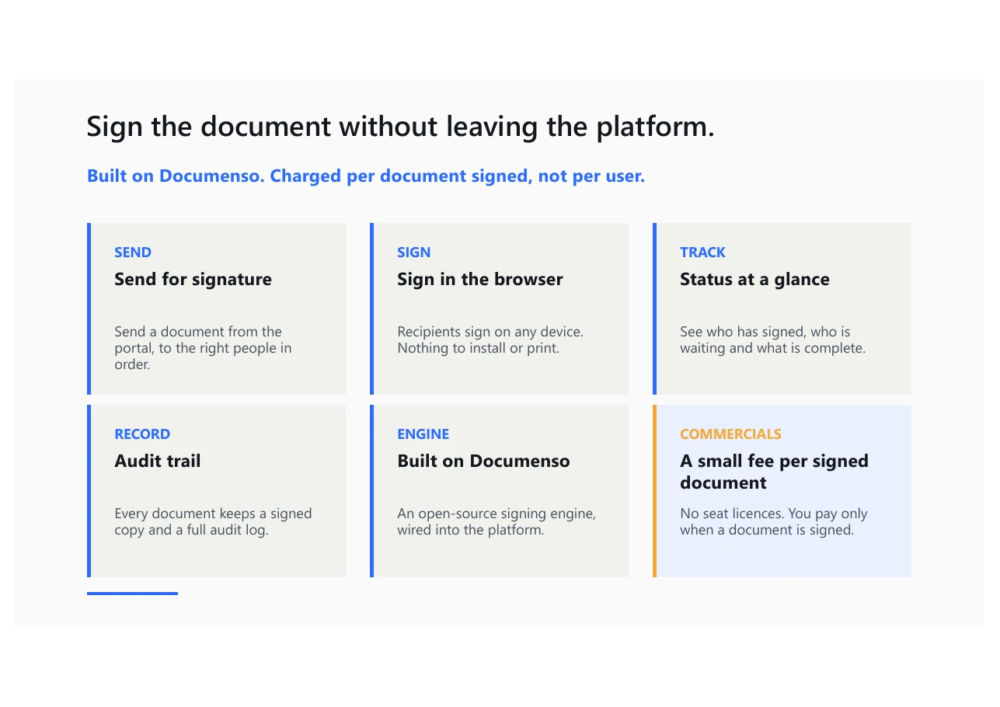

**Sign the document without leaving the platform.**

**Built on Documenso. Charged per document signed, not per user.**

**SEND**

**Send for signature**

Send a document from the portal, to the right people in order.

**SIGN**

**Sign in the browser**

Recipients sign on any device. Nothing to install or print.

**TRACK**

**Status at a glance**

See who has signed, who is waiting and what is complete.

**RECORD**

**Audit trail**

Every document keeps a signed copy and a full audit log.

**ENGINE**

**Built on Documenso**

An open-source signing engine, wired into the platform.

**COMMERCIALS**

**A small fee per signed document**

No seat licences. You pay only when a document is signed.

## Slide 38: Connect

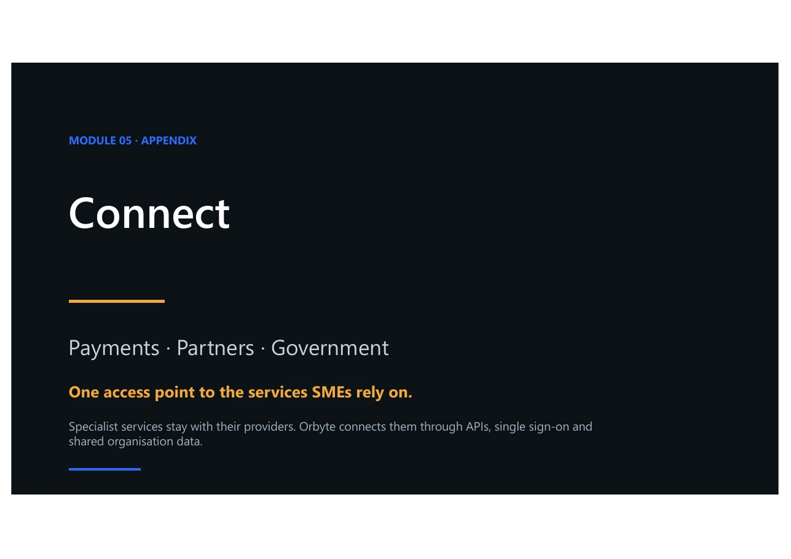

_MODULE 05 · APPENDIX_

**Connect**

Payments · Partners · Government

**One access point to the services SMEs rely on.**

Specialist services stay with their providers. Orbyte connects them through APIs, single sign-on and shared organisation data.

## Slide 39: Connect the services

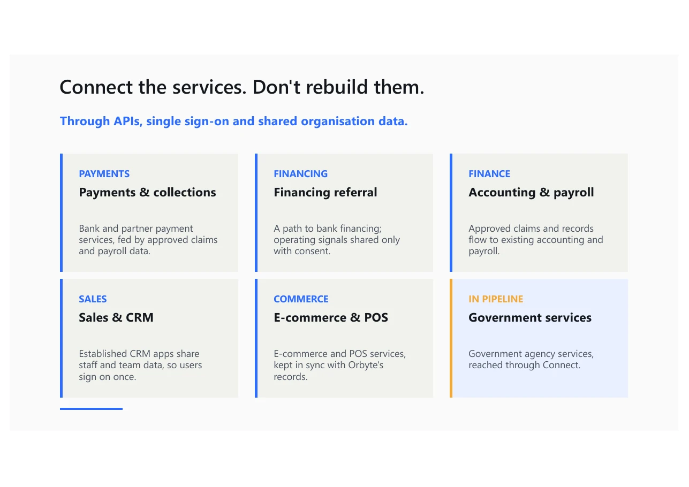

**Connect the services. Don't rebuild them.**

**Through APIs, single sign-on and shared organisation data.**

**PAYMENTS**

**Payments & collections**

Bank and partner payment services, fed by approved claims and payroll data.

**FINANCING**

**Financing referral**

A path to bank financing; operating signals shared only with consent.

**FINANCE**

**Accounting & payroll**

Approved claims and records flow to existing accounting and payroll.

**SALES**

**Sales & CRM**

Established CRM apps share staff and team data, so users sign on once.

**COMMERCE**

**E-commerce & POS**

E-commerce and POS services, kept in sync with Orbyte's records.

**IN PIPELINE**

**Government services**

Government agency services, reached through Connect.
