# Workshop 1 slides

The screens of the two live demos at SDC Hackathon 2026 Workshop 1, run by Alpha Red on Zoom on 20 October 2026, each with its image and its text. The workshop's two decks are in [Cloudflare slides](slides-cloudflare.md) and [Orbyte slides](slides-orbyte.md); this file holds what was shown between and after them. Slides 01 to 04 are Cheong Nan Feng's demo of the "Build Weekend" organizer assistant, the sample app from his deck, from about 00:25:50 to 00:27:00. Slides 05 to 14 are KC Cheah's tour of Alpha Red's own Orbyte workspace, from about 00:40:51 to 00:44:10, in the order he opened the pages. The [transcript](transcript.md) covers what was said and the [meeting chat](chat.md) what the recording shows of the Zoom chat.

Screens were captured from the organisers' recording in the workshop's [Drive folder](https://drive.google.com/drive/folders/1sWs2gnuY_Mfa_SCvHzEpS1Tw4XYvXYgF), once for each distinct screen or step, not for every scroll or click, and the italic line under each image gives its time in the recording, as used in the transcript. Images are cropped to the browser window below its tab strip, without the macOS menu bar or Zoom's sharing bar. The Build Weekend app ran in "Sample fixtures" mode, so its answers and routing are canned rather than live model calls, and its team, members and links are the deck's fictional examples. In the Orbyte screens, the names, email addresses and avatars of Alpha Red staff are pixelated and left out of the text, as are KC's own email address and profile photo. The Microsoft account picker he passed through while signing in isn't captured, as it lists email addresses.

Contents:

1.  [Slide 01: Build Weekend demo: the participant view](#slide-01-build-weekend-demo-the-participant-view)
1.  [Slide 02: Build Weekend demo: loading sample evidence](#slide-02-build-weekend-demo-loading-sample-evidence)
1.  [Slide 03: Build Weekend demo: before save and validate](#slide-03-build-weekend-demo-before-save-and-validate)
1.  [Slide 04: Build Weekend demo: the submitted draft](#slide-04-build-weekend-demo-the-submitted-draft)
1.  [Slide 05: Orbyte demo: sign-in](#slide-05-orbyte-demo-sign-in)
1.  [Slide 06: Orbyte demo: job list](#slide-06-orbyte-demo-job-list)
1.  [Slide 07: Orbyte demo: dashboard](#slide-07-orbyte-demo-dashboard)
1.  [Slide 08: Orbyte demo: users](#slide-08-orbyte-demo-users)
1.  [Slide 09: Orbyte demo: task list](#slide-09-orbyte-demo-task-list)
1.  [Slide 10: Orbyte demo: project focus timeline](#slide-10-orbyte-demo-project-focus-timeline)
1.  [Slide 11: Orbyte demo: meeting summaries](#slide-11-orbyte-demo-meeting-summaries)
1.  [Slide 12: Orbyte demo: the Talent Hub menu](#slide-12-orbyte-demo-the-talent-hub-menu)
1.  [Slide 13: Orbyte demo: BRD analysis and Azure DevOps sync](#slide-13-orbyte-demo-brd-analysis-and-azure-devops-sync)
1.  [Slide 14: Orbyte demo: settings in a second organisation](#slide-14-orbyte-demo-settings-in-a-second-organisation)

## Slide 01: Build Weekend demo: the participant view

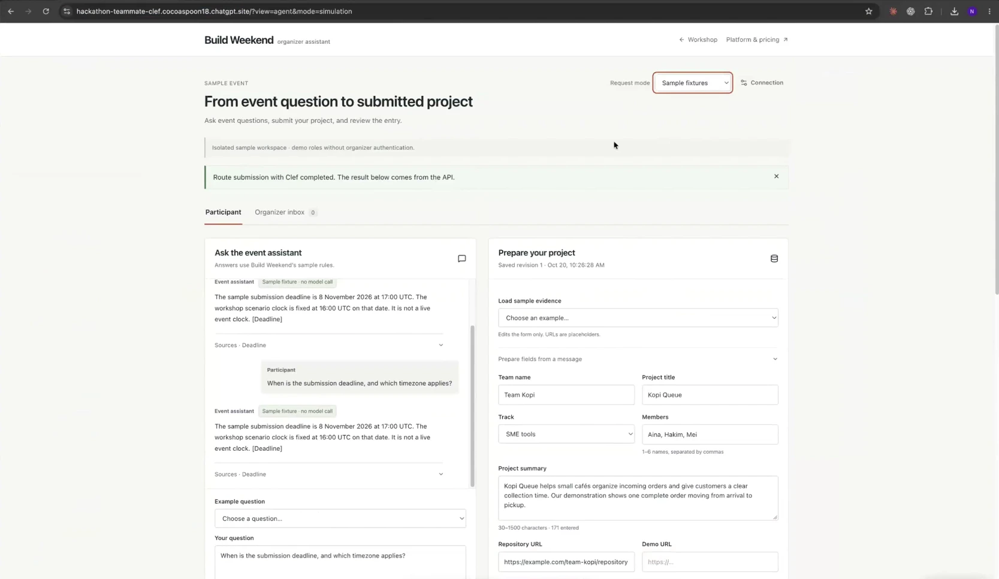

_At 00:25:58, as Nan Feng says "So this is the sample app": the Build Weekend organizer assistant in Chrome at hackathon-teammate-clef.cocoaspoon18.chatgpt.site, on its Participant tab. An earlier run has left a sample question and answer, and a saved draft for Team Kopi without a demo link._

**Build Weekend** organizer assistant · Workshop · Platform & pricing

SAMPLE EVENT

**From event question to submitted project**

Ask event questions, submit your project, and review the entry.

- Request mode: Sample fixtures · Connection
- Isolated sample workspace · demo roles without organizer authentication.
- Banner: "Route submission with Clef completed. The result below comes from the API."
- Tabs: Participant · Organizer inbox 0

**Ask the event assistant**: Answers use Build Weekend's sample rules.

- Event assistant (Sample fixture · no model call): "The sample submission deadline is 8 November 2026 at 17:00 UTC. The workshop scenario clock is fixed at 16:00 UTC on that date. It is not a live event clock. [Deadline]" · Sources · Deadline
- Participant: "When is the submission deadline, and which timezone applies?"
- Event assistant: the same answer again
- Example question: Choose a question...
- Your question: "When is the submission deadline, and which timezone applies?"

**Prepare your project**: Saved revision 1 · Oct 20, 10:26:28 AM

- Load sample evidence: Choose an example... (Edits the form only. URLs are placeholders.)
- Prepare fields from a message
- Team name: Team Kopi · Project title: Kopi Queue
- Track: SME tools · Members: Aina, Hakim, Mei (1–6 names, separated by commas)
- Project summary: "Kopi Queue helps small cafés organize incoming orders and give customers a clear collection time. Our demonstration shows one complete order moving from arrival to pickup." (30–1500 characters · 171 entered)
- Repository URL: https://example.com/team-kopi/repository · Demo URL: empty

## Slide 02: Build Weekend demo: loading sample evidence

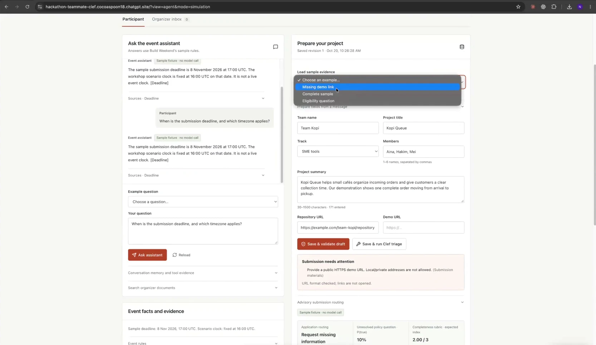

_At 00:26:27, as Nan Feng says "you can have a missing demo link": the Load sample evidence list open. Below it, the saved draft's validation and advisory routing both flag the missing demo URL. He picks Complete sample, which fills in the demo URL._

- Load sample evidence: Choose an example... · Missing demo link · Complete sample · Eligibility question
- Demo URL: empty
- Buttons: Save & validate draft · Save & run Clef triage
- **Submission needs attention**: "Provide a public HTTPS demo URL. Local/private addresses are not allowed. (Submission materials)" · URL format checked; links are not opened.
- Advisory submission routing (Sample fixture · no model call): Application routing: Request missing information · Unresolved policy question · P(true): 10% · Completeness rubric · expected index: 2.00 / 3

**Event facts and evidence**: Sample deadline: 8 Nov 2026, 17:00 UTC. Scenario clock: fixed at 16:00 UTC. · Event rules

## Slide 03: Build Weekend demo: before save and validate

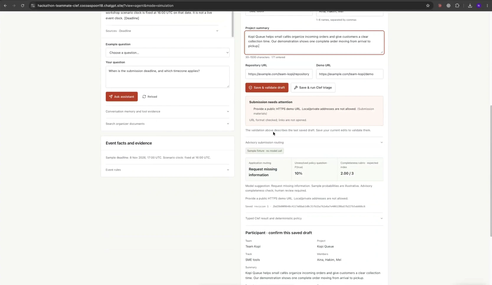

_At 00:26:36, a moment before Nan Feng clicks Save & validate draft: the form now holds the complete sample, with a demo URL, while the panels below still describe the last saved draft._

- Repository URL: https://example.com/team-kopi/repository · Demo URL: https://example.com/team-kopi/demo
- **Submission needs attention**: "Provide a public HTTPS demo URL. Local/private addresses are not allowed. (Submission materials)" · URL format checked; links are not opened.
- The validation above describes the last saved draft. Save your current edits to validate them.
- Advisory submission routing (Sample fixture · no model call): Request missing information · 10% · 2.00 / 3
  - Model suggestion: Request missing information. Sample probabilities are illustrative. Advisory completeness check; human review required.
  - Provide a public HTTPS demo URL. Local/private addresses are not allowed.
  - Saved revision 1, followed by a long hash
- Typed Clef result and deterministic policy

**Participant · confirm this saved draft**

- Team: Team Kopi · Project: Kopi Queue
- Track: SME tools · Members: Aina, Hakim, Mei
- Summary: the project summary above

## Slide 04: Build Weekend demo: the submitted draft

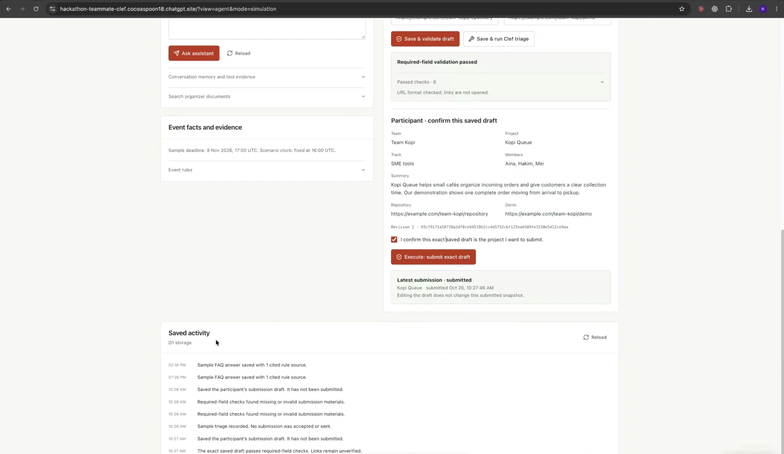

_At 00:26:51: the new draft has passed validation, and Nan Feng has ticked the confirmation and submitted it. Below, Saved activity lists what the app stored in D1. A last entry, behind Zoom's sharing bar and not in the image, reads "The participant confirmed the exact saved submission." He then scrolls back to the top, where the banner reads "Submit exact draft completed. The result below comes from the API." and the Organizer inbox tab shows 1._

- **Required-field validation passed**: Passed checks · 8 · URL format checked; links are not opened.

**Participant · confirm this saved draft**

- Team: Team Kopi · Project: Kopi Queue
- Track: SME tools · Members: Aina, Hakim, Mei
- Summary: the project summary
- Repository: https://example.com/team-kopi/repository · Demo: https://example.com/team-kopi/demo
- Revision 2, followed by a long hash
- Ticked: "I confirm this exact saved draft is the project I want to submit."
- Button: Execute: submit exact draft
- **Latest submission · submitted**: Kopi Queue · submitted Oct 20, 10:27:46 AM · Editing the draft does not change this submitted snapshot.

**Saved activity**: D1 storage · Reload

- 02:18 PM: Sample FAQ answer saved with 1 cited rule source.
- 07:26 PM: Sample FAQ answer saved with 1 cited rule source.
- 10:26 AM: Saved the participant's submission draft. It has not been submitted.
- 10:26 AM: Required-field checks found missing or invalid submission materials. (twice)
- 10:26 AM: Sample triage recorded. No submission was accepted or sent.
- 10:27 AM: Saved the participant's submission draft. It has not been submitted.
- 10:27 AM: The exact saved draft passes required-field checks. Links remain unverified.

## Slide 05: Orbyte demo: sign-in

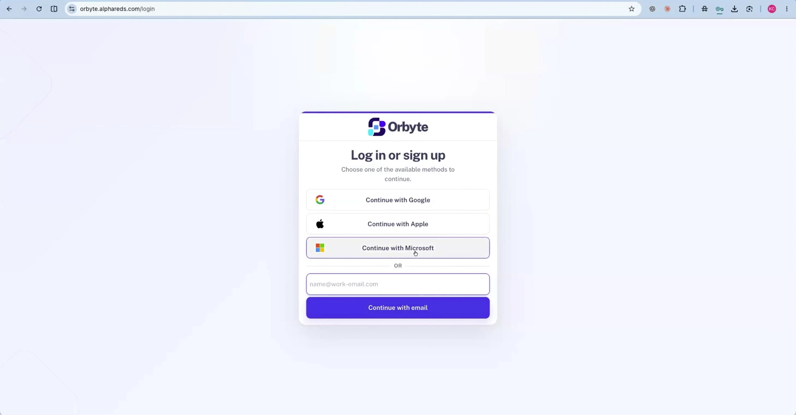

_At 00:41:03, as KC says "This is my account. I typically use Microsoft sign-in": Orbyte's login page at orbyte.alphareds.com/login._

**Orbyte**

**Log in or sign up**

Choose one of the available methods to continue.

- Continue with Google
- Continue with Apple
- Continue with Microsoft
- OR: an email field (name@work-email.com) · Continue with email

## Slide 06: Orbyte demo: job list

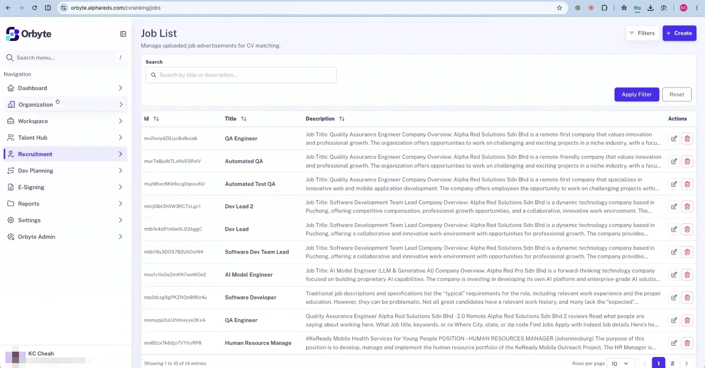

_At 00:41:13: the page Orbyte opened after sign-in, the Recruitment module's Job List at orbyte.alphareds.com/cvranking/jobs. KC's name is in the sidebar footer; his photo and email address are pixelated._

- Sidebar: Search menu... · Navigation: Dashboard · Organization · Workspace · Talent Hub · Recruitment · Dev Planning · E-Signing · Reports · Settings · Orbyte Admin

**Job List**: Manage uploaded job advertisements for CV matching. · Filters · Create

- Search by title or description... · Apply Filter · Reset
- Columns: Id · Title · Description · Actions (edit, delete)
- Titles: QA Engineer · Automated QA · Automated Test QA · Dev Lead 2 · Dev Lead · Software Dev Team Lead · AI Model Engineer · Software Developer · QA Engineer · Human Resource Manage
- Each description is the start of the job advertisement's text, most of them for roles at Alpha Red
- Showing 1 to 10 of 14 entries · Rows per page 10 · pages 1, 2

## Slide 07: Orbyte demo: dashboard

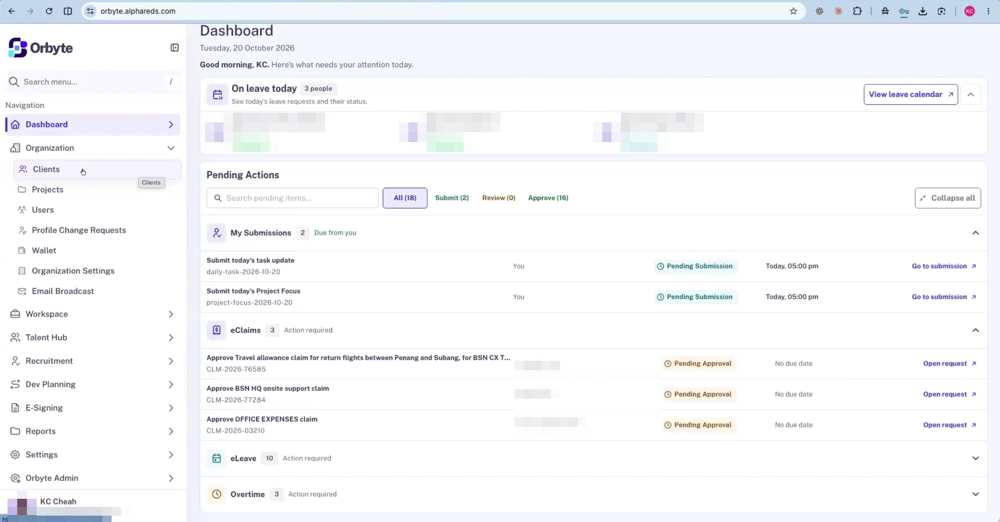

_At 00:41:53: the Dashboard at orbyte.alphareds.com, which KC calls his day-to-day tool for what to approve and submit, with the Organization menu open as he moves on to clients, projects and users. The names of the people on leave and of the claimants are pixelated._

- Organization menu: Clients · Projects · Users · Profile Change Requests · Wallet · Organization Settings · Email Broadcast

**Dashboard**: Tuesday, 20 October 2026

Good morning, KC. Here's what needs your attention today.

- **On leave today** (3 people): See today's leave requests and their status. · View leave calendar
  - Three staff on annual leave (AL), two approved and one reviewed
- **Pending Actions**: Search pending items... · All (18) · Submit (2) · Review (0) · Approve (16) · Collapse all
  - My Submissions (2, Due from you): "Submit today's task update" (daily-task-2026-10-20) and "Submit today's Project Focus" (project-focus-2026-10-20), each You · Pending Submission · Today, 05:00 pm · Go to submission
  - eClaims (3, Action required): a travel allowance claim, an onsite support claim and an office expenses claim, each Pending Approval · No due date · Open request
  - eLeave (10, Action required)
  - Overtime (3, Action required)

## Slide 08: Orbyte demo: users

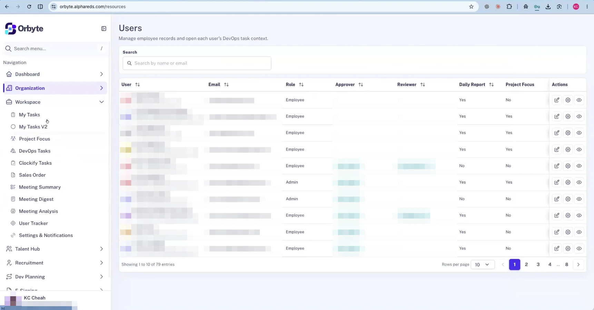

_At 00:42:13: the Users page at orbyte.alphareds.com/resources, a table of staff with their role, approver and reviewer, and whether they file a daily report and project focus. The User, Email, Approver and Reviewer columns are pixelated. In the sidebar, KC has opened the Workspace menu._

**Users**: Manage employee records and open each user's DevOps task context.

- Search by name or email
- Columns: User · Email · Role · Approver · Reviewer · Daily Report · Project Focus · Actions (edit, settings, view)
- Ten rows: eight Employees and two Admins
- Showing 1 to 10 of 79 entries · Rows per page 10 · pages 1, 2, 3, 4 ... 8
- Workspace menu: My Tasks · My Tasks V2 · Project Focus · DevOps Tasks · Clockify Tasks · Sales Order · Meeting Summary · Meeting Digest · Meeting Analysis · User Tracker · Settings & Notifications

## Slide 09: Orbyte demo: task list

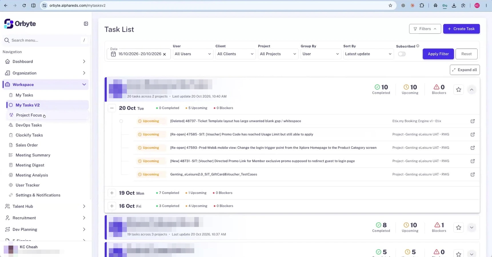

_At 00:42:26, as KC says he gets an overview of everybody's daily work, completed, upcoming and blocked: My Tasks V2 at orbyte.alphareds.com/mytasksv2, grouped by user. Each user's name, email address and initials are pixelated._

**Task List**: Filters · Create Task

- Date: 16/10/2026 - 20/10/2026 · User: All Users · Client: All Clients · Project: All Projects · Group By: User · Sort By: Latest update · Subscribed · Apply Filter · Reset · Expand all
- First user: 20 tasks across 2 projects · Last update 20 Oct 2026, 10:40 AM · 10 Completed · 10 Upcoming · 0 Blockers
  - 20 Oct Tue: 0 Completed · 5 Upcoming · 0 Blockers, with five upcoming tickets (bug fixes and test cases) on two client projects
  - 19 Oct Mon: 7 Completed · 1 Upcoming · 0 Blockers
  - 16 Oct Fri: 3 Completed · 4 Upcoming · 0 Blockers
- Second user: 19 tasks across 3 projects · Last update 20 Oct 2026, 10:37 AM · 8 Completed · 10 Upcoming · 1 Blockers
- Third user: 5 Completed · 5 Upcoming · 0 Blockers

## Slide 10: Orbyte demo: project focus timeline

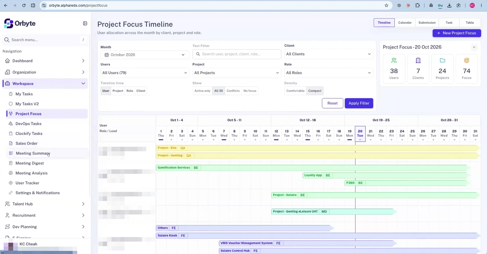

_At 00:42:39, as KC says he can see what everybody is focusing on through the month or quarter: the Project Focus Timeline at orbyte.alphareds.com/projectfocus. Coloured bars show each person's projects across October 2026; the names in the User column are pixelated._

**Project Focus Timeline**: User allocation across the month by client, project and role.

- Views: Timeline · Calendar · Submission · Task · Table · New Project Focus
- Month: October 2026 · Text Filter: Search user, project, client, role... · Client: All Clients
- Users: All Users (79) · Project: All Projects · Role: All Roles
- Timeline View: User · Project · Role · Client · Show: Active only · All 30 · Conflicts · No focus · Density: Comfortable · Compact · Reset · Apply Filter
- **Project Focus - 20 Oct 2026**: 38 Users · 7 Clients · 24 Projects · 74 Focus
- Timeline: Oct 1 - 4 · Oct 5 - 11 · Oct 12 - 18 · Oct 19 - 25 · Oct 26 - 31, with today, 20 Tue, marked by a line
- Each row gives a person's role and load (QA / 65%, BE / 75%, BE / 55%, MD / 55%, FE / 92%) and a bar for each project they're on, such as Gamification Services, Loyalty App, P360, VMS Voucher Management System and Others

## Slide 11: Orbyte demo: meeting summaries

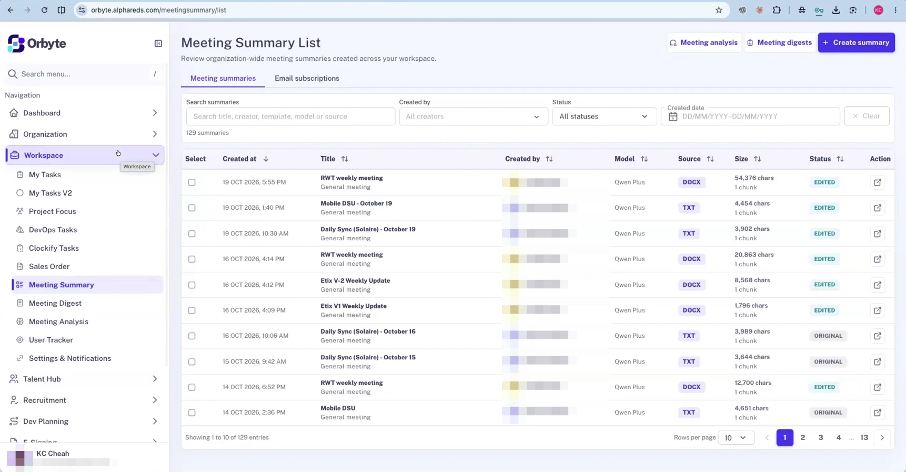

_At 00:43:00: the Meeting Summary List at orbyte.alphareds.com/meetingsummary/list, the module KC describes as meeting transcript analysis. The Created by column is pixelated._

**Meeting Summary List**: Review organization-wide meeting summaries created across your workspace. · Meeting analysis · Meeting digests · Create summary

- Tabs: Meeting summaries · Email subscriptions
- Search summaries: Search title, creator, template, model or source · Created by: All creators · Status: All statuses · Created date: DD/MM/YYYY - DD/MM/YYYY · Clear
- 129 summaries
- Columns: Select · Created at · Title · Created by · Model · Source · Size · Status · Action
- Ten summaries from 14 to 19 October 2026: weekly meetings and updates, DSUs and daily syncs, each a "General meeting" summarised with Qwen Plus from a DOCX or TXT source of 1,796 to 54,376 characters (1 chunk), status EDITED or ORIGINAL
- Showing 1 to 10 of 129 entries · Rows per page 10 · pages 1, 2, 3, 4 ... 13

## Slide 12: Orbyte demo: the Talent Hub menu

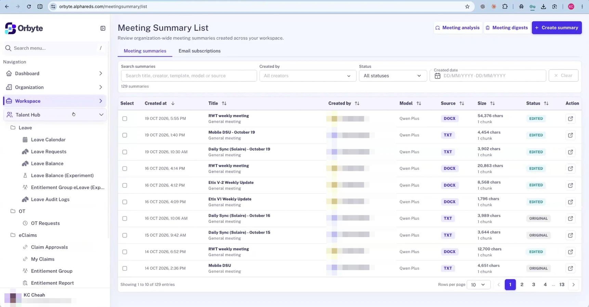

_At 00:43:17, as KC turns to the Talent Hub for leave, OT and claims: the meeting summary list stays on screen while he opens the sidebar's Talent Hub menu. He then opens Recruitment (AI CV Screening, Job Postings, Applicants, Applicant Questionnaires) and Dev Planning (BRD Analysis, User Story Builder)._

Talent Hub menu:

- Leave: Leave Calendar · Leave Requests · Leave Balance · Leave Balance (Experiment) · Entitlement Group eLeave (Exp... · Leave Audit Logs
- OT: OT Requests
- eClaims: Claim Approvals · My Claims · Entitlement Group · Entitlement Report

## Slide 13: Orbyte demo: BRD analysis and Azure DevOps sync

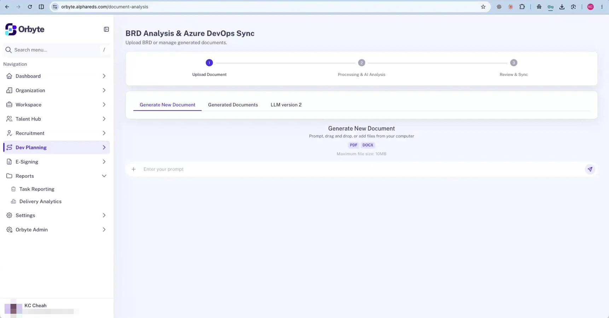

_At 00:43:54: Dev Planning's BRD Analysis at orbyte.alphareds.com/document-analysis, which KC says can create user stories in their DevOps tools from a business requirements document. On this page he opens the E-Signing menu, whose one item, Documents, links to a Documenso site on alphareds.com, then the Reports menu shown here._

**BRD Analysis & Azure DevOps Sync**: Upload BRD or manage generated documents.

- Steps: 1 Upload Document · 2 Processing & AI Analysis · 3 Review & Sync
- Tabs: Generate New Document · Generated Documents · LLM version 2
- **Generate New Document**: Prompt, drag and drop, or add files from your computer · PDF · DOCX · Maximum file size: 10MB
- Prompt box: Enter your prompt
- Reports menu: Task Reporting · Delivery Analytics

## Slide 14: Orbyte demo: settings in a second organisation

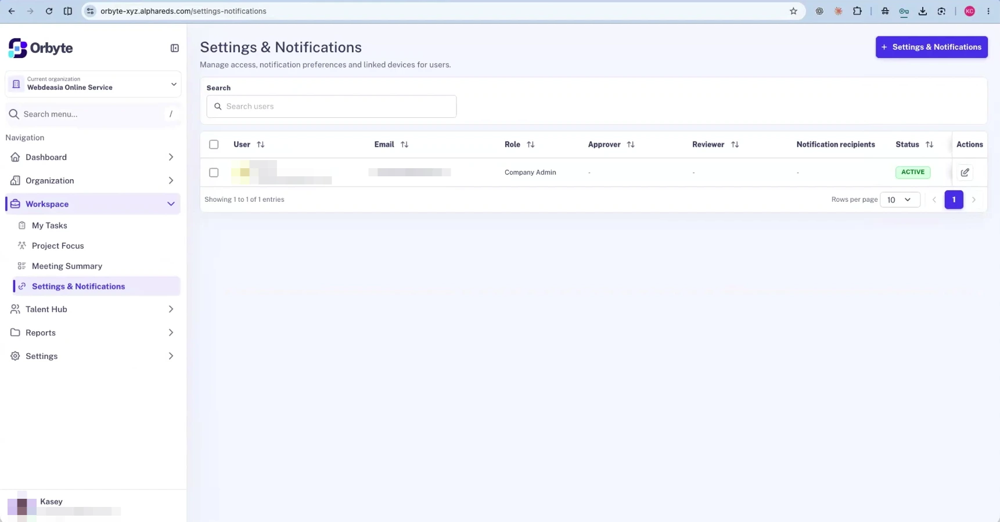

_At 00:44:08, just before KC wraps up: another browser tab, signed in at orbyte-xyz.alphareds.com, the address Domain 2 teams were later given for sign-up (see [Orbyte account setup](/docs/sources/drive.google.com/video-tutorials.md#orbyte-account-setup)). Its organisation has fewer modules, and its only user is KC's own account, shown as Kasey, a Company Admin. The user cell and email address are pixelated._

- Current organization: Webdeasia Online Service
- Sidebar: Dashboard · Organization · Workspace (My Tasks · Project Focus · Meeting Summary · Settings & Notifications) · Talent Hub · Reports · Settings

**Settings & Notifications**: Manage access, notification preferences and linked devices for users. · Settings & Notifications

- Search users
- Columns: User · Email · Role · Approver · Reviewer · Notification recipients · Status · Actions
- One row: Company Admin · no approver, reviewer or notification recipients · ACTIVE
- Showing 1 to 1 of 1 entries
