# Workshop 2 slides

Everything shown on the shared screen at SDC Hackathon 2026 Workshop 2, "How to Build An App with Replit In a 20 min Time Frame", held on Zoom on 21 October 2026, each with its image and its text. There was no slide deck: after Frederick Alexander, a community lead at Replit, introduced her, Sarah Li of Replit's Developer Relations team shared her browser for a live demo. She showed apps she had built, then built "Campus Share", a campus bulletin board, with Replit Agent and walked through the design canvas and its variants, parallel tasks, Google sign-in, a slide deck Replit generated, the security scan and publishing. In the Q&A she shared a Replit blog page with benchmark charts. The [transcript](transcript.md) covers what was said and the [meeting chat](chat.md) the questions attendees typed.

Screens were captured from the organisers' recording, "Replit Workshop Recording.mp4" in the workshop's [Drive folder](https://drive.google.com/drive/folders/1XmoZ-S4E0lHZDWsXfz7nMWl8Y8f0thVy), once for each distinct screen or step Sarah talks about, not for every scroll or keystroke, and the italic line under each image gives its time in the recording, as used in the transcript. The pre-roll before the session starts at 00:48:32, a waiting screen, mic checks and a loop of sponsor reels from Alpha Red, Runpod, KrackedDevs and Aiversecity, isn't captured. Sarah shared her screen from about 00:52:40 to 01:10:56 and again from 01:19:03 to 01:21:11; images are cropped to her browser, without her camera thumbnail, the Zoom frame, or the macOS menu bar and dock. Of the eight slides Replit generated, Sarah opened six in a few seconds; slides 2 and 5 are seen only as thumbnails. Nothing needed blacking out, as no keys, private emails or meeting details are on screen. [covered] marks text hidden behind a popup, a button or the screen edge, and [unreadable] text too blurred to read.

Contents:

1.  [Slide 01: Replit home page](#slide-01-replit-home-page)
1.  [Slide 02: Cosmic, the wish galaxy](#slide-02-cosmic-the-wish-galaxy)
1.  [Slide 03: Cosmic: draw your star](#slide-03-cosmic-draw-your-star)
1.  [Slide 04: Cosmic: make a wish](#slide-04-cosmic-make-a-wish)
1.  [Slide 05: Cosmic: another visitor's wish](#slide-05-cosmic-another-visitors-wish)
1.  [Slide 06: The Very Hungry Caterpillar](#slide-06-the-very-hungry-caterpillar)
1.  [Slide 07: eyespy on the App Store](#slide-07-eyespy-on-the-app-store)
1.  [Slide 08: The Replit YouTube channel](#slide-08-the-replit-youtube-channel)
1.  [Slide 09: Chat: asking for hackathon ideas](#slide-09-chat-asking-for-hackathon-ideas)
1.  [Slide 10: Chat: Replit's hackathon ideas](#slide-10-chat-replits-hackathon-ideas)
1.  [Slide 11: Agent modes: Free, Power and Max](#slide-11-agent-modes-free-power-and-max)
1.  [Slide 12: The Campus Share prompt](#slide-12-the-campus-share-prompt)
1.  [Slide 13: Replit Agent: starting the Campus Share build](#slide-13-replit-agent-starting-the-campus-share-build)
1.  [Slide 14: Campus Share, built earlier](#slide-14-campus-share-built-earlier)
1.  [Slide 15: Campus Share: pin something up](#slide-15-campus-share-pin-something-up)
1.  [Slide 16: Campus Share: the note is pinned](#slide-16-campus-share-the-note-is-pinned)
1.  [Slide 17: Campus Share: the board fails to load](#slide-17-campus-share-the-board-fails-to-load)
1.  [Slide 18: Design canvas: suggested next steps](#slide-18-design-canvas-suggested-next-steps)
1.  [Slide 19: Design variant: Campus Gazette](#slide-19-design-variant-campus-gazette)
1.  [Slide 20: Design variant: Sticker Club](#slide-20-design-variant-sticker-club)
1.  [Slide 21: Design variant: Common Room](#slide-21-design-variant-common-room)
1.  [Slide 22: Design variant: After Hours](#slide-22-design-variant-after-hours)
1.  [Slide 23: Design canvas: dropping in inspiration photos](#slide-23-design-canvas-dropping-in-inspiration-photos)
1.  [Slide 24: Campus Share, Playful Pastels](#slide-24-campus-share-playful-pastels)
1.  [Slide 25: Design canvas: templates](#slide-25-design-canvas-templates)
1.  [Slide 26: Design canvas: Mobbin inspiration](#slide-26-design-canvas-mobbin-inspiration)
1.  [Slide 27: Design canvas: designs and websites](#slide-27-design-canvas-designs-and-websites)
1.  [Slide 28: Design canvas: build this design](#slide-28-design-canvas-build-this-design)
1.  [Slide 29: Inviting collaborators](#slide-29-inviting-collaborators)
1.  [Slide 30: Parallel tasks: the task list](#slide-30-parallel-tasks-the-task-list)
1.  [Slide 31: Parallel tasks: asking for authentication](#slide-31-parallel-tasks-asking-for-authentication)
1.  [Slide 32: Google Authentication task: the sign-in page](#slide-32-google-authentication-task-the-sign-in-page)
1.  [Slide 33: Google Authentication task: sign in with Google](#slide-33-google-authentication-task-sign-in-with-google)
1.  [Slide 34: Hackathon Slides task: the slides request](#slide-34-hackathon-slides-task-the-slides-request)
1.  [Slide 35: Generated slide 1: Campus Share](#slide-35-generated-slide-1-campus-share)
1.  [Slide 36: Generated slide 3: The solution, a shared campus board](#slide-36-generated-slide-3-the-solution-a-shared-campus-board)
1.  [Slide 37: Generated slide 4: Product tour](#slide-37-generated-slide-4-product-tour)
1.  [Slide 38: Generated slide 6: Technical architecture](#slide-38-generated-slide-6-technical-architecture)
1.  [Slide 39: Generated slide 7: Next, an AI listing helper](#slide-39-generated-slide-7-next-an-ai-listing-helper)
1.  [Slide 40: Generated slide 8: Make reuse easier](#slide-40-generated-slide-8-make-reuse-easier)
1.  [Slide 41: Create something new](#slide-41-create-something-new)
1.  [Slide 42: Security and Privacy Center](#slide-42-security-and-privacy-center)
1.  [Slide 43: Scan level 1: basic security checks](#slide-43-scan-level-1-basic-security-checks)
1.  [Slide 44: Scan level 2: deep security scan](#slide-44-scan-level-2-deep-security-scan)
1.  [Slide 45: Scan level 3: AI pentest](#slide-45-scan-level-3-ai-pentest)
1.  [Slide 46: Fixing the selected issues with Agent](#slide-46-fixing-the-selected-issues-with-agent)
1.  [Slide 47: Publishing the app](#slide-47-publishing-the-app)
1.  [Slide 48: Custom domains](#slide-48-custom-domains)
1.  [Slide 49: Replit blog: free the models](#slide-49-replit-blog-free-the-models)
1.  [Slide 50: Benchmark: Replit Agent on DeepSWE](#slide-50-benchmark-replit-agent-on-deepswe)
1.  [Slide 51: Benchmark: GPT-6 Astra on DeepSWE](#slide-51-benchmark-gpt-6-astra-on-deepswe)

## Slide 01: Replit home page

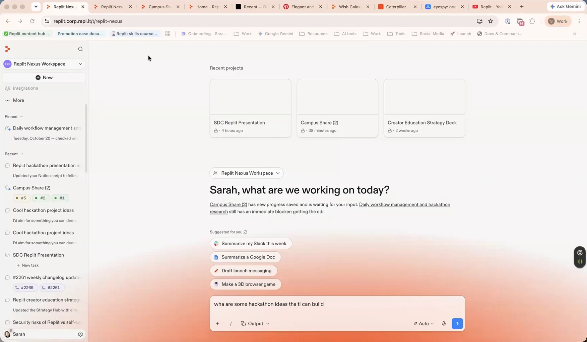

_At 00:53:10, as Sarah introduces herself: the Replit home page of her team workspace, Replit Nexus Workspace, in Chrome at replit.corp.repl.it/t/replit-nexus. The sidebar lists her pinned and recent chats and projects, including Campus Share (2) with tasks #5, #2 and #1._

**Sarah, what are we working on today?**

Campus Share (2) has new progress saved and is waiting for your input. Daily workflow management and hackathon research still has an immediate blocker: getting the edi

- Recent projects: SDC Replit Presentation (4 hours ago), Campus Share (2) (38 minutes ago), Creator Education Strategy Deck (2 weeks ago)
- Suggested for you: Summarize my Slack this week; Summarize a Google Doc; Draft launch messaging; Make a 3D browser game
- Prompt box, drafted but not sent: "wha are some hackathon ideas tha ti can build"

## Slide 02: Cosmic, the wish galaxy

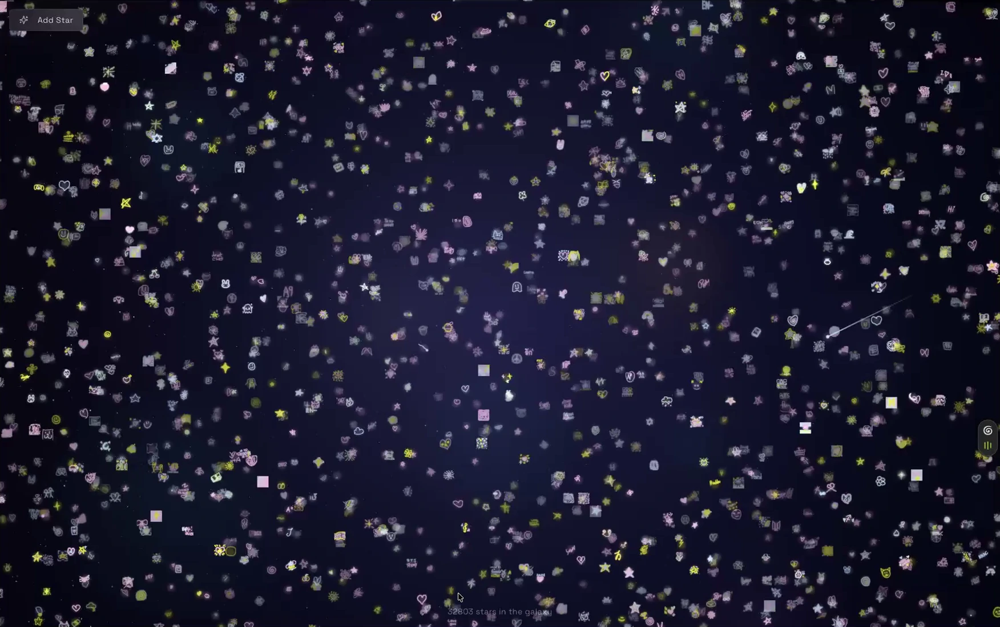

_At 00:53:57: Cosmic, Sarah's wish galaxy at cosmic-wishes.replit.app, full screen. Thousands of small hand-drawn stars float on a dark blue background._

- Button: Add Star
- 32803 stars in the galaxy

## Slide 03: Cosmic: draw your star

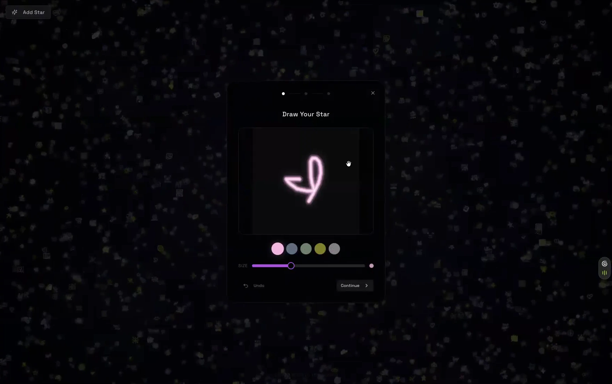

_At 00:54:09: the first step of adding a star, with a pink star doodled on the drawing pad._

**Draw Your Star**

- Five colour swatches and a Size slider
- Undo · Continue

## Slide 04: Cosmic: make a wish

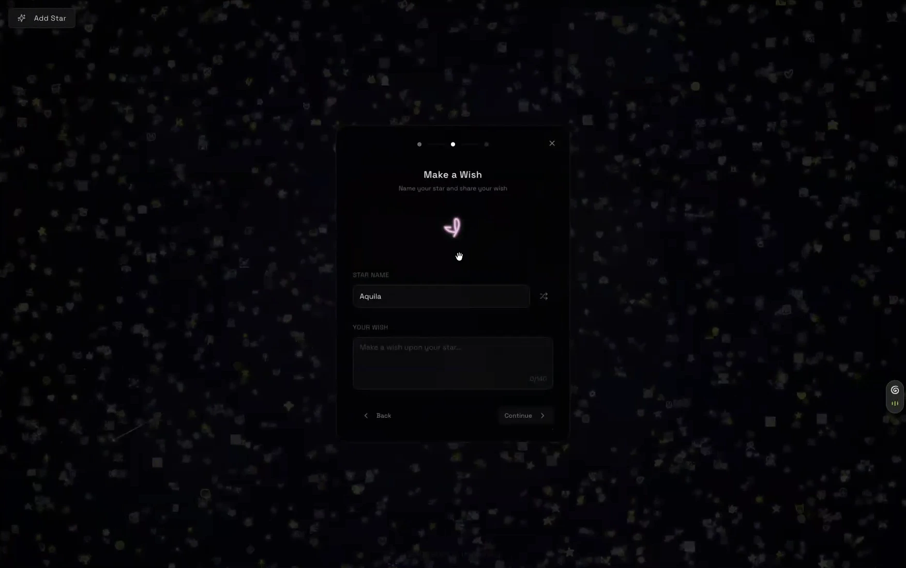

_At 00:54:12: the second step, naming the star and writing the wish._

**Make a Wish**

Name your star and share your wish

- Star name: Aquila
- Your wish: "Make a wish upon your star..." (0/140)
- Back · Continue

## Slide 05: Cosmic: another visitor's wish

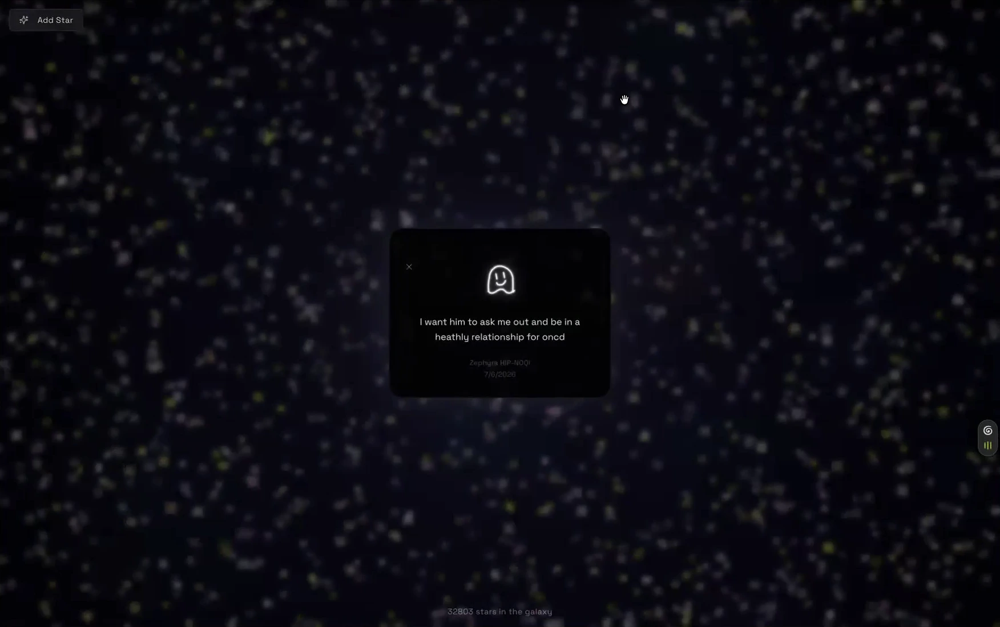

_At 00:54:20: a star Sarah clicked in the galaxy, showing what another visitor wrote under a smiling ghost doodle._

"I want him to ask me out and be in a heathly relationship for oncd"

Zephyra HIP-[unreadable] · 7/6/2026

## Slide 06: The Very Hungry Caterpillar

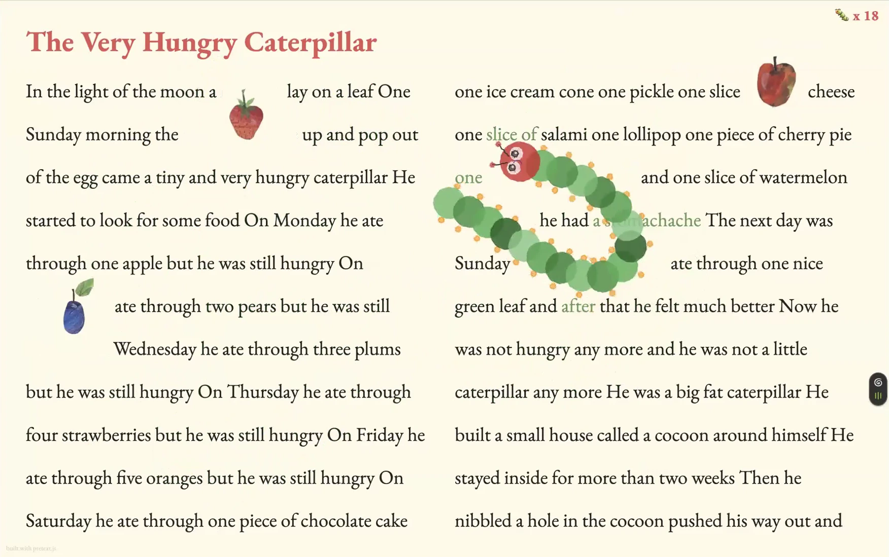

_At 00:54:46: Sarah's caterpillar app, steered by hand tracking with MediaPipe. The page sets the text of Eric Carle's story in two columns with pictures of fruit among the words, and a green caterpillar crawls across it eating the fruit while the text flows around it. The story text isn't reproduced here._

**The Very Hungry Caterpillar**

Counter: caterpillar × 18

Footer: built with pretext.js

## Slide 07: eyespy on the App Store

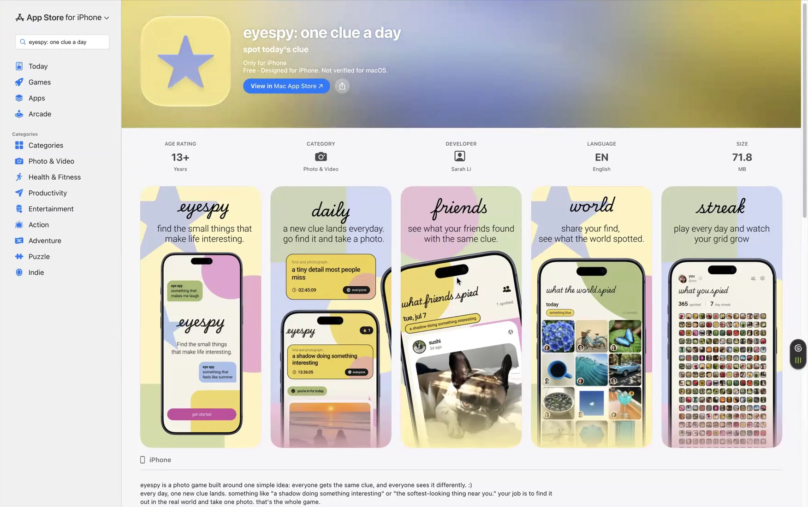

_At 00:55:30: the App Store page of Sarah's mobile app, eyespy, which she built with Replit. The icon is a lilac star on yellow._

**eyespy: one clue a day**

spot today's clue

Only for iPhone · Free · Designed for iPhone. Not verified for macOS. · View in Mac App Store

Screenshots: "eyespy: find the small things that make life interesting."; "daily: a new clue lands everyday. go find it and take a photo." (clue card: "a tiny detail most people miss"); "friends: see what your friends found with the same clue."; "world: share your find, see what the world spotted."; "streak: play every day and watch your grid grow"

| Age rating | Category      | Developer | Language   | Size    |
| ---------- | ------------- | --------- | ---------- | ------- |
| 13+ Years  | Photo & Video | Sarah Li  | EN English | 71.8 MB |

eyespy is a photo game built around one simple idea: everyone gets the same clue, and everyone sees it differently. :) every day, one new clue lands. something like "a shadow doing something interesting" or "the softest-looking thing near you." your job is to find it out in the real world and take one photo. that's the whole game.

## Slide 08: The Replit YouTube channel

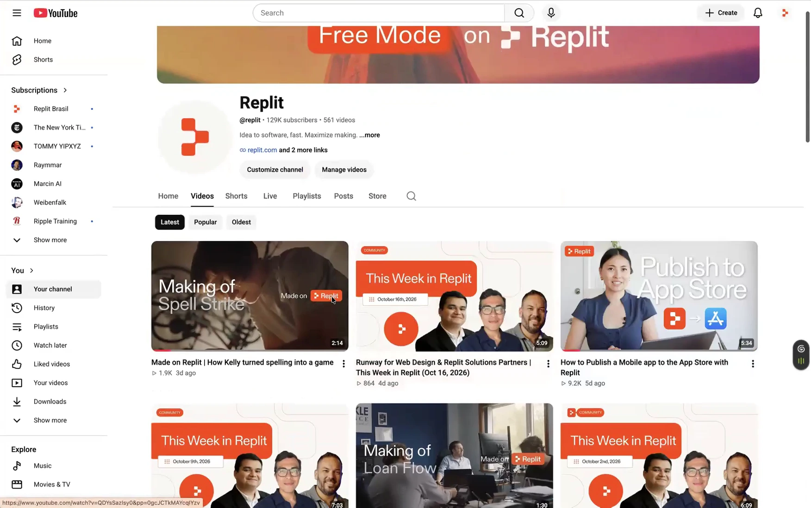

_At 00:55:58: the Videos tab of Replit's YouTube channel, where Sarah points to her App Store tutorial._

**Replit**

@replit · 129K subscribers · 561 videos · Idea to software, fast. Maximize making. · replit.com and 2 more links

Banner: Free Mode on Replit

| Video                                                                                   | Length | Views | Posted |
| --------------------------------------------------------------------------------------- | ------ | ----- | ------ |
| Made on Replit \| How Kelly turned spelling into a game                                 | 2:14   | 1.9K  | 3d ago |
| Runway for Web Design & Replit Solutions Partners \| This Week in Replit (Oct 16, 2026) | 5:09   | 864   | 4d ago |
| How to Publish a Mobile app to the App Store with Replit                                | 5:34   | 9.2K  | 5d ago |

The next row, cut off at the bottom of the screen, shows thumbnails for This Week in Replit (October 9th, 2026; 7:03), Making of Loan Flow (1:30) and This Week in Replit (October 2nd, 2026; 6:09).

## Slide 09: Chat: asking for hackathon ideas

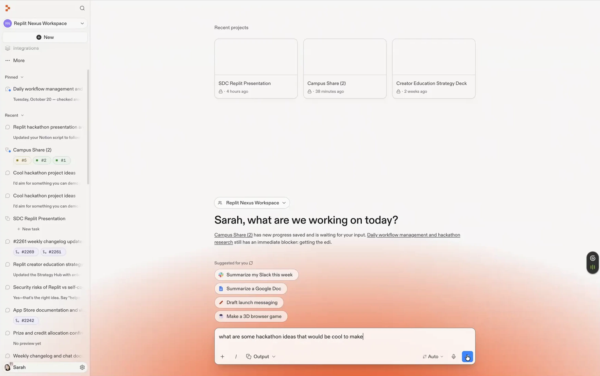

_At 00:57:31: back on the Replit home page, where Sarah types a brainstorming question into the chat box and sends it._

**Sarah, what are we working on today?**

Prompt: "what are some hackathon ideas that would be cool to make"

## Slide 10: Chat: Replit's hackathon ideas

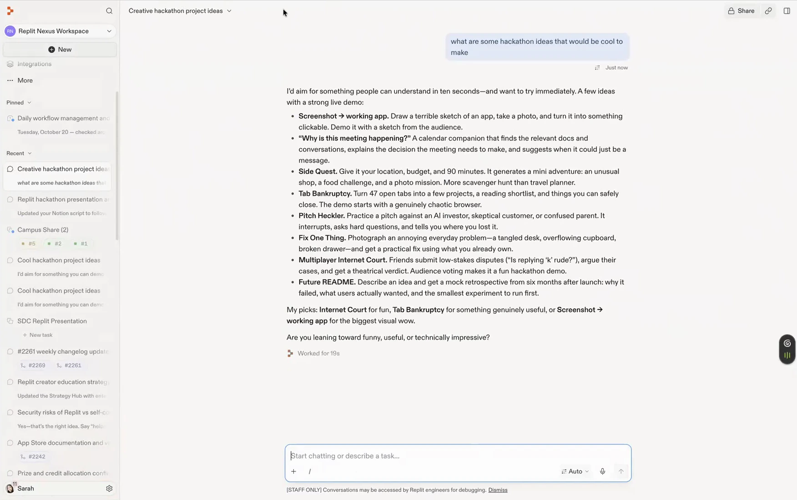

_At 00:57:56: Replit's reply to the brainstorming question._

I'd aim for something people can understand in ten seconds—and want to try immediately. A few ideas with a strong live demo:

- **Screenshot → working app.** Draw a terrible sketch of an app, take a photo, and turn it into something clickable. Demo it with a sketch from the audience.
- **"Why is this meeting happening?"** A calendar companion that finds the relevant docs and conversations, explains the decision the meeting needs to make, and suggests when it could just be a message.
- **Side Quest.** Give it your location, budget, and 90 minutes. It generates a mini adventure: an unusual shop, a food challenge, and a photo mission. More scavenger hunt than travel planner.
- **Tab Bankruptcy.** Turn 47 open tabs into a few projects, a reading shortlist, and things you can safely close. The demo starts with a genuinely chaotic browser.
- **Pitch Heckler.** Practice a pitch against an AI investor, skeptical customer, or confused parent. It interrupts, asks hard questions, and tells you where you lost it.
- **Fix One Thing.** Photograph an annoying everyday problem—a tangled desk, overflowing cupboard, broken drawer—and get a practical fix using what you already own.
- **Multiplayer Internet Court.** Friends submit low-stakes disputes ("Is replying 'k' rude?"), argue their cases, and get a theatrical verdict. Audience voting makes it a fun hackathon demo.
- **Future README.** Describe an idea and get a mock retrospective from six months after launch: why it failed, what users actually wanted, and the smallest experiment to run first.

My picks: **Internet Court** for fun, **Tab Bankruptcy** for something genuinely useful, or **Screenshot → working app** for the biggest visual wow.

Are you leaning toward funny, useful, or technically impressive?

## Slide 11: Agent modes: Free, Power and Max

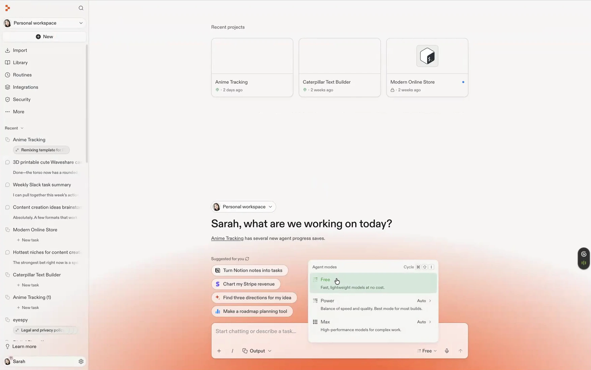

_At 00:58:20: the home page of Sarah's personal workspace, which looks like what attendees see, with the Agent modes menu open over the chat box. Recent projects: Anime Tracking, Caterpillar Text Builder, Modern Online Store._

**Agent modes** (Cycle ⌘ ⇧ I)

- **Free:** Fast, lightweight models at no cost.
- **Power** (Auto): Balance of speed and quality. Best mode for most builds.
- **Max** (Auto): High-performance models for complex work.

## Slide 12: The Campus Share prompt

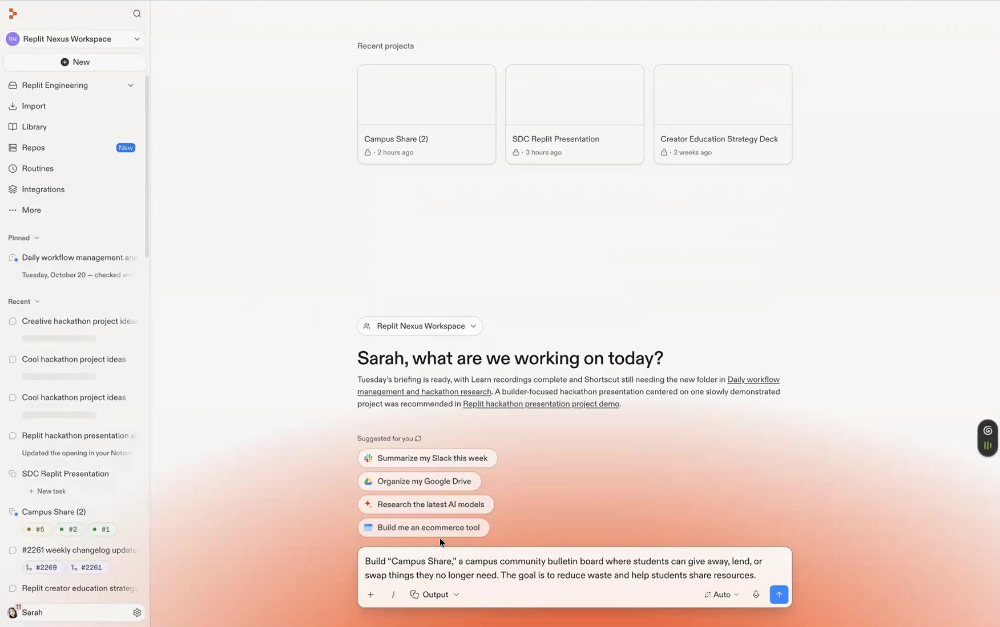

_At 00:58:52: the Replit Nexus Workspace home page with Sarah's build prompt typed into the chat box._

Tuesday's briefing is ready, with Learn recordings complete and Shortscut still needing the new folder in Daily workflow management and hackathon research. A builder-focused hackathon presentation centered on one slowly demonstrated project was recommended in Replit hackathon presentation project demo.

Prompt:

```
Build "Campus Share," a campus community bulletin board where students can give away, lend, or swap things they no longer need. The goal is to reduce waste and help students share resources.
```

## Slide 13: Replit Agent: starting the Campus Share build

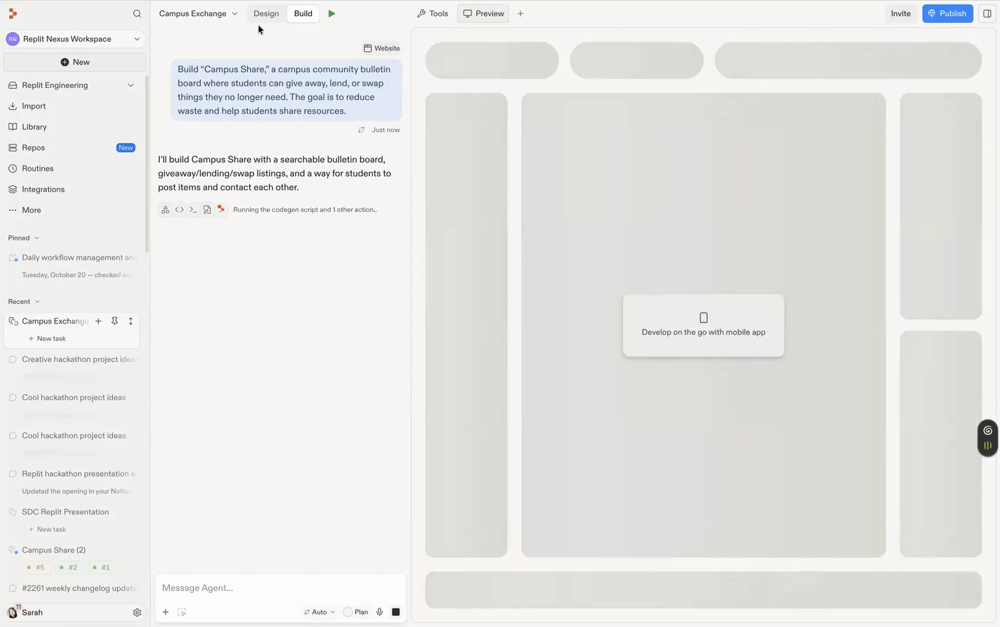

_At 00:59:50: the new project, which Agent named "Campus Exchange", a few seconds after the prompt was sent. The preview is still a grey placeholder with a "Develop on the go with mobile app" card._

Prompt (Website): Build "Campus Share," a campus community bulletin board where students can give away, lend, or swap things they no longer need. The goal is to reduce waste and help students share resources.

Agent: I'll build Campus Share with a searchable bulletin board, giveaway/lending/swap listings, and a way for students to post items and contact each other.

Running the codegen script and 1 other action..

## Slide 14: Campus Share, built earlier

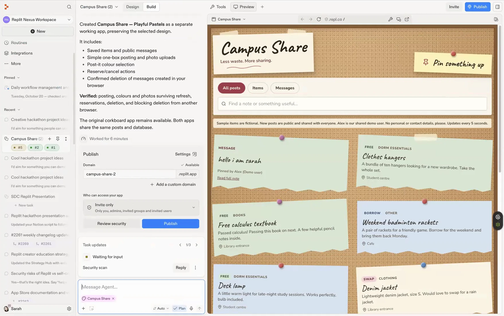

_At 01:00:02: Campus Share (2), the version Sarah built from the same prompt before the session, with the corkboard app in the preview and Agent's last report in the chat._

Agent: Created **Campus Share — Playful Pastels** as a separate working app, preserving the selected design. It includes:

- Saved items and public messages
- Simple one-box posting and photo uploads
- Post-it colour selection
- Reserve/cancel actions
- Confirmed deletion of messages created in your browser

**Verified:** posting, colours and photos surviving refresh, reservations, deletion, and blocking deletion from another browser. The original corkboard app remains available. Both apps share the same posts and database.

Publish card: Domain campus-share-2.replit.app (Available) · Who can access your app: Invite only · Review security · Publish. Task updates: Security scan, Waiting for input.

**Campus Share**

Less waste. More sharing.

- Pin something up
- All posts · Items · Messages · Find a note or something useful...
- Sample items are fictional. New posts are public and shared with everyone. Alex is our shared demo user. No personal or contact details, please. Updates every 5 seconds.
- Message: "hello i am sarah", pinned by Alex (Demo user)
- Free, Dorm essentials: Clothes hangers. A bundle of ten hangers looking for a new wardrobe. Take the whole set. (Student centre)
- Free, Books: Free calculus textbook. Passed calculus! Passing this book on next. A few helpful pencil notes inside. (Library entrance)
- Borrow, Other: Weekend badminton rackets. A pair of rackets for a friendly game. Borrow for the weekend and bring them back Monday. (Cafe)
- Free, Dorm essentials: Desk lamp. A little warm light for late-night study sessions. Works perfectly, bulb included. (Student centre)
- Swap, Clothing: Denim jacket. Lightweight denim jacket, size S. Would love to swap for a rain jacket. (Library entrance)

## Slide 15: Campus Share: pin something up

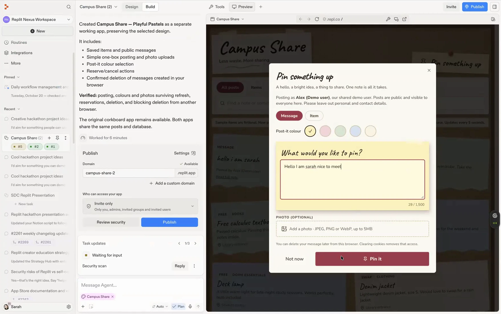

_At 01:00:14: the posting form, with Sarah typing a message._

**Pin something up**

A hello, a bright idea, a thing to share. One note is all it takes.

Posting as **Alex (Demo user)**, our shared demo user. Posts are public and visible to everyone here. Please leave out personal and contact details.

- Message · Item
- Post-it colour: five swatches, yellow selected
- What would you like to pin? "Hello I am sarah nice to meet" (29 / 1,500)
- Photo (optional): Add a photo · JPEG, PNG or WebP, up to 5MB
- You can delete your message later from this browser. Clearing cookies removes that access.
- Not now · Pin it

## Slide 16: Campus Share: the note is pinned

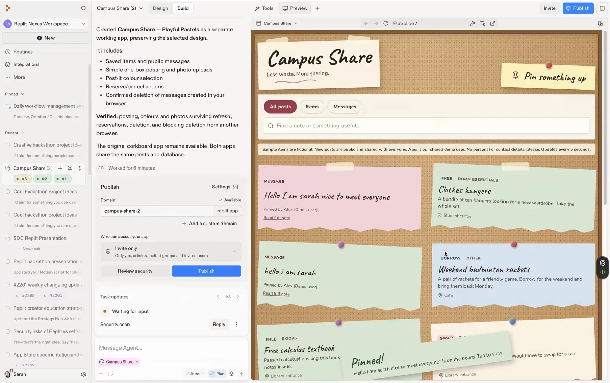

_At 01:00:21: the board with Sarah's new pink note at the top and a confirmation note at the bottom._

- Message: "Hello I am sarah nice to meet everyone", pinned by Alex (Demo user)
- **Pinned!** "Hello I am sarah nice to meet everyone" is on the board. Tap to view.

## Slide 17: Campus Share: the board fails to load

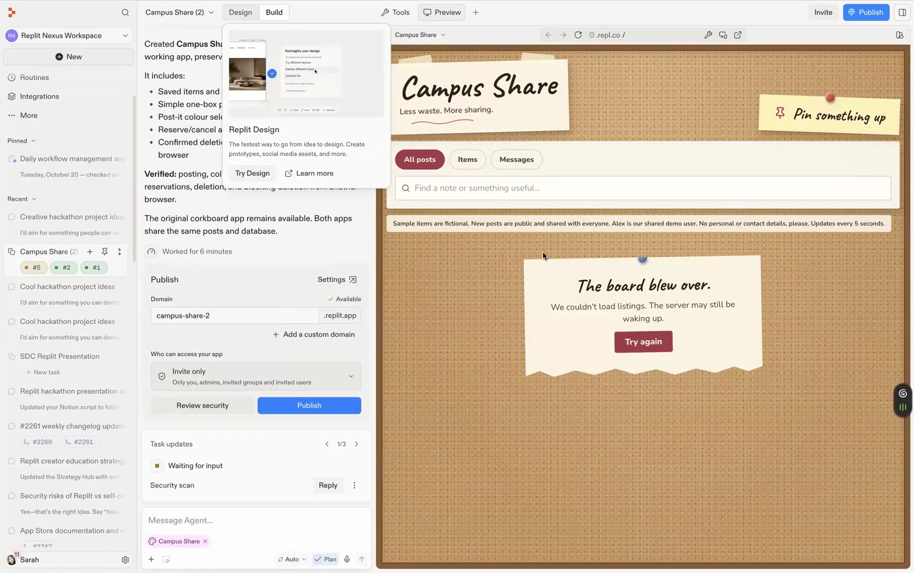

_At 01:00:39, when Sarah says "that didn't work": the preview shows an error note, and hovering the Design tab opens a card about Replit Design._

**The board blew over.**

We couldn't load listings. The server may still be waking up.

Button: Try again

**Replit Design** card: The fastest way to go from idea to design. Create prototypes, social media assets, and more. · Try Design · Learn more

## Slide 18: Design canvas: suggested next steps

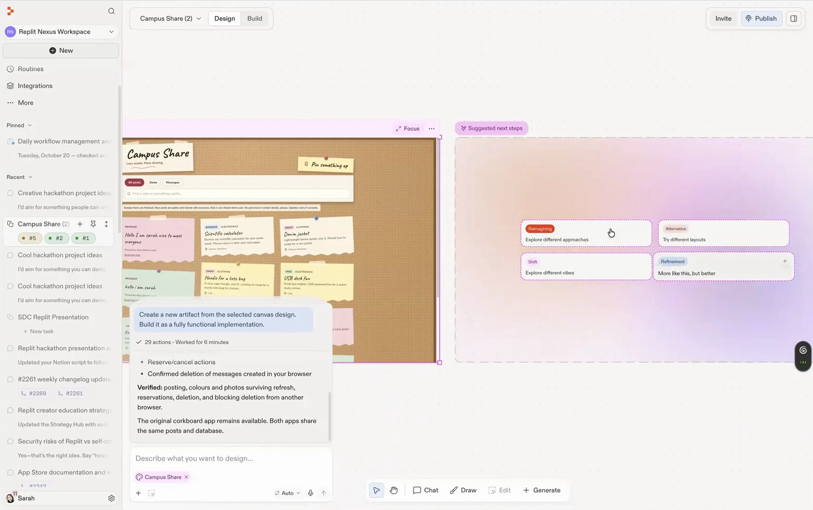

_At 01:01:12: the Design tab, with the corkboard app as a frame on the canvas and suggestions beside it._

**Suggested next steps**

- Reimagining: Explore different approaches
- Alternative: Try different layouts
- Shift: Explore different vibes
- Refinement: More like this, but better

## Slide 19: Design variant: Campus Gazette

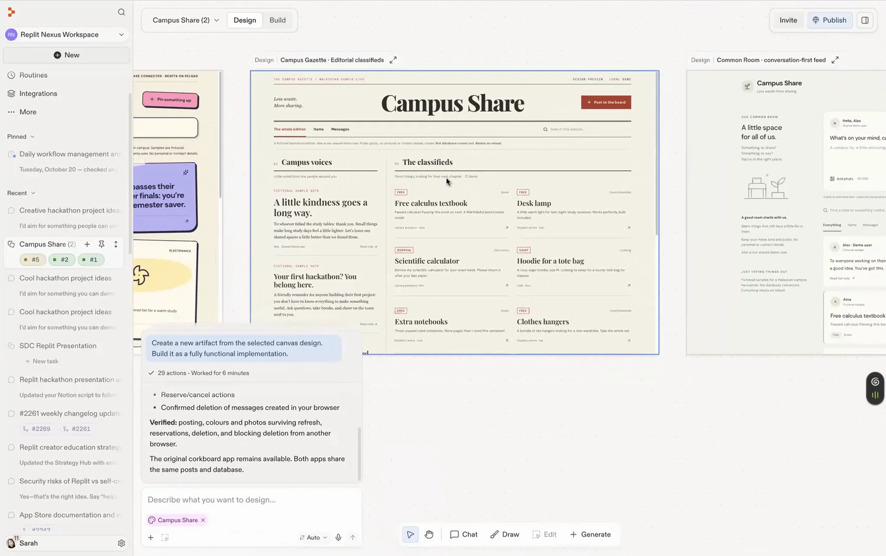

_At 01:01:29: the first of the designs Replit made for "Explore different approaches", styled as a newspaper._

**Design | Campus Gazette · Editorial classifieds**

The Campus Gazette / Malaysian campus life · Design preview · Local demo

**Campus Share**

Less waste. More sharing. · Post to the board

- The whole edition · Items · Messages · Search this edition...
- **01 Campus voices:** "A little kindness goes a long way."; "Your first hackathon? You belong here."
- **02 The classifieds:** Good things, looking for their next chapter. 12 items: Free calculus textbook, Desk lamp, Scientific calculator, Hoodie for a tote bag, Extra notebooks, Clothes hangers

## Slide 20: Design variant: Sticker Club

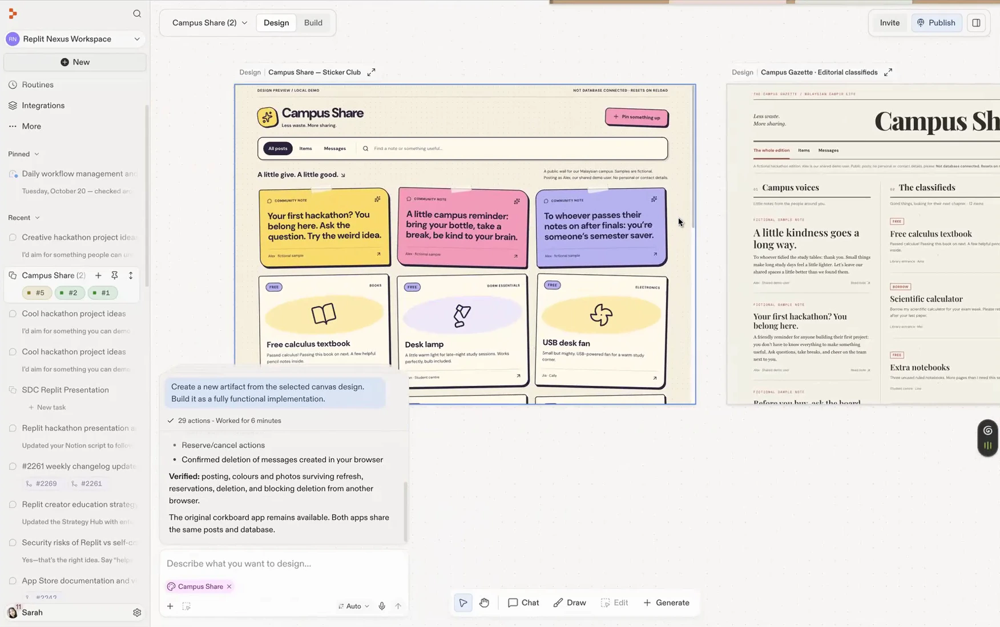

_At 01:01:31: a colourful variant with bold sticker-like cards._

**Design | Campus Share — Sticker Club**

Design preview / Local demo · Not database connected · Resets on reload

**Campus Share**

Less waste. More sharing. · Pin something up

- All posts · Items · Messages · Find a note or something useful...
- **A little give. A little good.** A public wall for our Malaysian campus. Samples are fictional.
- Community notes: "Your first hackathon? You belong here. Ask the question. Try the weird idea."; "A little campus reminder: bring your bottle, take a break, be kind to your brain."; "To whoever passes their notes on after finals: you're someone's semester saver."
- Items: Free calculus textbook, Desk lamp, USB desk fan

## Slide 21: Design variant: Common Room

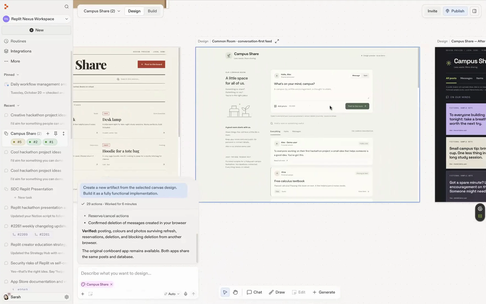

_At 01:01:34: a calm, green-grey variant built around a feed._

**Design | Common Room · conversation-first feed**

**Campus Share**

Less waste. More sharing.

- Our common room: **A little space for all of us.** Something to share? Something to say? You're in the right place.
- Composer: "Hello, Alex" · "What's on your mind, campus?" · Message / Item · Add photo · Post to the room
- Everything · Items · Messages
- Alex · Demo user: "To everyone working on their first hackathon project: a small idea that helps someone is a good idea. You've got this."
- Aina: Free calculus textbook

## Slide 22: Design variant: After Hours

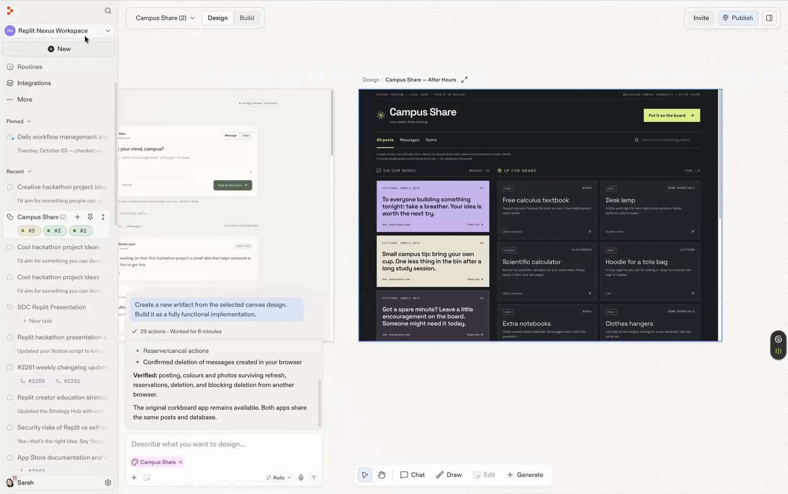

_At 01:01:42: the dark-mode variant._

**Design | Campus Share — After Hours**

Design preview / Local demo · Resets on reload · Malaysian campus community / After hours

**Campus Share**

Less waste. More sharing. · Put it on the board

- All posts · Messages · Items · Find a note or something useful...
- **On our minds** (Messages / 03): "To everyone building something tonight: take a breather. Your idea is worth the next try."; "Small campus tip: bring your own cup. One less thing in the bin after a long study session."; "Got a spare minute? Leave a little encouragement on the board. Someone might need it today."
- **Up for grabs** (Items / 12): Free calculus textbook, Desk lamp, Scientific calculator, Hoodie for a tote bag, Extra notebooks, Clothes hangers

## Slide 23: Design canvas: dropping in inspiration photos

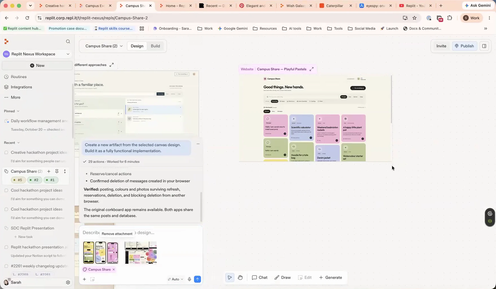

_At 01:02:20: two screenshots of colourful pastel app designs dropped into the design chat box, with the Playful Pastels website Replit made from them earlier on the canvas._

Design chat attachments: two screenshots, the Campus Share design selected ("Remove attachment" tooltip on hover). Canvas labels: "different approaches" and "Website | Campus Share — Playful Pastels".

Agent's earlier report in the chat: Create a new artifact from the selected canvas design. Build it as a fully functional implementation. · 29 actions · Worked for 6 minutes.

## Slide 24: Campus Share, Playful Pastels

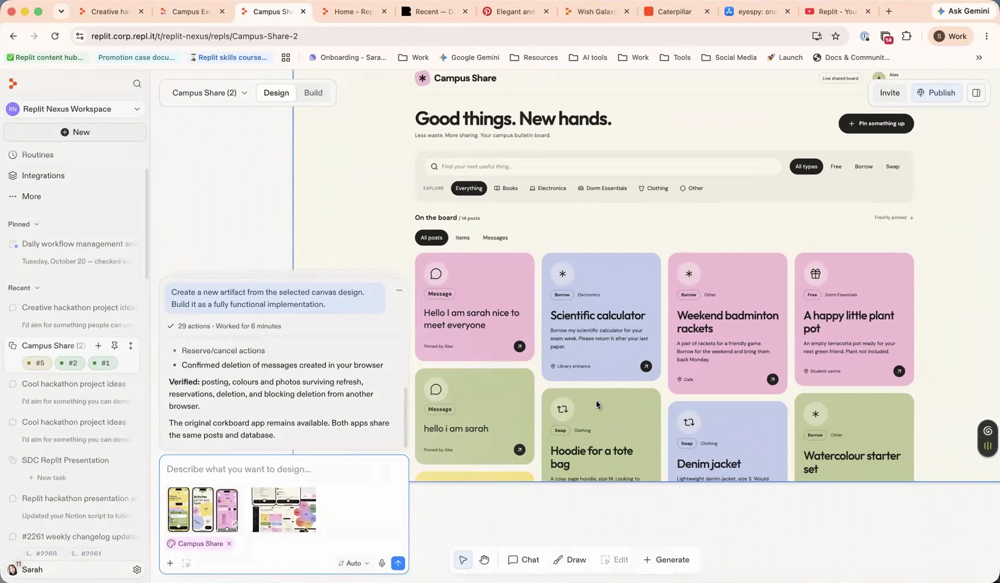

_At 01:02:34: the pastel design built from the inspiration photos, zoomed in on the canvas._

**Good things. New hands.**

Less waste. More sharing. Your campus bulletin board. · Live shared board · Pin something up

- Find your next useful thing... · All types · Free · Borrow · Swap
- Explore: Everything · Books · Electronics · Dorm Essentials · Clothing · Other
- On the board / 14 posts · Freshly pinned · All posts · Items · Messages
- Cards: Message "Hello I am sarah nice to meet everyone"; Borrow, Electronics: Scientific calculator; Borrow, Other: Weekend badminton rackets; Free, Dorm Essentials: A happy little plant pot; Message "hello i am sarah"; Swap, Clothing: Hoodie for a tote bag; Denim jacket; Watercolour starter set

## Slide 25: Design canvas: templates

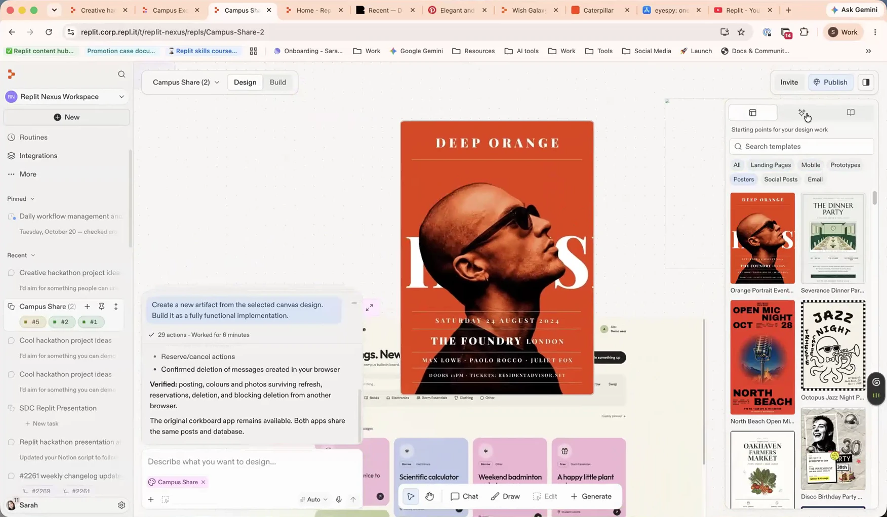

_At 01:02:59: the templates tab of the side panel, with a poster template dragged onto the canvas._

Starting points for your design work

- Search templates · All · Landing Pages · Mobile · Prototypes · Posters (selected) · Social Posts · Email
- Orange Portrait Event... · Severance Dinner Par... · North Beach Open Mi... · Octopus Jazz Night P... · an Oakhaven Farmers Market poster, label [covered] · Disco Birthday Party...

Poster on the canvas: DEEP ORANGE · Saturday 24 August 2024 · The Foundry London · Max Lowe · Paolo Rocco · Juliet Fox · Doors 11PM · Tickets: residentadvisor.net

## Slide 26: Design canvas: Mobbin inspiration

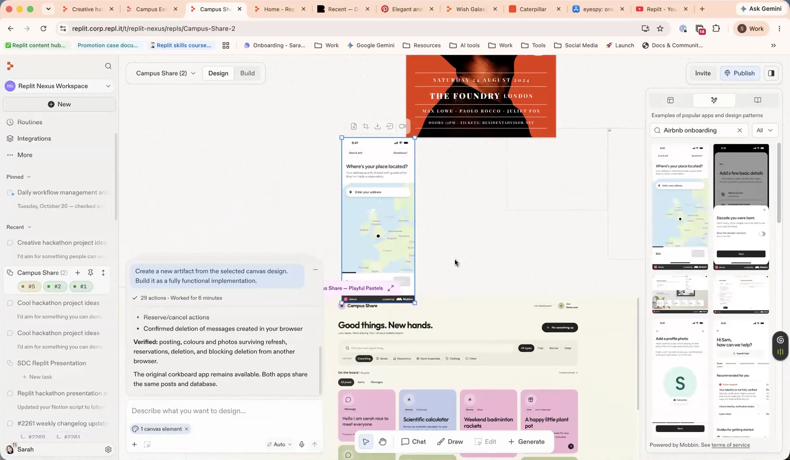

_At 01:03:24: the inspiration tab, searching Mobbin, with an Airbnb onboarding screen dragged onto the canvas next to the Playful Pastels website._

Examples of popular apps and design patterns

- Search: Airbnb onboarding · All
- Screens: "Where's your place located?"; "Add a few basic details"; "Decade you were born"; "Add a profile photo"; "Hi Sam, how can we help?"
- Powered by Mobbin. See terms of service

## Slide 27: Design canvas: designs and websites

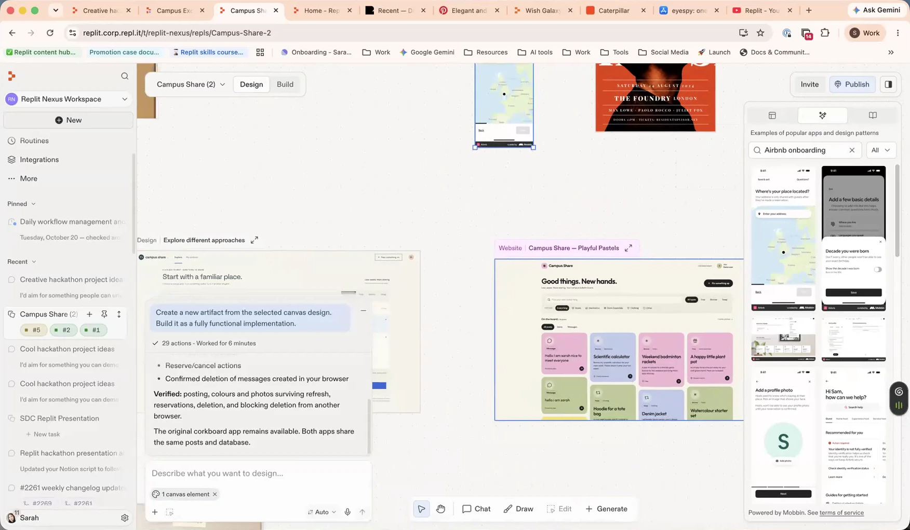

_At 01:03:30, as Sarah explains the labels: a design frame and a website frame side by side on the canvas._

- **Design** | Explore different approaches: a mock-up only, "basically just like a Figma file"
- **Website** | Campus Share — Playful Pastels: a working app with a database

## Slide 28: Design canvas: build this design

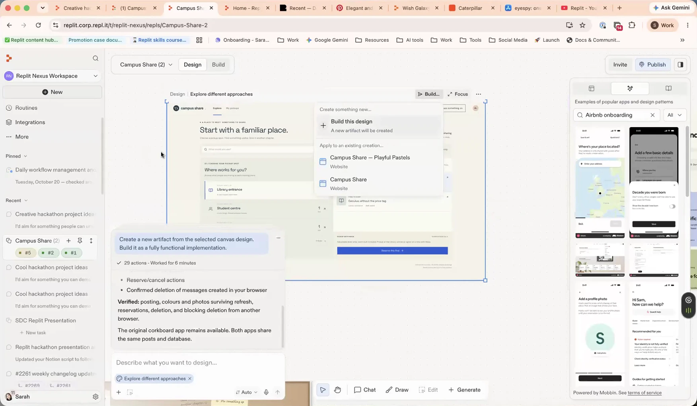

_At 01:04:04: the Build menu of a design frame on the canvas._

Build...

- Create something new...
  - **Build this design:** A new artifact will be created
- Apply to an existing creation...
  - Campus Share — Playful Pastels (Website)
  - Campus Share (Website)

## Slide 29: Inviting collaborators

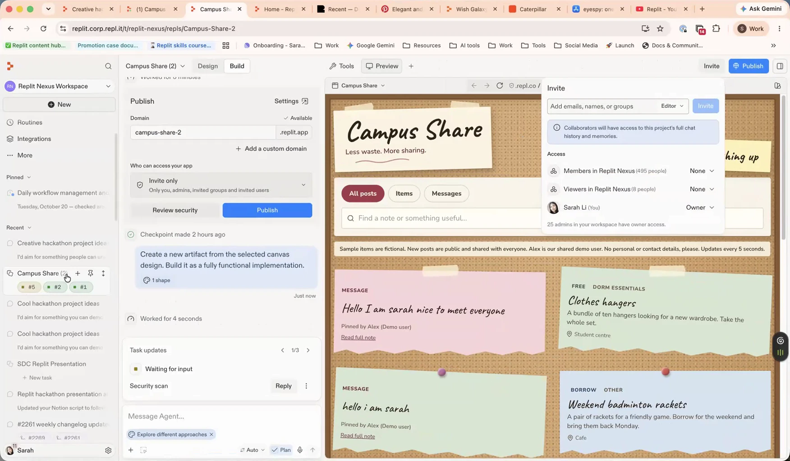

_At 01:04:30: back on the Build tab, with the Invite popover open over the corkboard app._

**Invite**

- Add emails, names, or groups · Editor · Invite
- Collaborators will have access to this project's full chat history and memories.
- Access: Members in Replit Nexus (495 people), None; Viewers in Replit Nexus (8 people), None; Sarah Li (You), Owner

## Slide 30: Parallel tasks: the task list

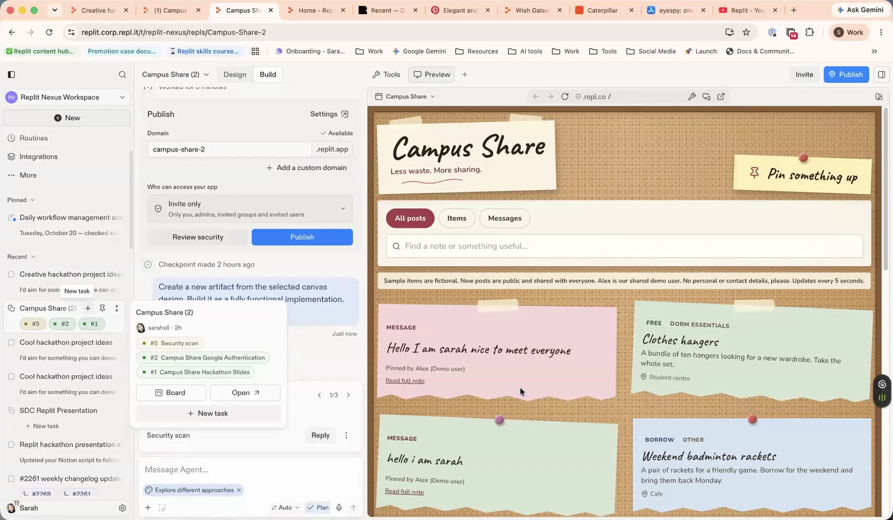

_At 01:04:43: the project's task list, opened from the sidebar, before Sarah presses New task._

**Campus Share (2)**

- #5 Security scan
- #2 Campus Share Google Authentication
- #1 Campus Share Hackathon Slides
- Board · Open
- New task

## Slide 31: Parallel tasks: asking for authentication

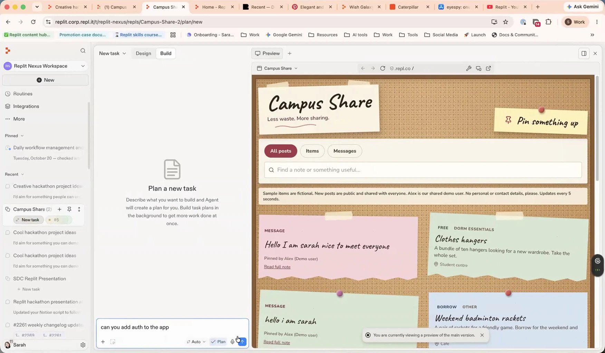

_At 01:05:12: a new task, with Sarah's request typed in its message box._

**Plan a new task**

Describe what you want to build and Agent will create a plan for you. Build task plans in the background to get more work done at once.

Prompt: "can you add auth to the app"

Notice over the preview: You are currently viewing a preview of the main version.

## Slide 32: Google Authentication task: the sign-in page

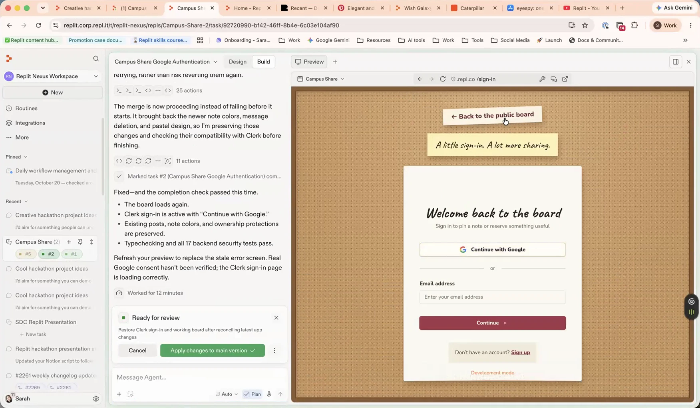

_At 01:05:33: the "Campus Share Google Authentication" task Sarah ran earlier, with the app's new sign-in page in the preview._

Agent: The merge is now proceeding instead of failing before it starts. It brought back the newer note colors, message deletion, and pastel design, so I'm preserving those changes and checking their compatibility with Clerk before finishing.

Marked task #2 (Campus Share Google Authentication) complete. Fixed—and the completion check passed this time.

- The board loads again.
- Clerk sign-in is active with "Continue with Google."
- Existing posts, note colors, and ownership protections are preserved.
- Typechecking and all 17 backend security tests pass.

Refresh your preview to replace the stale error screen. Real Google consent hasn't been verified; the Clerk sign-in page is loading correctly. · Worked for 12 minutes

Ready for review: Restore Clerk sign-in and working board after reconciling latest app changes · Cancel · Apply changes to main version

Preview (/sign-in): ← Back to the public board · "A little sign-in. A lot more sharing." · **Welcome back to the board** · Sign in to pin a note or reserve something useful · Continue with Google · or · Email address · Continue · Don't have an account? Sign up · Development mode

## Slide 33: Google Authentication task: sign in with Google

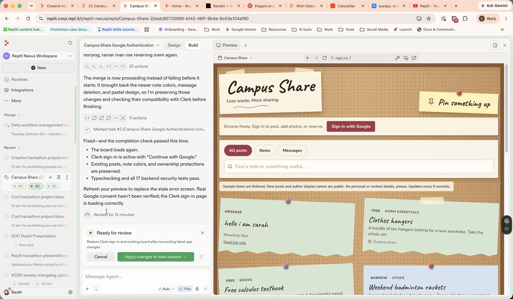

_At 01:05:55: the same task after Sarah goes back to the board, which now has a sign-in bar; the green Apply changes to main version button is what she points to._

Browse freely. Sign in to post, add photos, or reserve. · **Sign in with Google**

Sample items are fictional. New posts and author display names are public. No personal or contact details, please. Updates every 5 seconds.

## Slide 34: Hackathon Slides task: the slides request

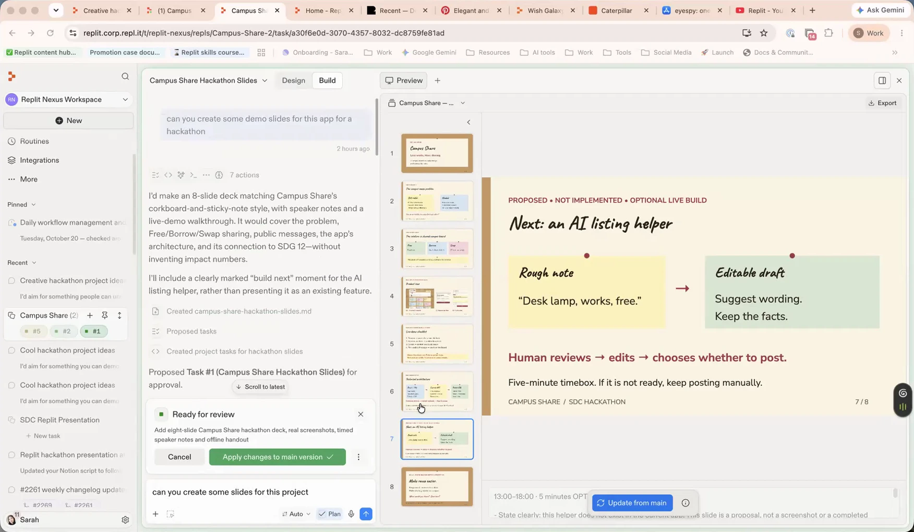

_At 01:06:39: the "Campus Share Hackathon Slides" task Sarah ran earlier, scrolled up to her original request, with "can you create some slides for this project" typed but not sent in the message box._

Prompt (2 hours ago): "can you create some demo slides for this app for a hackathon"

Agent: I'd make an 8-slide deck matching Campus Share's corkboard-and-sticky-note style, with speaker notes and a live-demo walkthrough. It would cover the problem, Free/Borrow/Swap sharing, public messages, the app's architecture, and its connection to SDG 12—without inventing impact numbers.

I'll include a clearly marked "build next" moment for the AI listing helper, rather than presenting it as an existing feature.

Created campus-share-hackathon-slides.md · Proposed tasks · Created project tasks for hackathon slides. Proposed **Task #1 (Campus Share Hackathon Slides)** for approval.

Ready for review: Add eight-slide Campus Share hackathon deck, real screenshots, timed speaker notes and offline handout · Cancel · Apply changes to main version

## Slide 35: Generated slide 1: Campus Share


_At 01:06:43: slide 1 of the 8 in the generated deck, "Campus Share — SDC Hackathon", in the task's preview. Sarah clicks through slides 1, 3, 4, 6, 7 and 8 between 01:06:42 and 01:06:50; slides 2 and 5 appear only in the thumbnail strip, and look like "The campus waste problem" and a "Live-demo checklist". The chat, scrolled to the end, shows Agent's final report._

SDC Hackathon

**Campus Share**

**Less waste. More sharing.**

A campus board for useful things and community notes.

Speaker notes bar: 0:00–1:00 · 1 minute · "- Ask: what useful thing is sitting [covered]"

Agent's final report: Campus Share — Offline Handout & Notes (HTML) · Presented output: Campus Share — SDC Hackathon (Slides) · Marked task #1 (Campus Share Hackathon Slides) complete. Completed the eight-slide Campus Share deck with:

- Timed speaker notes: **20 minutes**, or **16 minutes without live coding**
- Real product screenshots and an offline PDF/HTML fallback
- Reversible demo checklist and public-post privacy reminders
- Clearly labeled proposed AI helper

Open presenter controls. Navigation, fullscreen, notes, and eight-page print output were verified. App and backend behavior remain unchanged. · Worked for 8 minutes

## Slide 36: Generated slide 3: The solution, a shared campus board

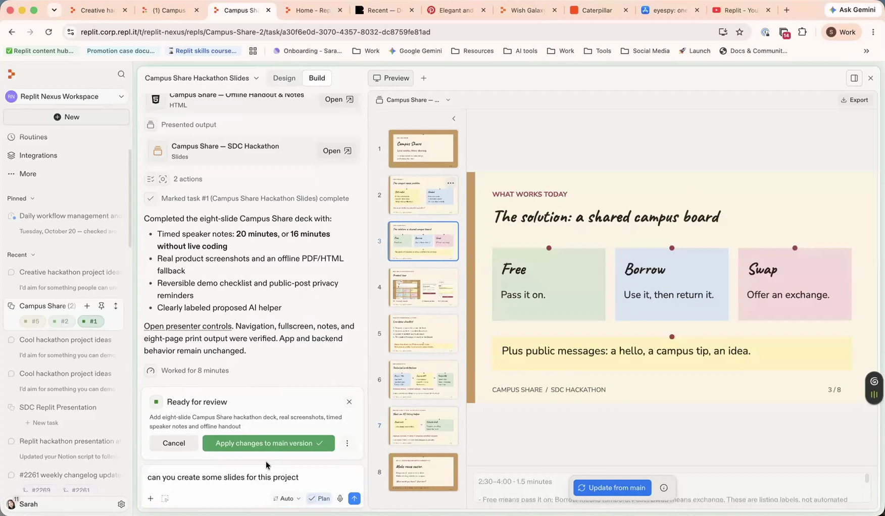

_At 01:06:42: slide 3 of 8._

What works today

**The solution: a shared campus board**

- **Free:** Pass it on.
- **Borrow:** Use it, then return it.
- **Swap:** Offer an exchange.

Plus public messages: a hello, a campus tip, an idea.

Campus Share / SDC Hackathon · 3 / 8

Speaker notes bar: 2:30–4:00 · 1.5 minutes · "- Free means pass it on; Borro[covered] means exchange. These are listing labels, not automated"

## Slide 37: Generated slide 4: Product tour

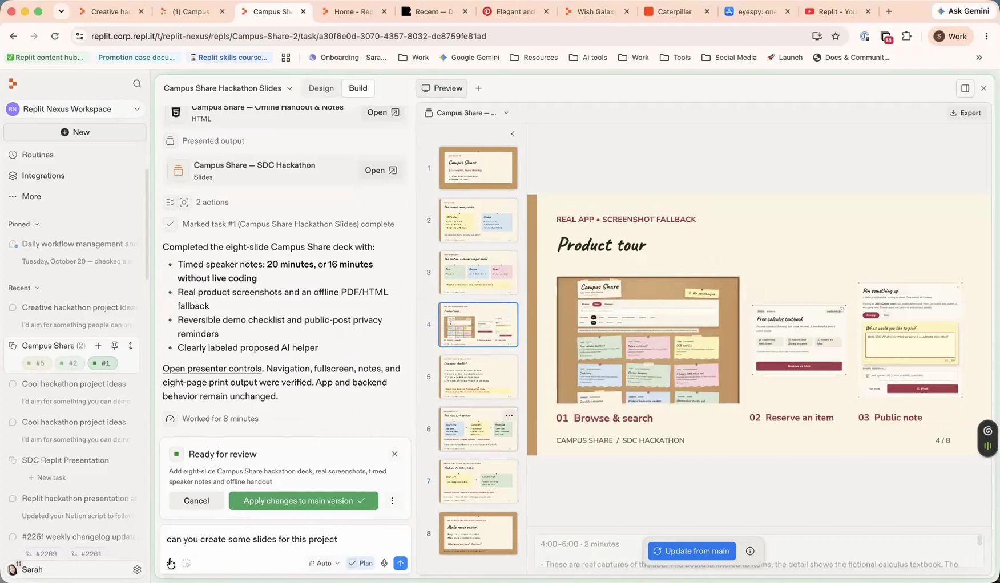

_At 01:06:44: slide 4 of 8, with three screenshots of the real app: the corkboard filtered to items, the Free calculus textbook detail with a Reserve button, and the Pin something up form._

Real app • Screenshot fallback

**Product tour**

- 01 Browse & search
- 02 Reserve an item
- 03 Public note

Campus Share / SDC Hackathon · 4 / 8

Speaker notes bar: 4:00–6:00 · 2 minutes · "- These are real captures of the [covered] is filtered to items; the detail shows the fictional calculus textbook. The"

## Slide 38: Generated slide 6: Technical architecture

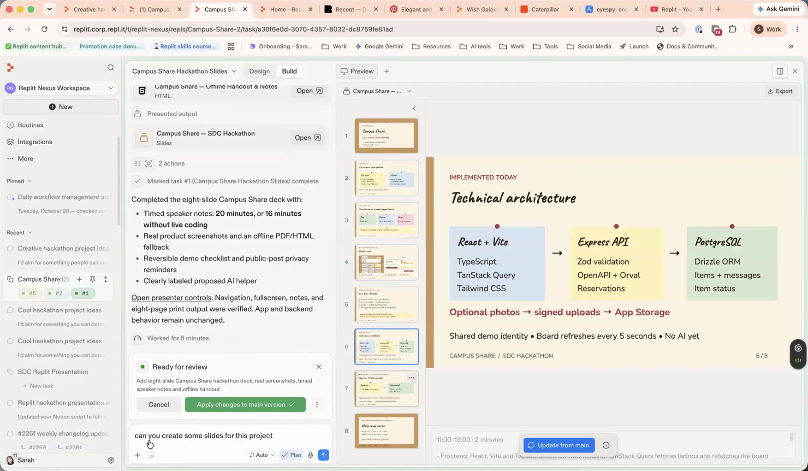

_At 01:06:45: slide 6 of 8, three sticky notes joined by arrows._

Implemented today

**Technical architecture**

- **React + Vite:** TypeScript, TanStack Query, Tailwind CSS
- → **Express API:** Zod validation, OpenAPI + Orval, Reservations
- → **PostgreSQL:** Drizzle ORM, Items + messages, Item status

Optional photos → signed uploads → App Storage

Shared demo identity • Board refreshes every 5 seconds • No AI yet

Campus Share / SDC Hackathon · 6 / 8

Speaker notes bar: 11:00–13:00 · 2 minutes · "- Frontend: React, Vite and T[covered]nStack Query fetches listings and refetches the board"

## Slide 39: Generated slide 7: Next, an AI listing helper

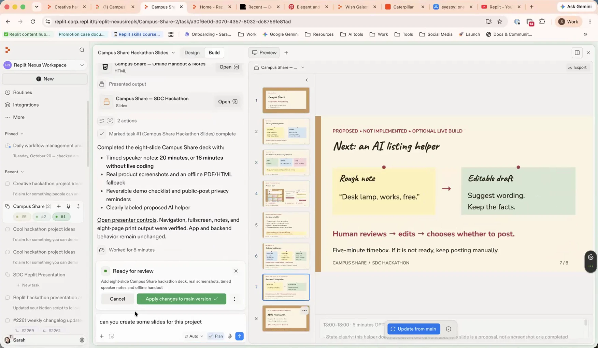

_At 01:06:46: slide 7 of 8._

Proposed • Not implemented • Optional live build

**Next: an AI listing helper**

- **Rough note:** "Desk lamp, works, free."
- → **Editable draft:** Suggest wording. Keep the facts.

Human reviews → edits → chooses whether to post.

Five-minute timebox. If it is not ready, keep posting manually.

Campus Share / SDC Hackathon · 7 / 8

Speaker notes bar: 13:00–18:00 · 5 minutes OPT[covered] · "- State clearly: this helper doe[covered]is slide is a proposal, not a screenshot or a completed"

## Slide 40: Generated slide 8: Make reuse easier

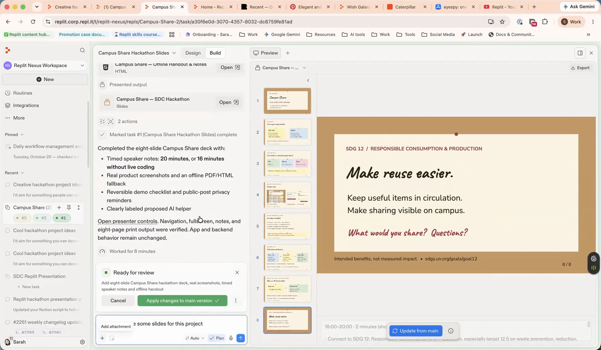

_At 01:06:50: slide 8 of 8, the closing slide._

SDG 12 / Responsible consumption & production

**Make reuse easier.**

Keep useful items in circulation. Make sharing visible on campus.

_What would you share? Questions?_

Intended benefits, not measured impact. • sdgs.un.org/goals/goal12 · 8 / 8

Speaker notes bar: 18:00–20:00 · 2 minutes (sho[covered] · "- Connect to SDG 12: Respon[covered]ion, especially target 12.5 on waste prevention, reduction,"

## Slide 41: Create something new

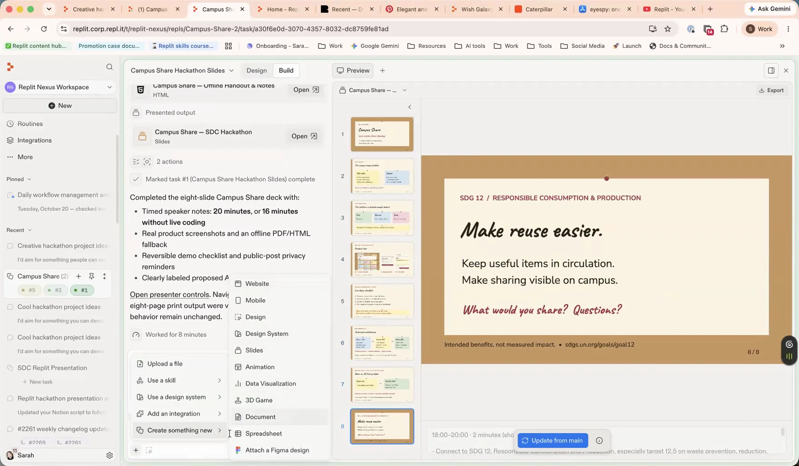

_At 01:07:00, as Sarah says Replit can build more than web apps: the + menu of the task's message box._

- Upload a file
- Use a skill
- Use a design system
- Add an integration
- Create something new: Website · Mobile · Design · Design System · Slides · Animation · Data Visualization · 3D Game · Document · Spreadsheet · Attach a Figma design

## Slide 42: Security and Privacy Center

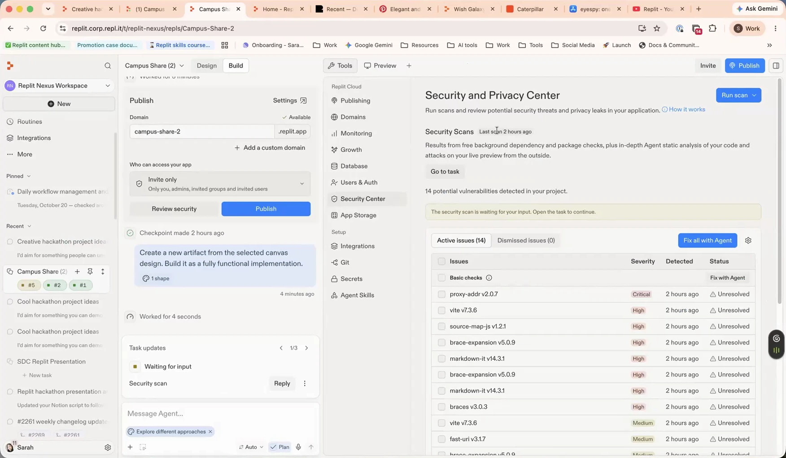

_At 01:07:45: the Security Center in the project's Tools panel (Replit Cloud: Publishing, Domains, Monitoring, Growth, Database, Users & Auth, Security Center, App Storage; Setup: Integrations, Git, Secrets, Agent Skills)._

**Security and Privacy Center**

Run scans and review potential security threats and privacy leaks in your application. · How it works · Run scan

**Security Scans** · Last scan 2 hours ago

Results from free background dependency and package checks, plus in-depth Agent static analysis of your code and attacks on your live preview from the outside. · Go to task

14 potential vulnerabilities detected in your project.

The security scan is waiting for your input. Open the task to continue.

Active issues (14) · Dismissed issues (0) · Fix all with Agent

| Issue (Basic checks)   | Severity | Detected    | Status     |
| ---------------------- | -------- | ----------- | ---------- |
| proxy-addr v2.0.7      | Critical | 2 hours ago | Unresolved |
| vite v7.3.6            | High     | 2 hours ago | Unresolved |
| source-map-js v1.2.1   | High     | 2 hours ago | Unresolved |
| brace-expansion v5.0.9 | High     | 2 hours ago | Unresolved |
| markdown-it v14.3.1    | High     | 2 hours ago | Unresolved |
| brace-expansion v5.0.9 | High     | 2 hours ago | Unresolved |
| markdown-it v14.3.1    | High     | 2 hours ago | Unresolved |
| braces v3.0.3          | High     | 2 hours ago | Unresolved |
| vite v7.3.6            | Medium   | 2 hours ago | Unresolved |
| fast-uri v3.1.7        | Medium   | 2 hours ago | Unresolved |

## Slide 43: Scan level 1: basic security checks

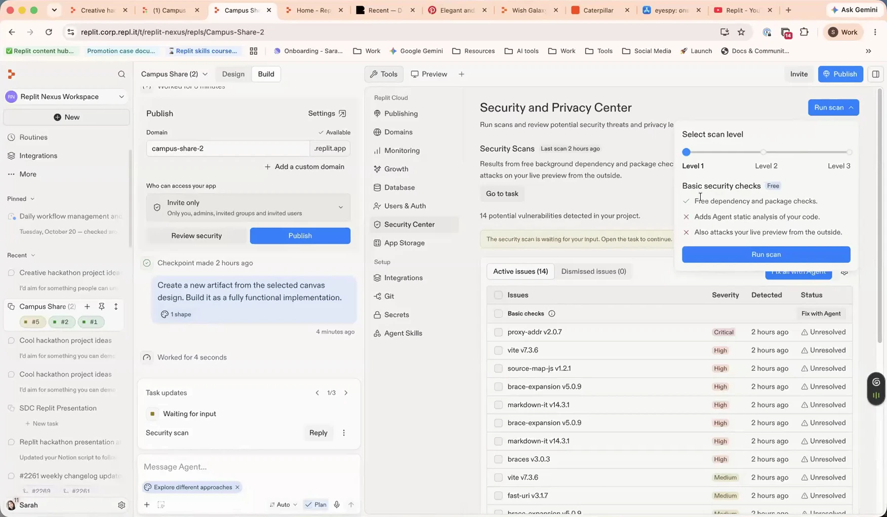

_At 01:08:26: the Run scan menu, with the slider on Level 1._

**Select scan level:** Level 1 · Level 2 · Level 3

**Basic security checks** (Free)

- ✓ Free dependency and package checks.
- ✗ Adds Agent static analysis of your code.
- ✗ Also attacks your live preview from the outside.

Button: Run scan

## Slide 44: Scan level 2: deep security scan


_At 01:08:44: the slider on Level 2._

**Deep security scan**

- ✓ Free dependency and package checks.
- ✓ Adds Agent static analysis of your code.
- ✗ Also attacks your live preview from the outside.

Customize · Run scan with Agent

## Slide 45: Scan level 3: AI pentest

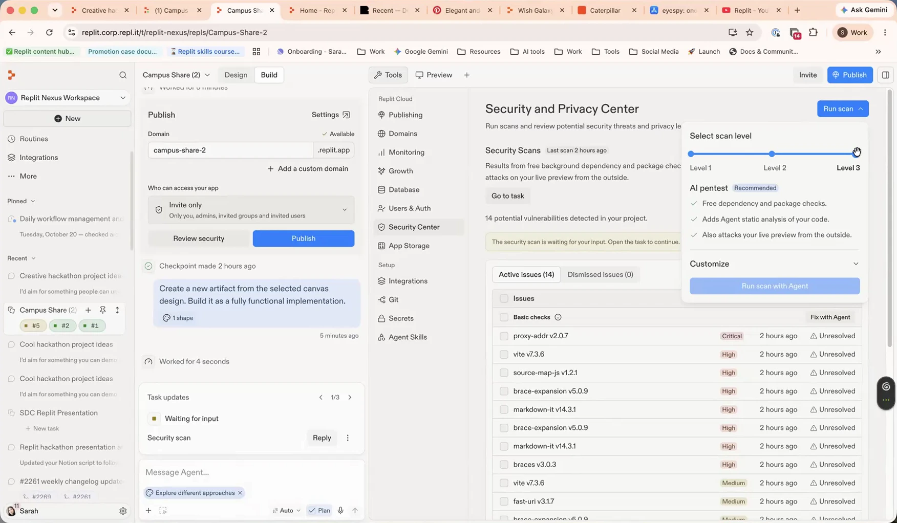

_At 01:09:02: the slider on Level 3._

**AI pentest** (Recommended)

- ✓ Free dependency and package checks.
- ✓ Adds Agent static analysis of your code.
- ✓ Also attacks your live preview from the outside.

Customize · Run scan with Agent

## Slide 46: Fixing the selected issues with Agent

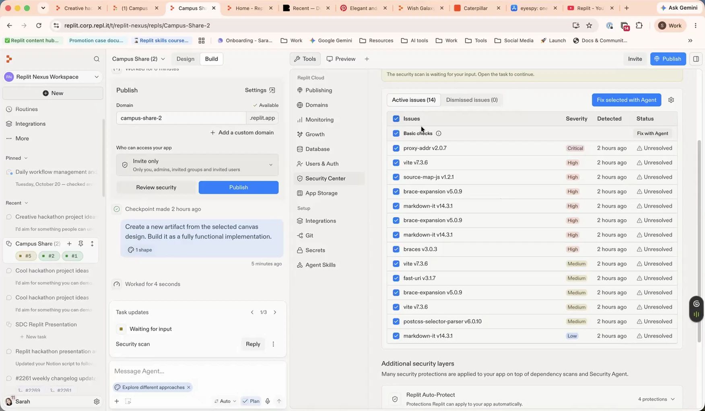

_At 01:09:25: all 14 issues selected with the header checkbox._

Active issues (14) · Dismissed issues (0) · **Fix selected with Agent**

| Issue (Basic checks)            | Severity |
| ------------------------------- | -------- |
| proxy-addr v2.0.7               | Critical |
| vite v7.3.6                     | High     |
| source-map-js v1.2.1            | High     |
| brace-expansion v5.0.9          | High     |
| markdown-it v14.3.1             | High     |
| brace-expansion v5.0.9          | High     |
| markdown-it v14.3.1             | High     |
| braces v3.0.3                   | High     |
| vite v7.3.6                     | Medium   |
| fast-uri v3.1.7                 | Medium   |
| brace-expansion v5.0.9          | Medium   |
| vite v7.3.6                     | Medium   |
| postcss-selector-parser v6.0.10 | Medium   |
| markdown-it v14.3.1             | Low      |

All detected 2 hours ago, all Unresolved.

**Additional security layers**

Many security protections are applied to your app on top of dependency scans and Security Agent.

- Replit Auto-Protect: Protections Replit can apply to your app automatically. (4 protections)

## Slide 47: Publishing the app

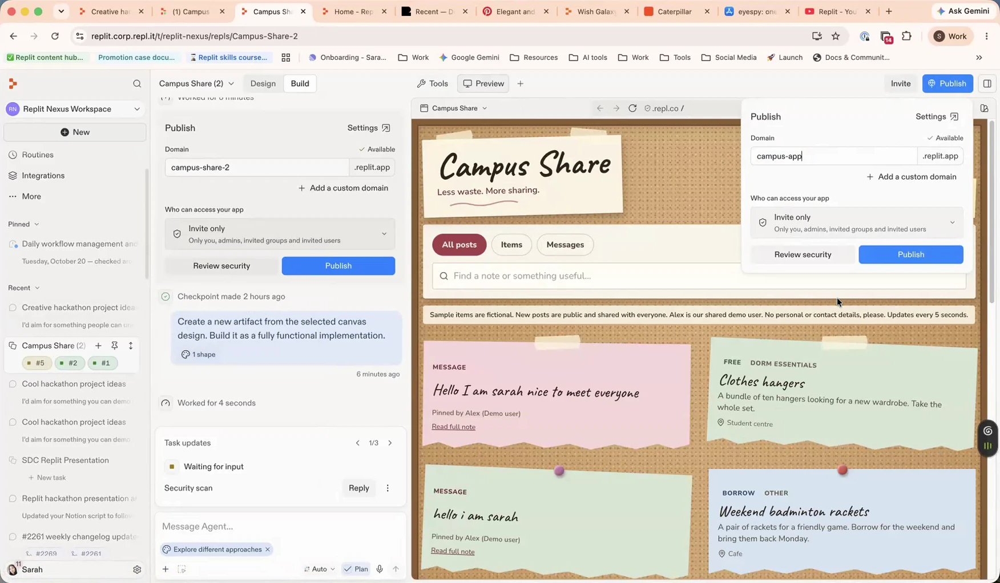

_At 01:09:58: the Publish panel, opened from the blue Publish button, with Sarah's custom subdomain typed in. She doesn't publish._

**Publish** · Settings

- Domain: campus-app.replit.app (Available)
- Add a custom domain
- Who can access your app: Invite only. Only you, admins, invited groups and invited users
- Review security · Publish

## Slide 48: Custom domains

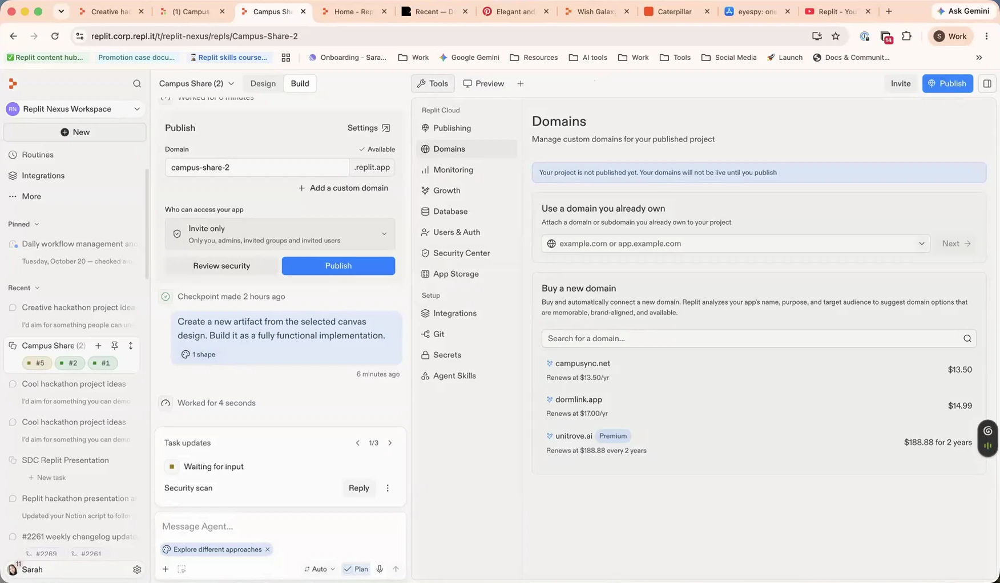

_At 01:10:20: the Domains pane of the Tools panel._

**Domains**

Manage custom domains for your published project

Your project is not published yet. Your domains will not be live until you publish

**Use a domain you already own:** Attach a domain or subdomain you already own to your project. Field: example.com or app.example.com · Next

**Buy a new domain:** Buy and automatically connect a new domain. Replit analyzes your app's name, purpose, and target audience to suggest domain options that are memorable, brand-aligned, and available.

| Suggested domain    | Price               | Renews                |
| ------------------- | ------------------- | --------------------- |
| campusync.net       | $13.50              | $13.50/yr             |
| dormlink.app        | $14.99              | $17.00/yr             |
| unitrove.ai Premium | $188.88 for 2 years | $188.88 every 2 years |

## Slide 49: Replit blog: free the models

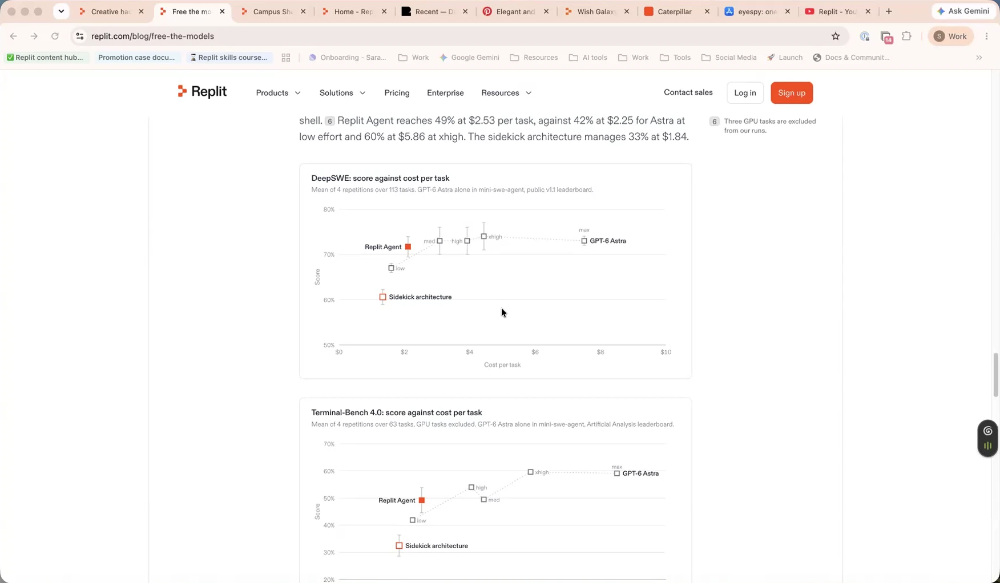

_At 01:19:40, in the Q&A: a Replit blog post at replit.com/blog/free-the-models with two charts of benchmark score against cost per task. Each plots Replit Agent (filled orange square), GPT-6 Astra at low, med, high, xhigh and max effort, and a "Sidekick architecture" point._

shell. 6 Replit Agent reaches 49% at $2.53 per task, against 42% at $2.25 for Astra at low effort and 60% at $5.86 at xhigh. The sidekick architecture manages 33% at $1.84.

Side note 6: Three GPU tasks are excluded from our runs.

**DeepSWE: score against cost per task**

Mean of 4 repetitions over 113 tasks. GPT-6 Astra alone in mini-swe-agent, public v1.1 leaderboard. (Score axis 50% to 80%, cost per task $0 to $10.)

**Terminal-Bench 4.0: score against cost per task**

Mean of 4 repetitions over 63 tasks, GPU tasks excluded. GPT-6 Astra alone in mini-swe-agent, Artificial Analysis leaderboard. (Score axis 20% to 70%.)

When the share starts at 01:19:03 the page is scrolled further down, to the paragraph below the charts: "Replit Agent beats the sidekick architecture on both benchmarks, by 11 and 16 points. The sidekick costs less, and gives up a sixth to a third of the score for it. Astra on its [covered]"

## Slide 50: Benchmark: Replit Agent on DeepSWE

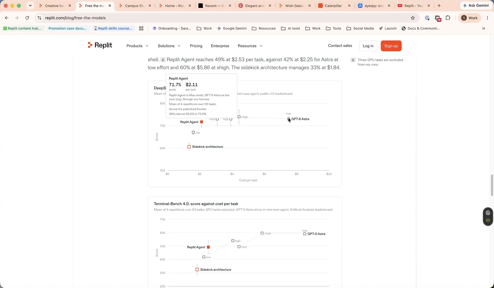

_At 01:20:22: the tooltip on the Replit Agent point of the DeepSWE chart._

**Replit Agent**

71.7% score · $2.11 per task

Replit Agent in Max mode, GPT-6 Astra as the core loop, through our harness. Mean of 4 repetitions over 113 tasks. Above the published frontier. 95% interval 69.4% to 73.9%.

## Slide 51: Benchmark: GPT-6 Astra on DeepSWE

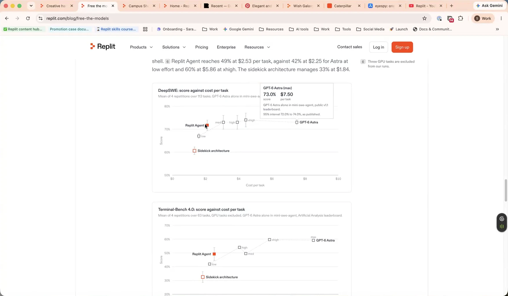

_At 01:20:40: the tooltip on the GPT-6 Astra (max) point of the DeepSWE chart._

**GPT-6 Astra (max)**

73.0% score · $7.50 per task

GPT-6 Astra alone in mini-swe-agent, public v1.1 leaderboard. 95% interval 72.0% to 74.0%, as published.
