# Workshop 3 slides

Every slide of "Deploying Open Source Models on Runpod Serverless", the 41-slide deck Jessica Garson Beauchemin, who leads Developer Relations at Runpod, presented at SDC Hackathon 2026 Workshop 3 on Zoom on 21 October 2026 from 10 PM MYT, each with its image and its text. The workshop was announced as "From Text to Decisions: Building AI Applications with Structured Outputs". The [transcript](transcript.md) covers what was said, the [meeting chat](chat.md) what attendees typed, and [Workshop 3 resources](resources.md) the two handouts.

The deck is the PDF in the workshop's [Drive folder](https://drive.google.com/drive/folders/1qOaWdgpXpzrra9jWBZNN4GW63zskvWQk), which the organisers uploaded at 11:14 PM that night, and the images are rendered from it. Links keep the targets in the PDF; addresses shown as plain text on a slide are linked to the same address. Code is copied as shown, except that lines the slides wrap to fit are joined. The copyright line in most slide footers and the page numbers on some slides are left out.

Contents:

1.  [Slide 01: Deploying open source models on Runpod Serverless](#slide-01-deploying-open-source-models-on-runpod-serverless)
1.  [Slide 02: Agenda](#slide-02-agenda)
1.  [Slide 03: Hi, I'm Jessica Garson Beauchemin](#slide-03-hi-im-jessica-garson-beauchemin)
1.  [Slide 04: The AI Developer Cloud](#slide-04-the-ai-developer-cloud)
1.  [Slide 05: What you need to get started](#slide-05-what-you-need-to-get-started)
1.  [Slide 06: Code from the workshop](#slide-06-code-from-the-workshop)
1.  [Slide 07: The article behind the workshop](#slide-07-the-article-behind-the-workshop)
1.  [Slide 08: Prerequisites](#slide-08-prerequisites)
1.  [Slide 09: What is Runpod Serverless?](#slide-09-what-is-runpod-serverless)
1.  [Slide 10: Pay-as-you-go compute](#slide-10-pay-as-you-go-compute)
1.  [Slide 11: What you need to know about Serverless](#slide-11-what-you-need-to-know-about-serverless)
1.  [Slide 12: Serverless core concepts](#slide-12-serverless-core-concepts)
1.  [Slide 13: The example: OpenJev, a decision model](#slide-13-the-example-openjev-a-decision-model)
1.  [Slide 14: What is a decision model?](#slide-14-what-is-a-decision-model)
1.  [Slide 15: Chat models answer in prose you have to parse](#slide-15-chat-models-answer-in-prose-you-have-to-parse)
1.  [Slide 16: Decision models answer in the format you ask for](#slide-16-decision-models-answer-in-the-format-you-ask-for)
1.  [Slide 17: What you need to know before you deploy](#slide-17-what-you-need-to-know-before-you-deploy)
1.  [Slide 18: Zero active workers, so you pay only while one runs](#slide-18-zero-active-workers-so-you-pay-only-while-one-runs)
1.  [Slide 19: You pay from worker start, including model load](#slide-19-you-pay-from-worker-start-including-model-load)
1.  [Slide 20: Cold starts take minutes, so check readiness first](#slide-20-cold-starts-take-minutes-so-check-readiness-first)
1.  [Slide 21: Three mistakes cost real GPU time, each with a fix](#slide-21-three-mistakes-cost-real-gpu-time-each-with-a-fix)
1.  [Slide 22: Load balancer for a sync API, queue for jobs](#slide-22-load-balancer-for-a-sync-api-queue-for-jobs)
1.  [Slide 23: Check the license and benchmark before you build](#slide-23-check-the-license-and-benchmark-before-you-build)
1.  [Slide 24: Deploying](#slide-24-deploying)
1.  [Slide 25: Five settings decide whether the OpenJev deploy works](#slide-25-five-settings-decide-whether-the-openjev-deploy-works)
1.  [Slide 26: The H100 80 GB is the setup OpenJev measured](#slide-26-the-h100-80-gb-is-the-setup-openjev-measured)
1.  [Slide 27: The console or the MCP server](#slide-27-the-console-or-the-mcp-server)
1.  [Slide 28: Two ways to connect, and one keeps your API key off disk](#slide-28-two-ways-to-connect-and-one-keeps-your-api-key-off-disk)
1.  [Slide 29: How do you authenticate?](#slide-29-how-do-you-authenticate)
1.  [Slide 30: Adding the Runpod MCP server](#slide-30-adding-the-runpod-mcp-server)
1.  [Slide 31: A deploy prompt for OpenJev](#slide-31-a-deploy-prompt-for-openjev)
1.  [Slide 32: Making requests](#slide-32-making-requests)
1.  [Slide 33: Setting up environment variables](#slide-33-setting-up-environment-variables)
1.  [Slide 34: Checking readiness](#slide-34-checking-readiness)
1.  [Slide 35: Making a cURL request](#slide-35-making-a-curl-request)
1.  [Slide 36: Response to the cURL request](#slide-36-response-to-the-curl-request)
1.  [Slide 37: Let's take a look at the Python code](#slide-37-lets-take-a-look-at-the-python-code)
1.  [Slide 38: Running the Python example](#slide-38-running-the-python-example)
1.  [Slide 39: Next steps](#slide-39-next-steps)
1.  [Slide 40: Join the Runpod Discord](#slide-40-join-the-runpod-discord)
1.  [Slide 41: Closing card](#slide-41-closing-card)

## Slide 01: Deploying open source models on Runpod Serverless

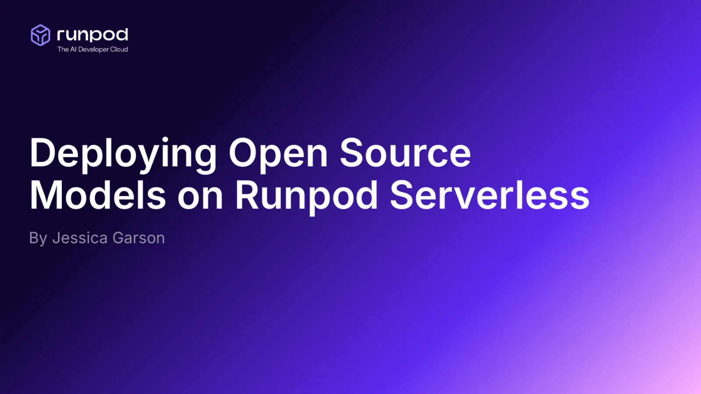

**Deploying Open Source Models on Runpod Serverless**

By Jessica Garson

_Title card with the Runpod logo and its tagline, "The AI Developer Cloud"._

## Slide 02: Agenda

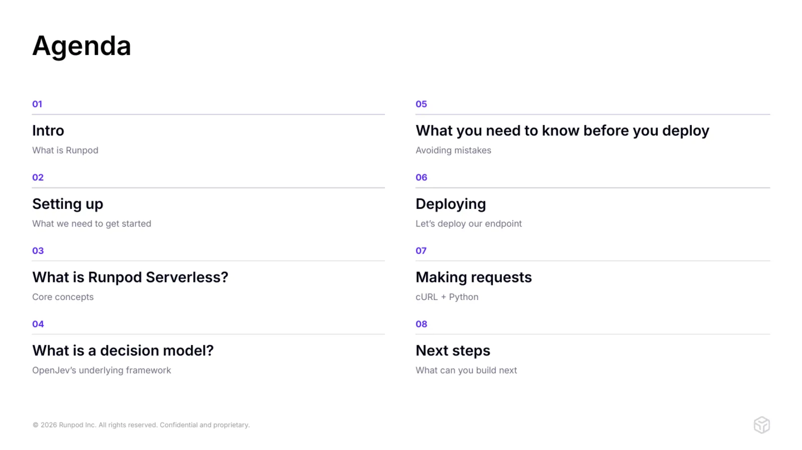

**Agenda**

1.  **Intro**: What is Runpod
2.  **Setting up**: What we need to get started
3.  **What is Runpod Serverless?**: Core concepts
4.  **What is a decision model?**: OpenJev's underlying framework
5.  **What you need to know before you deploy**: Avoiding mistakes
6.  **Deploying**: Let's deploy our endpoint
7.  **Making requests**: cURL + Python
8.  **Next steps**: What can you build next

## Slide 03: Hi, I'm Jessica Garson Beauchemin


**Hi, I'm Jessica Garson Beauchemin**

**I lead Developer Relations at Runpod**

_A photo of the speaker fills the left half, and a waving-hand emoji follows her name._

## Slide 04: The AI Developer Cloud

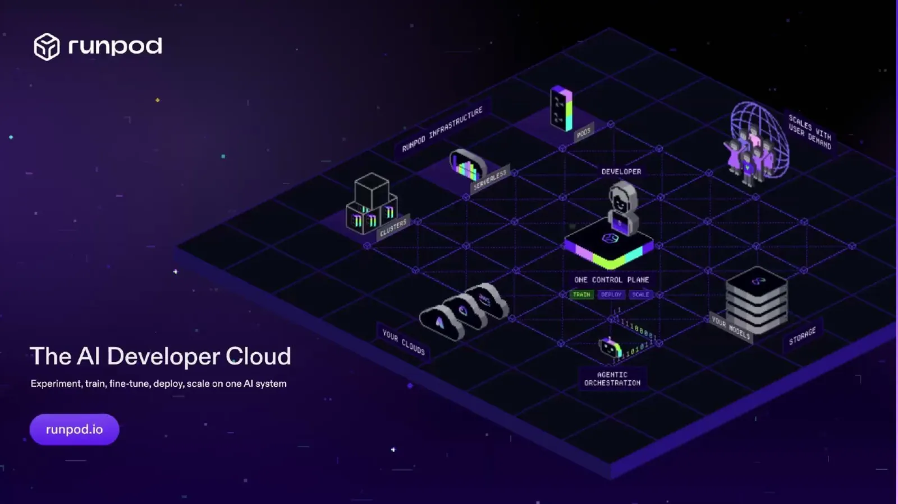

_Still from a video embedded in the deck; in the PDF the slide links to a [video on Google Drive][slide-04-video] that isn't shared publicly. It shows an isometric map of the Runpod platform, labelled Runpod infrastructure, Pods, Serverless, Clusters, Developer, One control plane (Train, Deploy, Scale), Scales with user demand, Your clouds, Your models, Storage and Agentic orchestration._

**The AI Developer Cloud**

Experiment, train, fine-tune, deploy, scale on one AI system

Button: runpod.io

[slide-04-video]: https://docs.google.com/file/d/1sdlF-4F0JPVUkFxe88lLkTKjp_Y8hOF-/preview

## Slide 05: What you need to get started


**What you need to get started**

_Section title card._

## Slide 06: Code from the workshop

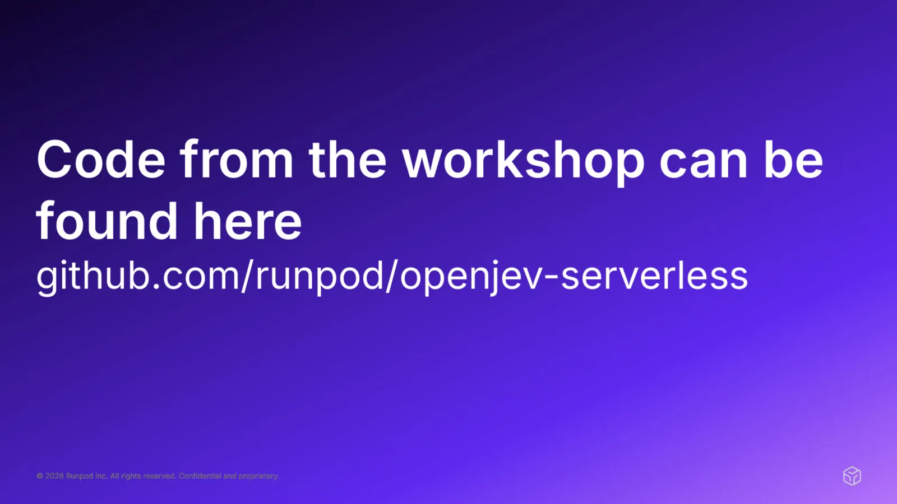

**Code from the workshop can be found here**

[github.com/runpod/openjev-serverless](https://github.com/runpod/openjev-serverless)

## Slide 07: The article behind the workshop

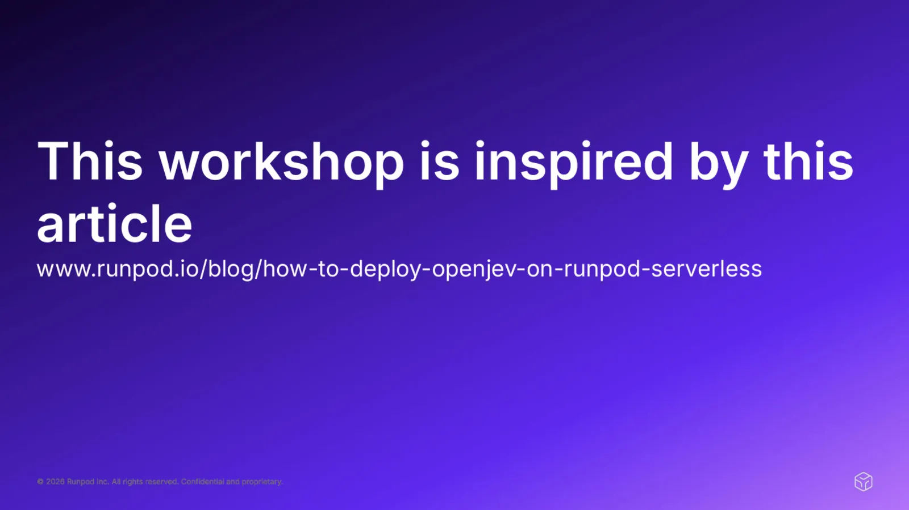

**This workshop is inspired by this article**

[www.runpod.io/blog/how-to-deploy-openjev-on-runpod-serverless][openjev-article]

[openjev-article]: https://www.runpod.io/blog/how-to-deploy-openjev-on-runpod-serverless

## Slide 08: Prerequisites

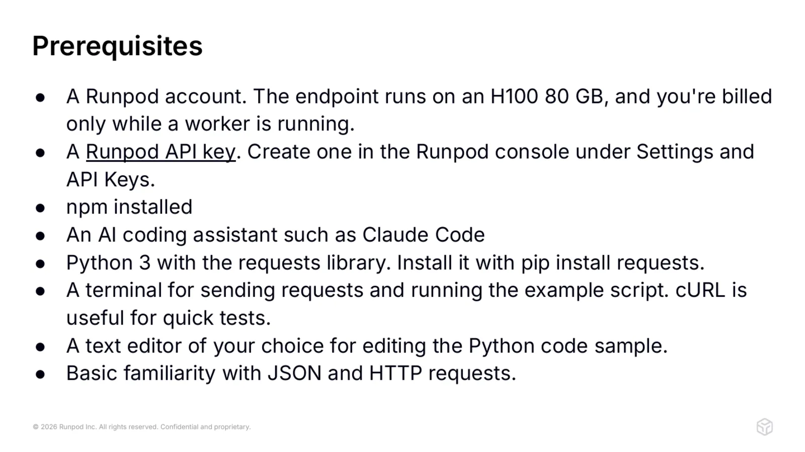

**Prerequisites**

- A Runpod account. The endpoint runs on an H100 80 GB, and you're billed only while a worker is running.
- A [Runpod API key](https://docs.runpod.io/get-started/credentials). Create one in the Runpod console under Settings and API Keys.
- npm installed
- An AI coding assistant such as Claude Code
- Python 3 with the requests library. Install it with pip install requests.
- A terminal for sending requests and running the example script. cURL is useful for quick tests.
- A text editor of your choice for editing the Python code sample.
- Basic familiarity with JSON and HTTP requests.

## Slide 09: What is Runpod Serverless?


**What is Runpod Serverless?**

_Section title card._

## Slide 10: Pay-as-you-go compute

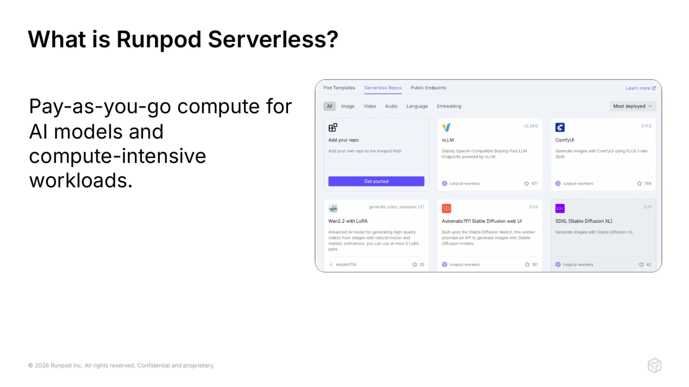

**What is Runpod Serverless?**

Pay-as-you-go compute for AI models and compute-intensive workloads.

_Screenshot of the Runpod Hub, on its Serverless Repos tab (beside Pod Templates and Public Endpoints, with a "Learn more" link), filtered to All (other filters: Image, Video, Audio, Language, Embedding) and sorted by Most deployed:_

- **Add your repo**: Add your own repo to the Runpod Hub! Button: Get started
- **vLLM** (v2.29.0, runpod-workers, 471 stars): Deploy OpenAI-Compatible Blazing-Fast LLM Endpoints powered by vLLM
- **ComfyUI** (5.11.0, runpod-workers, 749 stars): Generate images with ComfyUI using FLUX.1-dev (fp8)
- **Wan2.2 with LoRA** (generate_video_ksampler_v1.1, wlsdml1114, 35 stars): Advanced AI model for generating high-quality videos from images with natural motion and realistic animations. you can use at most 3 LoRA pairs
- **Automatic1111 Stable Diffusion web UI** (1.0.6, runpod-workers, 101 stars): Built upon the Stable Diffusion WebUI, this worker provides an API to generate images with Stable Diffusion models.
- **SDXL (Stable Diffusion XL)** (2.1.1, runpod-workers, 42 stars): Generate images with Stable Diffusion XL.

## Slide 11: What you need to know about Serverless

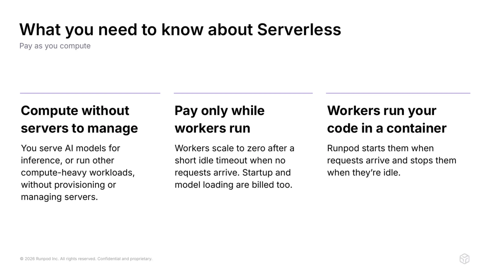

**What you need to know about Serverless**

Pay as you compute

- **Compute without servers to manage:** You serve AI models for inference, or run other compute-heavy workloads, without provisioning or managing servers.
- **Pay only while workers run:** Workers scale to zero after a short idle timeout when no requests arrive. Startup and model loading are billed too.
- **Workers run your code in a container:** Runpod starts them when requests arrive and stops them when they're idle.

## Slide 12: Serverless core concepts

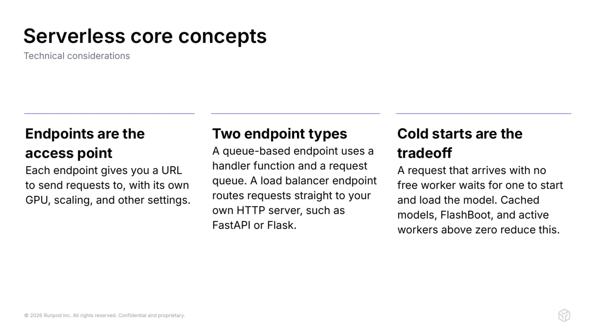

**Serverless core concepts**

Technical considerations

- **Endpoints are the access point:** Each endpoint gives you a URL to send requests to, with its own GPU, scaling, and other settings.
- **Two endpoint types:** A queue-based endpoint uses a handler function and a request queue. A load balancer endpoint routes requests straight to your own HTTP server, such as FastAPI or Flask.
- **Cold starts are the tradeoff:** A request that arrives with no free worker waits for one to start and load the model. Cached models, FlashBoot, and active workers above zero reduce this.

## Slide 13: The example: OpenJev, a decision model

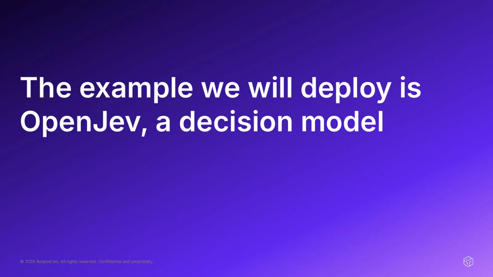

**The example we will deploy is OpenJev, a decision model**

## Slide 14: What is a decision model?


**What is a decision model?**

_Section title card._

## Slide 15: Chat models answer in prose you have to parse

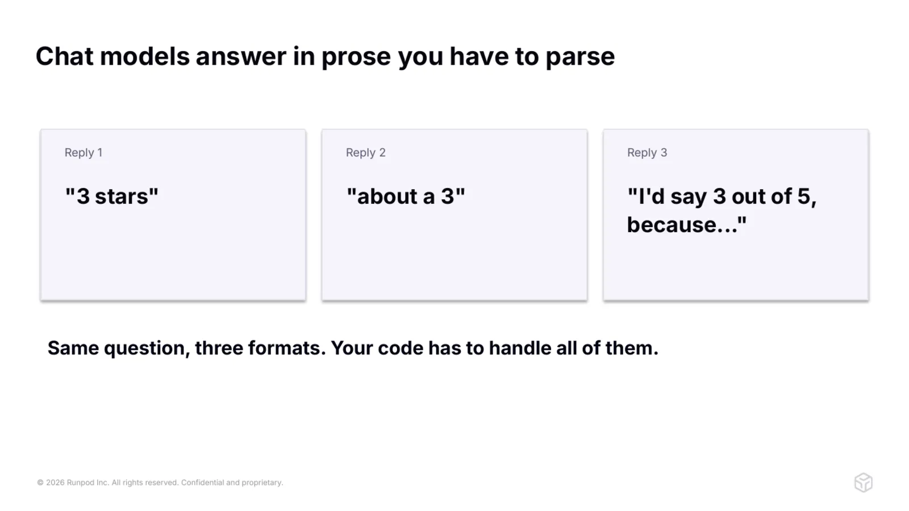

**Chat models answer in prose you have to parse**

- Reply 1: "3 stars"
- Reply 2: "about a 3"
- Reply 3: "I'd say 3 out of 5, because..."

**Same question, three formats. Your code has to handle all of them.**

## Slide 16: Decision models answer in the format you ask for

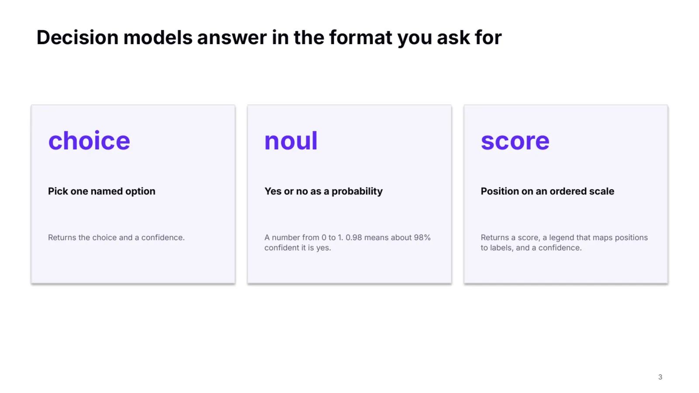

**Decision models answer in the format you ask for**

- `choice`: **Pick one named option.** Returns the choice and a confidence.
- `noul`: **Yes or no as a probability.** A number from 0 to 1. 0.98 means about 98% confident it is yes.
- `score`: **Position on an ordered scale.** Returns a score, a legend that maps positions to labels, and a confidence.

## Slide 17: What you need to know before you deploy


**What you need to know before you deploy**

_Section title card._

## Slide 18: Zero active workers, so you pay only while one runs

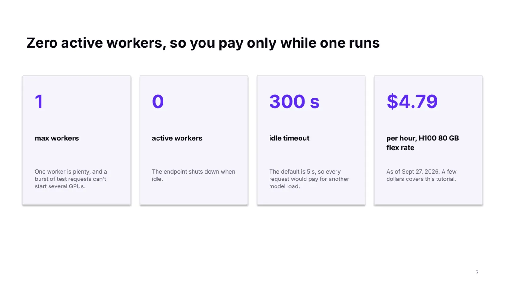

**Zero active workers, so you pay only while one runs**

- **1 max workers:** One worker is plenty, and a burst of test requests can't start several GPUs.
- **0 active workers:** The endpoint shuts down when idle.
- **300 s idle timeout:** The default is 5 s, so every request would pay for another model load.
- **$4.79 per hour, H100 80 GB flex rate:** As of Sept 27, 2026. A few dollars covers this tutorial.

## Slide 19: You pay from worker start, including model load

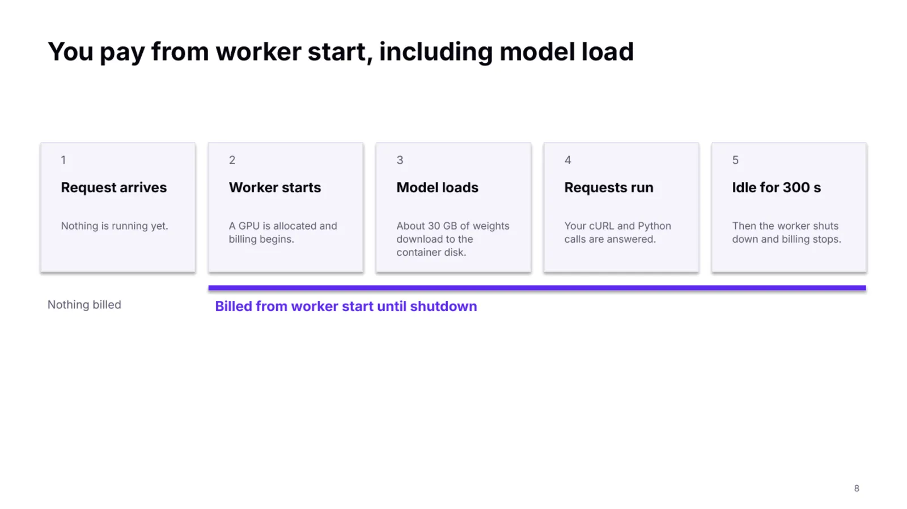

**You pay from worker start, including model load**

1.  **Request arrives:** Nothing is running yet.
2.  **Worker starts:** A GPU is allocated and billing begins.
3.  **Model loads:** About 30 GB of weights download to the container disk.
4.  **Requests run:** Your cURL and Python calls are answered.
5.  **Idle for 300 s:** Then the worker shuts down and billing stops.

_A timeline under the steps marks step 1 "Nothing billed" and steps 2 to 5 "Billed from worker start until shutdown"._

## Slide 20: Cold starts take minutes, so check readiness first

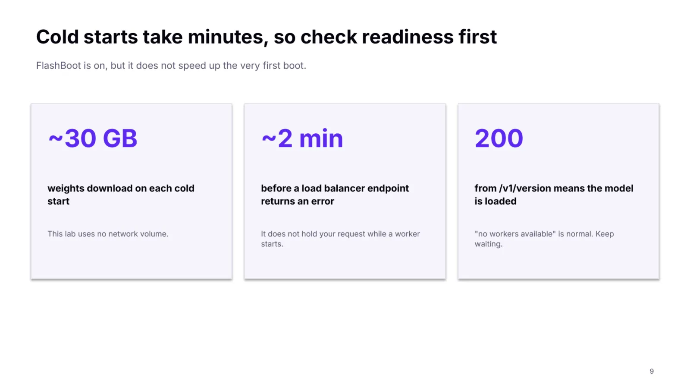

**Cold starts take minutes, so check readiness first**

FlashBoot is on, but it does not speed up the very first boot.

- **~30 GB weights download on each cold start:** This lab uses no network volume.
- **~2 min before a load balancer endpoint returns an error:** It does not hold your request while a worker starts.
- **200 from /v1/version means the model is loaded:** "no workers available" is normal. Keep waiting.

## Slide 21: Three mistakes cost real GPU time, each with a fix

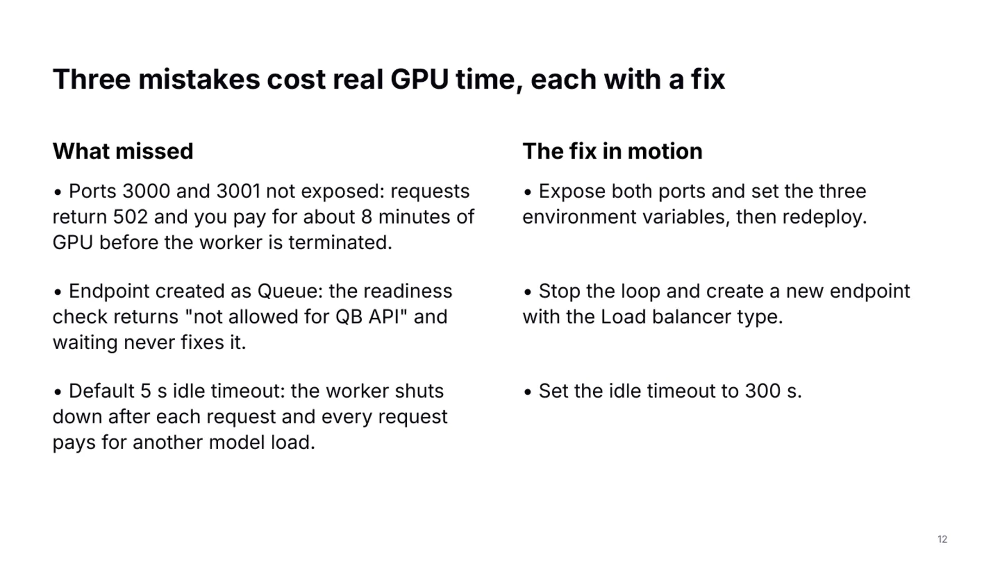

**Three mistakes cost real GPU time, each with a fix**

| What missed                                                                                                                  | The fix in motion                                                         |
| ---------------------------------------------------------------------------------------------------------------------------- | ------------------------------------------------------------------------- |
| Ports 3000 and 3001 not exposed: requests return 502 and you pay for about 8 minutes of GPU before the worker is terminated. | Expose both ports and set the three environment variables, then redeploy. |
| Endpoint created as Queue: the readiness check returns "not allowed for QB API" and waiting never fixes it.                  | Stop the loop and create a new endpoint with the Load balancer type.      |
| Default 5 s idle timeout: the worker shuts down after each request and every request pays for another model load.            | Set the idle timeout to 300 s.                                            |

## Slide 22: Load balancer for a sync API, queue for jobs

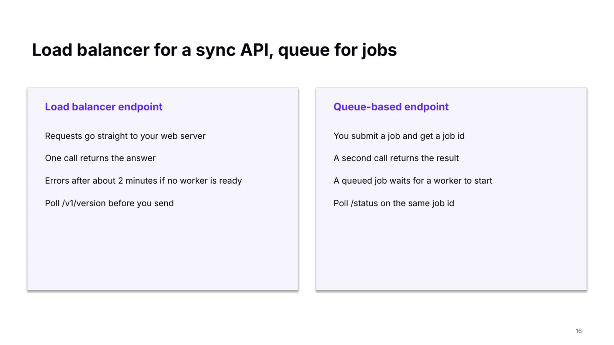

**Load balancer for a sync API, queue for jobs**

| Load balancer endpoint                             | Queue-based endpoint                     |
| -------------------------------------------------- | ---------------------------------------- |
| Requests go straight to your web server            | You submit a job and get a job id        |
| One call returns the answer                        | A second call returns the result         |
| Errors after about 2 minutes if no worker is ready | A queued job waits for a worker to start |
| Poll /v1/version before you send                   | Poll /status on the same job id          |

## Slide 23: Check the license and benchmark before you build

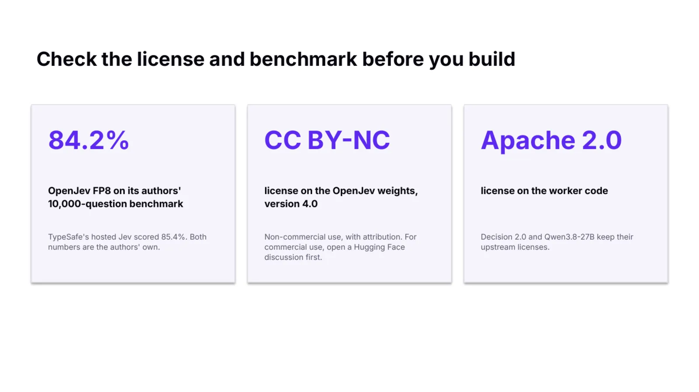

**Check the license and benchmark before you build**

- **84.2% OpenJev FP8 on its authors' 10,000-question benchmark:** TypeSafe's hosted Jev scored 85.4%. Both numbers are the authors' own.
- **CC BY-NC license on the OpenJev weights, version 4.0:** Non-commercial use, with attribution. For commercial use, open a Hugging Face discussion first.
- **Apache 2.0 license on the worker code:** Decision 2.0 and Qwen3.8-27B keep their upstream licenses.

## Slide 24: Deploying

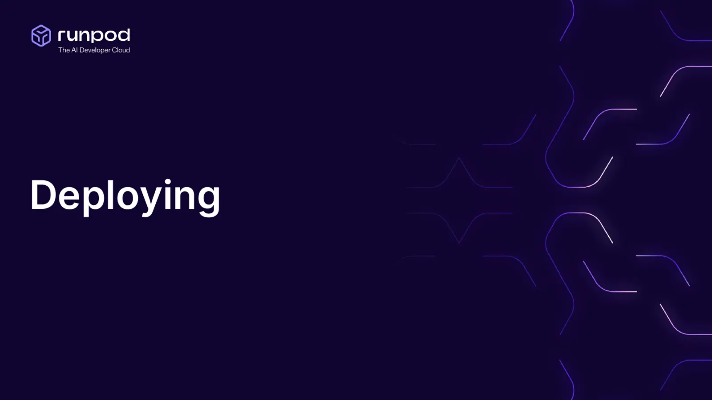

**Deploying**

_Section title card._

## Slide 25: Five settings decide whether the OpenJev deploy works

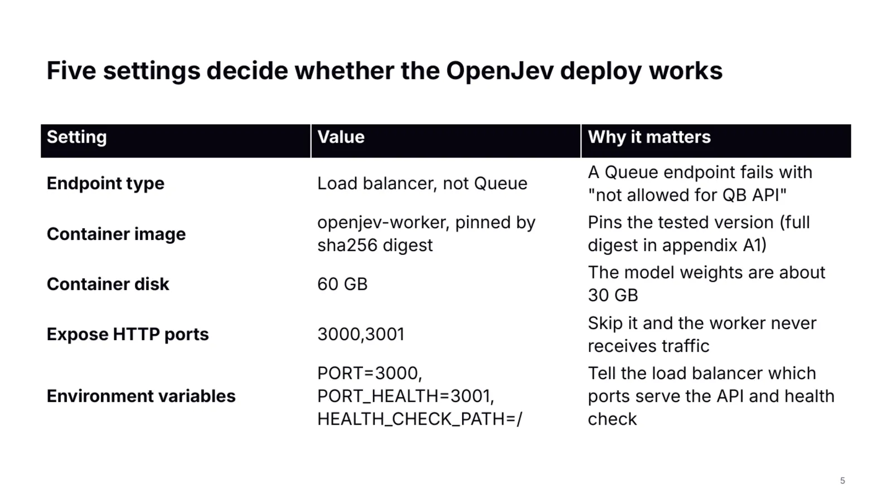

**Five settings decide whether the OpenJev deploy works**

| Setting                   | Value                                            | Why it matters                                                    |
| ------------------------- | ------------------------------------------------ | ----------------------------------------------------------------- |
| **Endpoint type**         | Load balancer, not Queue                         | A Queue endpoint fails with "not allowed for QB API"              |
| **Container image**       | openjev-worker, pinned by sha256 digest          | Pins the tested version (full digest in appendix A1)              |
| **Container disk**        | 60 GB                                            | The model weights are about 30 GB                                 |
| **Expose HTTP ports**     | 3000,3001                                        | Skip it and the worker never receives traffic                     |
| **Environment variables** | PORT=3000, PORT_HEALTH=3001, HEALTH_CHECK_PATH=/ | Tell the load balancer which ports serve the API and health check |

## Slide 26: The H100 80 GB is the setup OpenJev measured

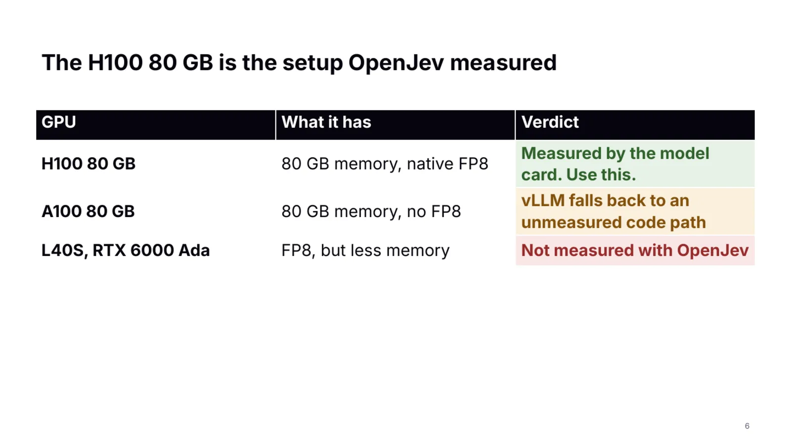

**The H100 80 GB is the setup OpenJev measured**

| GPU                    | What it has              | Verdict                                        |
| ---------------------- | ------------------------ | ---------------------------------------------- |
| **H100 80 GB**         | 80 GB memory, native FP8 | **Measured by the model card. Use this.**      |
| **A100 80 GB**         | 80 GB memory, no FP8     | **vLLM falls back to an unmeasured code path** |
| **L40S, RTX 6000 Ada** | FP8, but less memory     | **Not measured with OpenJev**                  |

_The verdicts are shaded green, amber and red._

## Slide 27: The console or the MCP server


**You can do this in the console or with our MCP Server**

## Slide 28: Two ways to connect, and one keeps your API key off disk

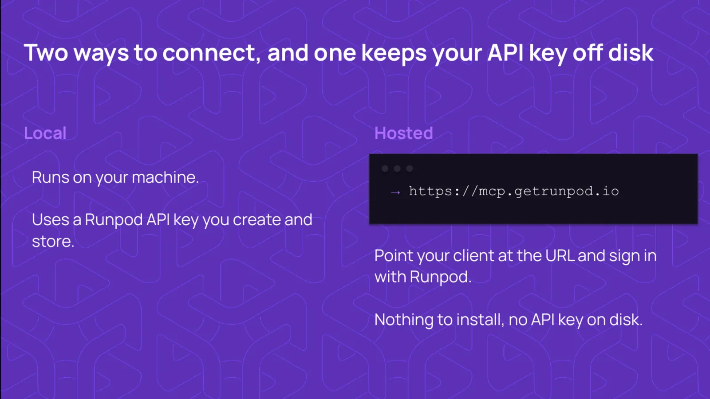

**Two ways to connect, and one keeps your API key off disk**

**Local**

Runs on your machine.

Uses a Runpod API key you create and store.

**Hosted**

Code box: `→ https://mcp.getrunpod.io`

Point your client at the URL and sign in with Runpod.

Nothing to install, no API key on disk.

## Slide 29: How do you authenticate?

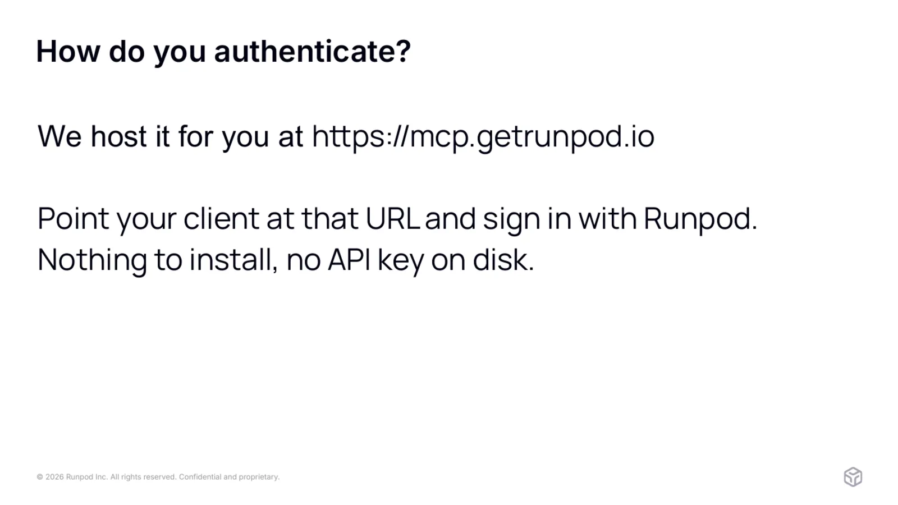

**How do you authenticate?**

We host it for you at [mcp.getrunpod.io](https://mcp.getrunpod.io/)

Point your client at that URL and sign in with Runpod. Nothing to install, no API key on disk.

## Slide 30: Adding the Runpod MCP server

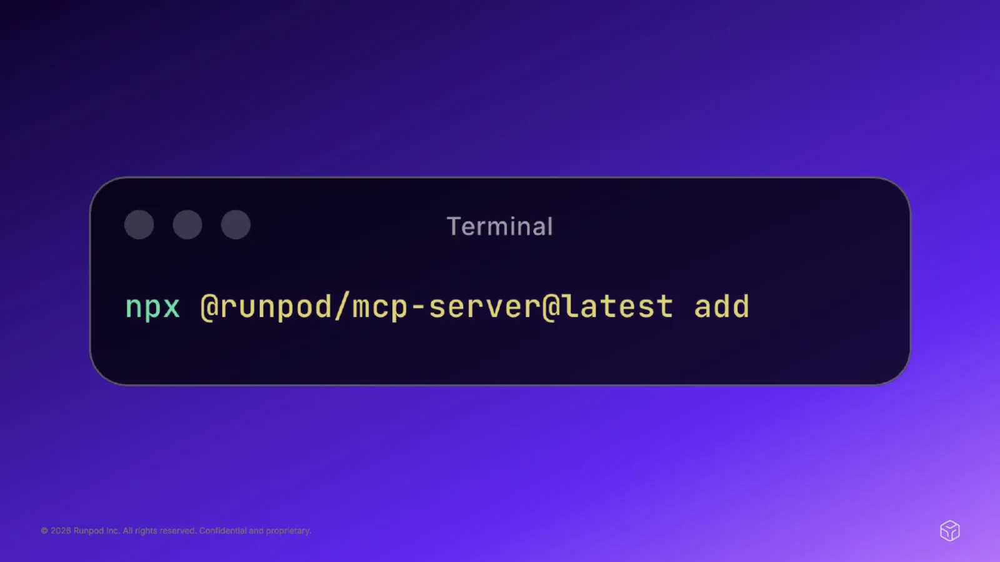

_A terminal window:_

```shell
npx @runpod/mcp-server@latest add
```

## Slide 31: A deploy prompt for OpenJev

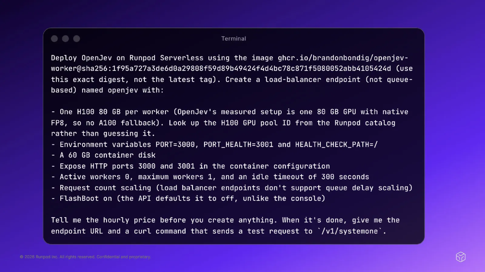

_A terminal window with a prompt for an AI coding assistant:_

```text
Deploy OpenJev on Runpod Serverless using the image ghcr.io/brandonbondig/openjev-worker@sha256:1f95a727a3de6d0a29808f59d89b49424f4d4bc78c871f5080052abb4105424d (use this exact digest, not the latest tag). Create a load-balancer endpoint (not queue-based) named openjev with:

- One H100 80 GB per worker (OpenJev's measured setup is one 80 GB GPU with native FP8, so no A100 fallback). Look up the H100 GPU pool ID from the Runpod catalog rather than guessing it.
- Environment variables PORT=3000, PORT_HEALTH=3001 and HEALTH_CHECK_PATH=/
- A 60 GB container disk
- Expose HTTP ports 3000 and 3001 in the container configuration
- Active workers 0, maximum workers 1, and an idle timeout of 300 seconds
- Request count scaling (load balancer endpoints don't support queue delay scaling)
- FlashBoot on (the API defaults it to off, unlike the console)

Tell me the hourly price before you create anything. When it's done, give me the endpoint URL and a curl command that sends a test request to `/v1/systemone`.
```

## Slide 32: Making requests

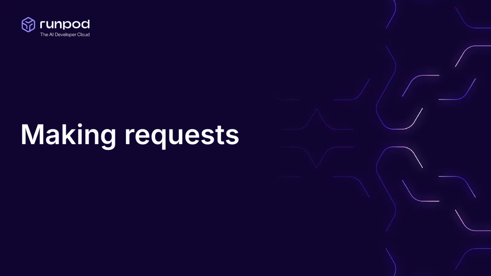

**Making requests**

_Section title card._

## Slide 33: Setting up environment variables

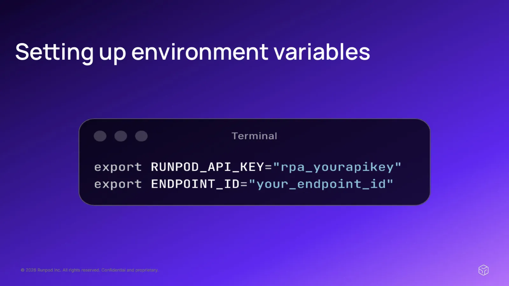

**Setting up environment variables**

```shell
export RUNPOD_API_KEY="rpa_yourapikey"
export ENDPOINT_ID="your_endpoint_id"
```

## Slide 34: Checking readiness

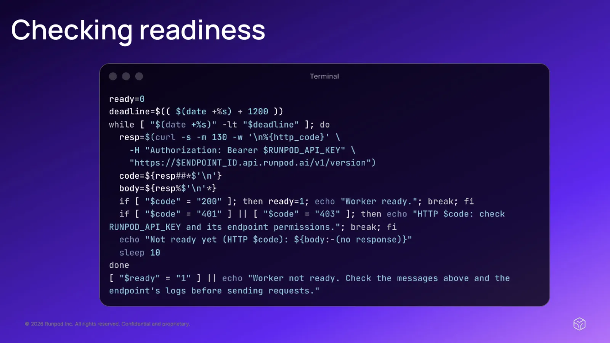

**Checking readiness**

```shell
ready=0
deadline=$(( $(date +%s) + 1200 ))
while [ "$(date +%s)" -lt "$deadline" ]; do
  resp=$(curl -s -m 130 -w '\n%{http_code}' \
    -H "Authorization: Bearer $RUNPOD_API_KEY" \
    "https://$ENDPOINT_ID.api.runpod.ai/v1/version")
  code=${resp##*$'\n'}
  body=${resp%$'\n'*}
  if [ "$code" = "200" ]; then ready=1; echo "Worker ready."; break; fi
  if [ "$code" = "401" ] || [ "$code" = "403" ]; then echo "HTTP $code: check RUNPOD_API_KEY and its endpoint permissions."; break; fi
  echo "Not ready yet (HTTP $code): ${body:-(no response)}"
  sleep 10
done
[ "$ready" = "1" ] || echo "Worker not ready. Check the messages above and the endpoint's logs before sending requests."
```

## Slide 35: Making a cURL request

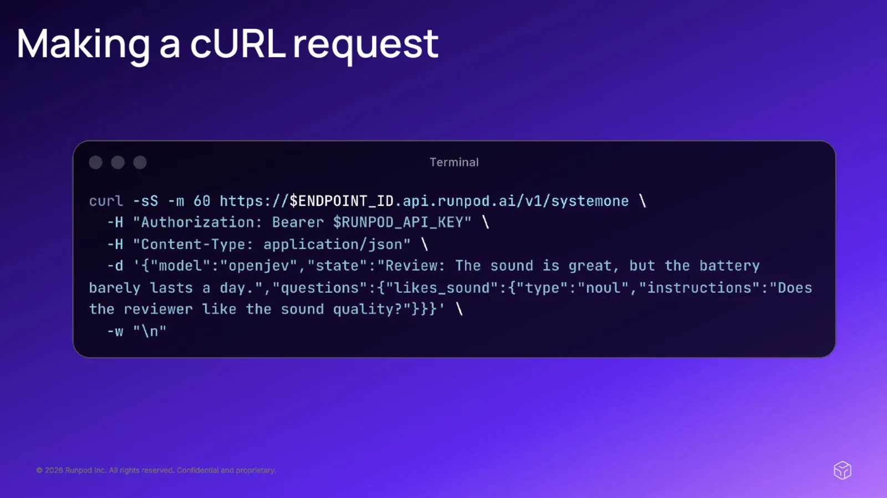

**Making a cURL request**

```shell
curl -sS -m 60 https://$ENDPOINT_ID.api.runpod.ai/v1/systemone \
  -H "Authorization: Bearer $RUNPOD_API_KEY" \
  -H "Content-Type: application/json" \
  -d '{"model":"openjev","state":"Review: The sound is great, but the battery barely lasts a day.","questions":{"likes_sound":{"type":"noul","instructions":"Does the reviewer like the sound quality?"}}}' \
  -w "\n"
```

## Slide 36: Response to the cURL request

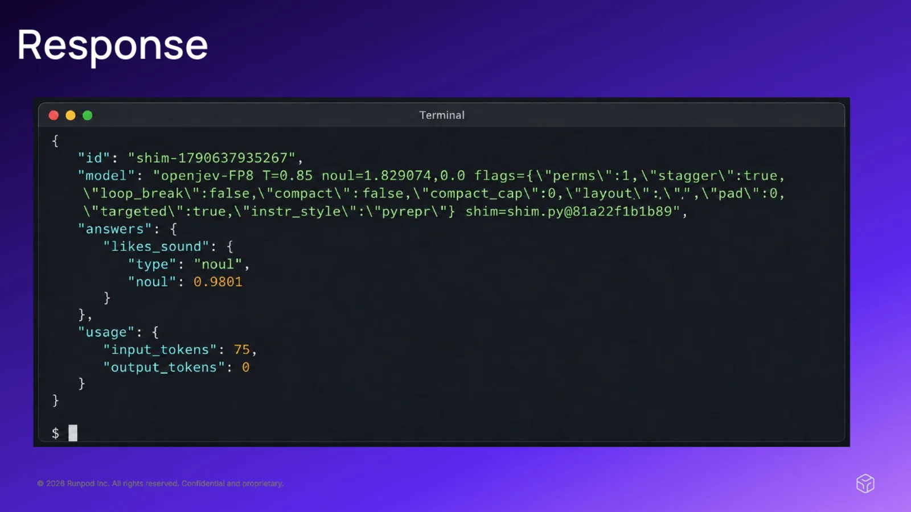

**Response**

_A terminal window showing the JSON reply, followed by a shell prompt:_

```text
{
   "id": "shim-1790637935267",
   "model": "openjev-FP8 T=0.85 noul=1.829074,0.0 flags={\"perms\":1,\"stagger\":true,\"loop_break\":false,\"compact\":false,\"compact_cap\":0,\"layout\":\"",\"pad\":0,\"targeted\":true,\"instr_style\":\"pyrepr\"} shim=shim.py@81a22f1b1b89",
   "answers": {
      "likes_sound": {
         "type": "noul",
         "noul": 0.9801
      }
   },
   "usage": {
      "input_tokens": 75,
      "output_tokens": 0
   }
}
```

The screenshot is blurred around the `layout` value, which reads `\""` there. That is one backslash short of an empty string (`\"\"`), so the reply isn't valid JSON as printed.

## Slide 37: Let's take a look at the Python code

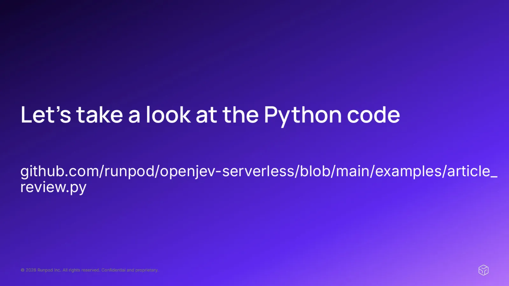

**Let's take a look at the Python code**

[github.com/runpod/openjev-serverless/blob/main/examples/article_review.py][article-review]

[article-review]: https://github.com/runpod/openjev-serverless/blob/main/examples/article_review.py

## Slide 38: Running the Python example

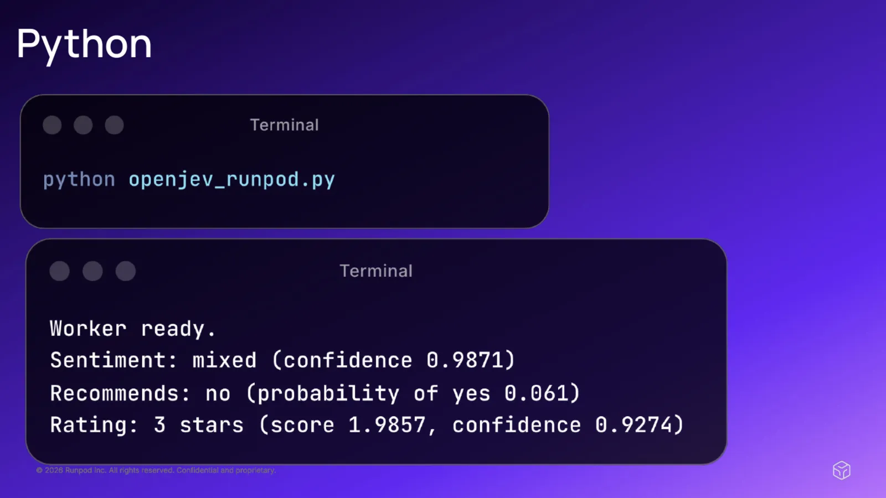

**Python**

_Two terminal windows: the command, then its output._

```shell
python openjev_runpod.py
```

```text
Worker ready.
Sentiment: mixed (confidence 0.9871)
Recommends: no (probability of yes 0.061)
Rating: 3 stars (score 1.9857, confidence 0.9274)
```

## Slide 39: Next steps


**Next steps**

_Section title card._

## Slide 40: Join the Runpod Discord


**If anything comes up along the way or you want to connect with others building with Runpod, join our Discord**

[discord.com/invite/runpod](https://discord.com/invite/runpod)

## Slide 41: Closing card

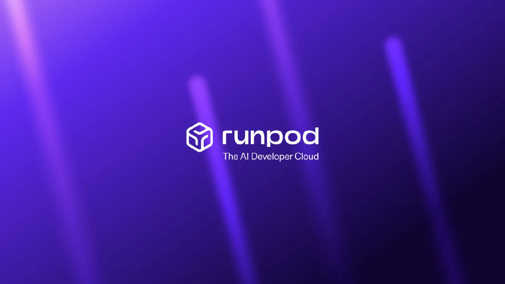

_Closing card with the Runpod logo and its tagline, "The AI Developer Cloud"._
