# Workshop 4 slides

Every slide of "AIoT: The Convergence of IoT and Artificial Intelligence", the talk Gopinath Rao Sinniah, PhD, Co-Founder and CTO of Favoriot Sdn Bhd, gave at SDC Hackathon 2026 Workshop 4 on Zoom on 22 October 2026, and every screen of his Favoriot platform demo, each with its image and its text. The [transcript](transcript.md) covers what was said.

The deck isn't in the workshop's [Drive folder](https://drive.google.com/drive/folders/1dBqZ-N1D3NLwBo_PExX6kpp05lwRPmoc), so the slides were captured from the organisers' recording, "Workshop Recording.mp4", in that folder. The recording starts mid-sentence on the title slide, so anything shown before it is missing. Slides 01 to 39 are the deck in the order shown; several build in steps, and each image shows the furthest step reached on screen. Slide 30 was on screen for about 6 seconds and slide 39 for about 2 seconds as the slideshow closed. A strip of participant videos covers the right edge of the shared screen, so the images are cropped to the visible area and [covered] marks text cut off by the strip. Gopinath's red laser pointer shows on many slides but hides no text. His email address and phone number on slide 39 are blacked out and left out.

Slides 40 to 66 are the screens of his demo of the Favoriot platform in a browser, from 00:55:05 to 01:06:52 in the recording, in the order he first opened them; pages he came back to appear once. The read-write and read-only API keys on slide 43 and the device access token on slide 45 are blacked out and left out. The Zoom gallery shown for the group photo after the demo is left out.

Contents:

1.  [Slide 01: AIoT: the convergence of IoT and artificial intelligence](#slide-01-aiot-the-convergence-of-iot-and-artificial-intelligence)
1.  [Slide 02: Topics](#slide-02-topics)
1.  [Slide 03: Introduction to IoT and AI](#slide-03-introduction-to-iot-and-ai)
1.  [Slide 04: Core 4IR technologies](#slide-04-core-4ir-technologies)
1.  [Slide 05: Early development and milestones in IoT technology](#slide-05-early-development-and-milestones-in-iot-technology)
1.  [Slide 06: IoT computing types](#slide-06-iot-computing-types)
1.  [Slide 07: Edge computing: powering IoT at the edge](#slide-07-edge-computing-powering-iot-at-the-edge)
1.  [Slide 08: Sensor networks: the backbone of IoT data collection](#slide-08-sensor-networks-the-backbone-of-iot-data-collection)
1.  [Slide 09: Data analytics: unlocking the power of IoT data](#slide-09-data-analytics-unlocking-the-power-of-iot-data)
1.  [Slide 10: First impression of AI](#slide-10-first-impression-of-ai)
1.  [Slide 11: Three definitions of AI](#slide-11-three-definitions-of-ai)
1.  [Slide 12: AI types](#slide-12-ai-types)
1.  [Slide 13: Business AI related subfields](#slide-13-business-ai-related-subfields)
1.  [Slide 14: The synergy between AI and IoT](#slide-14-the-synergy-between-ai-and-iot)
1.  [Slide 15: IoT, big data and AI](#slide-15-iot-big-data-and-ai)
1.  [Slide 16: Convergence of AI and IoT: unlocking new possibilities](#slide-16-convergence-of-ai-and-iot-unlocking-new-possibilities)
1.  [Slide 17: When nervous system meets cognitive brain](#slide-17-when-nervous-system-meets-cognitive-brain)
1.  [Slide 18: Traditional IoT vs. intelligent AIoT](#slide-18-traditional-iot-vs-intelligent-aiot)
1.  [Slide 19: Where does intelligence live?](#slide-19-where-does-intelligence-live)
1.  [Slide 20: AI techniques mapped to IoT data](#slide-20-ai-techniques-mapped-to-iot-data)
1.  [Slide 21: Six trends to watch](#slide-21-six-trends-to-watch)
1.  [Slide 22: Use cases](#slide-22-use-cases)
1.  [Slide 23: Smart homes: AIoT redefining living spaces](#slide-23-smart-homes-aiot-redefining-living-spaces)
1.  [Slide 24: AIoT application in smart energy management](#slide-24-aiot-application-in-smart-energy-management)
1.  [Slide 25: AIoT revolutionises healthcare](#slide-25-aiot-revolutionises-healthcare)
1.  [Slide 26: Research frontiers and challenges, section title](#slide-26-research-frontiers-and-challenges-section-title)
1.  [Slide 27: Research frontiers and challenges in AIoT](#slide-27-research-frontiers-and-challenges-in-aiot)
1.  [Slide 28: AIoT security: safeguarding the connected world](#slide-28-aiot-security-safeguarding-the-connected-world)
1.  [Slide 29: TinyML: AI at the very edge](#slide-29-tinyml-ai-at-the-very-edge)
1.  [Slide 30: Federated learning: collaborative AI for IoT](#slide-30-federated-learning-collaborative-ai-for-iot)
1.  [Slide 31: AIoT for sustainability](#slide-31-aiot-for-sustainability)
1.  [Slide 32: Favoriot AIoT platform](#slide-32-favoriot-aiot-platform)
1.  [Slide 33: About Favoriot](#slide-33-about-favoriot)
1.  [Slide 34: Make the invisible visible](#slide-34-make-the-invisible-visible)
1.  [Slide 35: Operational visibility platform architecture](#slide-35-operational-visibility-platform-architecture)
1.  [Slide 36: Connect, learn, detect](#slide-36-connect-learn-detect)
1.  [Slide 37: Example dashboards](#slide-37-example-dashboards)
1.  [Slide 38: Favoriot platform live demo](#slide-38-favoriot-platform-live-demo)
1.  [Slide 39: Thank you](#slide-39-thank-you)
1.  [Slide 40: Favoriot demo: edge gateways](#slide-40-favoriot-demo-edge-gateways)
1.  [Slide 41: Favoriot demo: pricing](#slide-41-favoriot-demo-pricing)
1.  [Slide 42: Favoriot demo: overview](#slide-42-favoriot-demo-overview)
1.  [Slide 43: Favoriot demo: API keys](#slide-43-favoriot-demo-api-keys)
1.  [Slide 44: Favoriot demo: devices](#slide-44-favoriot-demo-devices)
1.  [Slide 45: Favoriot demo: device information](#slide-45-favoriot-demo-device-information)
1.  [Slide 46: Favoriot demo: data streams](#slide-46-favoriot-demo-data-streams)
1.  [Slide 47: Favoriot demo: dashboards](#slide-47-favoriot-demo-dashboards)
1.  [Slide 48: Favoriot demo: city-wide air quality dashboard](#slide-48-favoriot-demo-city-wide-air-quality-dashboard)
1.  [Slide 49: Favoriot demo: Sherlock Holmes Meeting Room dashboard](#slide-49-favoriot-demo-sherlock-holmes-meeting-room-dashboard)
1.  [Slide 50: Favoriot demo: smart office alarms](#slide-50-favoriot-demo-smart-office-alarms)
1.  [Slide 51: Favoriot demo: Smart Office dashboard](#slide-51-favoriot-demo-smart-office-dashboard)
1.  [Slide 52: Favoriot demo: edge gateway configurations](#slide-52-favoriot-demo-edge-gateway-configurations)
1.  [Slide 53: Favoriot demo: edge gateway configuration](#slide-53-favoriot-demo-edge-gateway-configuration)
1.  [Slide 54: Favoriot demo: rules](#slide-54-favoriot-demo-rules)
1.  [Slide 55: Favoriot demo: GatewayRule rule chain](#slide-55-favoriot-demo-gatewayrule-rule-chain)
1.  [Slide 56: Favoriot demo: Decode Value script](#slide-56-favoriot-demo-decode-value-script)
1.  [Slide 57: Favoriot demo: decoded DemoSensor data](#slide-57-favoriot-demo-decoded-demosensor-data)
1.  [Slide 58: Favoriot demo: analytics](#slide-58-favoriot-demo-analytics)
1.  [Slide 59: Favoriot demo: city-wide AQI analysis](#slide-59-favoriot-demo-city-wide-aqi-analysis)
1.  [Slide 60: Favoriot demo: AQI analysis charts](#slide-60-favoriot-demo-aqi-analysis-charts)
1.  [Slide 61: Favoriot demo: AQI analysis report](#slide-61-favoriot-demo-aqi-analysis-report)
1.  [Slide 62: Favoriot demo: city-wide weather analysis](#slide-62-favoriot-demo-city-wide-weather-analysis)
1.  [Slide 63: Favoriot demo: weather analysis report](#slide-63-favoriot-demo-weather-analysis-report)
1.  [Slide 64: Favoriot demo: machine learning](#slide-64-favoriot-demo-machine-learning)
1.  [Slide 65: Favoriot demo: Faybee AI](#slide-65-favoriot-demo-faybee-ai)
1.  [Slide 66: Favoriot demo: resources](#slide-66-favoriot-demo-resources)

## Slide 01: AIoT: the convergence of IoT and artificial intelligence

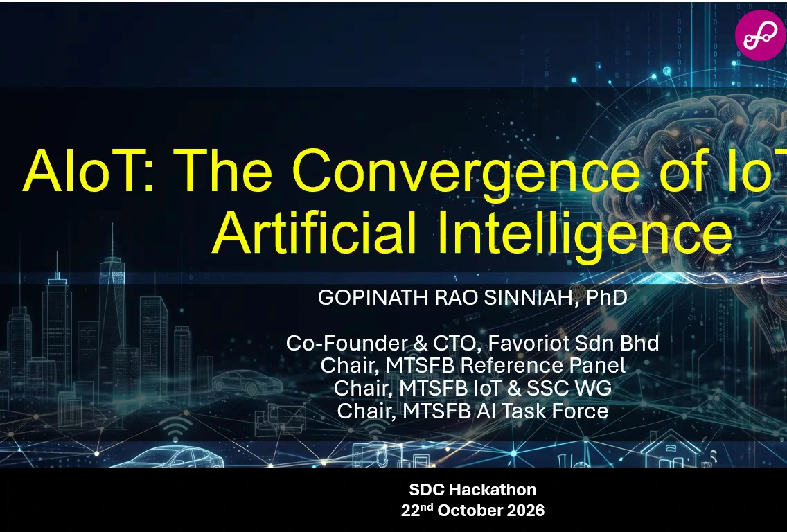

**AIoT: The Convergence of Io[covered] Artificial Intelligence**

GOPINATH RAO SINNIAH, PhD

Co-Founder & CTO, Favoriot Sdn Bhd\
Chair, MTSFB Reference Panel\
Chair, MTSFB IoT & SSC WG\
Chair, MTSFB AI Task Force

SDC Hackathon\
22nd October 2026

_Title card with the Favoriot logo, over a city skyline, a glowing brain and network lines._

## Slide 02: Topics

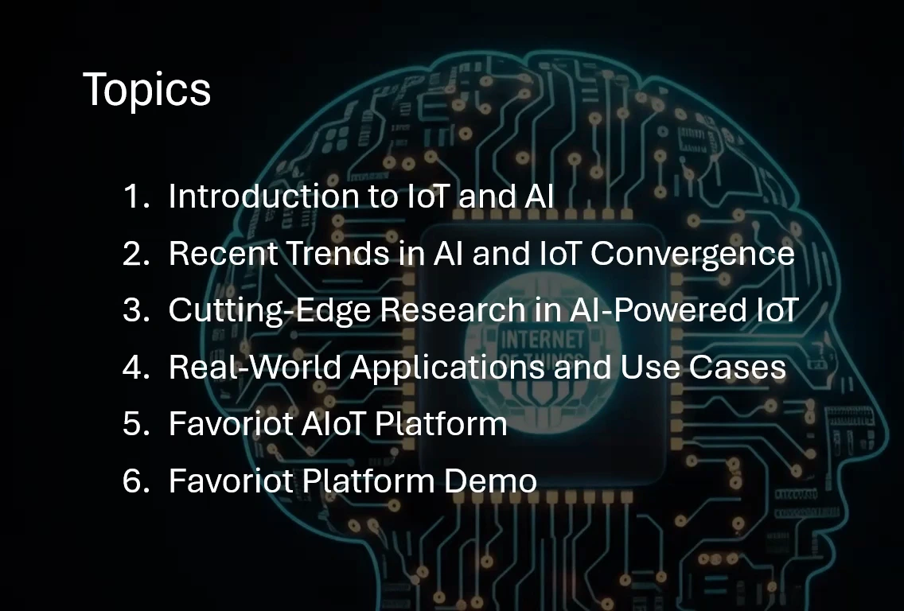

**Topics**

1.  Introduction to IoT and AI
2.  Recent Trends in AI and IoT Convergence
3.  Cutting-Edge Research in AI-Powered IoT
4.  Real-World Applications and Use Cases
5.  Favoriot AIoT Platform
6.  Favoriot Platform Demo

## Slide 03: Introduction to IoT and AI

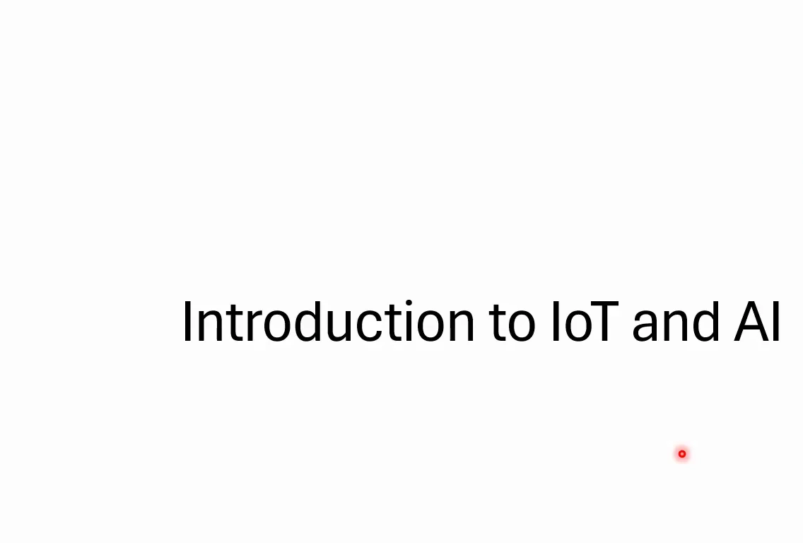

**Introduction to IoT and AI**

_Section title card._

## Slide 04: Core 4IR technologies

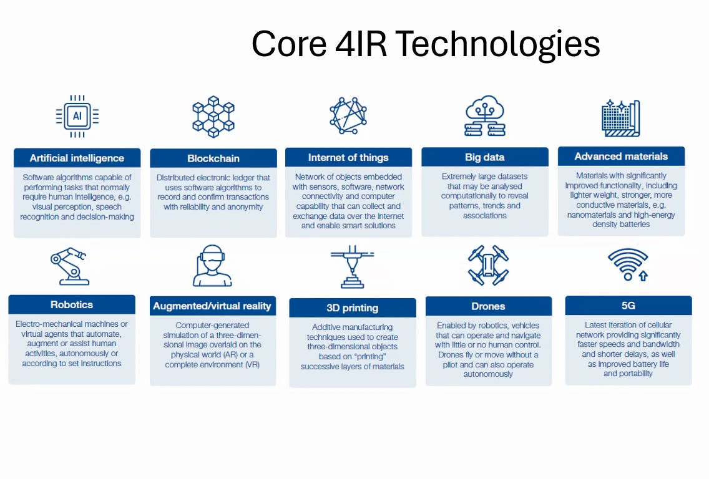

**Core 4IR Technologies**

- **Artificial intelligence**: Software algorithms capable of performing tasks that normally require human intelligence, e.g. visual perception, speech recognition and decision-making
- **Blockchain**: Distributed electronic ledger that uses software algorithms to record and confirm transactions with reliability and anonymity
- **Internet of things**: Network of objects embedded with sensors, software, network connectivity and computer capability that can collect and exchange data over the Internet and enable smart solutions
- **Big data**: Extremely large datasets that may be analysed computationally to reveal patterns, trends and associations
- **Advanced materials**: Materials with significantly improved functionality, including lighter weight, stronger, more conductive materials, e.g. nanomaterials and high-energy density batteries
- **Robotics**: Electro-mechanical machines or virtual agents that automate, augment or assist human activities, autonomously or according to set instructions
- **Augmented/virtual reality**: Computer-generated simulation of a three-dimensional image overlaid on the physical world (AR) or a complete environment (VR)
- **3D printing**: Additive manufacturing techniques used to create three-dimensional objects based on "printing" successive layers of materials
- **Drones**: Enabled by robotics, vehicles that can operate and navigate with little or no human control. Drones fly or move without a pilot and can also operate autonomously
- **5G**: Latest iteration of cellular network providing significantly faster speeds and bandwidth and shorter delays, as well as improved battery life and portability

_Ten tiles, each with an icon above its name._

## Slide 05: Early development and milestones in IoT technology

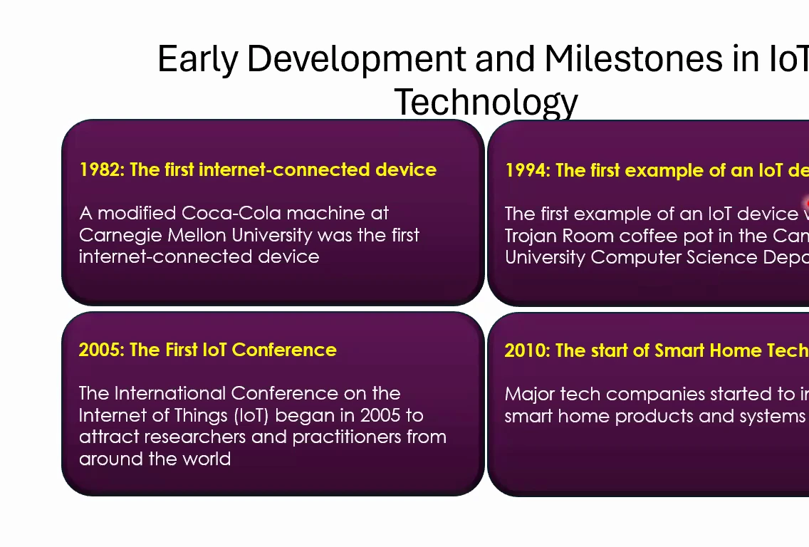

**Early Development and Milestones in Io[covered] Technology**

- **1982: The first internet-connected device**: A modified Coca-Cola machine at Carnegie Mellon University was the first internet-connected device
- **1994: The first example of an IoT de[covered]**: The first example of an IoT device w[covered] Trojan Room coffee pot in the Cam[covered] University Computer Science Depa[covered]
- **2005: The First IoT Conference**: The International Conference on the Internet of Things (IoT) began in 2005 to attract researchers and practitioners from around the world
- **2010: The start of Smart Home Tech[covered]**: Major tech companies started to i[covered] smart home products and systems [covered]

## Slide 06: IoT computing types

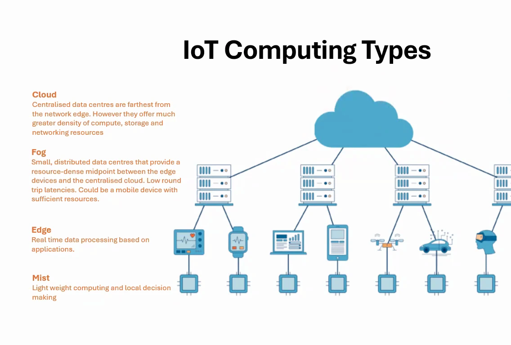

**IoT Computing Types**

- **Cloud**: Centralised data centres are farthest from the network edge. However they offer much greater density of compute, storage and networking resources
- **Fog**: Small, distributed data centres that provide a resource-dense midpoint between the edge devices and the centralised cloud. Low round trip latencies. Could be a mobile device with sufficient resources.
- **Edge**: Real time data processing based on applications.
- **Mist**: Light weight computing and local decision making

_Diagram: a cloud links down to a row of server racks (fog), each linked to devices such as a health monitor, a smartwatch, a laptop, a tablet, a drone, a car and a VR headset (edge), each above a microchip (mist); the rightmost branch is cut off by the strip._

## Slide 07: Edge computing: powering IoT at the edge

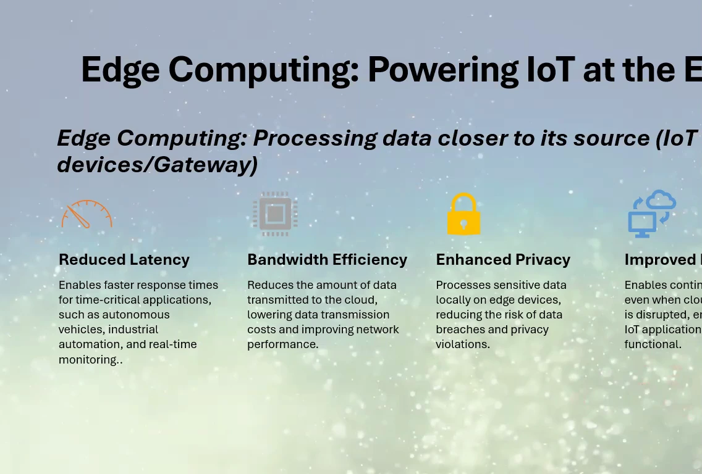

**Edge Computing: Powering IoT at the E[covered]**

Edge Computing: Processing data closer to its source (IoT devices/Gateway)

- **Reduced Latency**: Enables faster response times for time-critical applications, such as autonomous vehicles, industrial automation, and real-time monitoring..
- **Bandwidth Efficiency**: Reduces the amount of data transmitted to the cloud, lowering data transmission costs and improving network performance.
- **Enhanced Privacy**: Processes sensitive data locally on edge devices, reducing the risk of data breaches and privacy violations.
- **Improved [covered]**: Enables contin[covered] even when clou[covered] is disrupted, en[covered] IoT application[covered] functional.

## Slide 08: Sensor networks: the backbone of IoT data collection

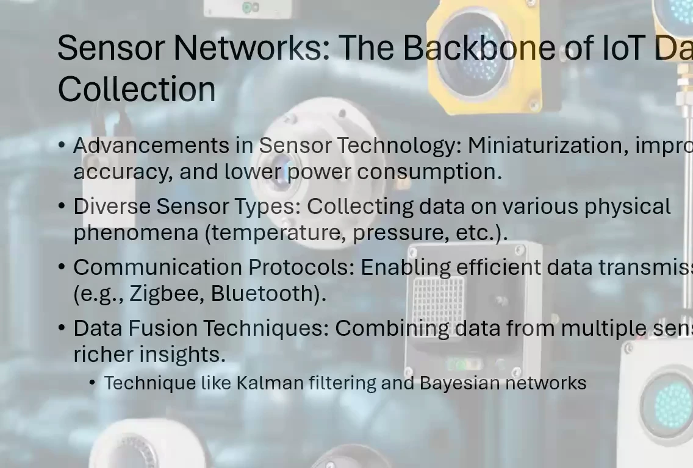

**Sensor Networks: The Backbone of IoT Da[covered] Collection**

- Advancements in Sensor Technology: Miniaturization, impro[covered] accuracy, and lower power consumption.
- Diverse Sensor Types: Collecting data on various physical phenomena (temperature, pressure, etc.).
- Communication Protocols: Enabling efficient data transmis[covered] (e.g., Zigbee, Bluetooth).
- Data Fusion Techniques: Combining data from multiple sens[covered] richer insights.
  - Technique like Kalman filtering and Bayesian networks

_Background photo of industrial sensors._

## Slide 09: Data analytics: unlocking the power of IoT data

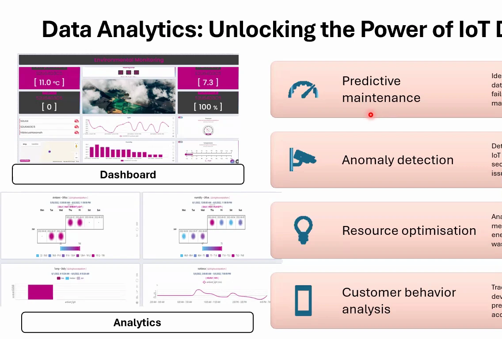

**Data Analytics: Unlocking the Power of IoT D[covered]**

- Predictive maintenance: [covered]
- Anomaly detection: [covered]
- Resource optimisation: [covered]
- Customer behavior analysis: [covered]

_Screenshots of a Favoriot "Environmental Monitoring" dashboard, labelled "Dashboard", and of analytics charts, labelled "Analytics", beside the four uses, each with an icon and a description the strip cuts off after its first letters._

## Slide 10: First impression of AI

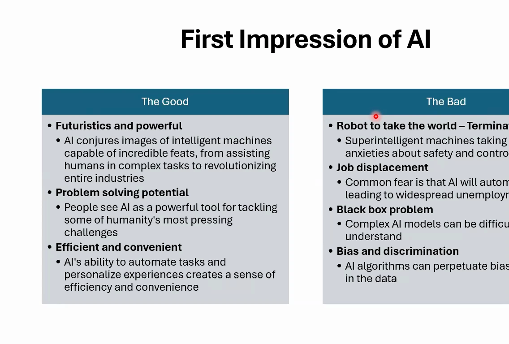

**First Impression of AI**

**The Good**

- **Futuristics and powerful**
  - AI conjures images of intelligent machines capable of incredible feats, from assisting humans in complex tasks to revolutionizing entire industries
- **Problem solving potential**
  - People see AI as a powerful tool for tackling some of humanity's most pressing challenges
- **Efficient and convenient**
  - AI's ability to automate tasks and personalize experiences creates a sense of efficiency and convenience

**The Bad**

- **Robot to take the world – Terminat[covered]**
  - Superintelligent machines taking [covered] anxieties about safety and contro[covered]
- **Job displacement**
  - Common fear is that AI will autom[covered] leading to widespread unemploy[covered]
- **Black box problem**
  - Complex AI models can be difficu[covered] understand
- **Bias and discrimination**
  - AI algorithms can perpetuate bias[covered] in the data

## Slide 11: Three definitions of AI

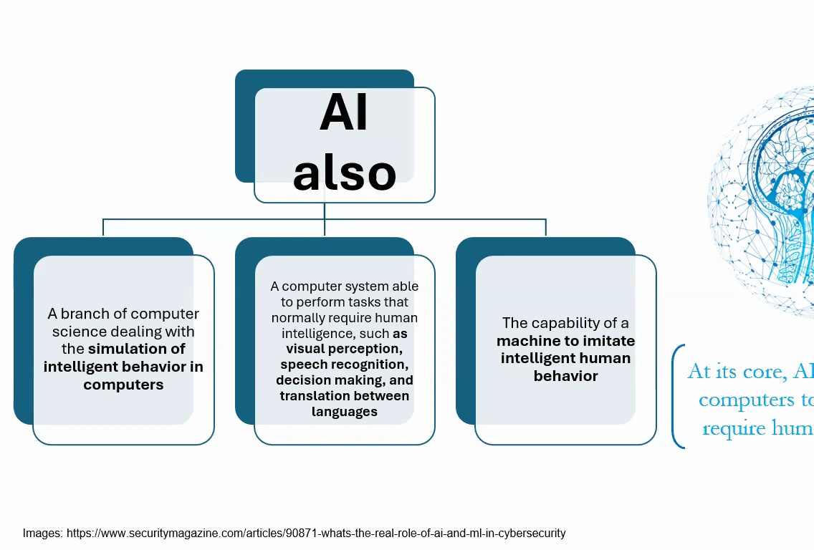

**AI also**

- A branch of computer science dealing with the **simulation of intelligent behavior in computers**
- A computer system able to perform tasks that normally require human intelligence, such **as visual perception, speech recognition, decision making, and translation between languages**
- The capability of a **machine to imitate intelligent human behavior**

At its core, AI[covered] computers to[covered] require hum[covered]

Images: [https://www.securitymagazine.com/articles/90871-whats-the-real-role-of-ai-and-ml-in-cybersecurity](https://www.securitymagazine.com/articles/90871-whats-the-real-role-of-ai-and-ml-in-cybersecurity)

_Diagram: an "AI also" box branches into the three definitions; a globe of brain-like network lines sits on the right._

## Slide 12: AI types

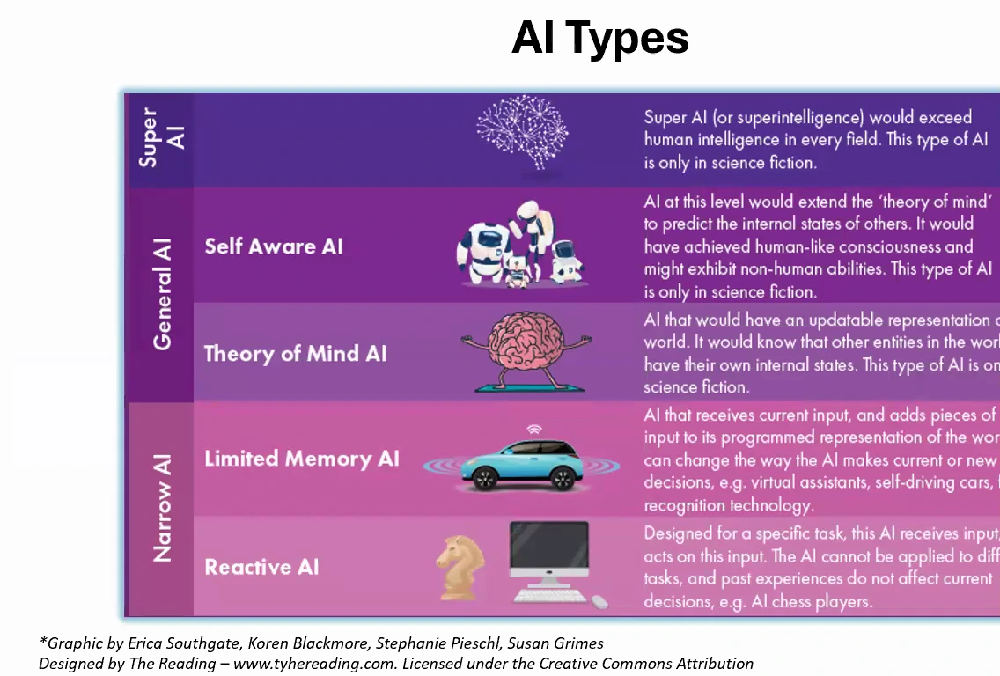

**AI Types**

| Group      | Type              | Description                                                                                                                                                                                                                                                               |
| ---------- | ----------------- | ------------------------------------------------------------------------------------------------------------------------------------------------------------------------------------------------------------------------------------------------------------------------- |
| Super AI   |                   | Super AI (or superintelligence) would exceed human intelligence in every field. This type of AI is only in science fiction.                                                                                                                                               |
| General AI | Self Aware AI     | AI at this level would extend the 'theory of mind' to predict the internal states of others. It would have achieved human-like consciousness and might exhibit non-human abilities. This type of AI is only in science fiction.                                           |
| General AI | Theory of Mind AI | AI that would have an updatable representation [covered] world. It would know that other entities in the wor[covered] have their own internal states. This type of AI is on[covered] science fiction.                                                                     |
| Narrow AI  | Limited Memory AI | AI that receives current input, and adds pieces of [covered] input to its programmed representation of the wor[covered] can change the way the AI makes current or new [covered] decisions, e.g. virtual assistants, self-driving cars, [covered] recognition technology. |
| Narrow AI  | Reactive AI       | Designed for a specific task, this AI receives input[covered] acts on this input. The AI cannot be applied to diff[covered] tasks, and past experiences do not affect current decisions, e.g. AI chess players.                                                           |

\*Graphic by Erica Southgate, Koren Blackmore, Stephanie Pieschl, Susan Grimes\
Designed by The Reading – www.tyhereading.com. Licensed under the Creative Commons Attribution

_A stacked chart with an illustration for each type: a brain of network lines, robots, a meditating brain, a car and a chess knight beside a computer._

## Slide 13: Business AI related subfields

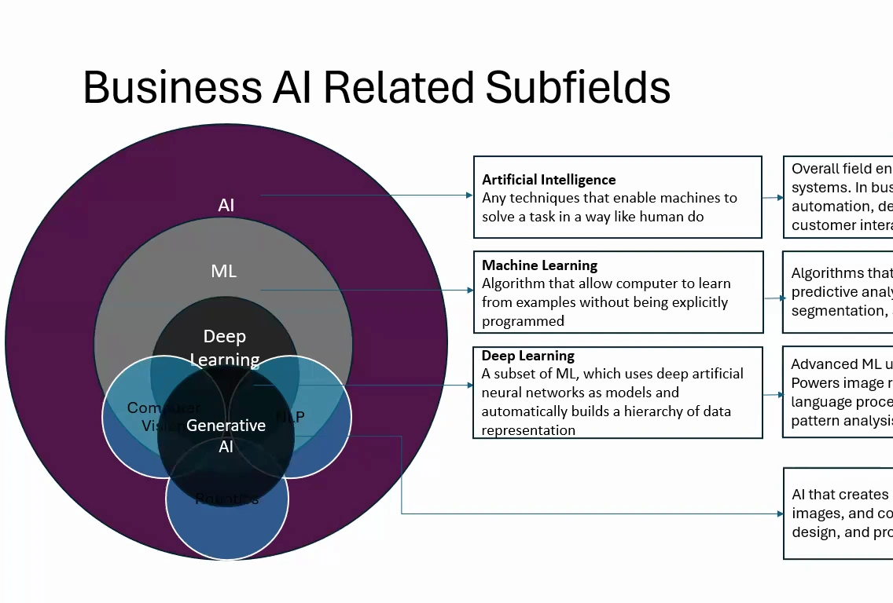

**Business AI Related Subfields**

- **Artificial Intelligence**: Any techniques that enable machines to solve a task in a way like human do. Overall field en[covered] systems. In bus[covered] automation, de[covered] customer intera[covered]
- **Machine Learning**: Algorithm that allow computer to learn from examples without being explicitly programmed. Algorithms that[covered] predictive analy[covered] segmentation, [covered]
- **Deep Learning**: A subset of ML, which uses deep artificial neural networks as models and automatically builds a hierarchy of data representation. Advanced ML u[covered] Powers image r[covered] language proce[covered] pattern analysis[covered]
- AI that creates [covered] images, and co[covered] design, and pro[covered]

_Diagram: nested circles, AI containing ML containing Deep Learning, overlapped by Computer Vision, NLP and Robotics circles around a central Generative AI circle; arrows lead from AI, ML, Deep Learning and Generative AI to the definition boxes on the right, each followed by a second box the strip cuts off._

## Slide 14: The synergy between AI and IoT

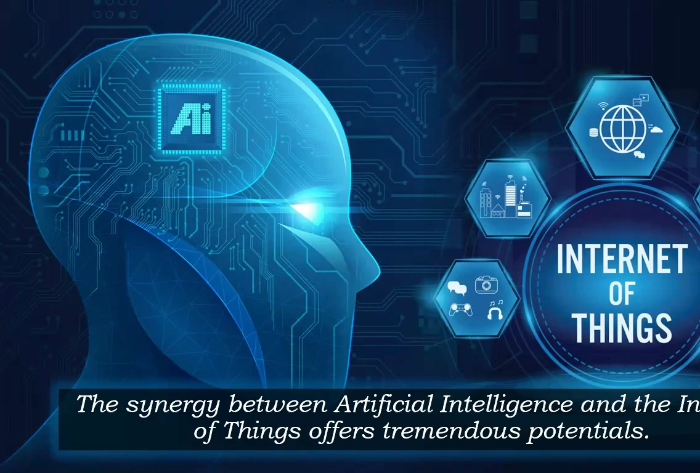

The synergy between Artificial Intelligence and the In[covered] of Things offers tremendous potentials.

_Image of a glowing robotic head with an "Ai" chip, facing hexagon icons around an "INTERNET OF THINGS" badge._

## Slide 15: IoT, big data and AI

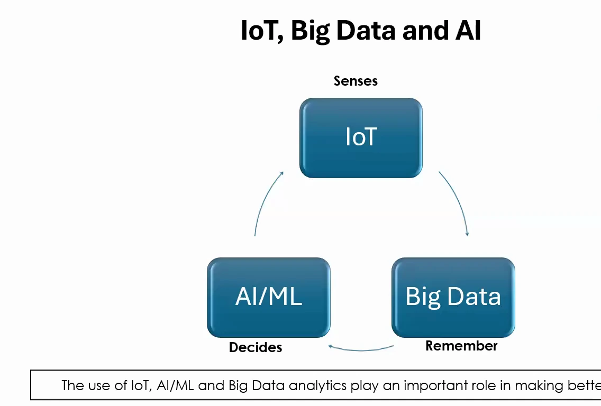

**IoT, Big Data and AI**

- IoT: Senses
- Big Data: Remember
- AI/ML: Decides

The use of IoT, AI/ML and Big Data analytics play an important role in making bette[covered]

_Diagram: arrows run in a cycle from IoT to Big Data to AI/ML and back to IoT._

## Slide 16: Convergence of AI and IoT: unlocking new possibilities

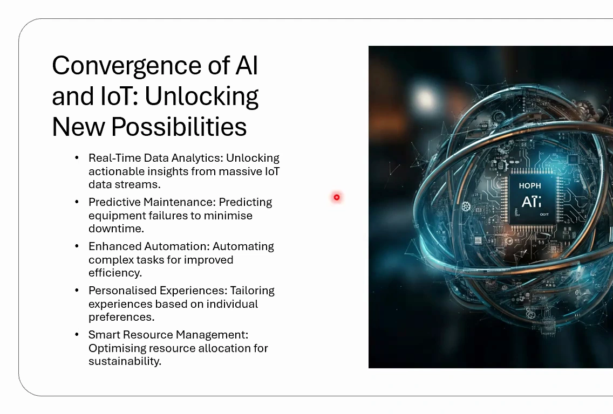

**Convergence of AI and IoT: Unlocking New Possibilities**

- Real-Time Data Analytics: Unlocking actionable insights from massive IoT data streams.
- Predictive Maintenance: Predicting equipment failures to minimise downtime.
- Enhanced Automation: Automating complex tasks for improved efficiency.
- Personalised Experiences: Tailoring experiences based on individual preferences.
- Smart Resource Management: Optimising resource allocation for sustainability.

_Image of an "AI" chip inside a sphere of metal rings and circuit fragments._

## Slide 17: When nervous system meets cognitive brain

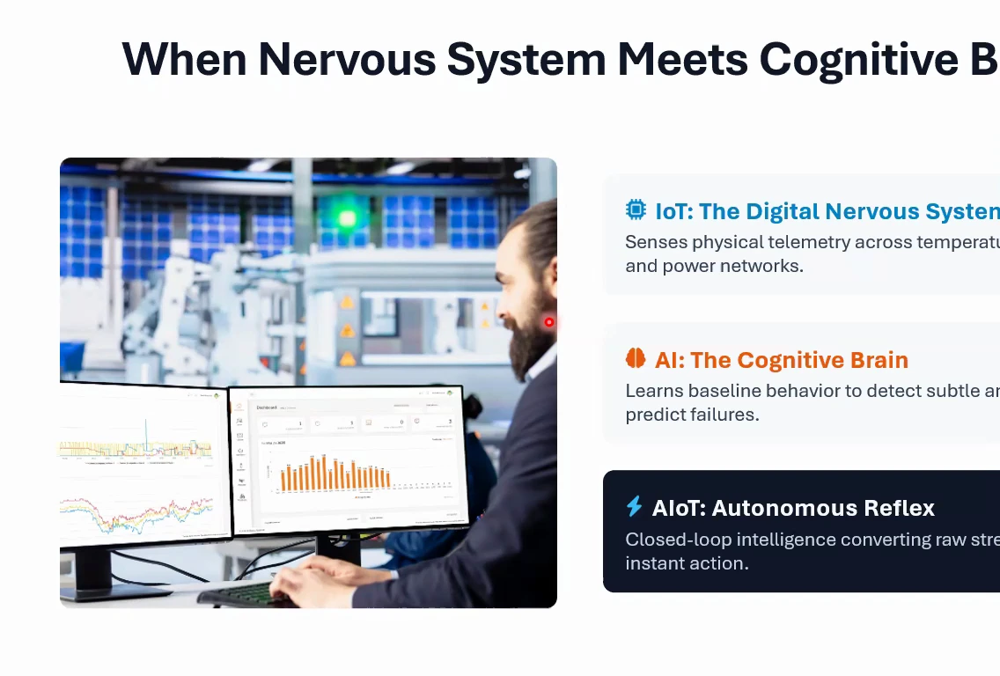

**When Nervous System Meets Cognitive B[covered]**

- **IoT: The Digital Nervous Syste[covered]**: Senses physical telemetry across temperatu[covered] and power networks.
- **AI: The Cognitive Brain**: Learns baseline behavior to detect subtle a[covered] predict failures.
- **AIoT: Autonomous Reflex**: Closed-loop intelligence converting raw stre[covered] instant action.

_Photo of a man at two monitors showing dashboards and charts, in front of an automated factory line._

## Slide 18: Traditional IoT vs. intelligent AIoT

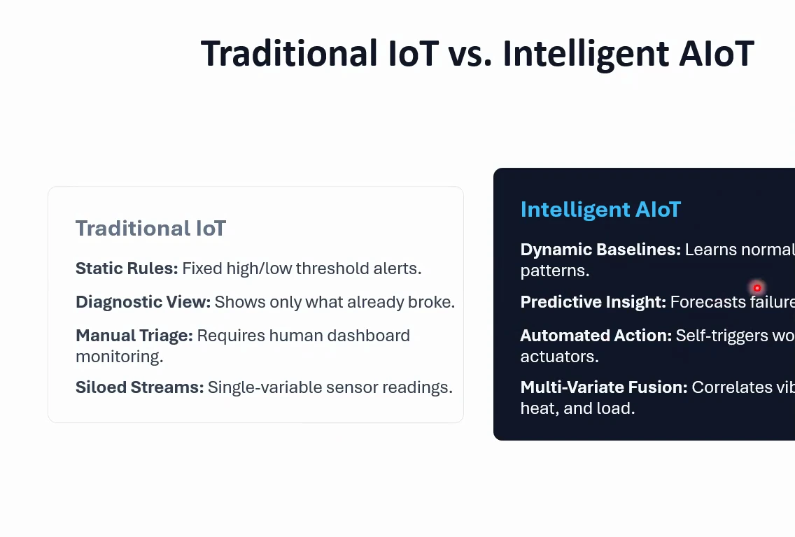

**Traditional IoT vs. Intelligent AIoT**

**Traditional IoT**

- **Static Rules:** Fixed high/low threshold alerts.
- **Diagnostic View:** Shows only what already broke.
- **Manual Triage:** Requires human dashboard monitoring.
- **Siloed Streams:** Single-variable sensor readings.

**Intelligent AIoT**

- **Dynamic Baselines:** Learns normal[covered] patterns.
- **Predictive Insight:** Forecasts failure[covered]
- **Automated Action:** Self-triggers wo[covered] actuators.
- **Multi-Variate Fusion:** Correlates vib[covered] heat, and load.

## Slide 19: Where does intelligence live?

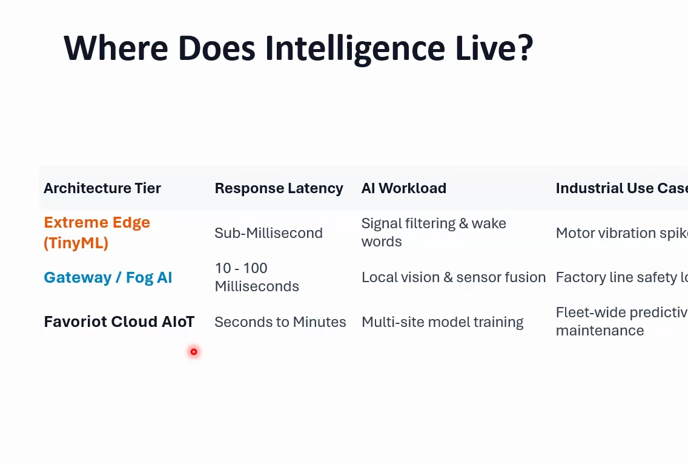

**Where Does Intelligence Live?**

| Architecture Tier     | Response Latency      | AI Workload                   | Industrial Use Cas[covered]               |
| --------------------- | --------------------- | ----------------------------- | ----------------------------------------- |
| Extreme Edge (TinyML) | Sub-Millisecond       | Signal filtering & wake words | Motor vibration spik[covered]             |
| Gateway / Fog AI      | 10 - 100 Milliseconds | Local vision & sensor fusion  | Factory line safety l[covered]            |
| Favoriot Cloud AIoT   | Seconds to Minutes    | Multi-site model training     | Fleet-wide predictiv[covered] maintenance |

## Slide 20: AI techniques mapped to IoT data

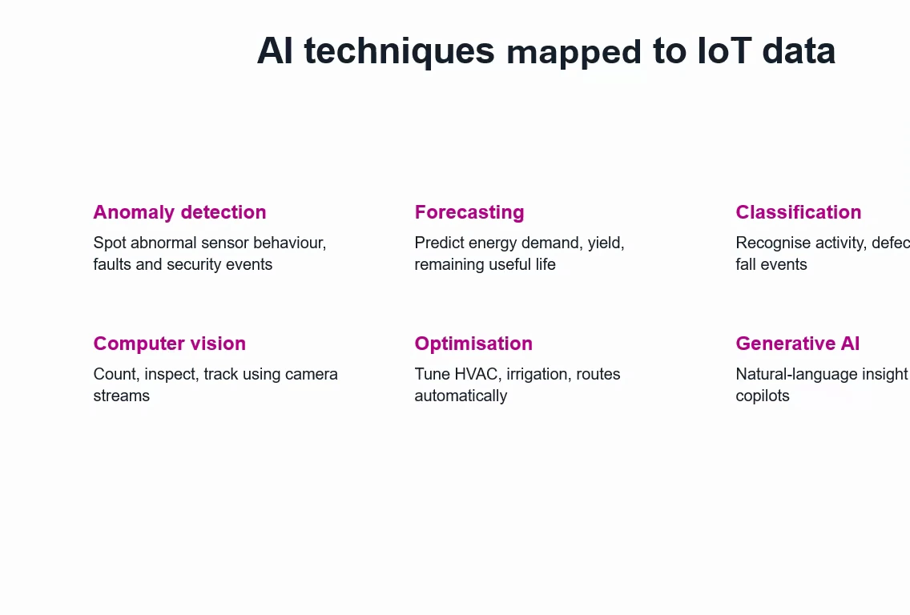

**AI techniques mapped to IoT data**

- **Anomaly detection**: Spot abnormal sensor behaviour, faults and security events
- **Forecasting**: Predict energy demand, yield, remaining useful life
- **Classification**: Recognise activity, defec[covered] fall events
- **Computer vision**: Count, inspect, track using camera streams
- **Optimisation**: Tune HVAC, irrigation, routes automatically
- **Generative AI**: Natural-language insight [covered] copilots

## Slide 21: Six trends to watch

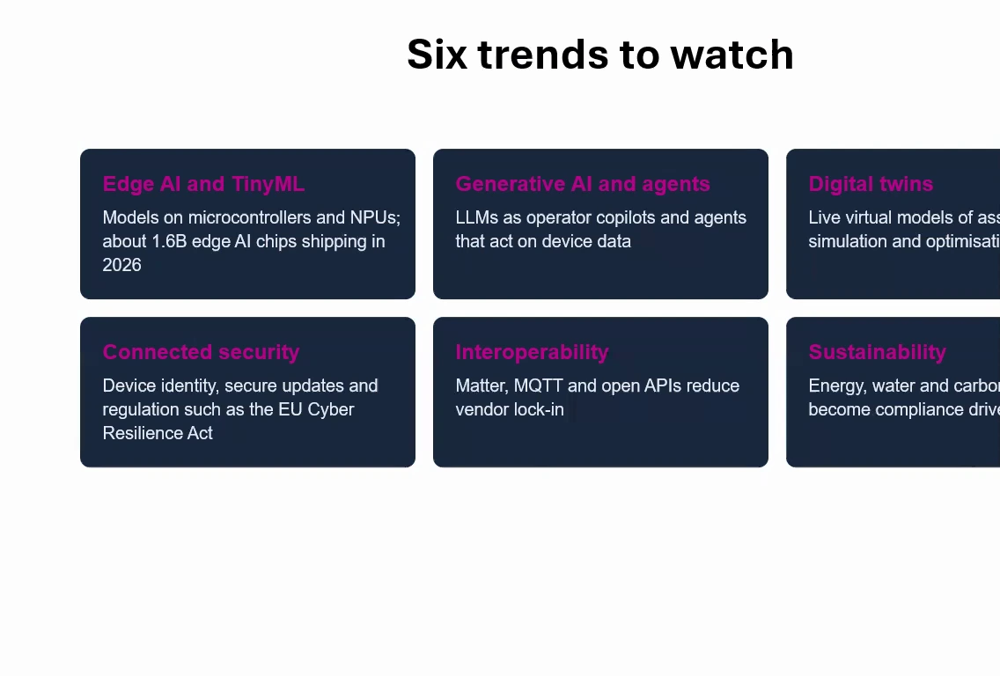

**Six trends to watch**

- **Edge AI and TinyML**: Models on microcontrollers and NPUs; about 1.6B edge AI chips shipping in 2026
- **Generative AI and agents**: LLMs as operator copilots and agents that act on device data
- **Digital twins**: Live virtual models of ass[covered] simulation and optimisati[covered]
- **Connected security**: Device identity, secure updates and regulation such as the EU Cyber Resilience Act
- **Interoperability**: Matter, MQTT and open APIs reduce vendor lock-in
- **Sustainability**: Energy, water and carbo[covered] become compliance drive[covered]

## Slide 22: Use cases

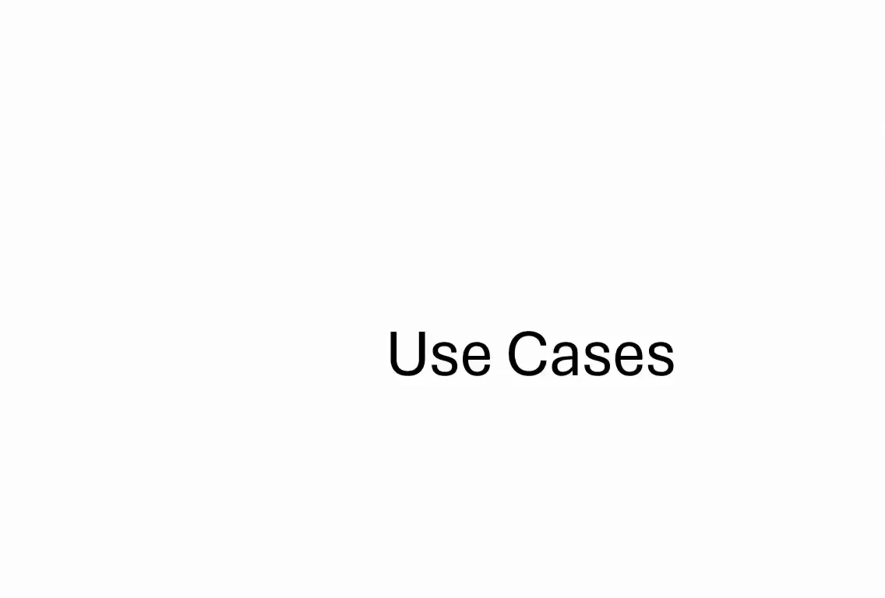

**Use Cases**

_Section title card._

## Slide 23: Smart homes: AIoT redefining living spaces

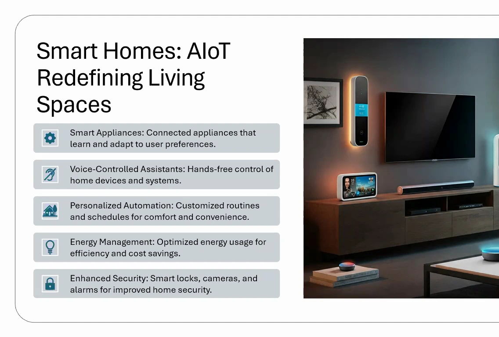

**Smart Homes: AIoT Redefining Living Spaces**

- Smart Appliances: Connected appliances that learn and adapt to user preferences.
- Voice-Controlled Assistants: Hands-free control of home devices and systems.
- Personalized Automation: Customized routines and schedules for comfort and convenience.
- Energy Management: Optimized energy usage for efficiency and cost savings.
- Enhanced Security: Smart locks, cameras, and alarms for improved home security.

_Photo of a living room with a wall-mounted TV, a smart display, a sound bar and smart speakers._

## Slide 24: AIoT application in smart energy management

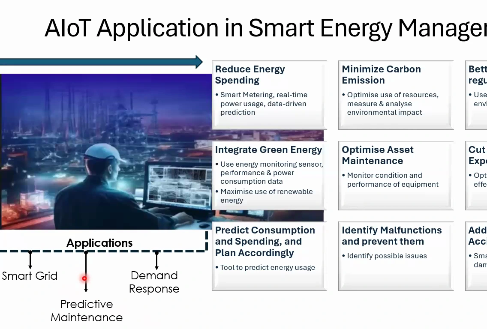

**AIoT Application in Smart Energy Managem[covered]**

- **Reduce Energy Spending**: Smart Metering, real-time power usage, data-driven prediction
- **Minimize Carbon Emission**: Optimise use of resources, measure & analyse environmental impact
- **Bett[covered] regu[covered]**: Use[covered] envi[covered]
- **Integrate Green Energy**: Use energy monitoring sensor, performance & power consumption data; Maximise use of renewable energy
- **Optimise Asset Maintenance**: Monitor condition and performance of equipment
- **Cut [covered] Exp[covered]**: Opt[covered] effe[covered]
- **Predict Consumption and Spending, and Plan Accordingly**: Tool to predict energy usage
- **Identify Malfunctions and prevent them**: Identify possible issues
- **Add[covered] Acci[covered]**: Sma[covered] dam[covered]

Applications: Smart Grid, Predictive Maintenance, Demand Response

_Photo of an engineer at control-room monitors over a city at night, beside the grid of nine boxes; the "Applications" branch appears at a later step._

## Slide 25: AIoT revolutionises healthcare

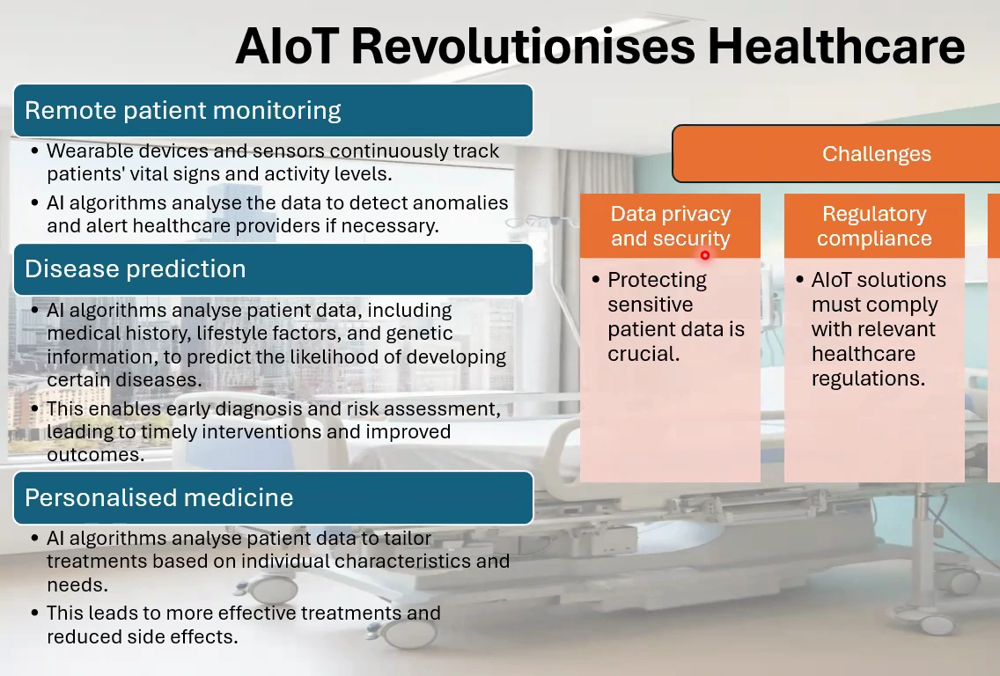

**AIoT Revolutionises Healthcare**

**Remote patient monitoring**

- Wearable devices and sensors continuously track patients' vital signs and activity levels.
- AI algorithms analyse the data to detect anomalies and alert healthcare providers if necessary.

**Disease prediction**

- AI algorithms analyse patient data, including medical history, lifestyle factors, and genetic information, to predict the likelihood of developing certain diseases.
- This enables early diagnosis and risk assessment, leading to timely interventions and improved outcomes.

**Personalised medicine**

- AI algorithms analyse patient data to tailor treatments based on individual characteristics and needs.
- This leads to more effective treatments and reduced side effects.

**Challenges**

- **Data privacy and security**: Protecting sensitive patient data is crucial.
- **Regulatory compliance**: AIoT solutions must comply with relevant healthcare regulations.
- [covered]

_Background photo of a hospital ward; the "Challenges" boxes appear at a later step._

## Slide 26: Research frontiers and challenges, section title

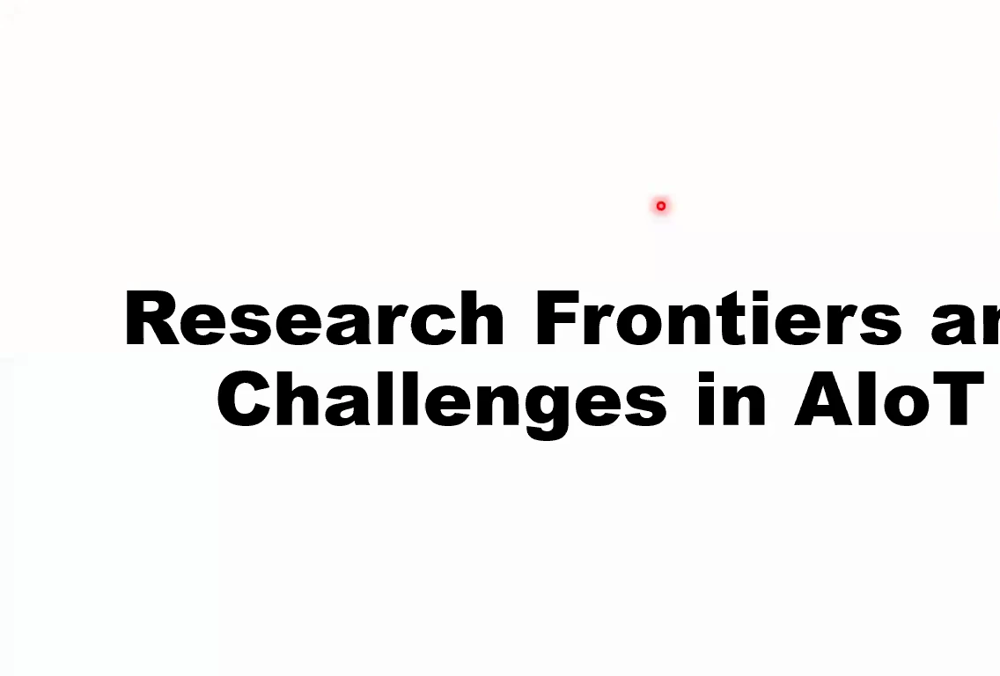

**Research Frontiers a[covered] Challenges in AIoT**

_Section title card._

## Slide 27: Research frontiers and challenges in AIoT

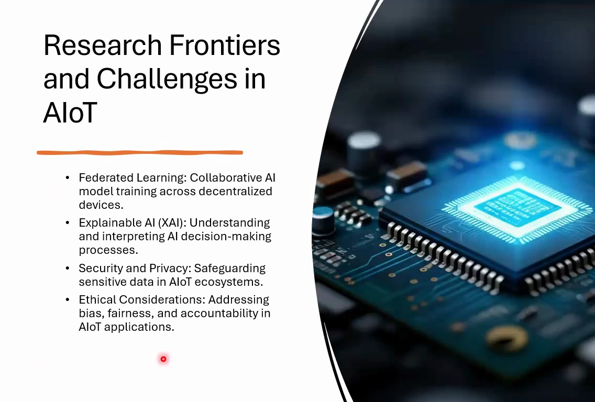

**Research Frontiers and Challenges in AIoT**

- Federated Learning: Collaborative AI model training across decentralized devices.
- Explainable AI (XAI): Understanding and interpreting AI decision-making processes.
- Security and Privacy: Safeguarding sensitive data in AIoT ecosystems.
- Ethical Considerations: Addressing bias, fairness, and accountability in AIoT applications.

_Photo of a glowing microchip on a circuit board._

## Slide 28: AIoT security: safeguarding the connected world


**AIoT Security: Safeguarding the Connected World**

- Device Vulnerabilities: Secure devices against hacking and unauthorised access.
- Data Encryption: Protect sensitive data in transit and at rest.
- Network Security: Implement robust firewalls and intrusion detection systems.
- Access Control: Manage user access and permissions effectively.
- Security Updates: Regularly update software and firmware to patch vulnerabilities.

_Photo of a padlock with a Wi-Fi symbol and a circuit pattern._

## Slide 29: TinyML: AI at the very edge

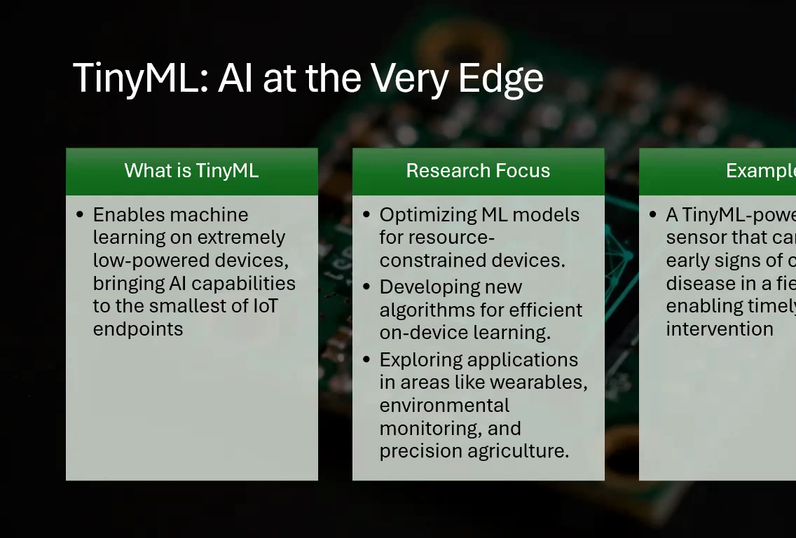

**TinyML: AI at the Very Edge**

**What is TinyML**

- Enables machine learning on extremely low-powered devices, bringing AI capabilities to the smallest of IoT endpoints

**Research Focus**

- Optimizing ML models for resource-constrained devices.
- Developing new algorithms for efficient on-device learning.
- Exploring applications in areas like wearables, environmental monitoring, and precision agriculture.

**Exampl[covered]**

- A TinyML-powe[covered] sensor that ca[covered] early signs of c[covered] disease in a fie[covered] enabling timely intervention

## Slide 30: Federated learning: collaborative AI for IoT

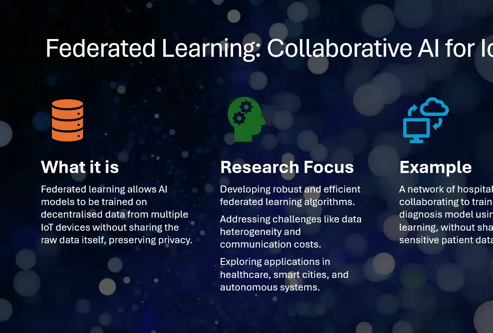

**Federated Learning: Collaborative AI for Io[covered]**

- **What it is**: Federated learning allows AI models to be trained on decentralised data from multiple IoT devices without sharing the raw data itself, preserving privacy.
- **Research Focus**: Developing robust and efficient federated learning algorithms. Addressing challenges like data heterogeneity and communication costs. Exploring applications in healthcare, smart cities, and autonomous systems.
- **Example**: A network of hospital[covered] collaborating to train[covered] diagnosis model usin[covered] learning, without sha[covered] sensitive patient data[covered]

## Slide 31: AIoT for sustainability

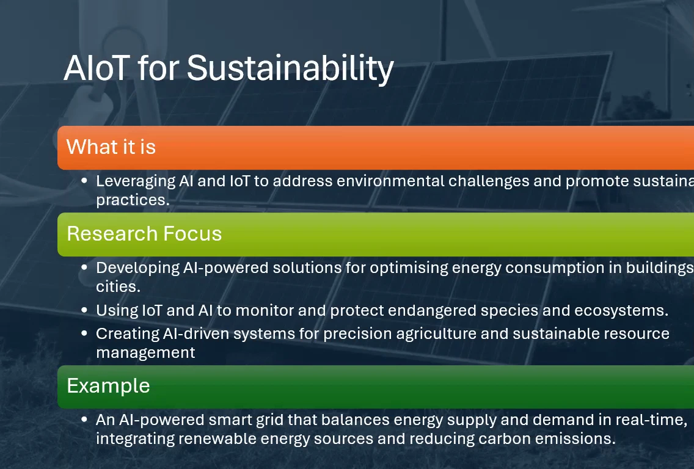

**AIoT for Sustainability**

**What it is**

- Leveraging AI and IoT to address environmental challenges and promote sustaina[covered] practices.

**Research Focus**

- Developing AI-powered solutions for optimising energy consumption in buildings[covered] cities.
- Using IoT and AI to monitor and protect endangered species and ecosystems.
- Creating AI-driven systems for precision agriculture and sustainable resource management

**Example**

- An AI-powered smart grid that balances energy supply and demand in real-time, integrating renewable energy sources and reducing carbon emissions.

## Slide 32: Favoriot AIoT platform

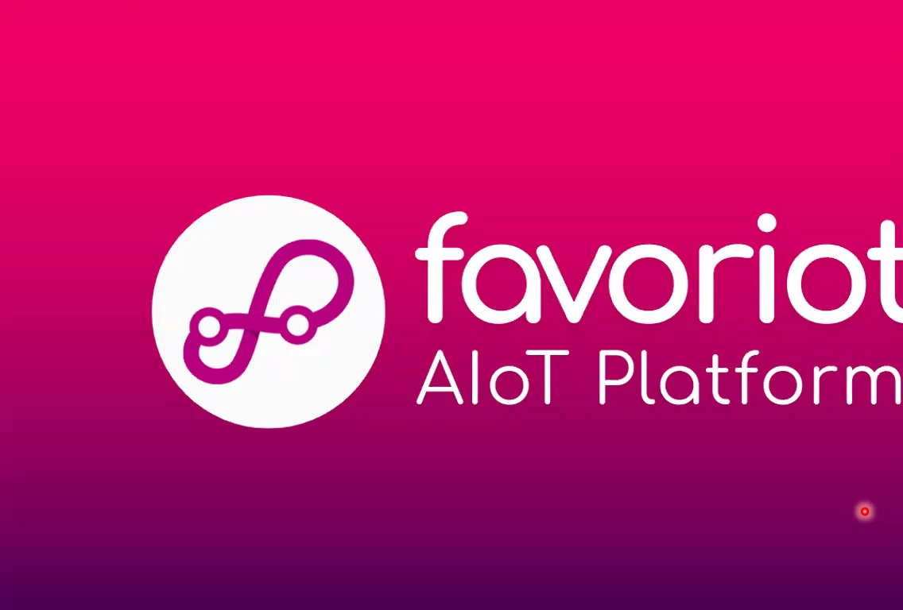

**favoriot AIoT Platform**

_Section title card with the Favoriot logo._

## Slide 33: About Favoriot

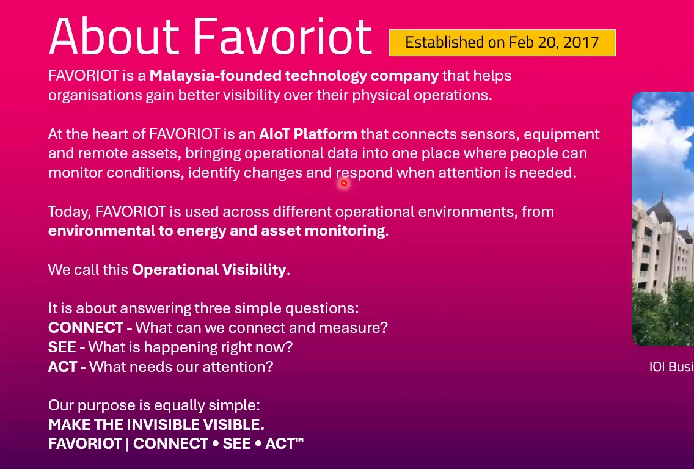

**About Favoriot**

Established on Feb 20, 2017

FAVORIOT is a **Malaysia-founded technology company** that helps organisations gain better visibility over their physical operations.

At the heart of FAVORIOT is an **AIoT Platform** that connects sensors, equipment and remote assets, bringing operational data into one place where people can monitor conditions, identify changes and respond when attention is needed.

Today, FAVORIOT is used across different operational environments, from **environmental to energy and asset monitoring**.

We call this **Operational Visibility**.

It is about answering three simple questions:\
**CONNECT -** What can we connect and measure?\
**SEE -** What is happening right now?\
**ACT -** What needs our attention?

Our purpose is equally simple:\
**MAKE THE INVISIBLE VISIBLE.**\
**FAVORIOT | CONNECT • SEE • ACT™**

_A photo of an office building on the right, captioned "IOI Busi[covered]"._

## Slide 34: Make the invisible visible


**MAKE THE INVISIBLE VISIBLE.**

favoriot · THE AIOT PLATFORM FOR OPERATIONAL VISIBILITY · OPERATIONAL VISIBILITY

See what is happening across your operations, even when nobody is there.

- Remote Sites
- Distributed Assets
- Real-Time Monitoring
- Early Alerts

FAVORIOT connects your devices and equipment, turning real-world data into clear visibility so you can detect issues early, reduce downtime and keep your operations running smoothly.

- **CONNECT**: Your devices to the cloud
- **SEE**: What is happening across your operations
- **ACT™**: Before small issues become big problems

**SEE MORE. OPERATE SMARTER.** Talk to FAVORIOT about Operational Visibility.

CONNECT • SEE • ACT™

_A pink-tinted photo of storage tanks by a river, with a "Tank 01 • Online" card (Level 78 %, Temperature 28.4 °C, Pressure 1.2 bar, Normal) and a laptop showing a Favoriot dashboard (Total Assets 248, Online 210, Asset Health Trend)._

## Slide 35: Operational visibility platform architecture

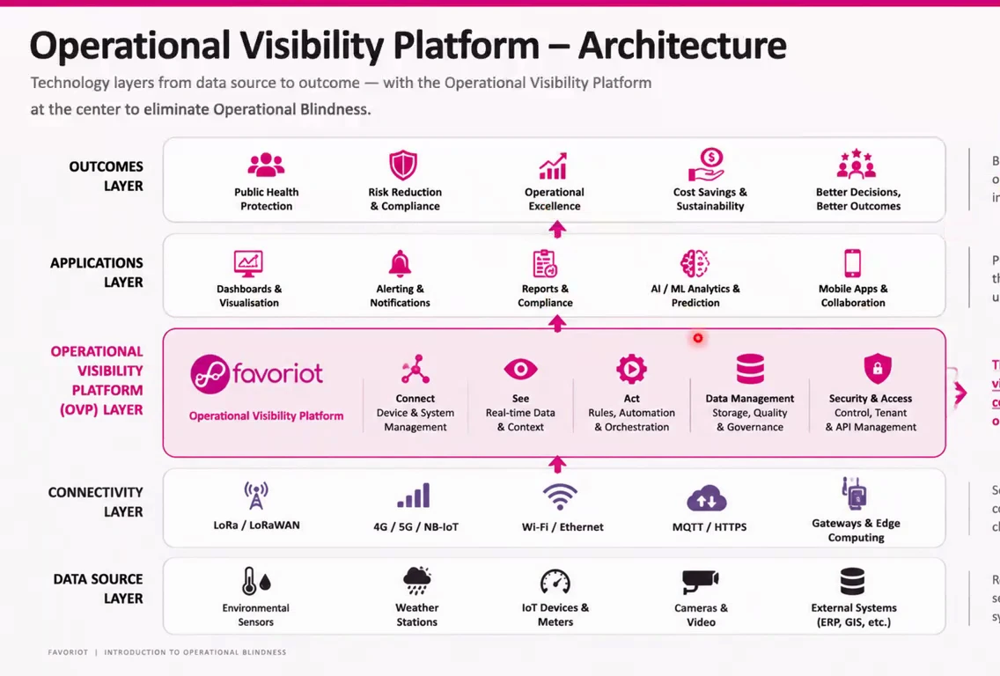

**Operational Visibility Platform – Architecture**

Technology layers from data source to outcome — with the Operational Visibility Platform at the center to eliminate Operational Blindness.

- **OUTCOMES LAYER**: Public Health Protection · Risk Reduction & Compliance · Operational Excellence · Cost Savings & Sustainability · Better Decisions, Better Outcomes
- **APPLICATIONS LAYER**: Dashboards & Visualisation · Alerting & Notifications · Reports & Compliance · AI / ML Analytics & Prediction · Mobile Apps & Collaboration
- **OPERATIONAL VISIBILITY PLATFORM (OVP) LAYER**: favoriot Operational Visibility Platform · Connect: Device & System Management · See: Real-time Data & Context · Act: Rules, Automation & Orchestration · Data Management: Storage, Quality & Governance · Security & Access: Control, Tenant & API Management
- **CONNECTIVITY LAYER**: LoRa / LoRaWAN · 4G / 5G / NB-IoT · Wi-Fi / Ethernet · MQTT / HTTPS · Gateways & Edge Computing
- **DATA SOURCE LAYER**: Environmental Sensors · Weather Stations · IoT Devices & Meters · Cameras & Video · External Systems (ERP, GIS, etc.)

FAVORIOT | INTRODUCTION TO OPERATIONAL BLINDNESS

_Diagram: the five layers stacked with icons, arrows pointing up from each layer to the next; a description beside each layer is [covered]._

## Slide 36: Connect, learn, detect

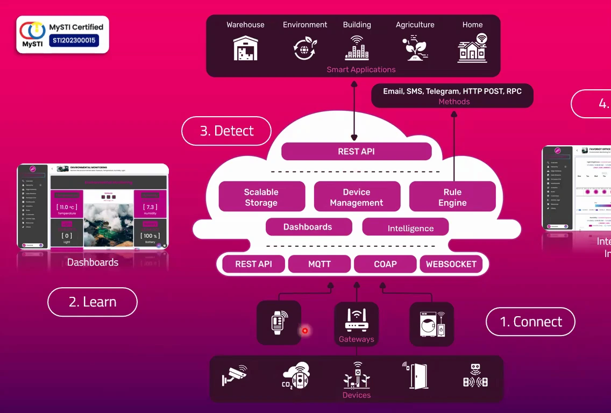

- MySTI Certified, STI202300015
- **1. Connect**: Devices and Gateways, sending data over REST API, MQTT, COAP and WEBSOCKET
- **2. Learn**: Dashboards
- **3. Detect**: REST API; Scalable Storage, Device Management, Rule Engine; Dashboards, Intelligence
- Methods: Email, SMS, Telegram, HTTP POST, RPC
- Smart Applications: Warehouse, Environment, Building, Agriculture, Home
- **4.[covered]**: Inte[covered]

_Diagram: the Favoriot platform as a cloud between devices and smart applications, with screenshots of an "Environmental Monitoring" dashboard under "2. Learn" and a Favoriot office dashboard under "4."._

## Slide 37: Example dashboards

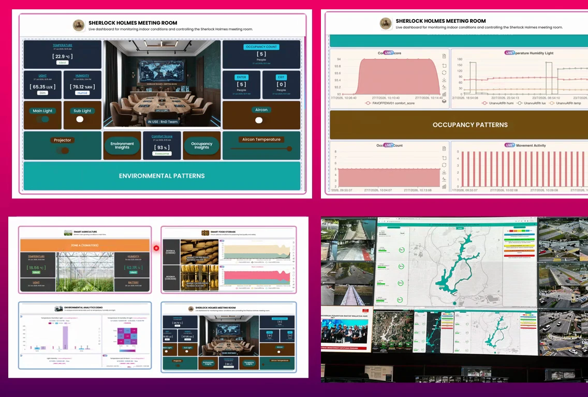

_Four example screens: the "Sherlock Holmes Meeting Room" dashboard ("Live dashboard for monitoring indoor conditions and controlling the Sherlock Holmes meeting room.") with its "ENVIRONMENTAL PATTERNS" and "OCCUPANCY PATTERNS" charts; a collage of the "Smart Agriculture", "Smart Food Storage", "Environmental Analytics Demo" and "Sherlock Holmes Meeting Room" dashboards; and a photo of a control-room video wall with a city map and CCTV feeds._

## Slide 38: Favoriot platform live demo

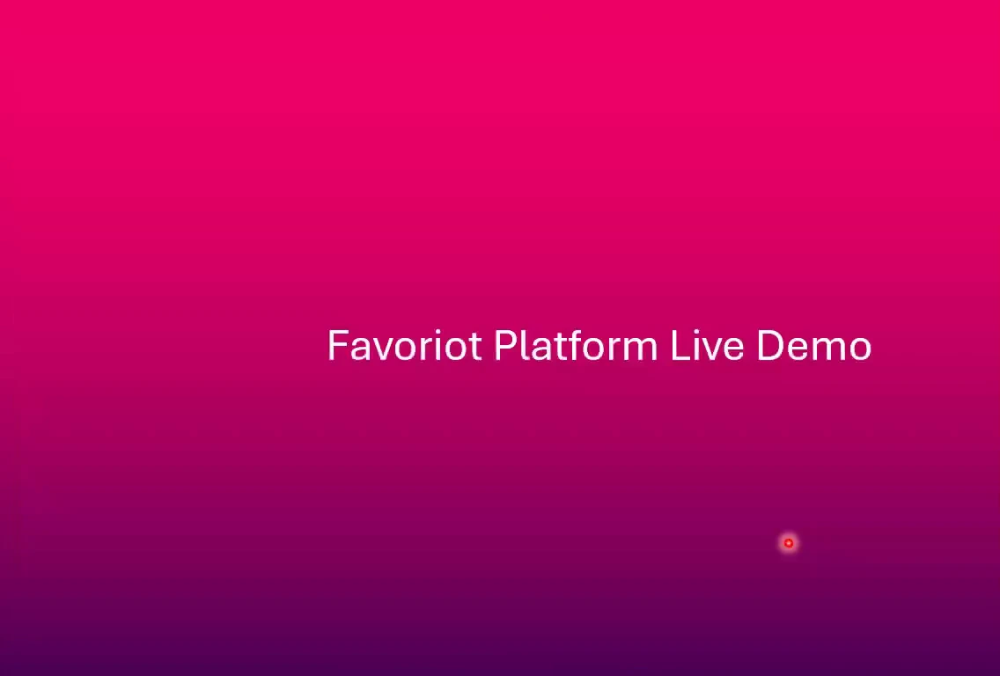

**Favoriot Platform Live Demo**

_Section title card._

## Slide 39: Thank you


**THANK YO[covered]**

[contact details omitted]\
www.favoriot.com

_Closing card with a glowing digital head and streams of binary digits._

## Slide 40: Favoriot demo: edge gateways

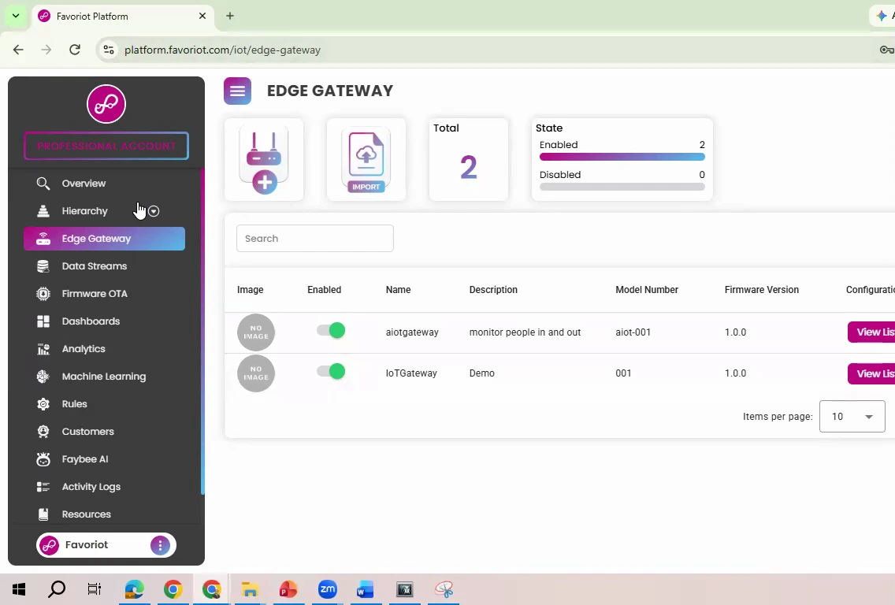

_Screenshot of the Favoriot platform at platform.favoriot.com/iot/edge-gateway, the first screen of the demo. He comes back to this page at about 01:00:10 to explain the Edge Gateway feature._

- Sidebar: PROFESSIONAL ACCOUNT · Overview · Hierarchy · Edge Gateway · Data Streams · Firmware OTA · Dashboards · Analytics · Machine Learning · Rules · Customers · Faybee AI · Activity Logs · Resources · Favoriot
- **EDGE GATEWAY**
- Total 2 · State: Enabled 2, Disabled 0
- aiotgateway: "monitor people in and out", model aiot-001, firmware 1.0.0
- IoTGateway: "Demo", model 001, firmware 1.0.0
- Each gateway has a "View Lis[covered]" button under "Configurati[covered]".

## Slide 41: Favoriot demo: pricing

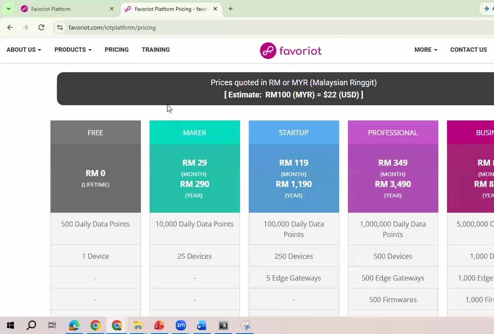

_Screenshot of the Favoriot pricing page, favoriot.com/iotplatform/pricing, opened in a second tab._

- Navigation: ABOUT US · PRODUCTS · PRICING · TRAINING · favoriot · MORE · CONTACT US
- Prices quoted in RM or MYR (Malaysian Ringgit) [ Estimate: RM100 (MYR) = $22 (USD) ]
- **FREE**: RM 0 (lifetime); 500 Daily Data Points; 1 Device
- **MAKER**: RM 29 (month), RM 290 (year); 10,000 Daily Data Points; 25 Devices
- **STARTUP**: RM 119 (month), RM 1,190 (year); 100,000 Daily Data Points; 250 Devices; 5 Edge Gateways
- **PROFESSIONAL**: RM 349 (month), RM 3,490 (year); 1,000,000 Daily Data Points; 500 Devices; 500 Edge Gateways; 500 Firmwares
- **BUSIN[covered]**: RM 8[covered]; 5,000,000 D[covered]; 1,000 D[covered]; 1,000 Edge[covered]; 1,000 Fir[covered]

## Slide 42: Favoriot demo: overview

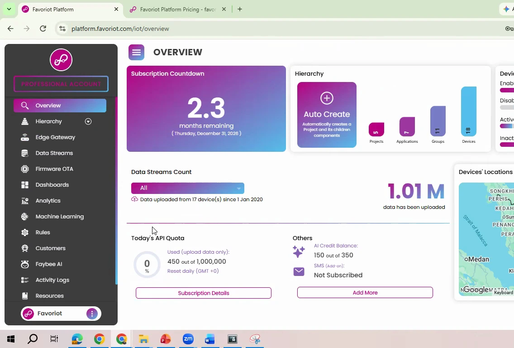

_Screenshot of the platform's Overview page. He comes back to it at the end of the demo._

- **OVERVIEW**
- Subscription Countdown: 2.3 months remaining (Thursday, December 31, 2026)
- Hierarchy: Auto Create, "Automatically creates a Project and its children components"; 5 Projects, 7 Applications, 11 Groups, 18 Devices
- Devi[covered]: Enab[covered], Disab[covered], Activ[covered], Inact[covered]
- Data Streams Count: All; Data uploaded from 17 device(s) since 1 Jan 2020; 1.01 M data has been uploaded
- Today's API Quota: 0 %; Used (upload data only): 450 out of 1,000,000; Reset daily (GMT +0); Subscription Details
- Others: AI Credit Balance: 150 out of 350; SMS (Add-on): Not Subscribed; Add More
- Devices' Locations: a map of northern Peninsular Malaysia and Sumatra

## Slide 43: Favoriot demo: API keys

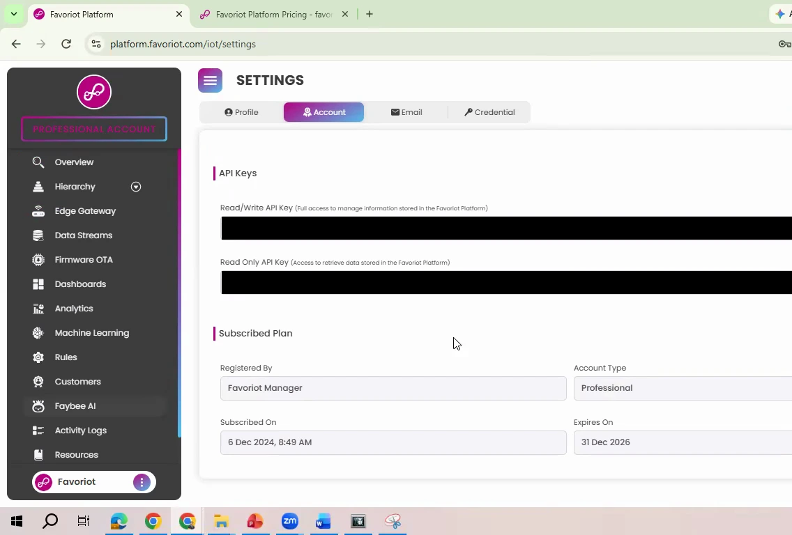

_Screenshot of Settings on its Account tab, after a brief look at the Profile tab (Favoriot Sdn Bhd, registered on 6 December 2024). Both API keys are blacked out._

- **SETTINGS**: Profile · Account · Email · Credential
- API Keys
  - Read/Write API Key (Full access to manage information stored in the Favoriot Platform): [left out]
  - Read Only API Key (Access to retrieve data stored in the Favoriot Platform): [left out]
- Subscribed Plan: Registered By: Favoriot Manager · Account Type: Professional · Subscribed On: 6 Dec 2024, 8:49 AM · Expires On: 31 Dec 2026

## Slide 44: Favoriot demo: devices

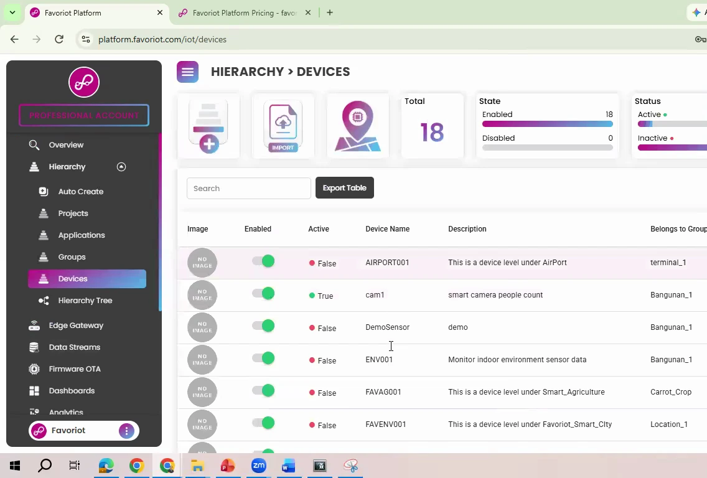

_Screenshot of the device list under Hierarchy._

- Hierarchy menu: Auto Create · Projects · Applications · Groups · Devices · Hierarchy Tree
- **HIERARCHY > DEVICES**
- Total 18 · State: Enabled 18, Disabled 0 · Status: Active, Inactive
- Search · Export Table
- Columns: Image · Enabled · Active · Device Name · Description · Belongs to Group[covered]
- The first rows are AIRPORT001, cam1 ("smart camera people count", the only active one shown), DemoSensor ("demo"), ENV001, FAVAG001 and FAVENV001.

## Slide 45: Favoriot demo: device information

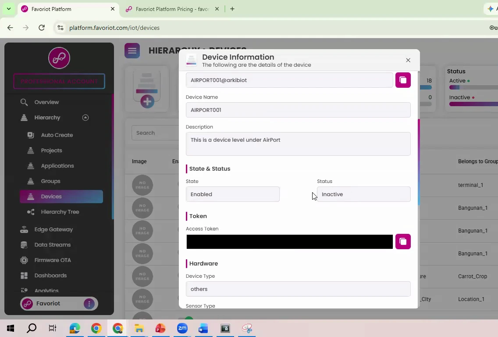

_Screenshot of the Device Information panel for AIRPORT001, opened from the device list. The access token is blacked out._

- **Device Information**: The following are the details of the device
- AIRPORT001@arkibiot
- Device Name: AIRPORT001
- Description: This is a device level under AirPort
- State & Status: State Enabled · Status Inactive
- Token: Access Token [left out]
- Hardware: Device Type others · Sensor Type

## Slide 46: Favoriot demo: data streams

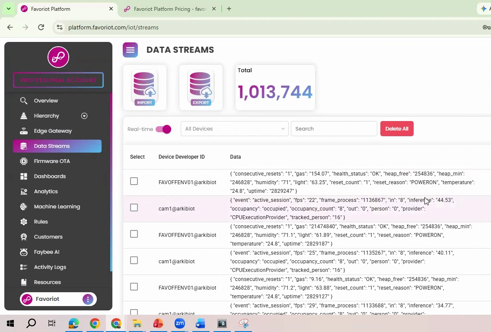

_Screenshot of Data Streams, with the latest payloads from all devices arriving in real time._

- **DATA STREAMS**: Import · Export · Total 1,013,744
- Real-time (on) · All Devices · Search · Delete All
- Columns: Select · Device Developer ID · Data
- FAVOFFENV01@arkibiot: `{ "consecutive_resets": "1", "gas": "154.07", "health_status": "OK", "heap_free": "254836", "heap_min": "246828", "humidity": "71", "light": "63.25", "reset_count": "1", "reset_reason": "POWERON", "temperature": "24.8", "uptime": "2829247" }`
- cam1@arkibiot: `{ "event": "active_session", "fps": "22", "frame_process": "1136867", "in": "8", "inference": "44.53", "occupancy": "occupied", "occupancy_count": "8", "out": "0", "person": "0", "provider": "CPUExecutionProvider", "tracked_person": "16" }`
- The rows below alternate between the same two devices.

## Slide 47: Favoriot demo: dashboards

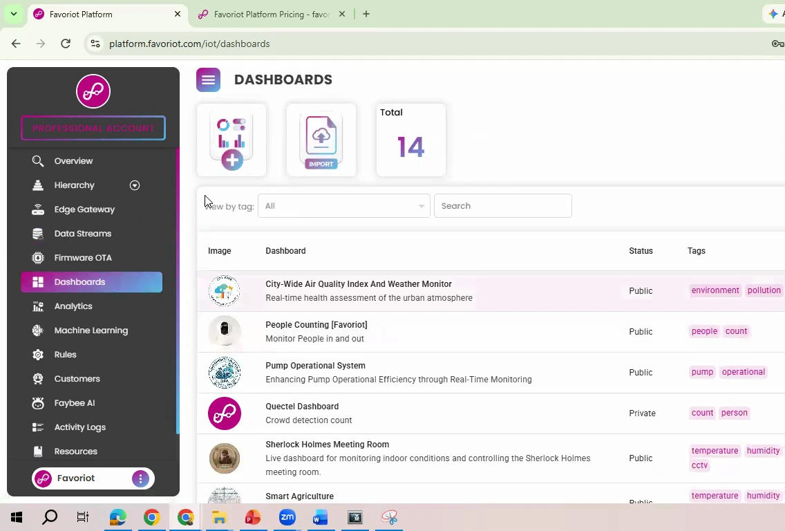

_Screenshot of the Dashboards list. He comes back to it between dashboards._

- **DASHBOARDS**: Total 14 · View by tag: All · Search
- Columns: Image · Dashboard · Status · Tags
- City-Wide Air Quality Index And Weather Monitor: Real-time health assessment of the urban atmosphere · Public · environment, pollution
- People Counting [Favoriot]: Monitor People in and out · Public · people, count
- Pump Operational System: Enhancing Pump Operational Efficiency through Real-Time Monitoring · Public · pump, operational
- Quectel Dashboard: Crowd detection count · Private · count, person
- Sherlock Holmes Meeting Room: Live dashboard for monitoring indoor conditions and controlling the Sherlock Holmes meeting room. · Public · temperature, humidity, cctv
- Smart Agriculture (cut off at the bottom)

## Slide 48: Favoriot demo: city-wide air quality dashboard

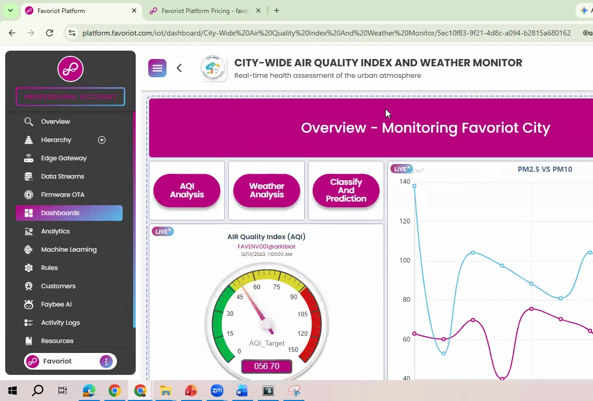

_Screenshot of the City-Wide Air Quality Index And Weather Monitor dashboard._

- **CITY-WIDE AIR QUALITY INDEX AND WEATHER MONITOR**: Real-time health assessment of the urban atmosphere
- Overview - Monitoring Favoriot City
- Buttons: AQI Analysis · Weather Analysis · Classify And Prediction
- AIR Quality Index (AQI), live: FAVENV001@arkibiot, 12/13/2023, 7:00:00 AM; a gauge from 0 to 150 reading AQI_Target 056.70
- PM2.5 VS PM10, live: a line chart of the two readings

## Slide 49: Favoriot demo: Sherlock Holmes Meeting Room dashboard

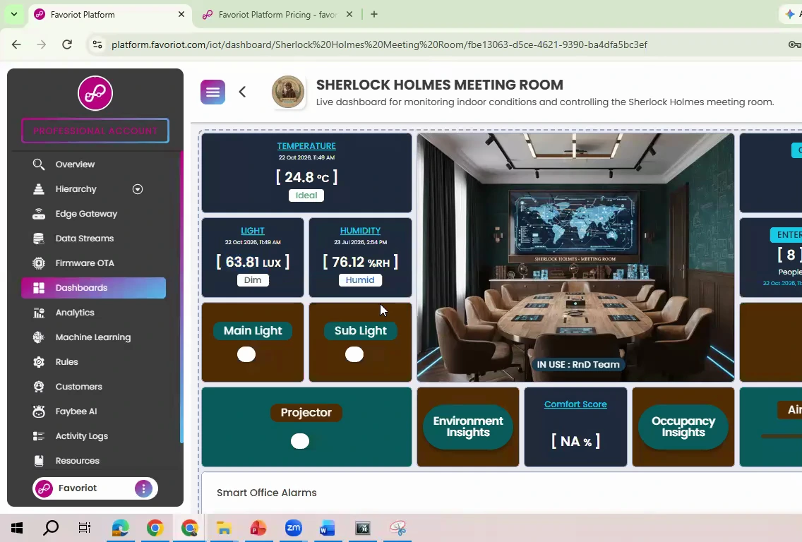

_Screenshot of the Sherlock Holmes Meeting Room dashboard, with live readings from that morning._

- **SHERLOCK HOLMES MEETING ROOM**: Live dashboard for monitoring indoor conditions and controlling the Sherlock Holmes meeting room.
- TEMPERATURE, 22 Oct 2026, 11:49 AM: [ 24.8 °C ] Ideal
- LIGHT, 22 Oct 2026, 11:49 AM: [ 63.81 LUX ] Dim
- HUMIDITY, 23 Jul 2026, 2:54 PM: [ 76.12 %RH ] Humid
- Switches: Main Light · Sub Light · Projector
- A photo of the meeting room: IN USE : RnD Team
- Environment Insights · Comfort Score [ NA % ] · Occupancy Insights
- ENTER[covered]: [ 8 ] People, 22 Oct 202[covered]
- Smart Office Alarms (below)

## Slide 50: Favoriot demo: smart office alarms

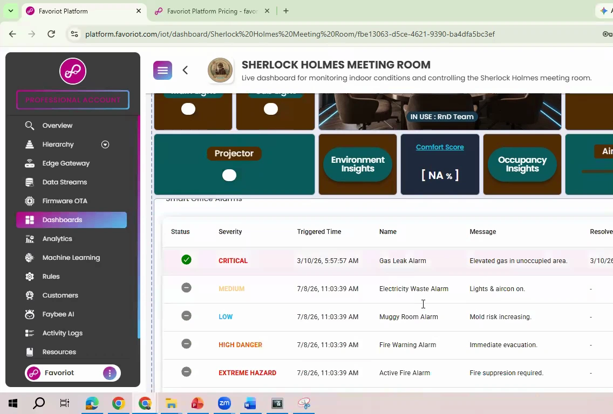

_The same dashboard scrolled down to its alarm table._

- Smart Office Alarms
- Columns: Status · Severity · Triggered Time · Name · Message · Resolve[covered]
- CRITICAL · 3/10/26, 5:57:57 AM · Gas Leak Alarm · Elevated gas in unoccupied area. (resolved, 3/10/26[covered])
- MEDIUM · 7/8/26, 11:03:39 AM · Electricity Waste Alarm · Lights & aircon on.
- LOW · 7/8/26, 11:03:39 AM · Muggy Room Alarm · Mold risk increasing.
- HIGH DANGER · 7/8/26, 11:03:39 AM · Fire Warning Alarm · Immediate evacuation.
- EXTREME HAZARD · 7/8/26, 11:03:39 AM · Active Fire Alarm · Fire suppresion required.

## Slide 51: Favoriot demo: Smart Office dashboard

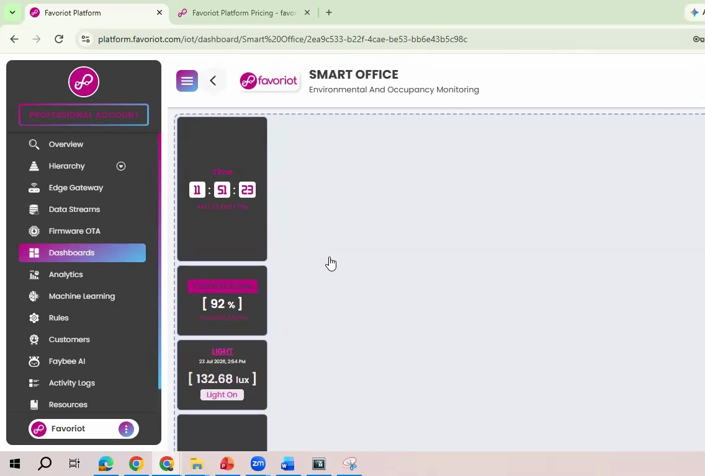

_Screenshot of the Smart Office dashboard while it loads; most of its widgets haven't appeared yet._

- **SMART OFFICE**: Environmental And Occupancy Monitoring
- Time: 11 : 51 : 23, AM | 22 Oct | Thu
- Comfort Score: [ 92 % ]
- LIGHT, 23 Jul 2026, 2:54 PM: [ 132.68 lux ] Light On

## Slide 52: Favoriot demo: edge gateway configurations

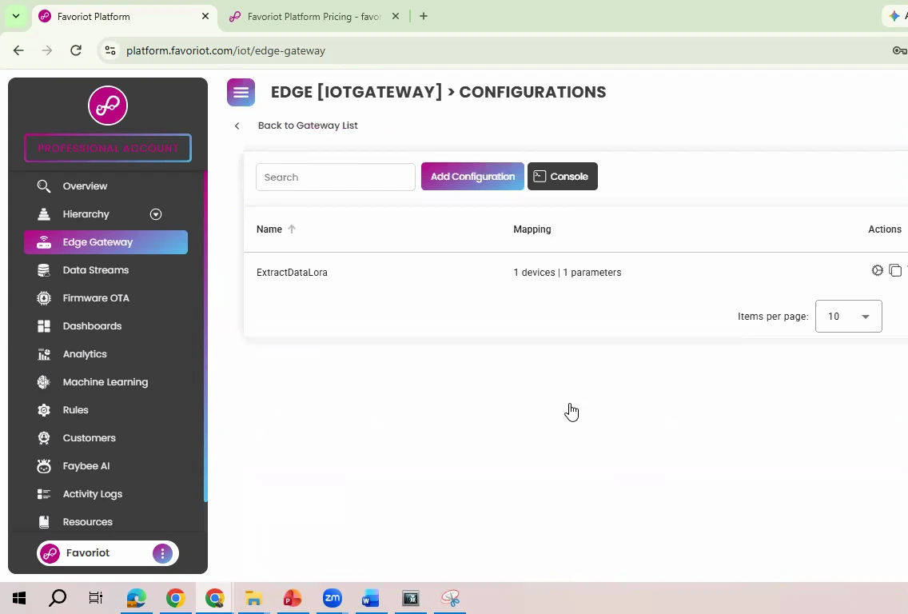

_Screenshot of the configuration list of the IoTGateway edge gateway, opened from the edge gateway page._

- **EDGE [IOTGATEWAY] > CONFIGURATIONS**
- Back to Gateway List
- Search · Add Configuration · Console
- ExtractDataLora: 1 devices | 1 parameters

## Slide 53: Favoriot demo: edge gateway configuration

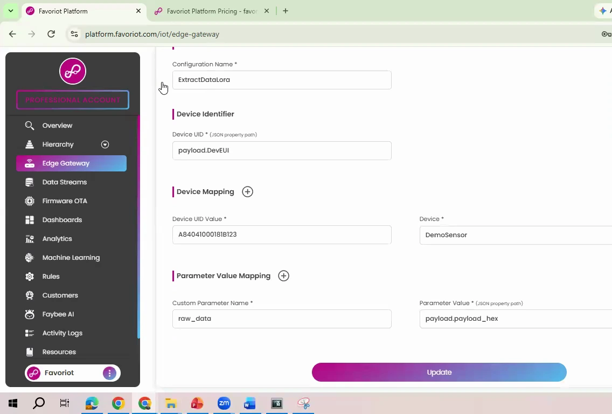

_Screenshot of the ExtractDataLora configuration, scrolled down; above it the page reads "EDGE [IOTGATEWAY] > CONFIGURATION", "Back to Configuration List", "IoTGateway Configuration" and "Information"._

- Configuration Name: ExtractDataLora
- Device Identifier: Device UID (JSON property path): `payload.DevEUI`
- Device Mapping: Device UID Value: A84041000181B123 · Device: DemoSensor
- Parameter Value Mapping: Custom Parameter Name: `raw_data` · Parameter Value (JSON property path): `payload.payload_hex`
- Update

## Slide 54: Favoriot demo: rules


_Screenshot of the Rules list. He comes back to it at about 01:05:15 when he mentions rules again._

- **RULES**: Total 10 · Status: Enabled 6, Disabled 4
- Columns: Enabled · Rule · Device
- AlarmTest: [Development] Alarm feature · FAVOFFENV01 · on
- Favoriot Comfort Score: To determine the comfort index from the existing environmental data · UnarvuAtRh · off
- Favoriot Comfort Score 2: To determine the comfort index from the existing environmental data · FAVOFFENV01 · on
- Favoriot Light Status: To determine when the lights on and off in the Favoriot office. · FAVOFFENV01 · off
- Favoriot Occupancy: To assign the status of occupancy in the Favoriot office. · cam1 · on
- GatewayRule: Demo · DemoSensor · on
- Museum Rule Flow (cut off at the bottom)

## Slide 55: Favoriot demo: GatewayRule rule chain


_Screenshot of the drag-and-drop rule editor for GatewayRule._

- **GatewayRule**: DemoSensor
- Node palette: Search · Input · Filter · Function · External · Rule Chain Templates
- Select any node or edge and press **Backspace** to delete it from the canvas.
- Canvas: Stream → Decode Value → [covered]

## Slide 56: Favoriot demo: Decode Value script


_Screenshot of the Decode Value node's settings, with its function scrolled to the end; the first two lines, on screen before he scrolls, are included below._

- **Script Node**: Runs a custom JavaScript function for advanced processing.
- Label: Decode Value
- Function (payload):

<!-- prettier-ignore -->
```javascript
// Extract hex string from raw_data
var raw = payload.raw_data;

// Parse first 4 hex chars (0132 -> 306 decimal -> 30.6°C)
var tempHex = raw.substring(0, 4);
payload['temperature'] = parseInt(tempHex, 16) / 10;

// Parse last 4 hex chars (01BD -> 445 decimal -> 44.5%)
var humHex = raw.substring(4, 8);
payload['humidity'] = parseInt(humHex, 16) / 10;

// Return updated payload object for Favoriot
return payload;
```

- Confirm

## Slide 57: Favoriot demo: decoded DemoSensor data


_Screenshot of Data Streams filtered to DemoSensor, with the raw hex value stored next to the decoded readings._

- **DATA STREAMS**: Total 31 · Real-time · DemoSensor
- Columns: Select · Device Developer ID · Data · Uploaded
- DemoSensor@arkibiot: `{ "humidity": "40", "raw_data": "00F00190", "temperature": "24" }`, 20/10/26, 10:29:1[covered]
- The other rows shown repeat the same data, uploaded seconds apart on 20/10/26.

## Slide 58: Favoriot demo: analytics


_Screenshot of the Analytics list, which he opens before each analysis._

- **ANALYTICS**: Total 21 · View by tag: All · Search
- Columns: Image · Analytic Dashboard · Status · Tags
- City-Wide AQI Analysis: Analysis air quality index data · Public · AQI, environment, rain, wind
- City-Wide Classify And Prediction Analysis: AQI, weather classify and prediction · Public · AQI, environment, rain, wind
- City-Wide Weather Analysis: Analysis weather · Public · AQI, environment, rain, wind
- Decompose Example: Show Real Decompose How it work using Environment Monitoring Data in Favoriot Office · Public · environment
- Environmental Analytics Demo: To analyse environmental data such as temperature, humidity and light. · Public · temperature, humidity, light
- Equipment Health Diagnostics (cut off at the bottom)

## Slide 59: Favoriot demo: city-wide AQI analysis


_Screenshot of the City-Wide AQI Analysis dashboard._

- **CITY-WIDE AQI ANALYSIS**: Analysis air quality index data
- Correlation Analysis ( FAVENV001@arkibiot ), 12/1/2023, 12:00:00 AM ~ 12/13/2023, 11:59:59 PM, [ PEARSON ]
- Below it: Average AQI (PPM) and PM2.5 vs PM10

_A heat map of Pearson correlations between PM2.5, PM10, NO2, SO2, CO, O3, Wind_Direction_deg and AQI_Target, on a scale from -1 to 1; AQI_Target and PM2.5 correlate at 0.94._

## Slide 60: Favoriot demo: AQI analysis charts


_The same dashboard scrolled down to its charts, all for 12/1/2023, 12:00:00 AM ~ 12/13/2023, 11:59:59 PM._

- Average AQI (PPM) ( FAVENV001@arkibiot ), [ DAILY | AVG ]: AQI_Target (avg) bars and an AQI_Target (growth) line; a tooltip for 2023-12-08 reads AQI_Target (avg) 45.56, AQI_Target (growth) 0
- PM2.5 vs PM10 ( FAVENV00[covered] ), [ DAILY | AVG ]: PM2.5 (avg) and PM[covered] bars, in ppm
- Trend ( FAVENV001@arkibiot ), [ TREND | DAILY | AVG | AQI_TARGET ]: an AQI_Target line
- Seasonal ( FAVENV00[covered] ), [ SEASONAL | DAILY | AVG | AQ[covered] ]: an AQI_Target line

## Slide 61: Favoriot demo: AQI analysis report


_Screenshot of the report generated for the City-Wide AQI Analysis, a PDF (report.pdf on s3.favoriot.com) opened in Adobe Acrobat in a new tab._

**City-Wide AQI Analysis**

**PM2.5 vs PM10**, 30 Nov 2023 16:00 ~ 13 Dec 2023 15:59

**Observation:** \* The **Peak (Max)** for PM2.5 reached **67.64** on 09 Dec 2023 16:00, while PM10 reached its **Peak (Max)** of **101.43** on 10 Dec 2023 16:00. This indicates a period of high particulate concentration during the second week of December. \* The **Trough (Min)** for PM2.5 was **54.71** on 01 Dec 2023 16:00, and for PM10, it was **77.11** on 06 Dec 2023 16:00. \* The PM2.5 levels averaged **59.76** (±4.28), while PM10 averaged **89.10** (±7.85). The high average for PM2.5 relative to PM10 suggests that fine particulates, which pose greater respiratory risks, constitute a significant portion of the total particulate matter.

**Significant Finding:** A notable **Step Change** occurred between 08 Dec and 09 Dec, where PM2.5 spiked from **59.37** to **67.64**, a **13.93% increase** in 24 hours. This sharp rise precedes the PM10 peak, suggesting that fine particulate accumulation is the leading indicator of deteriorating air quality in this urban environment.

**Comparative Data:**

| Date              | PM2.5     | PM10       | Ratio (PM2.5/PM10) |
| ----------------- | --------- | ---------- | ------------------ |
| 09 Dec 2023 16:00 | **67.64** | 81.07      | **0.83**           |
| 10 Dec 2023 16:00 | 57.65     | **101.43** | 0.57               |
| 12 Dec 2023 16:00 | **65.33** | 93.53      | **0.70**           |

_As he scrolls, the report goes on to Average AQI (PPM), Gases Pollutants and High-Significance Observations sections, then a Summary with City Management Recommendations, and ends "Auto-generated by Faybee AI Assistant | Favoriot Platform", "Generated: 26 May 2026 08:48", with a disclaimer that "Faybee AI may occasionally produce inaccurate information"._

## Slide 62: Favoriot demo: city-wide weather analysis


_Screenshot of the City-Wide Weather Analysis dashboard._

- **CITY-WIDE WEATHER ANALYSIS**: Analysis weather
- Environment Sensors Data ( FAVENV001@arkibiot ), 12/1/2023, 12:00:00 AM ~ 12/13/2023, 11:59:59 PM, [ DAILY | AVG ]: Temp_C (avg), Temp_C (growth), Humidity_% (avg), Humidity_% (growth), Pressure_hPa (avg), Pre[covered]
- Rain And Wind ( FAVENV001@arkibiot ), 12/1/2023, 12:00:00 AM ~ 12/13/2023, 11:59:59 PM, [ DAILY | AVG ]: Wind_Speed_mps (avg), Wind_Speed_mps (growth), Rain_mm (avg), Rain_mm (growth)

## Slide 63: Favoriot demo: weather analysis report


_Screenshot of the report generated for the City-Wide Weather Analysis, a PDF opened in Adobe Acrobat, which offers "Get an AI-generated summary for this PDF."_

**City-Wide Weather Analysis**

**Environment Sensors Data**, 30 Nov 2023 16:00 ~ 13 Dec 2023 15:59

**Observation:** \* The temperature reached a **Peak (Max)** of **28.73°C** on 06 Dec 2023 16:00 and hit a **Trough (Min)** of **25.56°C** on 12 Dec 2023 16:00. This range indicates a relatively stable thermal environment with a variance of only **3.17°C**, suggesting consistent urban heat patterns during this period. \* Humidity levels peaked at **72.38%** on 11 Dec 2023 16:00, while the lowest recorded value was **62.41%** on 12 Dec 2023 16:00. The **Average (Mean)** temperature was **26.71°C** (±**0.92**) and average humidity was **65.37%** (±**3.21**). \* Barometric pressure remained high and stable, ranging from **1008.51 hPa** to **1012.07 hPa**, which typically correlates with the clear but humid weather observed in the telemetry.

**Significant Finding:** A significant state change occurred between 10 Dec and 11 Dec, where humidity spiked by **15%**. This was immediately followed by a sharp **6%** drop in temperature and a **14%** reduction in humidity by 12 Dec. This pattern suggests a brief localized weather event or moisture influx that was quickly displaced by a higher-pressure system (**1012.07 hPa**), returning the city to a drier baseline.

## Slide 64: Favoriot demo: machine learning


_Screenshot of the Machine Learning list, scrolled past its header, "MACHINE LEARNING", Total 48._

- Columns: Model · Type · Data Source · Training Details · Resu[covered]
- Air Quality Index (Demo): Supervised (Linear Regression) · FAVOFFENV01 (gas,humidity,temperature) · Last trained: 16 Oct 2026, 10:39 AM
- City-Wide AQI Classification And Health Levels: Supervised (Random Forest) · FAVENV001 (AQI_Target)
- City-Wide AQI Classification And Health Levels XGBOOST: Supervised (XGBoost) · FAVENV001 (AQI_Target)
- City-Wide Classify Rainfall: Supervised (XGBoost) · FAVENV001 (Rain_mm)
- City-Wide Classify Wind Speed: Supervised (Random Forest) · FAVENV001 (Wind_Speed_mps)
- City-Wide Cluster Environments: Unsupervised (DBSCAN) · FAVENV001 (Temp_C,Humidity_%)
- City-Wide Cluster Rainfall And Wind Speed: Unsupervised (GMM) · FAVENV001 (Wind_Speed_mps,Rain_mm)
- City-Wide Forecast AQI: Time Series Forecast (ARIMA) · FAVENV001 (AQI_Target)

## Slide 65: Favoriot demo: Faybee AI


_Screenshot of Faybee AI, the platform's chat assistant._

- Faybee
- **Hey, I'm Faybee!**
- Buzz buzz! I'm ready to guide you on your Favoriot Platform journey.
- Ask Faybee.....

_A cartoon bee mascot wearing a crown and the Favoriot logo._

## Slide 66: Favoriot demo: resources


_Screenshot of the Resources page, the last screen of the demo before he returns to the overview._

- **RESOURCES**
- Cards: Tutorial · API · Documentation · [covered] · Blog · Releases

_Each card shows a thumbnail: a "How-To Use Favoriot" YouTube playlist, the "FAVORIOT IOT PLATFORM" API reference, the documentation's introduction, the blog ("IoT World – Your IoT Journey Starts Here") and release notes._
