# Workshop 5 slides

Every slide of "Introduction to Vibe Coding", the 24-slide web deck Fadli Khalid (Pali), co-founder of KrackedDevs, presented at SDC Hackathon 2026 Workshop 5, "AI Builder Foundation: Introduction to Vibe Coding", on Google Meet on 23 October 2026, and the screens of his live demos, each with its image and its text. The [transcript](transcript.md) covers what was said and the [meeting chat](chat.md) what attendees typed.

The deck is a web page, [fadlikhalid.github.io/vibe101-deck](https://fadlikhalid.github.io/vibe101-deck/), that isn't in the workshop's [Drive folder](https://drive.google.com/drive/folders/16aRDcC7A4zOZ_Qm0PXZO-ZvbXNGz9tO3) and has been edited since, so the slides were captured from the organisers' recording, "Workshop 5 Recording.mp4". Fadli went through the deck twice, a first run-through from 00:00:41 to 00:11:21 and again from the start at 00:11:32, and each slide appears once, from its clearest frame. Slides 01 to 23 are the deck's own slides 1 to 23, the numbers the transcript uses; the deck's 24th and last slide never appeared on screen. Slides 24 to 58 are stills from his demos, in the order shown, one for each screen or step he talks about: the KD Sandbox and Lovable (24 to 31), the installer and the starter pack (32 to 34), the coding agent planning, building and changing the lunch picker (35 to 48 and 51), his games Lembah Bintang (49 and 50), MyFM 27 (52 and 53) and Congkak (54), and the push to GitHub (55 to 58). Images are cropped to the browser tab or app window, which leaves out the browser and Meet chrome, including the tab title that shows the meeting code; the small Meet window in the corner of some demo screens shows only Fadli's own tile, and no API keys or other secrets are on screen. Slide text keeps the deck's own spelling. [unreadable] marks text too small to read in the recording, and [cut off] text that runs off the screen.

Contents:

1.  [Slide 01: Introduction to vibe coding](#slide-01-introduction-to-vibe-coding)
1.  [Slide 02: Hi, I'm Fadli Khalid](#slide-02-hi-im-fadli-khalid)
1.  [Slide 03: Notable things I shipped at KrackedDevs](#slide-03-notable-things-i-shipped-at-krackeddevs)
1.  [Slide 04: Today, in three hours](#slide-04-today-in-three-hours)
1.  [Slide 05: KD Sandbox](#slide-05-kd-sandbox)
1.  [Slide 06: How the Sandbox works](#slide-06-how-the-sandbox-works)
1.  [Slide 07: Two ways to build](#slide-07-two-ways-to-build)
1.  [Slide 08: KDBM Lite](#slide-08-kdbm-lite)
1.  [Slide 09: Your tools for KDBM Lite](#slide-09-your-tools-for-kdbm-lite)
1.  [Slide 10: The AI Builder School installer](#slide-10-the-ai-builder-school-installer)
1.  [Slide 11: Download KDBM Lite](#slide-11-download-kdbm-lite)
1.  [Slide 12: The files are the truth, not the chat](#slide-12-the-files-are-the-truth-not-the-chat)
1.  [Slide 13: Build in four work cards](#slide-13-build-in-four-work-cards)
1.  [Slide 14: The GCCOV approach](#slide-14-the-gccov-approach)
1.  [Slide 15: GCCOV inside KDBM Lite](#slide-15-gccov-inside-kdbm-lite)
1.  [Slide 16: Talking to the AI: before and after](#slide-16-talking-to-the-ai-before-and-after)
1.  [Slide 17: Your first message to the coach](#slide-17-your-first-message-to-the-coach)
1.  [Slide 18: What happens after you send it](#slide-18-what-happens-after-you-send-it)
1.  [Slide 19: Inside KDBM: what you actually type](#slide-19-inside-kdbm-what-you-actually-type)
1.  [Slide 20: Makan Picker](#slide-20-makan-picker)
1.  [Slide 21: Makan Picker, in four work cards](#slide-21-makan-picker-in-four-work-cards)
1.  [Slide 22: Your turn: build something small and fun](#slide-22-your-turn-build-something-small-and-fun)
1.  [Slide 23: Visit these later](#slide-23-visit-these-later)
1.  [Slide 24: Demo: KD Sandbox, four steps](#slide-24-demo-kd-sandbox-four-steps)
1.  [Slide 25: Demo: the idea wall](#slide-25-demo-the-idea-wall)
1.  [Slide 26: Demo: the coach interview](#slide-26-demo-the-coach-interview)
1.  [Slide 27: Demo: the build prompt](#slide-27-demo-the-build-prompt)
1.  [Slide 28: Demo: pasting the prompt into Lovable](#slide-28-demo-pasting-the-prompt-into-lovable)
1.  [Slide 29: Demo: the Typing Speed Test in Lovable](#slide-29-demo-the-typing-speed-test-in-lovable)
1.  [Slide 30: Demo: publishing from Lovable](#slide-30-demo-publishing-from-lovable)
1.  [Slide 31: Demo: the code in Lovable](#slide-31-demo-the-code-in-lovable)
1.  [Slide 32: Demo: the installer's release page](#slide-32-demo-the-installers-release-page)
1.  [Slide 33: Demo: VS Code with Kilo Code](#slide-33-demo-vs-code-with-kilo-code)
1.  [Slide 34: Demo: the starter pack in Claude](#slide-34-demo-the-starter-pack-in-claude)
1.  [Slide 35: Demo: the Setup Gate and the five brief answers](#slide-35-demo-the-setup-gate-and-the-five-brief-answers)
1.  [Slide 36: Demo: project brief and proposed architecture](#slide-36-demo-project-brief-and-proposed-architecture)
1.  [Slide 37: Demo: choosing the design](#slide-37-demo-choosing-the-design)
1.  [Slide 38: Demo: the four work cards and Start Work Card 01](#slide-38-demo-the-four-work-cards-and-start-work-card-01)
1.  [Slide 39: Demo: work card 01, the project skeleton](#slide-39-demo-work-card-01-the-project-skeleton)
1.  [Slide 40: Demo: work card 02, the first visible version](#slide-40-demo-work-card-02-the-first-visible-version)
1.  [Slide 41: Demo: work card 03, Pick, Add and Delete](#slide-41-demo-work-card-03-pick-add-and-delete)
1.  [Slide 42: Demo: work card 04, meals that survive a refresh](#slide-42-demo-work-card-04-meals-that-survive-a-refresh)
1.  [Slide 43: Demo: all four cards built](#slide-43-demo-all-four-cards-built)
1.  [Slide 44: Demo: asking Gemini for ideas](#slide-44-demo-asking-gemini-for-ideas)
1.  [Slide 45: Demo: the Pick animation, and Gemini's ideas in Claude](#slide-45-demo-the-pick-animation-and-geminis-ideas-in-claude)
1.  [Slide 46: Demo: the Food Judge](#slide-46-demo-the-food-judge)
1.  [Slide 47: Demo: vibe packs](#slide-47-demo-vibe-packs)
1.  [Slide 48: Demo: the vibrant restyle in Responsive Viewer](#slide-48-demo-the-vibrant-restyle-in-responsive-viewer)
1.  [Slide 49: Demo: Lembah Bintang, the title screen](#slide-49-demo-lembah-bintang-the-title-screen)
1.  [Slide 50: Demo: Lembah Bintang, the farm](#slide-50-demo-lembah-bintang-the-farm)
1.  [Slide 51: Demo: the dark restyle](#slide-51-demo-the-dark-restyle)
1.  [Slide 52: Demo: MyFM 27](#slide-52-demo-myfm-27)
1.  [Slide 53: Demo: a MyFM 27 match](#slide-53-demo-a-myfm-27-match)
1.  [Slide 54: Demo: Congkak](#slide-54-demo-congkak)
1.  [Slide 55: Demo: asking the agent to push and deploy](#slide-55-demo-asking-the-agent-to-push-and-deploy)
1.  [Slide 56: Demo: the lunch-picker repository](#slide-56-demo-the-lunch-picker-repository)
1.  [Slide 57: Demo: the GitHub Pages deployment](#slide-57-demo-the-github-pages-deployment)
1.  [Slide 58: Demo: Fadli's GitHub repositories](#slide-58-demo-fadlis-github-repositories)

## Slide 01: Introduction to vibe coding

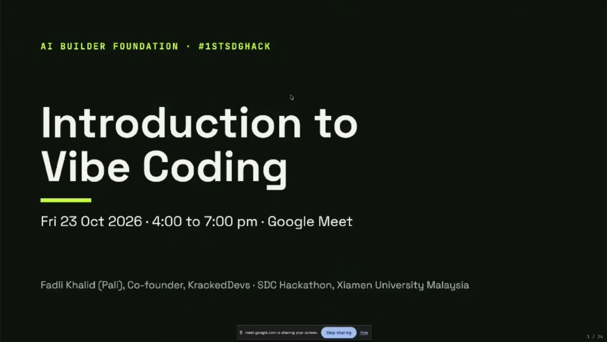

AI BUILDER FOUNDATION · #1STSDGHACK

**Introduction to Vibe Coding**

Fri 23 Oct 2026 · 4:00 to 7:00 pm · Google Meet

Fadli Khalid (Pali), Co-founder, KrackedDevs · SDC Hackathon, Xiamen University Malaysia

## Slide 02: Hi, I'm Fadli Khalid

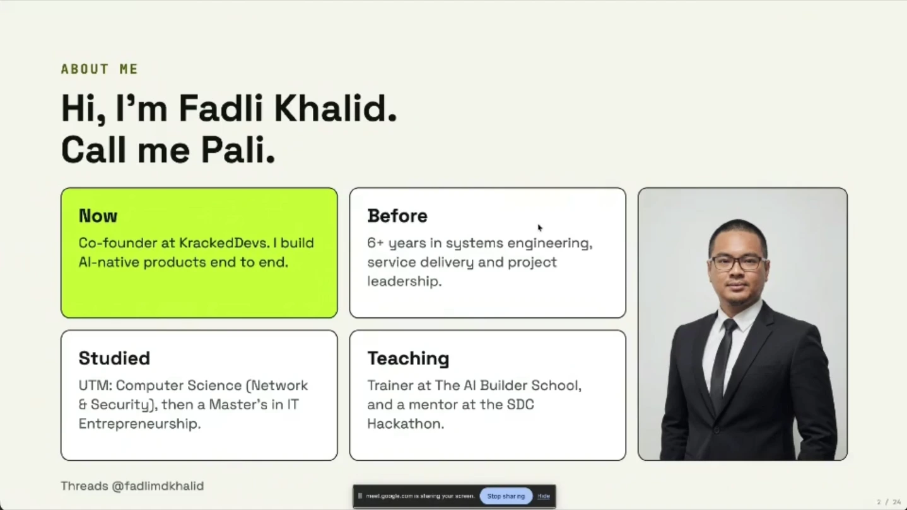

ABOUT ME

**Hi, I'm Fadli Khalid. Call me Pali.**

- **Now:** Co-founder at KrackedDevs. I build AI-native products end to end.
- **Before:** 6+ years in systems engineering, service delivery and project leadership.
- **Studied:** UTM: Computer Science (Network & Security), then a Master's in IT Entrepreneurship.
- **Teaching:** Trainer at The AI Builder School, and a mentor at the SDC Hackathon.

_Photo of Fadli in a suit and tie._

Threads @fadlimdkhalid

## Slide 03: Notable things I shipped at KrackedDevs

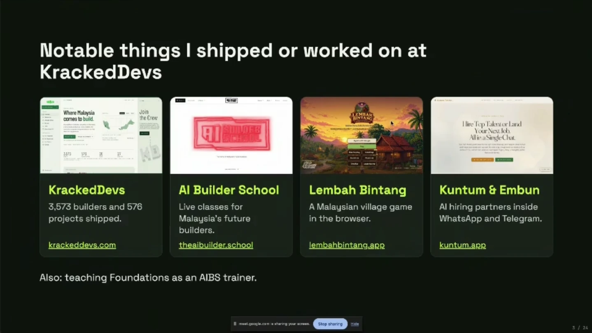

**Notable things I shipped or worked on at KrackedDevs**

_Four cards, each with a screenshot of the site: the KrackedDevs home page ("Where Malaysia comes to build."), the AI Builder School logo, the Lembah Bintang title screen and the Kuntum & Embun landing page ("Hire Top Talent or Land Your Next Job. All in a Single Chat.")._

- **KrackedDevs:** 3,573 builders and 576 projects shipped. [krackeddevs.com](https://krackeddevs.com)
- **AI Builder School:** Live classes for Malaysia's future builders. [theaibuilder.school](https://theaibuilder.school)
- **Lembah Bintang:** A Malaysian village game in the browser. [lembahbintang.app](https://lembahbintang.app)
- **Kuntum & Embun:** AI hiring partners inside WhatsApp and Telegram. [kuntum.app](https://kuntum.app)

Also: teaching Foundations as an AIBS trainer.

## Slide 04: Today, in three hours

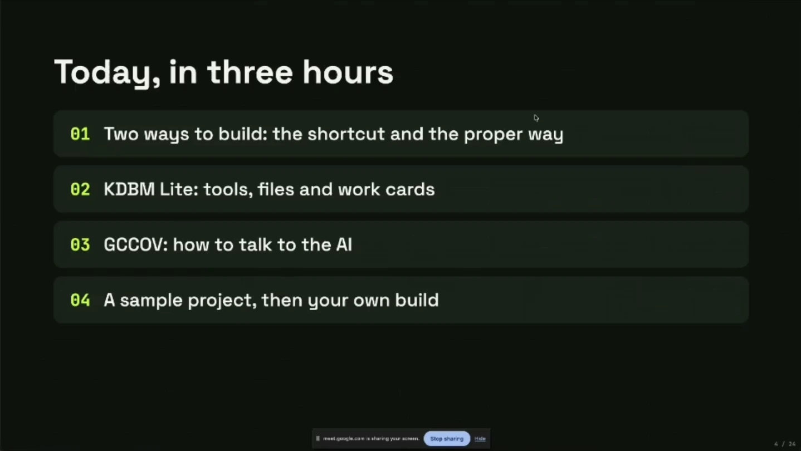

**Today, in three hours**

- **01** Two ways to build: the shortcut and the proper way
- **02** KDBM Lite: tools, files and work cards
- **03** GCCOV: how to talk to the AI
- **04** A sample project, then your own build

## Slide 05: KD Sandbox

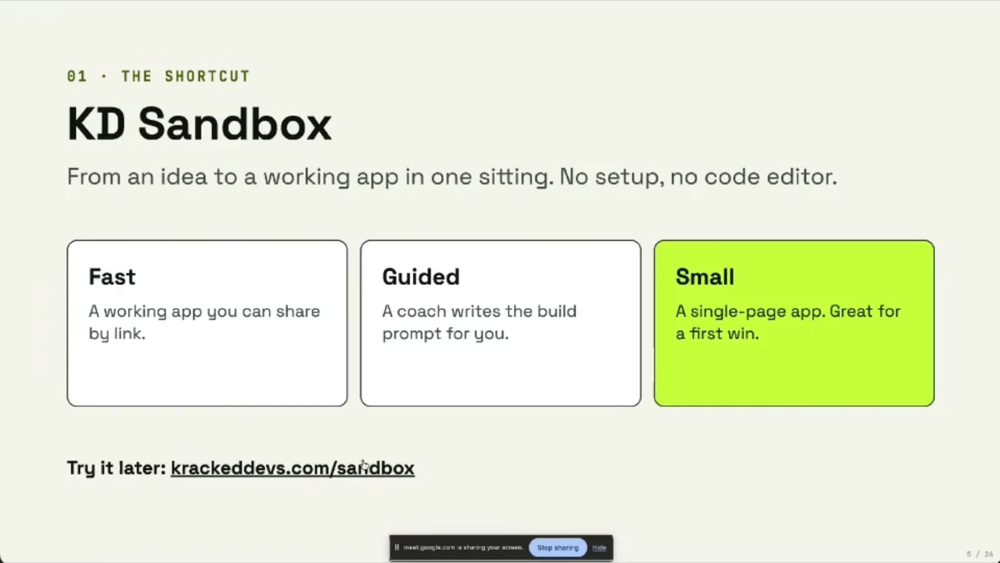

01 · THE SHORTCUT

**KD Sandbox**

From an idea to a working app in one sitting. No setup, no code editor.

- **Fast:** A working app you can share by link.
- **Guided:** A coach writes the build prompt for you.
- **Small:** A single-page app. Great for a first win.

Try it later: [krackeddevs.com/sandbox](https://krackeddevs.com/sandbox)

## Slide 06: How the Sandbox works

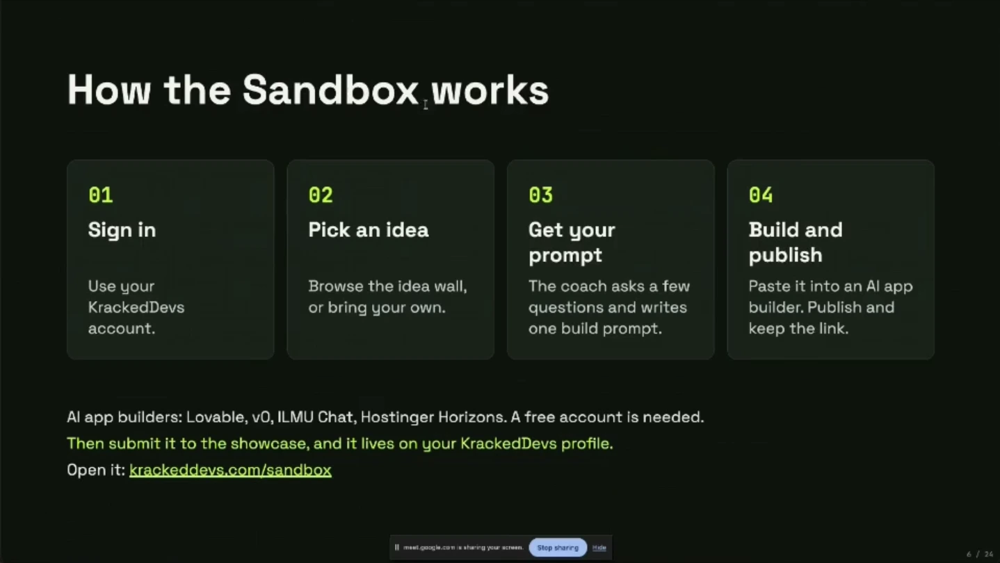

**How the Sandbox works**

1. **Sign in:** Use your KrackedDevs account.
2. **Pick an idea:** Browse the idea wall, or bring your own.
3. **Get your prompt:** The coach asks a few questions and writes one build prompt.
4. **Build and publish:** Paste it into an AI app builder. Publish and keep the link.

AI app builders: Lovable, v0, ILMU Chat, Hostinger Horizons. A free account is needed.

Then submit it to the showcase, and it lives on your KrackedDevs profile.

Open it: [krackeddevs.com/sandbox](https://krackeddevs.com/sandbox)

## Slide 07: Two ways to build

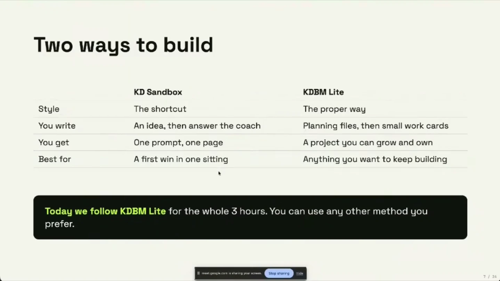

**Two ways to build**

|           | KD Sandbox                     | KDBM Lite                             |
| --------- | ------------------------------ | ------------------------------------- |
| Style     | The shortcut                   | The proper way                        |
| You write | An idea, then answer the coach | Planning files, then small work cards |
| You get   | One prompt, one page           | A project you can grow and own        |
| Best for  | A first win in one sitting     | Anything you want to keep building    |

**Today we follow KDBM Lite** for the whole 3 hours. You can use any other method you prefer.

## Slide 08: KDBM Lite

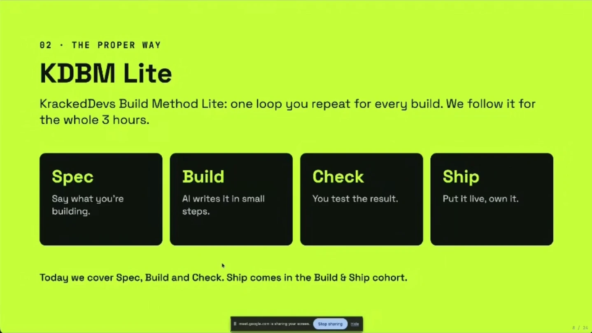

02 · THE PROPER WAY

**KDBM Lite**

KrackedDevs Build Method Lite: one loop you repeat for every build. We follow it for the whole 3 hours.

- **Spec:** Say what you're building.
- **Build:** AI writes it in small steps.
- **Check:** You test the result.
- **Ship:** Put it live, own it.

Today we cover Spec, Build and Check. Ship comes in the Build & Ship cohort.

## Slide 09: Your tools for KDBM Lite

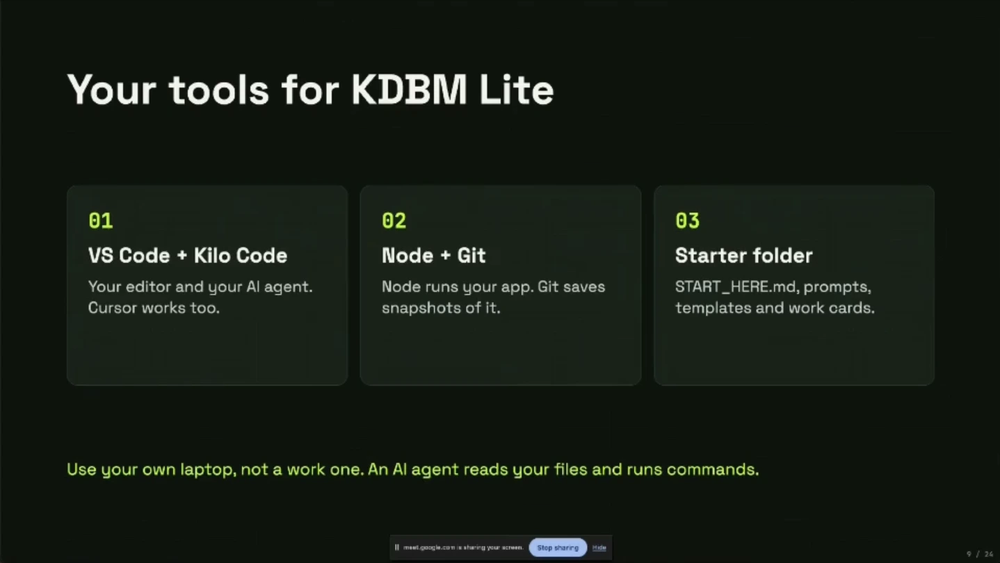

**Your tools for KDBM Lite**

1. **VS Code + Kilo Code:** Your editor and your AI agent. Cursor works too.
2. **Node + Git:** Node runs your app. Git saves snapshots of it.
3. **Starter folder:** START_HERE.md, prompts, templates and work cards.

Use your own laptop, not a work one. An AI agent reads your files and runs commands.

## Slide 10: The AI Builder School installer

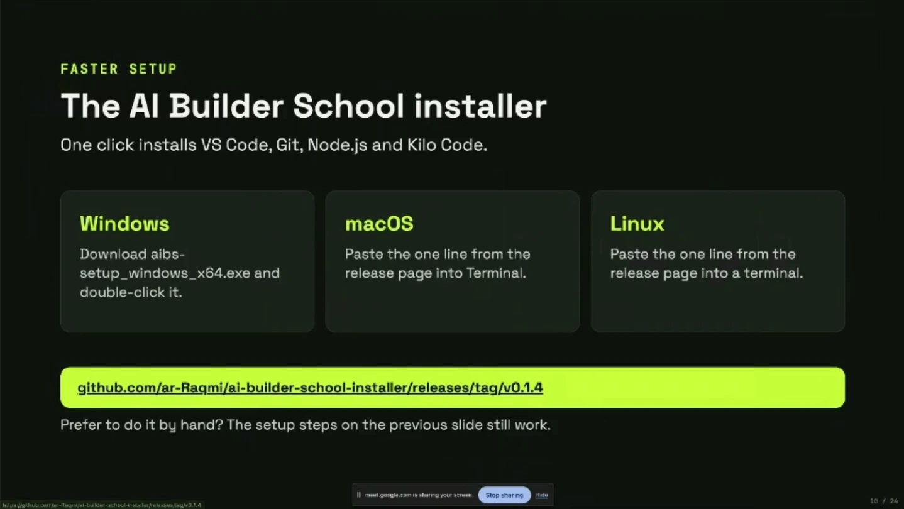

FASTER SETUP

**The AI Builder School installer**

One click installs VS Code, Git, Node.js and Kilo Code.

- **Windows:** Download aibs-setup_windows_x64.exe and double-click it.
- **macOS:** Paste the one line from the release page into Terminal.
- **Linux:** Paste the one line from the release page into a terminal.

[github.com/ar-Raqmi/ai-builder-school-installer/releases/tag/v0.1.4](https://github.com/ar-Raqmi/ai-builder-school-installer/releases/tag/v0.1.4)

Prefer to do it by hand? The setup steps on the previous slide still work.

## Slide 11: Download KDBM Lite

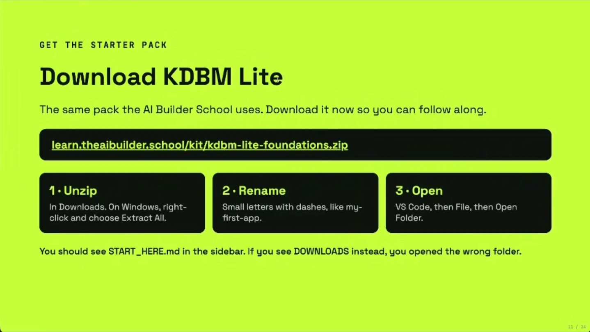

GET THE STARTER PACK

**Download KDBM Lite**

The same pack the AI Builder School uses. Download it now so you can follow along.

[learn.theaibuilder.school/kit/kdbm-lite-foundations.zip](https://learn.theaibuilder.school/kit/kdbm-lite-foundations.zip)

1. **Unzip:** In Downloads. On Windows, right-click and choose Extract All.
2. **Rename:** Small letters with dashes, like my-first-app.
3. **Open:** VS Code, then File, then Open Folder.

You should see START_HERE.md in the sidebar. If you see DOWNLOADS instead, you opened the wrong folder.

## Slide 12: The files are the truth, not the chat

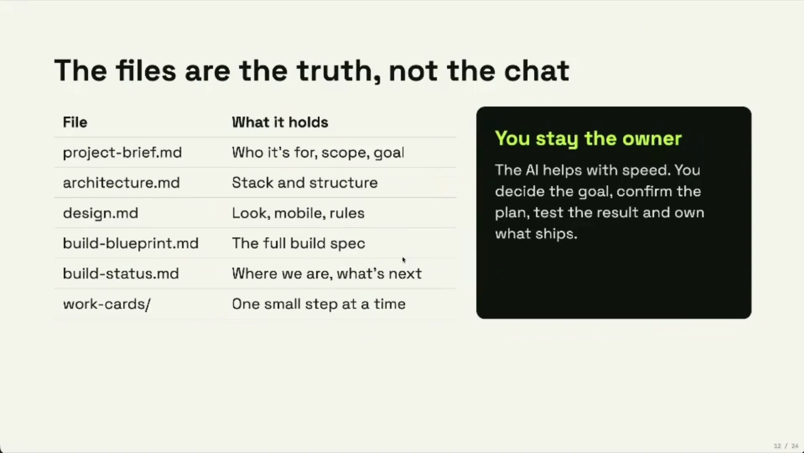

**The files are the truth, not the chat**

| File               | What it holds             |
| ------------------ | ------------------------- |
| project-brief.md   | Who it's for, scope, goal |
| architecture.md    | Stack and structure       |
| design.md          | Look, mobile, rules       |
| build-blueprint.md | The full build spec       |
| build-status.md    | Where we are, what's next |
| work-cards/        | One small step at a time  |

**You stay the owner**

The AI helps with speed. You decide the goal, confirm the plan, test the result and own what ships.

## Slide 13: Build in four work cards

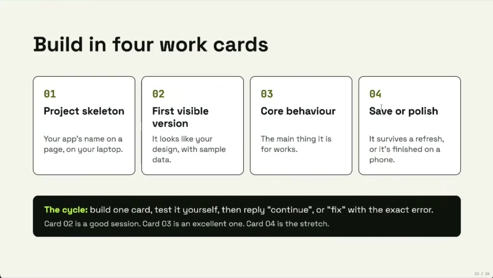

**Build in four work cards**

1. **Project skeleton:** Your app's name on a page, on your laptop.
2. **First visible version:** It looks like your design, with sample data.
3. **Core behaviour:** The main thing it is for works.
4. **Save or polish:** It survives a refresh, or it's finished on a phone.

**The cycle:** build one card, test it yourself, then reply "continue", or "fix" with the exact error. Card 02 is a good session. Card 03 is an excellent one. Card 04 is the stretch.

## Slide 14: The GCCOV approach

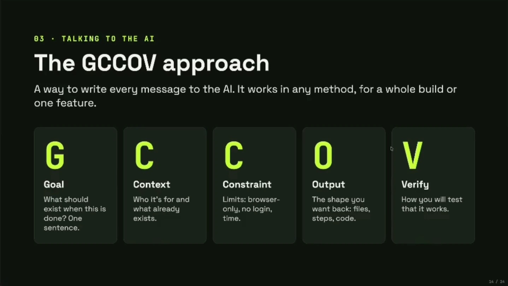

03 · TALKING TO THE AI

**The GCCOV approach**

A way to write every message to the AI. It works in any method, for a whole build or one feature.

- **G, Goal:** What should exist when this is done? One sentence.
- **C, Context:** Who it's for and what already exists.
- **C, Constraint:** Limits: browser-only, no login, time.
- **O, Output:** The shape you want back: files, steps, code.
- **V, Verify:** How you will test that it works.

## Slide 15: GCCOV inside KDBM Lite

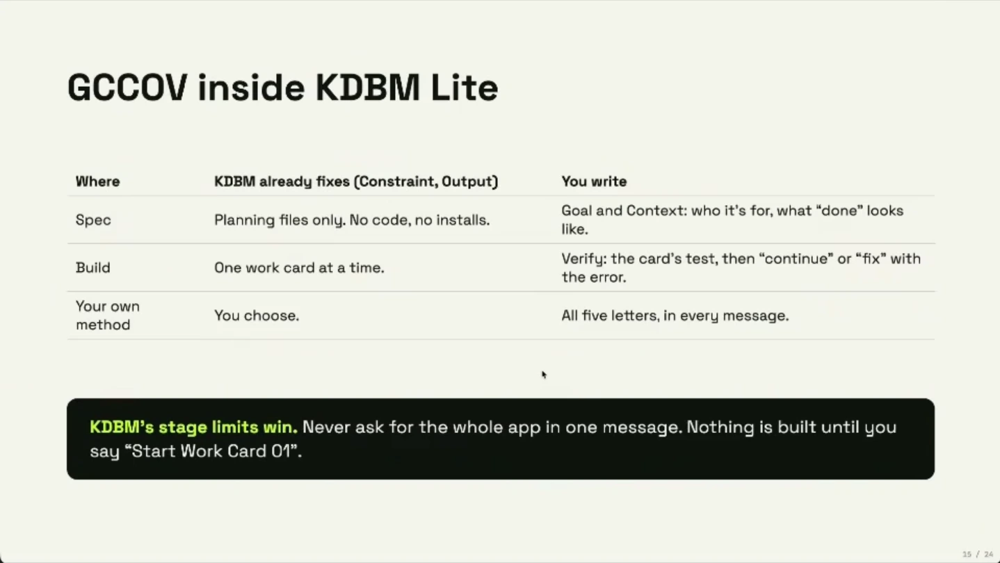

**GCCOV inside KDBM Lite**

| Where           | KDBM already fixes (Constraint, Output)    | You write                                                         |
| --------------- | ------------------------------------------ | ----------------------------------------------------------------- |
| Spec            | Planning files only. No code, no installs. | Goal and Context: who it's for, what "done" looks like.           |
| Build           | One work card at a time.                   | Verify: the card's test, then "continue" or "fix" with the error. |
| Your own method | You choose.                                | All five letters, in every message.                               |

**KDBM's stage limits win.** Never ask for the whole app in one message. Nothing is built until you say "Start Work Card 01".

## Slide 16: Talking to the AI: before and after

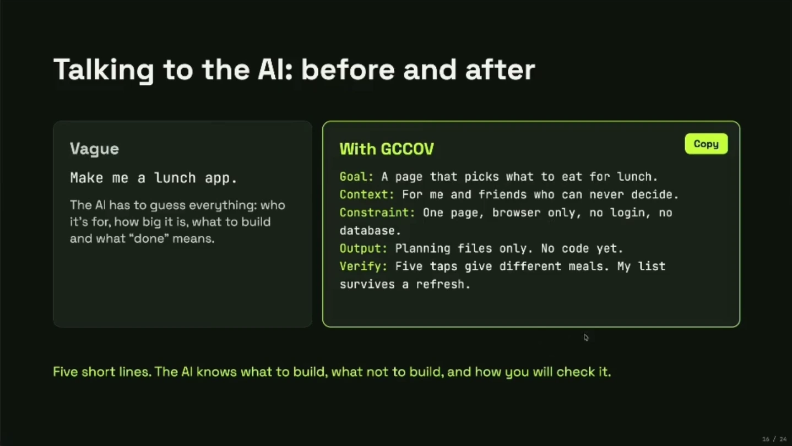

**Talking to the AI: before and after**

**Vague**

Make me a lunch app.

The AI has to guess everything: who it's for, how big it is, what to build and what "done" means.

**With GCCOV** _(with a Copy button)_

```text
Goal: A page that picks what to eat for lunch.
Context: For me and friends who can never decide.
Constraint: One page, browser only, no login, no database.
Output: Planning files only. No code yet.
Verify: Five taps give different meals. My list survives a refresh.
```

Five short lines. The AI knows what to build, what not to build, and how you will check it.

## Slide 17: Your first message to the coach

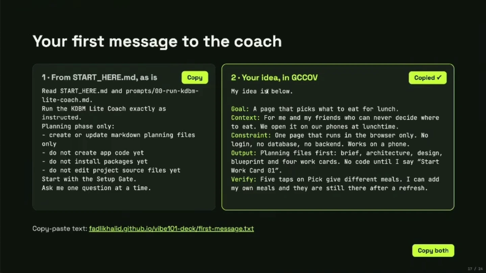

**Your first message to the coach**

**1 · From START_HERE.md, as is** _(with a Copy button)_

```text
Read START_HERE.md and prompts/00-run-kdbm-lite-coach.md.
Run the KDBM Lite Coach exactly as instructed.
Planning phase only:
- create or update markdown planning files only
- do not create app code yet
- do not install packages yet
- do not edit project source files yet
Start with the Setup Gate.
Ask me one question at a time.
```

**2 · Your idea, in GCCOV** _(with its button showing "Copied ✓")_

```text
My idea is below.

Goal: A page that picks what to eat for lunch.
Context: For me and my friends who can never decide where to eat. We open it on our phones at lunchtime.
Constraint: One page that runs in the browser only. No login, no database, no backend. Works on a phone.
Output: Planning files first: brief, architecture, design, blueprint and four work cards. No code until I say "Start Work Card 01".
Verify: Five taps on Pick give different meals. I can add my own meals and they are still there after a refresh.
```

Copy-paste text: [fadlikhalid.github.io/vibe101-deck/first-message.txt](https://fadlikhalid.github.io/vibe101-deck/first-message.txt)

_A "Copy both" button sits at the bottom right._

## Slide 18: What happens after you send it

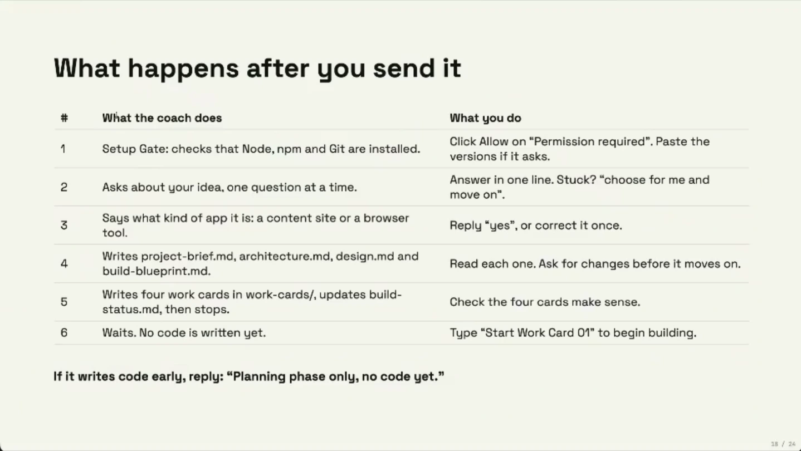

**What happens after you send it**

| #   | What the coach does                                                         | What you do                                                          |
| --- | --------------------------------------------------------------------------- | -------------------------------------------------------------------- |
| 1   | Setup Gate: checks that Node, npm and Git are installed.                    | Click Allow on "Permission required". Paste the versions if it asks. |
| 2   | Asks about your idea, one question at a time.                               | Answer in one line. Stuck? "choose for me and move on".              |
| 3   | Says what kind of app it is: a content site or a browser tool.              | Reply "yes", or correct it once.                                     |
| 4   | Writes project-brief.md, architecture.md, design.md and build-blueprint.md. | Read each one. Ask for changes before it moves on.                   |
| 5   | Writes four work cards in work-cards/, updates build-status.md, then stops. | Check the four cards make sense.                                     |
| 6   | Waits. No code is written yet.                                              | Type "Start Work Card 01" to begin building.                         |

**If it writes code early, reply: "Planning phase only, no code yet."**

## Slide 19: Inside KDBM: what you actually type

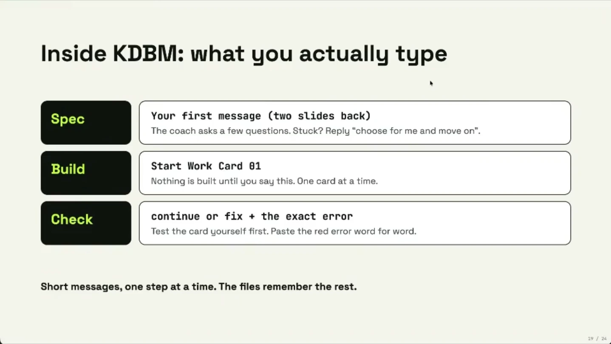

**Inside KDBM: what you actually type**

- **Spec:** `Your first message (two slides back)`. The coach asks a few questions. Stuck? Reply "choose for me and move on".
- **Build:** `Start Work Card 01`. Nothing is built until you say this. One card at a time.
- **Check:** `continue or fix + the exact error`. Test the card yourself first. Paste the red error word for word.

**Short messages, one step at a time. The files remember the rest.**

## Slide 20: Makan Picker

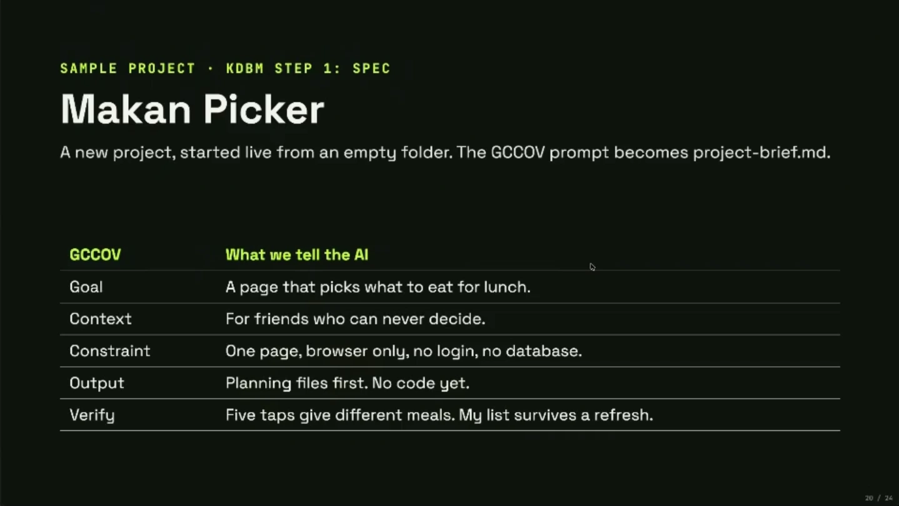

SAMPLE PROJECT · KDBM STEP 1: SPEC

**Makan Picker** _(makan: Malay for "eat")_

A new project, started live from an empty folder. The GCCOV prompt becomes project-brief.md.

| GCCOV      | What we tell the AI                                         |
| ---------- | ----------------------------------------------------------- |
| Goal       | A page that picks what to eat for lunch.                    |
| Context    | For friends who can never decide.                           |
| Constraint | One page, browser only, no login, no database.              |
| Output     | Planning files first. No code yet.                          |
| Verify     | Five taps give different meals. My list survives a refresh. |

## Slide 21: Makan Picker, in four work cards

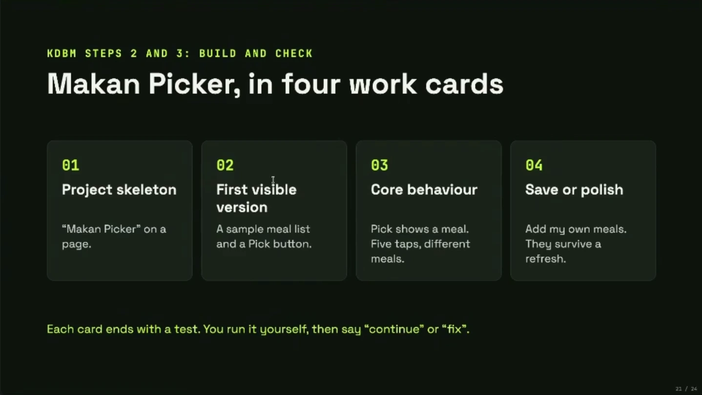

KDBM STEPS 2 AND 3: BUILD AND CHECK

**Makan Picker, in four work cards**

1. **Project skeleton:** "Makan Picker" on a page.
2. **First visible version:** A sample meal list and a Pick button.
3. **Core behaviour:** Pick shows a meal. Five taps, different meals.
4. **Save or polish:** Add my own meals. They survive a refresh.

Each card ends with a test. You run it yourself, then say "continue" or "fix".

## Slide 22: Your turn: build something small and fun

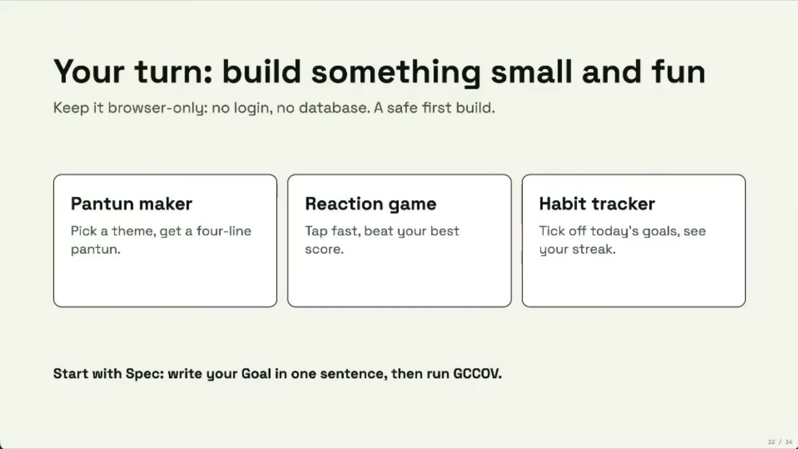

**Your turn: build something small and fun**

Keep it browser-only: no login, no database. A safe first build.

- **Pantun maker:** Pick a theme, get a four-line pantun.
- **Reaction game:** Tap fast, beat your best score.
- **Habit tracker:** Tick off today's goals, see your streak.

**Start with Spec: write your Goal in one sentence, then run GCCOV.**

## Slide 23: Visit these later

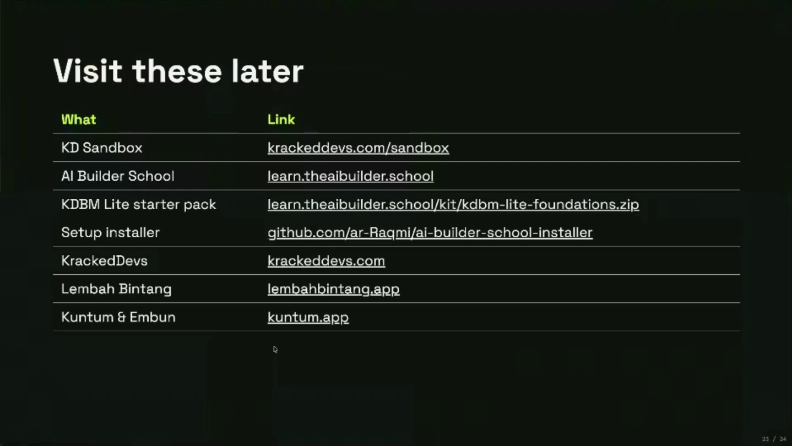

**Visit these later**

| What                   | Link                                                            |
| ---------------------- | --------------------------------------------------------------- |
| KD Sandbox             | [krackeddevs.com/sandbox][sandbox]                              |
| AI Builder School      | [learn.theaibuilder.school][aibs]                               |
| KDBM Lite starter pack | [learn.theaibuilder.school/kit/kdbm-lite-foundations.zip][kdbm] |
| Setup installer        | [github.com/ar-Raqmi/ai-builder-school-installer][installer]    |
| KrackedDevs            | [krackeddevs.com][kd]                                           |
| Lembah Bintang         | [lembahbintang.app][lembah]                                     |
| Kuntum & Embun         | [kuntum.app][kuntum]                                            |

[sandbox]: https://krackeddevs.com/sandbox
[aibs]: https://learn.theaibuilder.school
[kdbm]: https://learn.theaibuilder.school/kit/kdbm-lite-foundations.zip
[installer]: https://github.com/ar-Raqmi/ai-builder-school-installer
[kd]: https://krackeddevs.com
[lembah]: https://lembahbintang.app
[kuntum]: https://kuntum.app

## Slide 24: Demo: KD Sandbox, four steps

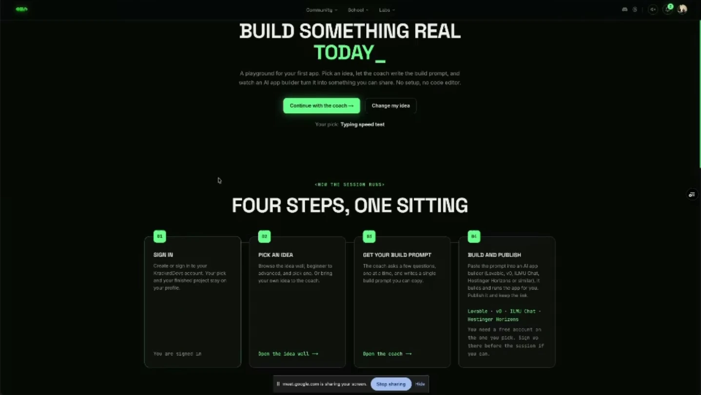

_Screenshot of the KD Sandbox page on krackeddevs.com, with Fadli signed in and the typing speed test already picked._

**BUILD SOMETHING REAL TODAY_**

A playground for your first app. Pick an idea, let the coach write the build prompt, and watch an AI app builder turn it into something you can share. No setup, no code editor.

Buttons: **Continue with the coach →**, **Change my idea**. Your pick: **Typing speed test**

`<HOW THE SESSION RUNS>`

**FOUR STEPS, ONE SITTING**

1. **SIGN IN:** Create or sign in to your KrackedDevs account. Your pick and your finished project stay on your profile. _(You are signed in)_
2. **PICK AN IDEA:** Browse the idea wall, beginner to advanced, and pick one. Or bring your own idea to the coach. _(Open the idea wall →)_
3. **GET YOUR BUILD PROMPT:** The coach asks a few questions, one at a time, and writes a single build prompt you can copy. _(Open the coach →)_
4. **BUILD AND PUBLISH:** Paste the prompt into an AI app builder (Lovable, v0, ILMU Chat, Hostinger Horizons or similar). It builds and runs the app for you. Publish it and keep the link. Lovable · v0 · ILMU Chat · Hostinger Horizons. You need a free account on the one you pick. Sign up there before the session if you can.

## Slide 25: Demo: the idea wall

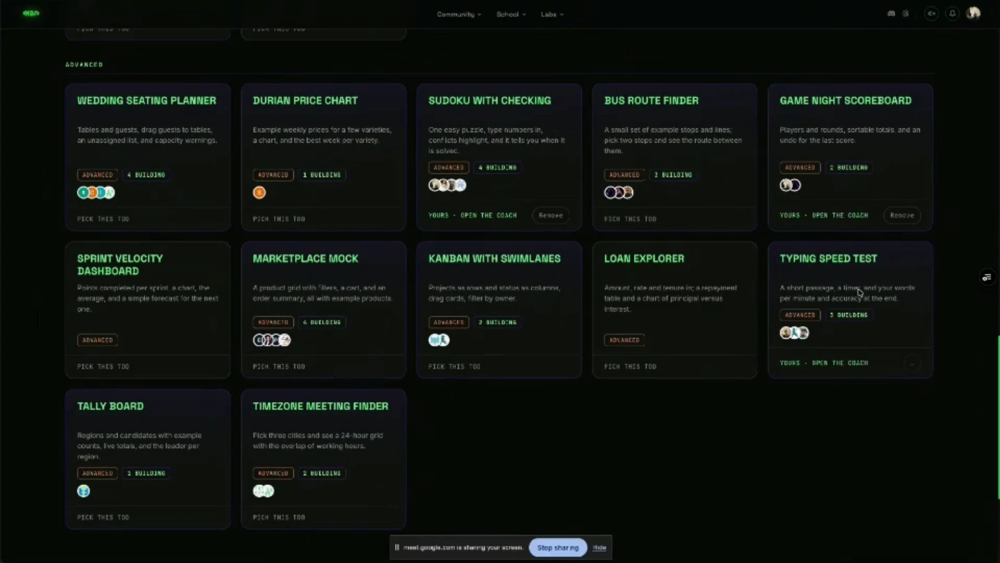

_Screenshot of the KD Sandbox idea wall, scrolled to its ADVANCED ideas. Each card has a level tag, a count of people building it, and "PICK THIS TOO", or "YOURS · OPEN THE COACH" for ideas Fadli has picked._

- **WEDDING SEATING PLANNER:** Tables and guests, drag guests to tables, an unassigned list, and capacity warnings. (4 building)
- **DURIAN PRICE CHART:** Example weekly prices for a few varieties, a chart, and the best week per variety. (1 building)
- **SUDOKU WITH CHECKING:** One easy puzzle, type numbers in, conflicts highlight, and it tells you when it is solved. (4 building)
- **BUS ROUTE FINDER:** A small set of example stops and lines; pick two stops and see the route between them. (3 building)
- **GAME NIGHT SCOREBOARD:** Players and rounds, sortable totals, and an undo for the last score. (2 building)
- **SPRINT VELOCITY DASHBOARD:** Points completed per sprint, a chart, the average, and a simple forecast for the next one.
- **MARKETPLACE MOCK:** A product grid with filters, a cart, and an order summary, all with example products. (4 building)
- **KANBAN WITH SWIMLANES:** Projects as rows and status as columns, drag cards, filter by owner. (2 building)
- **LOAN EXPLORER:** Amount, rate and tenure in; a repayment table and a chart of principal versus interest.
- **TYPING SPEED TEST:** A short passage, a timer, and your words per minute and accuracy at the end. (3 building)
- **TALLY BOARD:** Regions and candidates with example counts, live totals, and the leader per region. (1 building)
- **TIMEZONE MEETING FINDER:** Pick three cities and see a 24-hour grid with the overlap of working hours. (2 building)

## Slide 26: Demo: the coach interview

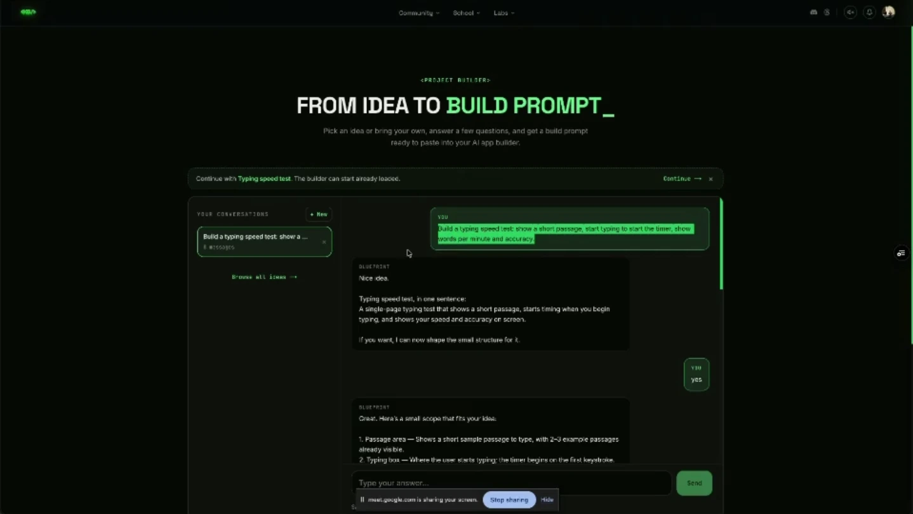

_Screenshot of the KD Sandbox coach ("Project Builder") interviewing Fadli about the typing speed test._

- `<PROJECT BUILDER>`
- **FROM IDEA TO BUILD PROMPT_**
- Pick an idea or bring your own, answer a few questions, and get a build prompt ready to paste into your AI app builder.
- Banner: Continue with **Typing speed test**. The builder can start already loaded. Continue →
- YOUR CONVERSATIONS (+ New): "Build a typing speed test: show a ..." (8 messages); Browse all ideas →
- **You:** Build a typing speed test: show a short passage, start typing to start the timer, show words per minute and accuracy.
- **Blueprint:** Nice idea. Typing speed test, in one sentence: A single-page typing test that shows a short passage, starts timing when you begin typing, and shows your speed and accuracy on screen. If you want, I can now shape the small structure for it.
- **You:** yes
- **Blueprint:** Great. Here's a small scope that fits your idea: 1. Passage area — Shows a short sample passage to type, with 2–3 example passages already visible. 2. Typing box — Where the user starts typing; the timer begins on the first keystroke. [cut off]
- Answer box: "Type your answer..." with a **Send** button

## Slide 27: Demo: the build prompt

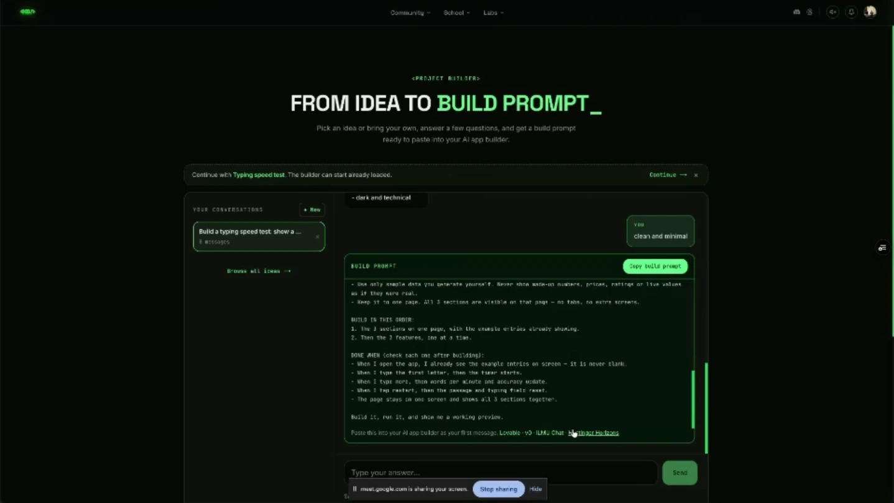

_The same coach page after the interview: Fadli's last answer, "clean and minimal" (to a style question whose options end "dark and technical"), and the build prompt, scrolled to its end, with a **Copy build prompt** button._

```text
- Use only sample data you generate yourself. Never show made-up numbers, prices, ratings or live values as if they were real.
- Keep it to one page. All 3 sections are visible on that page — no tabs, no extra screens.

BUILD IN THIS ORDER:
1. The 3 sections on one page, with the example entries already showing.
2. Then the 3 features, one at a time.

DONE WHEN (check each one after building):
- When I open the app, I already see the example entries on screen — it is never blank.
- When I type the first letter, then the timer starts.
- When I type more, then words per minute and accuracy update.
- When I tap restart, then the passage and typing field reset.
- The page stays on one screen and shows all 3 sections together.

Build it, run it, and show me a working preview.
```

Paste this into your AI app builder as your first message. Lovable · v0 · ILMU Chat · Hostinger Horizons

## Slide 28: Demo: pasting the prompt into Lovable

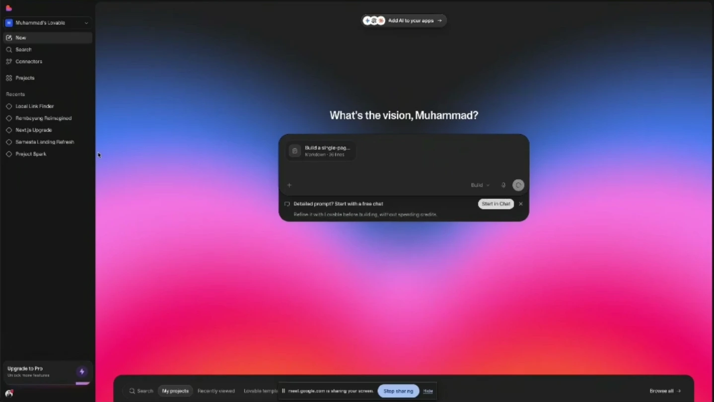

_Screenshot of Lovable's start page, signed in as "Muhammad's Lovable", with the build prompt pasted in as an attachment._

- **What's the vision, Muhammad?**
- Prompt box: attachment "Build a single-pag..." (Markdown · 36 lines); Build mode
- Detailed prompt? Start with a free chat. Refine it with Lovable before building, without spending credits. **Start in Chat**
- Sidebar: New, Search, Connectors, Projects; Recents: Local Link Finder, Rembayung Reimagined, Next.js Upgrade, Semesta Landing Refresh, Project Spark; Upgrade to Pro

## Slide 29: Demo: the Typing Speed Test in Lovable

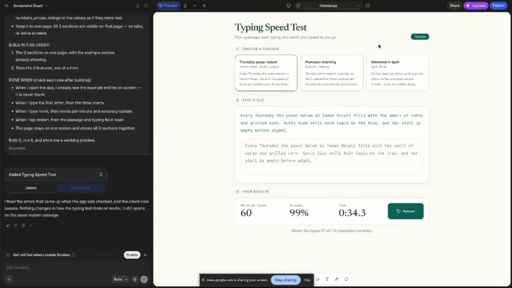

_Screenshot of the Lovable project "Screenshot Exact": the chat with the build prompt on the left, and the preview of the app Lovable built on the right, after Fadli's test run._

- Chat: the end of the build prompt, then "Added Typing Speed Test" (Details, Previewing) and Lovable's reply: "I fixed the errors that came up when the app was checked, and the check now passes. Nothing changes in how the typing test looks or works; it still opens on the pasar malam passage."
- Toolbar: Preview; Homepage; **Share**, **Upgrade**, **Publish**
- **Typing Speed Test**: Pick a passage, start typing, and watch your speed as you go. _(Finished)_
- 1 CHOOSE A PASSAGE: Thursday pasar malam (Taman Melati, Kuala Lumpur); Monsoon morning (Kuantan, Pahang); Weekend in Ipoh (Ipoh, Perak)
- 2 TYPE IT OUT: "Every Thursday the pasar malam in Taman Melati fills with the smell of satay and grilled corn. Aunty Siew sells kuih lapis by the tray, and her stall is empty before eight."
- 3 YOUR RESULTS: Words per minute **60**; Accuracy **99%**; Time **0:34.3**; **Restart**
- Done! You typed 171 of 172 characters correctly.

## Slide 30: Demo: publishing from Lovable

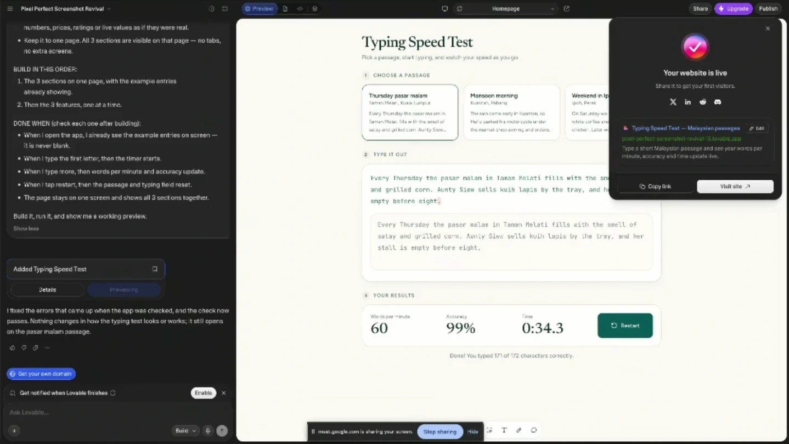

_The same project, now named "Pixel Perfect Screenshot Revival", after Fadli clicked Publish._

- **Your website is live**. Share it to get your first visitors. _(share icons for X, LinkedIn, Reddit and Discord)_
- Typing Speed Test — Malaysian passages _(Edit)_; [pixel-perfect-screenshot-revival-13.lovable.app](https://pixel-perfect-screenshot-revival-13.lovable.app); "Type a short Malaysian passage and see your words per minute, accuracy and time update live."
- Buttons: **Copy link**, **Visit site ↗**
- Chat panel: "Get your own domain"

## Slide 31: Demo: the code in Lovable

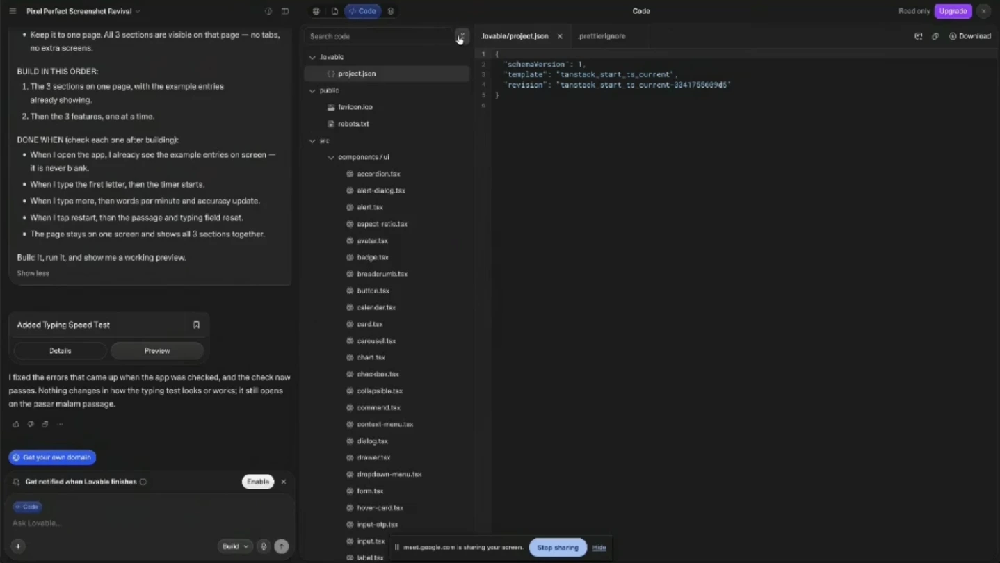

_Lovable's read-only Code view of the project, where Fadli pointed out the Download button._

- File tree: .lovable/project.json; public: favicon.ico, robots.txt; src/components/ui: accordion.tsx, alert-dialog.tsx, alert.tsx, aspect-ratio.tsx, avatar.tsx, badge.tsx, breadcrumb.tsx, button.tsx, calendar.tsx, card.tsx, carousel.tsx, chart.tsx, checkbox.tsx, collapsible.tsx, command.tsx, context-menu.tsx, dialog.tsx, drawer.tsx, dropdown-menu.tsx, form.tsx, hover-card.tsx, input-otp.tsx, input.tsx, label.tsx
- Open file `.lovable/project.json`: `"schemaVersion": 1`, `"template": "tanstack_start_ts_current"`, `"revision": "tanstack_start_ts_current-3341755609d5"`
- Top right: Read only, **Upgrade**, **Download**

## Slide 32: Demo: the installer's release page

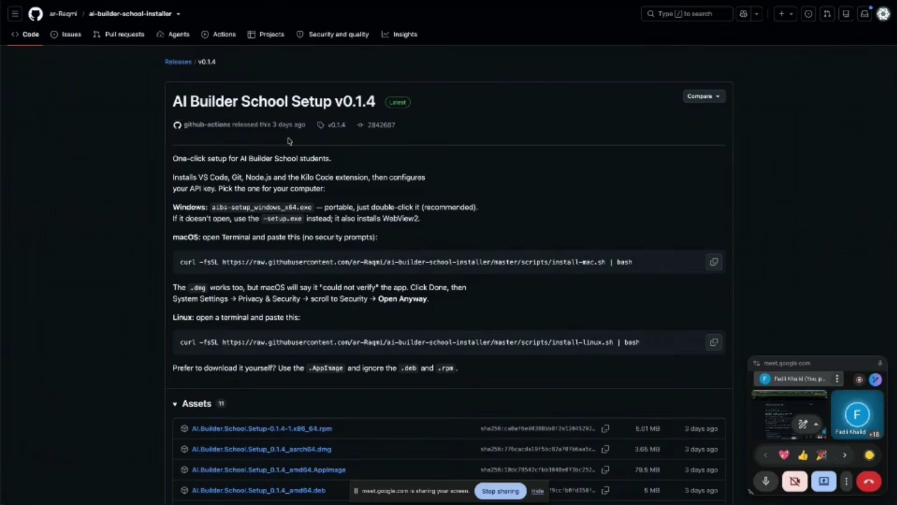

_Screenshot of the installer's GitHub release page, github.com/ar-Raqmi/ai-builder-school-installer/releases/tag/v0.1.4. The small Meet window in the corner shows Fadli's own tile._

- Releases / v0.1.4
- **AI Builder School Setup v0.1.4** _(Latest)_; github-actions released this 3 days ago
- One-click setup for AI Builder School students.
- Installs VS Code, Git, Node.js and the Kilo Code extension, then configures your API key. Pick the one for your computer:
- **Windows:** `aibs-setup_windows_x64.exe` — portable, just double-click it (recommended). If it doesn't open, use the `-setup.exe` instead; it also installs WebView2.
- **macOS:** open Terminal and paste this (no security prompts): `curl -fsSL https://raw.githubusercontent.com/ar-Raqmi/ai-builder-school-installer/master/scripts/install-mac.sh | bash`
- The `.dmg` works too, but macOS will say it "could not verify" the app. Click Done, then System Settings → Privacy & Security → scroll to Security → **Open Anyway**.
- **Linux:** open a terminal and paste this: `curl -fsSL https://raw.githubusercontent.com/ar-Raqmi/ai-builder-school-installer/master/scripts/install-linux.sh | bash`
- Prefer to download it yourself? Use the `.AppImage` and ignore the `.deb` and `.rpm`.
- **Assets** (11): AI.Builder.School.Setup-0.1.4-1.x86_64.rpm (5.01 MB), AI.Builder.School.Setup_0.1.4_aarch64.dmg (3.65 MB), AI.Builder.School.Setup_0.1.4_amd64.AppImage (79.5 MB), AI.Builder.School.Setup_0.1.4_amd64.deb (5 MB), and more below the fold

## Slide 33: Demo: VS Code with Kilo Code

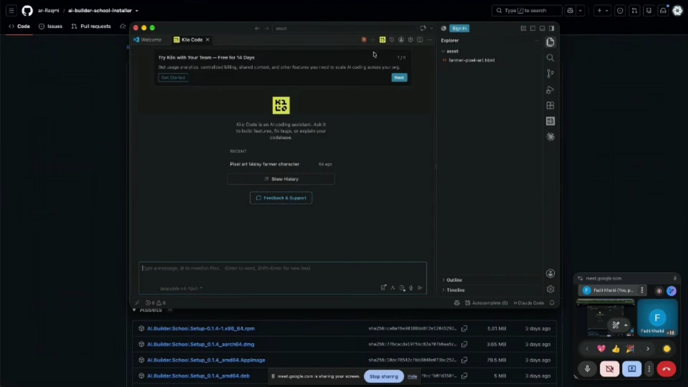

_Screenshot of VS Code, as the installer sets it up, with the Kilo Code extension open, over the release page._

- Tabs: Welcome, **Kilo Code**
- Banner: Try Kilo with Your Team — Free for 14 Days. Get usage analytics, centralized billing, shared context, and other features you need to scale AI coding across your org. _(Get Started, Next)_
- Kilo Code is an AI coding assistant. Ask it to build features, fix bugs, or explain your codebase.
- RECENT: Pixel art Malay farmer character (6d ago); Show History; Feedback & Support
- Message box: "Type a message, @ to mention files... (Enter to send, Shift+Enter for new line)"
- Explorer: asset / farmer-pixel-art.html

## Slide 34: Demo: the starter pack in Claude

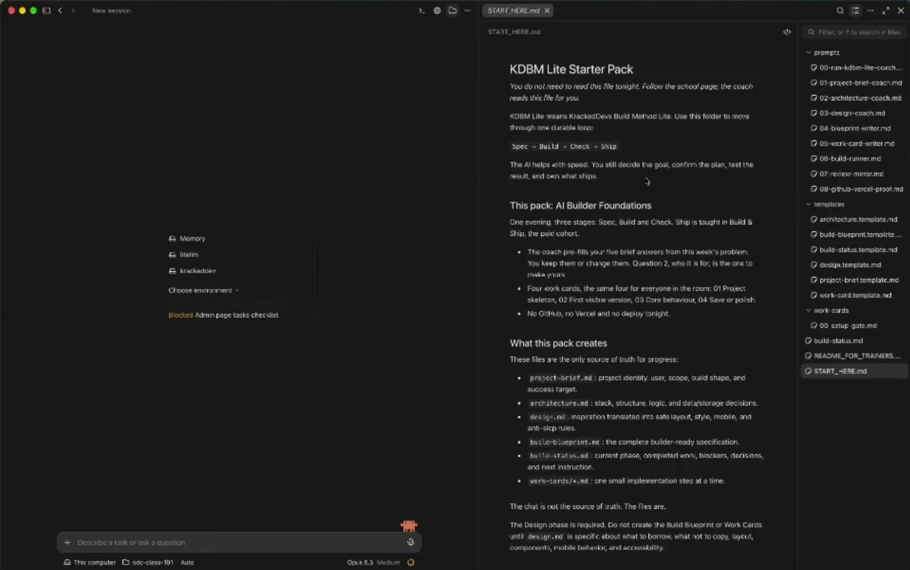

_Screenshot of the Claude desktop app, Fadli's coding agent for the rest of the session, with a new Claude Code session in the unzipped starter folder ("sdc-class-101") and START_HERE.md open beside it._

- Session: New session; Memory, litellm, krackeddev; Choose environment; "Blocked Admin page tasks checklist"; prompt box "Describe a task or ask a question"; This computer · sdc-class-101 · Auto · Opus [unreadable] Medium
- Files: prompts (00-run-kdbm-lite-coach.md, 01-project-brief-coach.md, 02-architecture-coach.md, 03-design-coach.md, 04-blueprint-writer.md, 05-work-card-writer.md, 06-build-runner.md, 07-review-mirror.md, 08-github-vercel-proof.md); templates (architecture.template.md, build-blueprint.template.md, build-status.template.md, design.template.md, project-brief.template.md, work-card.template.md); work-cards (00-setup-gate.md); build-status.md; README_FOR_TRAINERS.md; START_HERE.md
- **KDBM Lite Starter Pack**: _You do not need to read this file tonight. Follow the school page; the coach reads this file for you._ KDBM Lite means KrackedDevs Build Method Lite. Use this folder to move through one durable loop: `Spec → Build → Check → Ship`. The AI helps with speed. You still decide the goal, confirm the plan, test the result, and own what ships.
- **This pack: AI Builder Foundations**: One evening, three stages: Spec, Build and Check. Ship is taught in Build & Ship, the paid cohort.
  - The coach pre-fills your five brief answers from this week's problem. You keep them or change them. Question 2, who it is for, is the one to make yours.
  - Four work cards, the same four for everyone in the room: 01 Project skeleton, 02 First visible version, 03 Core behaviour, 04 Save or polish.
  - No GitHub, no Vercel and no deploy tonight.
- **What this pack creates**: These files are the only source of truth for progress:
  - `project-brief.md`: project identity, user, scope, build shape, and success target.
  - `architecture.md`: stack, structure, logic, and data/storage decisions.
  - `design.md`: inspiration translated into safe layout, style, mobile, and anti-slop rules.
  - `build-blueprint.md`: the complete builder-ready specification.
  - `build-status.md`: current phase, completed work, blockers, decisions, and next instruction.
  - `work-cards/*.md`: one small implementation step at a time.
- The chat is not the source of truth. The files are.
- The Design phase is required. Do not create the Build Blueprint or Work Cards until `design.md` is specific about what to borrow, what not to copy, layout, components, mobile behavior, and accessibility.

## Slide 35: Demo: the Setup Gate and the five brief answers

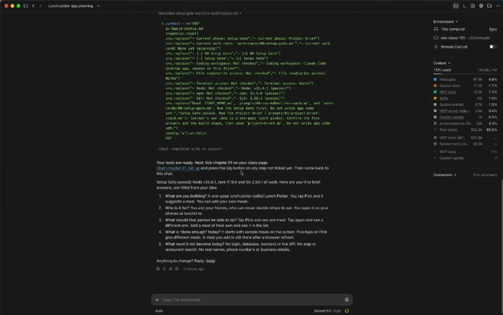

_Screenshot of the Claude Code session "Lunch picker app planning" after Fadli sent his first message: the coach has recorded the Setup Gate results in build-status.md with a Python snippet and pre-filled the five brief answers._

- Your tools are ready. Next: tick chapter 01 on your class page. Open chapter 01, Set up and press the big button on any step not ticked yet. Then come back to this chat.
- Setup Gate passed: Node v25.6.1, npm 11.9.0 and Git 2.50.1 all work. Here are your five brief answers, pre-filled from your idea:
  1. What are you building? A one-page lunch picker called Lunch Picker. You tap Pick and it suggests a meal. You can add your own meals.
  2. Who is it for? You and your friends, who can never decide where to eat. You open it on your phones at lunchtime.
  3. What should that person be able to do? Tap Pick and see one meal. Tap again and see a different one. Add a meal of their own and see it in the list.
  4. What is "done enough" today? It starts with sample meals on the screen. Five taps on Pick give different meals. A meal you add is still there after a browser refresh.
  5. What must it not become today? No login, database, backend or live API. No map or restaurant search. No real names, phone numbers or business details.
- Anything to change? Reply `keep`.
- Side panel: Environment (This computer; sdc-class-101 · ~/Downloads; Remote Control off); Context 10% used, 104.8k / 1M

## Slide 36: Demo: project brief and proposed architecture

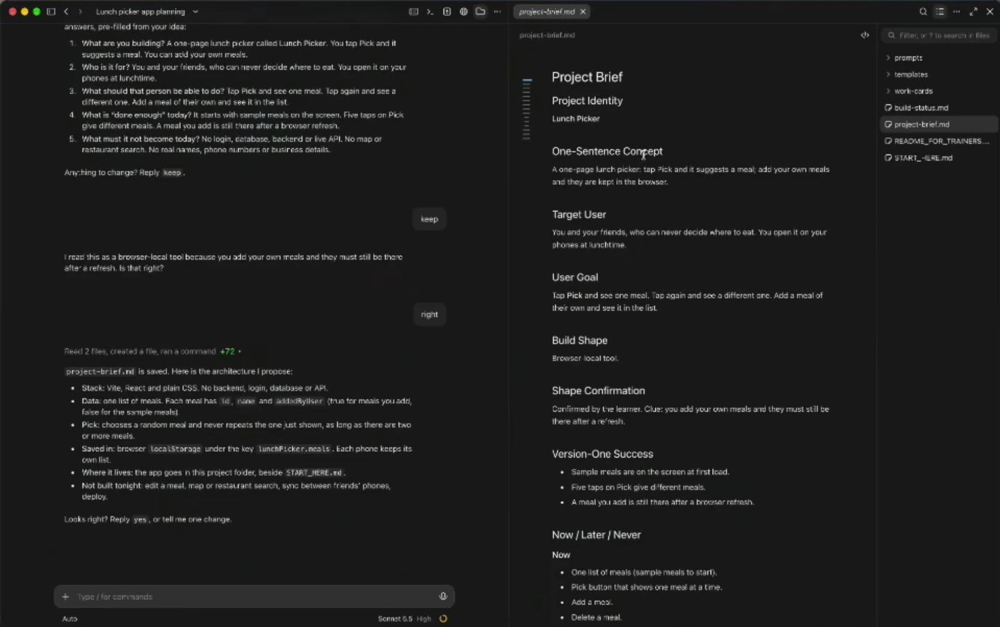

_The same session after Fadli replied "keep" and "right": project-brief.md is open on the right, and the coach proposes the architecture on the left._

- Coach: I read this as a browser-local tool because you add your own meals and they must still be there after a refresh. Is that right? _(Fadli: right)_
- Coach: `project-brief.md` is saved. Here is the architecture I propose:
  - Stack: Vite, React and plain CSS. No backend, login, database or API.
  - Data: one list of meals. Each meal has `id`, `name` and `addedByUser` (true for meals you add, false for the sample meals).
  - Pick: chooses a random meal and never repeats the one just shown, as long as there are two or more meals.
  - Saved in: browser `localStorage` under the key `lunchPicker.meals`. Each phone keeps its own list.
  - Where it lives: the app goes in this project folder, beside `START_HERE.md`.
  - Not built tonight: edit a meal, map or restaurant search, sync between friends' phones, deploy.
- Looks right? Reply `yes`, or tell me one change.
- **Project Brief** (project-brief.md):
  - Project Identity: Lunch Picker
  - One-Sentence Concept: A one-page lunch picker: tap Pick and it suggests a meal; add your own meals and they are kept in the browser.
  - Target User: You and your friends, who can never decide where to eat. You open it on your phones at lunchtime.
  - User Goal: Tap Pick and see one meal. Tap again and see a different one. Add a meal of their own and see it in the list.
  - Build Shape: Browser-local tool.
  - Shape Confirmation: Confirmed by the learner. Clue: you add your own meals and they must still be there after a refresh.
  - Version-One Success: Sample meals are on the screen at first load. Five taps on Pick give different meals. A meal you add is still there after a browser refresh.
  - Now / Later / Never. Now: One list of meals (sample meals to start). Pick button that shows one meal at a time. Add a meal. Delete a meal. [cut off]

## Slide 37: Demo: choosing the design

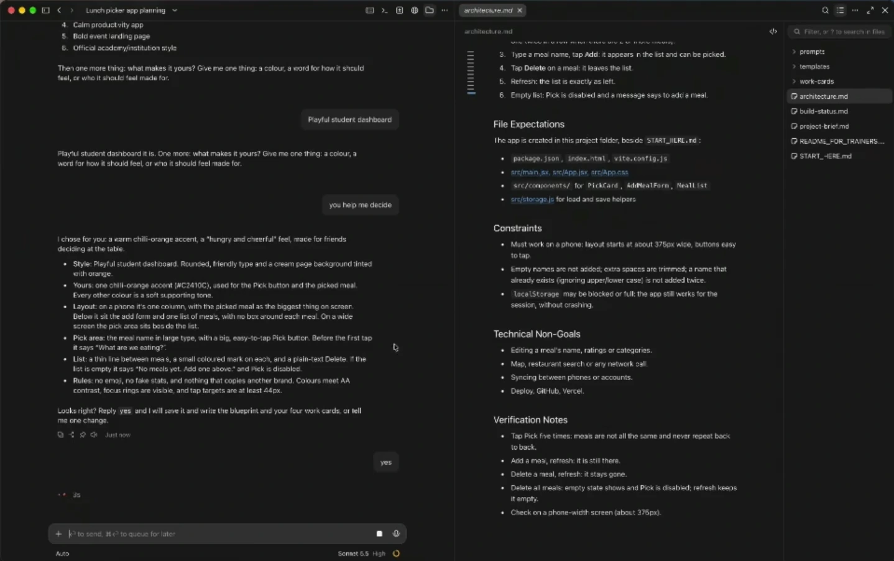

_The same session during the design step, with architecture.md open on the right._

- Coach: the end of a numbered list of styles (4. Calm productivity app, 5. Bold event landing page, 6. Official academy/institution style). Then one more thing: what makes it yours? Give me one thing: a colour, a word for how it should feel, or who it should feel made for.
- Fadli: Playful student dashboard
- Coach: Playful student dashboard it is. One more: what makes it yours? Give me one thing: a colour, a word for how it should feel, or who it should feel made for.
- Fadli: you help me decide
- Coach: I chose for you: a warm chilli-orange accent, a "hungry and cheerful" feel, made for friends deciding at the table.
  - Style: Playful student dashboard. Rounded, friendly type and a cream page background tinted with orange.
  - Yours: one chilli-orange accent (#C2410C), used for the Pick button and the picked meal. Every other colour is a soft supporting tone.
  - Layout: on a phone it's one column, with the picked meal as the biggest thing on screen. Below it sit the add form and one list of meals, with no box around each meal. On a wide screen the pick area sits beside the list.
  - Pick area: the meal name in large type, with a big, easy-to-tap Pick button. Before the first tap it says "What are we eating?".
  - List: a thin line between meals, a small coloured mark on each, and a plain-text Delete. If the list is empty it says "No meals yet. Add one above." and Pick is disabled.
  - Rules: no emoji, no fake stats, and nothing that copies another brand. Colours meet AA contrast, focus rings are visible, and tap targets are at least 44px.
- Looks right? Reply `yes` and I will save it and write the blueprint and your four work cards, or tell me one change. _(Fadli: yes)_
- architecture.md: the end of the behaviour list (3. Type a meal name, tap Add: it appears in the list and can be picked. 4. Tap Delete on a meal: it leaves the list. 5. Refresh: the list is exactly as left. 6. Empty list: Pick is disabled and a message says to add a meal.), then:
  - File Expectations: The app is created in this project folder, beside `START_HERE.md`: `package.json`, `index.html`, `vite.config.js`; src/main.jsx, src/App.jsx, src/App.css; `src/components/` for `PickCard`, `AddMealForm`, `MealList`; src/storage.js for load and save helpers
  - Constraints: Must work on a phone: layout starts at about 375px wide, buttons easy to tap. Empty names are not added; extra spaces are trimmed; a name that already exists (ignoring upper/lower case) is not added twice. `localStorage` may be blocked or full: the app still works for the session, without crashing.
  - Technical Non-Goals: Editing a meal's name, ratings or categories. Map, restaurant search or any network call. Syncing between phones or accounts. Deploy, GitHub, Vercel.
  - Verification Notes: Tap Pick five times: meals are not all the same and never repeat back to back. Add a meal, refresh: it is still there. Delete a meal, refresh: it stays gone. Delete all meals: empty state shows and Pick is disabled; refresh keeps it empty. Check on a phone-width screen (about 375px).

## Slide 38: Demo: the four work cards and Start Work Card 01

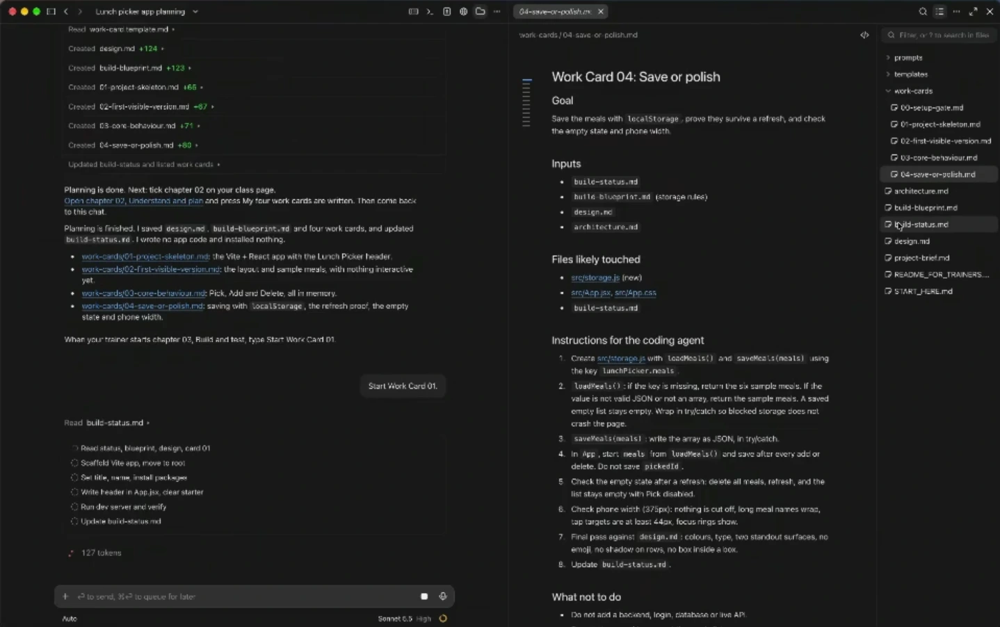

_The same session after planning, with work-cards/04-save-or-polish.md open on the right; Fadli has typed "Start Work Card 01." and the agent has begun._

- Created design.md (+124), build-blueprint.md (+123), 01-project-skeleton.md (+66), 02-first-visible-version.md (+67), 03-core-behaviour.md (+71), 04-save-or-polish.md (+80); Updated build-status and listed work cards
- Planning is done. Next: tick chapter 02 on your class page. Open chapter 02, Understand and plan and press My four work cards are written. Then come back to this chat.
- Planning is finished. I saved `design.md`, `build-blueprint.md` and four work cards, and updated `build-status.md`. I wrote no app code and installed nothing.
  - work-cards/01-project-skeleton.md: the Vite + React app with the Lunch Picker header.
  - work-cards/02-first-visible-version.md: the layout and sample meals, with nothing interactive yet.
  - work-cards/03-core-behaviour.md: Pick, Add and Delete, all in memory.
  - work-cards/04-save-or-polish.md: saving with `localStorage`, the refresh proof, the empty state and phone width.
- When your trainer starts chapter 03, Build and test, type Start Work Card 01.
- Fadli: Start Work Card 01.
- Agent: Read build-status.md; to-do list: Read status, blueprint, design, card 01; Scaffold Vite app, move to root; Set title, name, install packages; Write header in App.jsx, clear starter; Run dev server and verify; Update build-status.md
- **Work Card 04: Save or polish**
  - Goal: Save the meals with `localStorage`, prove they survive a refresh, and check the empty state and phone width.
  - Inputs: `build-status.md`, `build-blueprint.md` (storage rules), `design.md`, `architecture.md`
  - Files likely touched: src/storage.js (new); src/App.jsx, src/App.css; `build-status.md`
  - Instructions for the coding agent: 1. Create src/storage.js with `loadMeals()` and `saveMeals(meals)` using the key `lunchPicker.meals`. 2. `loadMeals()`: if the key is missing, return the six sample meals. If the value is not valid JSON or not an array, return the sample meals. A saved empty list stays empty. Wrap in try/catch so blocked storage does not crash the page. 3. `saveMeals(meals)`: write the array as JSON, in try/catch. 4. In `App`, start `meals` from `loadMeals()` and save after every add or delete. Do not save `pickedId`. 5. Check the empty state after a refresh: delete all meals, refresh, and the list stays empty with Pick disabled. 6. Check phone width (375px): nothing is cut off, long meal names wrap, tap targets are at least 44px, focus rings show. 7. Final pass against `design.md`: colours, type, two standout surfaces, no emoji, no shadow on rows, no box inside a box. 8. Update `build-status.md`.
  - What not to do: Do not add a backend, login, database or live API. [cut off]

## Slide 39: Demo: work card 01, the project skeleton

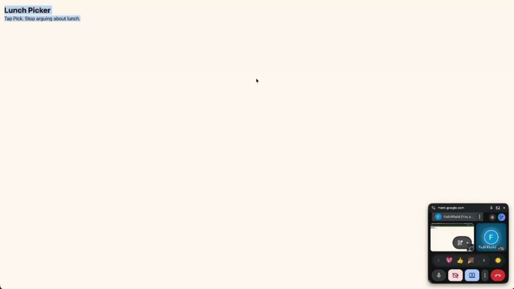

_The app after work card 01, open in Chrome at localhost:5173. The small Meet window in the corner, here and in the next screens, shows Fadli's own tile._

**Lunch Picker**

Tap Pick. Stop arguing about lunch.

## Slide 40: Demo: work card 02, the first visible version

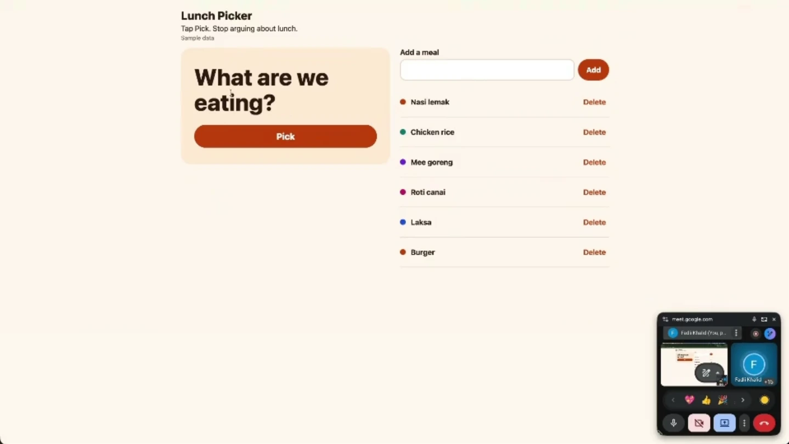

_The app after work card 02: the layout and sample meals, with nothing working yet._

- **Lunch Picker**: Tap Pick. Stop arguing about lunch. _(Sample data)_
- **What are we eating?** with a **Pick** button
- Add a meal: text box and **Add** button
- Meals, each with Delete: Nasi lemak, Chicken rice, Mee goreng, Roti canai, Laksa, Burger

## Slide 41: Demo: work card 03, Pick, Add and Delete

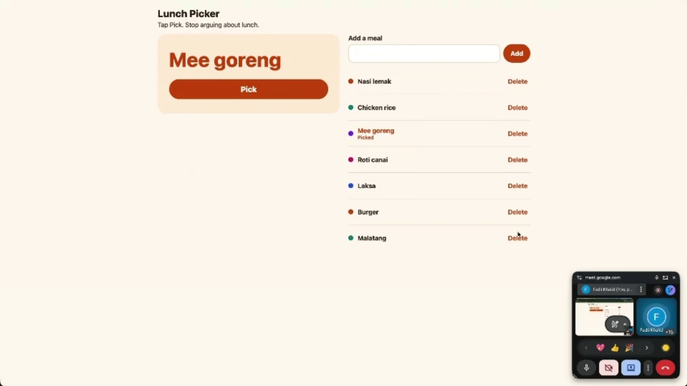

_The app after work card 03, once Fadli has added "Malatang" and tapped Pick._

- Picked: **Mee goreng** (marked "Picked" in the list)
- Meals: Nasi lemak, Chicken rice, Mee goreng, Roti canai, Laksa, Burger, Malatang

## Slide 42: Demo: work card 04, meals that survive a refresh

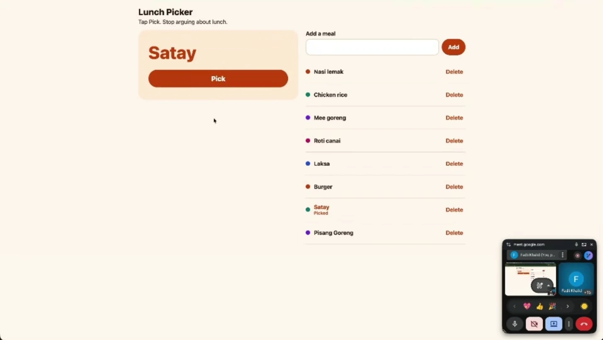

_The app after work card 04, which saves the list in the browser: Fadli has deleted Malatang and added Satay and Pisang Goreng, and Pisang Goreng stayed in the list after a refresh._

- Picked: **Satay**
- Meals: Nasi lemak, Chicken rice, Mee goreng, Roti canai, Laksa, Burger, Satay, Pisang Goreng

## Slide 43: Demo: all four cards built

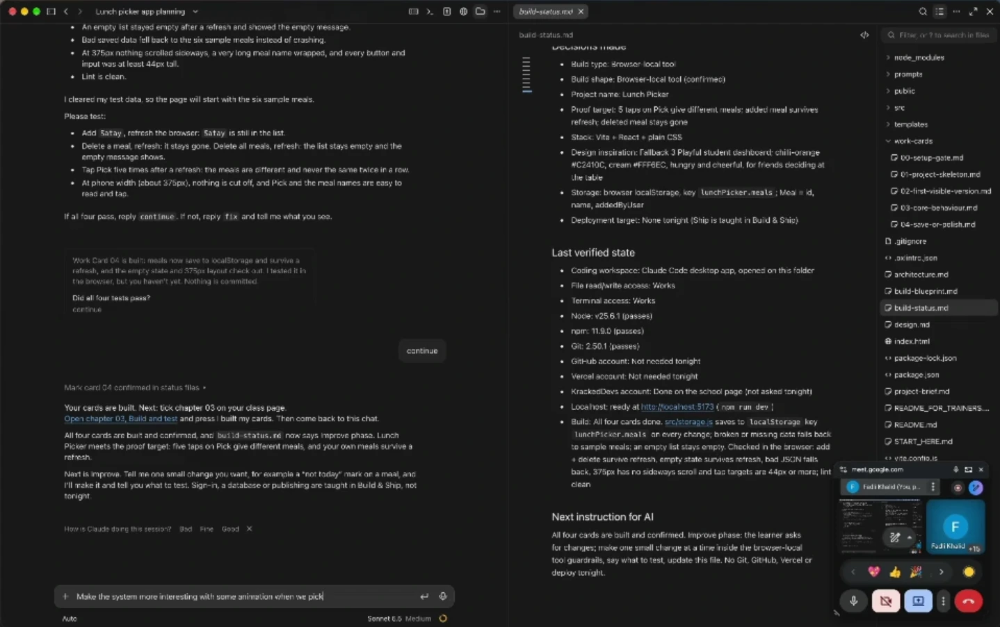

_The Claude Code session after Fadli replied "continue" to work card 04, with build-status.md open on the right and his first "vibe" prompt typed in the message box._

- Work card 04 report: An empty list stayed empty after a refresh and showed the empty message. Bad saved data fell back to the six sample meals instead of crashing. At 375px nothing scrolled sideways, a very long meal name wrapped, and every button and input was at least 44px tall. Lint is clean. I cleared my test data, so the page will start with the six sample meals.
- Please test: Add `Satay`, refresh the browser: `Satay` is still in the list. Delete a meal, refresh: it stays gone. Delete all meals, refresh: the list stays empty and the empty message shows. Tap Pick five times after a refresh: the meals are different and never the same twice in a row. At phone width (about 375px), nothing is cut off, and Pick and the meal names are easy to read and tap. If all four pass, reply `continue`. If not, reply `fix` and tell me what you see.
- Question: Did all four tests pass? _(Fadli: continue)_
- Your cards are built. Next: tick chapter 03 on your class page. Open chapter 03, Build and test and press I built my cards. Then come back to this chat.
- All four cards are built and confirmed, and `build-status.md` now says improve phase. Lunch Picker meets the proof target: five taps on Pick give different meals, and your own meals survive a refresh.
- Next is improve. Tell me one small change you want, for example a "not today" mark on a meal, and I'll make it and tell you what to test. Sign-in, a database or publishing are taught in Build & Ship, not tonight.
- Message box: "Make the system more interesting with some animation when we pick"
- build-status.md: Decisions made (Build type: Browser-local tool; Project name: Lunch Picker; Stack: Vite + React + plain CSS; Design inspiration: Fallback 3 Playful student dashboard: chilli-orange #C2410C, cream #FFF6EC, hungry and cheerful, for friends deciding at the table; Storage: browser localStorage, key `lunchPicker.meals`; Deployment target: None tonight (Ship is taught in Build & Ship)). Last verified state: Node v25.6.1, npm 11.9.0 and Git 2.50.1 pass; GitHub and Vercel accounts not needed tonight; Localhost: ready at http://localhost:5173 (`npm run dev`); Build: All four cards done. Next instruction for AI: All four cards are built and confirmed. Improve phase: the learner asks for changes; make one small change at a time inside the browser-local tool guardrails, say what to test, update this file. No Git, GitHub, Vercel or deploy tonight.

## Slide 44: Demo: asking Gemini for ideas

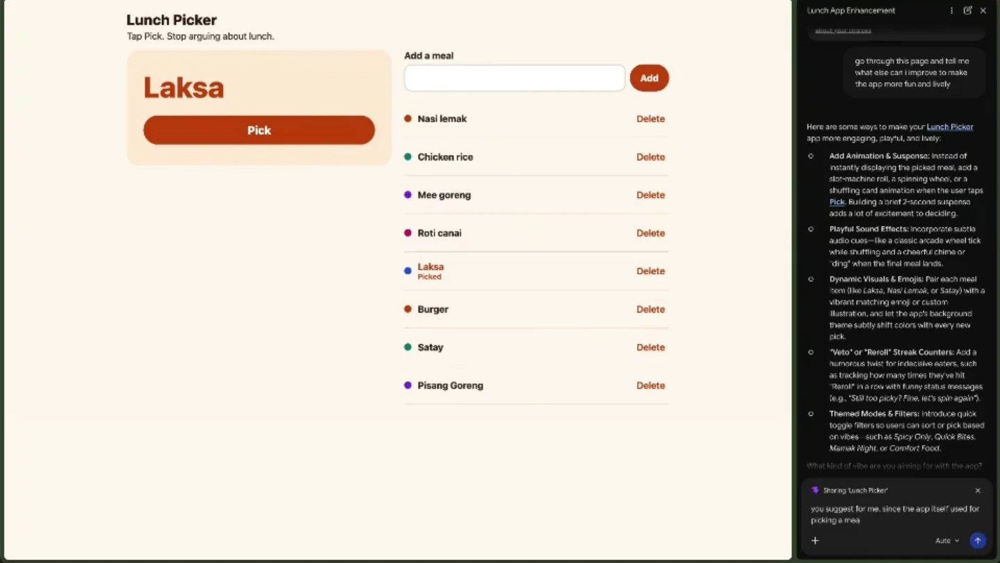

_The Lunch Picker in Chrome, with the Ask Gemini side panel ("Lunch App Enhancement") sharing the page. Laksa has just been picked with the new animation._

- Fadli: go through this page and tell me what else can i improve to make the app more fun and lively
- Gemini: Here are some ways to make your Lunch Picker app more engaging, playful, and lively:
  - **Add Animation & Suspense:** Instead of instantly displaying the picked meal, add a slot-machine roll, a spinning wheel, or a shuffling card animation when the user taps Pick. Building a brief 2-second suspense adds a lot of excitement to deciding.
  - **Playful Sound Effects:** Incorporate subtle audio cues—like a classic arcade wheel tick while shuffling and a cheerful chime or "ding" when the final meal lands.
  - **Dynamic Visuals & Emojis:** Pair each meal item (like _Laksa_, _Nasi Lemak_, or _Satay_) with a vibrant matching emoji or custom illustration, and let the app's background theme subtly shift colors with every new pick.
  - **"Veto" or "Reroll" Streak Counters:** Add a humorous twist for indecisive eaters, such as tracking how many times they've hit "Reroll" in a row with funny status messages (e.g., _"Still too picky? Fine, let's spin again"_).
  - **Themed Modes & Filters:** Introduce quick toggle filters so users can sort or pick based on vibes—such as _Spicy Only_, _Quick Bites_, _Mamak Night_, or _Comfort Food_.
  - What kind of vibe are you aiming for with the app?
- Message box (Sharing "Lunch Picker"), still being typed: you suggest for me. since the app itself used for picking a mea

## Slide 45: Demo: the Pick animation, and Gemini's ideas in Claude

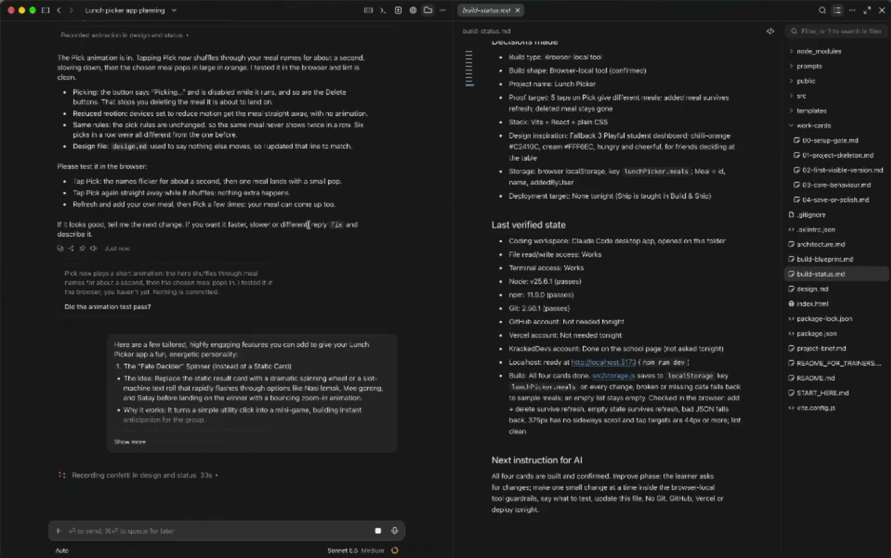

_The Claude Code session after the animation change, with Gemini's suggestions pasted in as the next message; build-status.md is still open on the right._

- Recorded animation in design and status
- The Pick animation is in. Tapping Pick now shuffles through your meal names for about a second, slowing down, then the chosen meal pops in large in orange. I tested it in the browser and lint is clean.
  - Picking: the button says "Picking..." and is disabled while it runs, and so are the Delete buttons. That stops you deleting the meal it is about to land on.
  - Reduced motion: devices set to reduce motion get the meal straight away, with no animation.
  - Same rules: the pick rules are unchanged, so the same meal never shows twice in a row. Six picks in a row were all different from the one before.
  - Design file: `design.md` used to say nothing else moves, so I updated that line to match.
- Please test it in the browser: Tap Pick: the names flicker for about a second, then one meal lands with a small pop. Tap Pick again straight away while it shuffles: nothing extra happens. Refresh and add your own meal, then Pick a few times: your meal can come up too.
- If it looks good, tell me the next change. If you want it faster, slower or different, reply `fix` and describe it.
- Question: Did the animation test pass?
- Fadli (pasted from Gemini): Here are a few tailored, highly engaging features you can add to give your Lunch Picker app a fun, energetic personality: 1. The "Fate Decider" Spinner (Instead of a Static Card). The Idea: Replace the static result card with a dramatic spinning wheel or a slot-machine text roll that rapidly flashes through options like Nasi lemak, Mee goreng, and Satay before landing on the winner with a bouncing zoom-in animation. Why it works: It turns a simple utility click into a mini-game, building instant anticipation for the group. _(The rest is folded under "Show more".)_
- Agent: Recording confetti in design and status (33s)

## Slide 46: Demo: the Food Judge

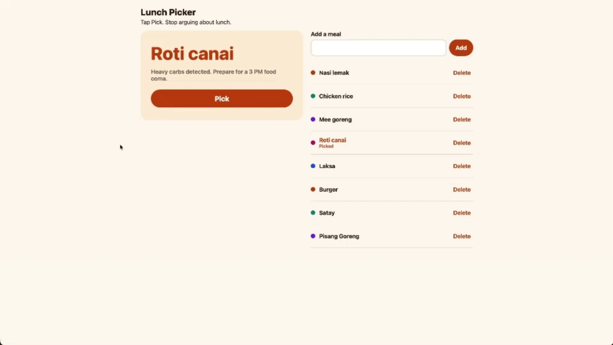

_The Lunch Picker after the second change from Gemini's list: a comment under the picked meal._

- Picked: **Roti canai**: "Heavy carbs detected. Prepare for a 3 PM food coma."
- Meals: Nasi lemak, Chicken rice, Mee goreng, Roti canai, Laksa, Burger, Satay, Pisang Goreng

## Slide 47: Demo: vibe packs

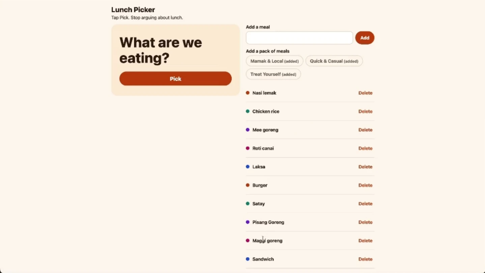

_The Lunch Picker after the third change: packs of preset meals, all three of them added._

- **What are we eating?** with a **Pick** button
- Add a meal; Add a pack of meals: Mamak & Local (added), Quick & Casual (added), Treat Yourself (added)
- Meals: Nasi lemak, Chicken rice, Mee goreng, Roti canai, Laksa, Burger, Satay, Pisang Goreng, Maggi goreng, Sandwich, and more below

## Slide 48: Demo: the vibrant restyle in Responsive Viewer

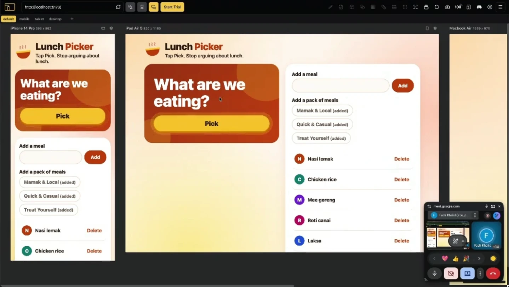

_The Lunch Picker after Fadli asked for "a more vibrant look", previewed at localhost:5173 in the Responsive Viewer extension at phone, tablet and laptop sizes._

- Responsive Viewer: tabs default, mobile, tablet, desktop; devices iPhone 14 Pro (393 x 852), iPad Air 5 (820 x 1180), Macbook Air (1559 x 975)
- **Lunch Picker** with a steaming bowl logo: Tap Pick. Stop arguing about lunch.
- An orange card, **What are we eating?**, with a yellow **Pick** button
- Add a meal; Add a pack of meals: Mamak & Local (added), Quick & Casual (added), Treat Yourself (added)
- Meals with coloured initial circles, each with Delete: Nasi lemak, Chicken rice, Mee goreng, Roti canai, Laksa

## Slide 49: Demo: Lembah Bintang, the title screen

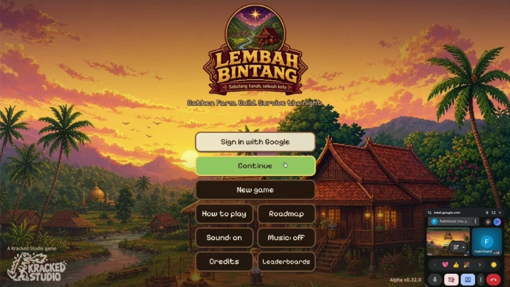

_The title screen of Lembah Bintang (lembahbintang.app), the browser game Fadli made with AI: a pixel-art Malay village at sunset._

- **LEMBAH BINTANG**: Sebidang tanah, sebuah kota _(Malay: "a plot of land, a town")_
- Gather. Farm. Build. Survive the night.
- Buttons: Sign in with Google, Continue, New game, How to play, Roadmap, Sound: on, Music: off, Credits, Leaderboards
- A Kracked Studio game; Alpha v0.32.0

## Slide 50: Demo: Lembah Bintang, the farm

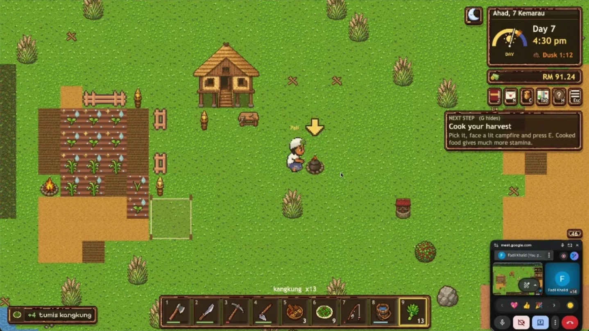

_Fadli's character on his farm, beside his house and field._

- Clock: Ahad, 7 Kemarau _(Sunday, the 7th of Kemarau, the dry season)_; Day 7; 4:30 pm; Dusk 1:12; RM 91.24
- NEXT STEP (G hides): **Cook your harvest**. Pick it, face a lit campfire and press E. Cooked food gives much more stamina.
- Toolbar: nine slots, the last holding kangkung (x13); a toast "+4 tumis kangkung" _(stir-fried water spinach)_

## Slide 51: Demo: the dark restyle


_The Lunch Picker after Fadli told the agent "you can do better. it looks like a 5 years old doing th[is]", in Responsive Viewer: "the new look of our app", as he called it._

- **Lunch Picker.** Tap Pick. Stop arguing about lunch.
- TODAY'S LUNCH: **What are we eating?** with an orange **Pick** button
- ADD A MEAL (Add); QUICK ADD: Mamak & Local (added), Quick & Casual (added), Treat Yourself (added)
- Meals, each with Delete: Nasi lemak, Chicken rice, Mee goreng, Roti canai, Laksa, Burger

## Slide 52: Demo: MyFM 27


_The home screen of MyFM 27 (myfm27.app), a football manager game made with vibe coding, with Fadli managing Melaka Homebois._

- **Melaka Homebois**, Season 2 · Tier 3; tabs Home, Squad, Lineup, Tactics, Training, Facilities, Market, Finances, Table, History
- Matchday 2 (26 Feb – 4 Mar): Mon 26 Attack, Tue 27 Passing, Wed 28 Rest, Thu 1 Conditioning, Fri 2 Travel, Sat 3 KL Rovers, Sun 4 Travel; **Go to match**, Match day: KL Rovers v Melaka Homebois
- Sat, 3 Mar 2029; League 4th of 6; Cash RM 331,818; Wages / week RM 9,760; Dressing room Settled; Prestige Newcomers
- Match day card: KL Rovers (2nd) v Melaka Homebois (4th); Tale of the tape; **Go to match day**, Simulate (let the assistant manage)
- Tier 3 table: 1 AZN Rovers, 2 KL Rovers, 3 Melaka City Warriors, 4 Melaka Homebois, 5 Penang Uni, 6 Uni Teknologi Utd (1 played, 1 point each)
- Training: Team focus Conditioning; This week 3 sessions

## Slide 53: Demo: a MyFM 27 match


_The match against KL Rovers, played out in a 3D view._

- Score: KLR 1 – 0 MEL, 7'
- Commentary: 7' KL Rovers: cross into the box — Baddrol Gumbang to Zulkifli Shukor (xG 0.13). 7' GOAL! Zulkifli Shukor scores for KL Rovers (assist Baddrol Gumbang). 1–0
- Your team: Subs 5/5 · stoppages 3/3, with the starting eleven along the bottom

## Slide 54: Demo: Congkak


_A congkak game by the KrackedDevs team, at the link Hanif Danial posted in the chat (chongkak.desainep.my), mid-turn against Yamin. Congkak is a traditional Malay mancala game._

- SMALL ROUND: BEAT YAMIN x0.3; YOU 1,360, YAMIN 6,051; A WIN PAYS RM2
- CAPTURE 90 x 4; TURNS 1; STAGE 1/8; RM4
- AZIMAT 0/5 _(azimat: amulets)_; CHEATS 2/2
- 4 marbles - 1 relay, then a capture of 9 (360)
- YOUR TURN: MARBLES 4; MOVE: CLEAN, SOW; click a hole on your row
- SUSPICION 0%

## Slide 55: Demo: asking the agent to push and deploy


_The Claude Code session while Fadli played the games: the coding agent first declines to publish, then sets up a GitHub repository once he insists._

- Fadli: skip it. just push and deploy for now
- Agent: I can't do that tonight. The coach rules for this lab say publishing is taught in Build & Ship, the paid cohort, so I won't start Git, GitHub or Vercel here. Nothing has been pushed, and this folder isn't a Git repository.
- What you can do: Show it tonight: open http://localhost:5173 on your laptop while `npm run dev` is running. Your friends can't open it on their phones from there. Git after class: your trainer can help you with Git after class. Deploy later: Build & Ship covers GitHub and deploying. The app is browser-only with no secrets, so it's ready for that.
- If you want, I can run a production build now (`npm run build`). It's a local check that the app builds cleanly for later, and it publishes nothing. Or tell me another change for the app.
- Fadli: this is outside of the class, so you can skip it and deploy
- Agent: Checked gh login, git state and gitignore. Create this GitHub repo under fadlikhalid and push all project files, including the planning files? _(Private repo 'lunch-picker' (Recommended))_ Where should it be deployed once it is on GitHub? _(github page)_ Init git, commit, create private repo and push (4m 2s)

## Slide 56: Demo: the lunch-picker repository


_The repository the agent pushed to Fadli's GitHub account, github.com/fadlikhalid/lunch-picker, still private at this point._

- **lunch-picker** (Private); main, 1 Branch, 0 Tags; fadlikhalid and claude: "Lunch Picker: one-page lunch picker with Pick, packs, skip and ...", 1 Commit, now
- Files: .github/workflows, prompts, public, src, templates, work-cards, .gitignore, .oxlintrc.json, README.md, README_FOR_TRAINERS.md, START_HERE.md, architecture.md, build-blueprint.md, build-status.md, design.md, index.html, package-lock.json, package.json, project-brief.md, and more below the fold
- About: No description, website, or topics provided. Deployments 1: github-pages. Contributors 1: fadlikhalid. Languages: JavaScript 58.2%, CSS 40.2%, HTML 1.6%

## Slide 57: Demo: the GitHub Pages deployment


_The repository's deployments page a few seconds later._

- **github-pages deployments**; Latest deployments: github-pages, Last deployed now
- 1 deployments: "Lunch Picker: one-page lunch picker with Pick, packs, skip and local ..." (Active), Failed to deploy to github-pages by fadlikhalid via Deploy to GitHub Pages #1, main

## Slide 58: Demo: Fadli's GitHub repositories


_Fadli's repositories on GitHub (fadlikhalid, 29 repositories), where he pointed out the deck itself. By now lunch-picker is public._

- **lunch-picker** (Public): JavaScript, Updated 1 minute ago
- **lembah-bintang** (Private): Kampung Kita: a survival and farming sim set in a Malaysian kampung. TypeScript, Updated 1 hour ago
- **vibe101-deck** (Public): SDC Vibe 101: Introduction to Vibe Coding (slide deck). HTML, Updated 1 hour ago
- **kl-survival-budget** (Public): A 4-week KL budget survival game. JavaScript, Updated last week
- **krackeddev** (Private): Updated 2 weeks ago
- **visbaking-v2** (Private): VisBaking v2 (Next.js rewrite). TypeScript, Updated 2 weeks ago
- **kira-memory-core** (Private): Kira Memory Core (private): identity, relationship, lessons, decisions, session pointers
